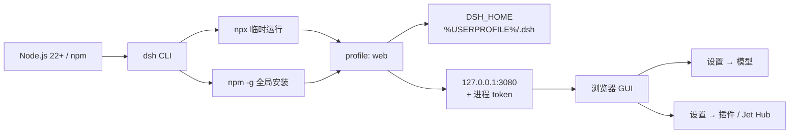
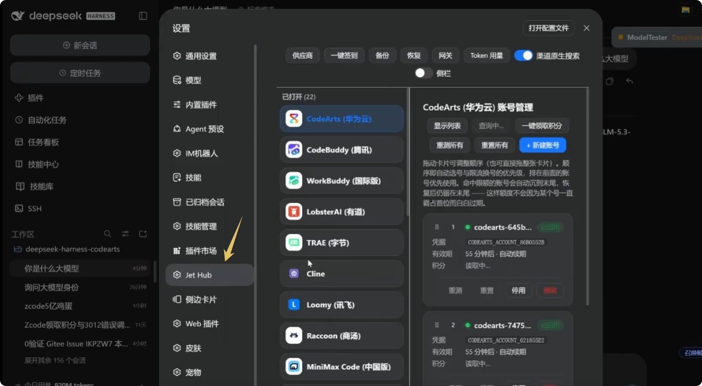

# Windows 本地 DSH 启动指南

> 适用：Windows 10/11，在本机用命令行启动 DeepSeek Harness（DSH）Web UI。
> 基线：2026-10-24 在本机实测；命令默认在 **PowerShell** 中执行，Git Bash 差异单独标注。
> 本文可持续追加：新增内容按 [附录 B](#sB) 的约定写入，不改动已有编号。

---

## 目录

| 章节 | 内容 |
|---|---|
| [0. 新人小结：3 分钟跑起来](#s0) | 最短路径与三条硬规矩 |
| [1. 前置条件与版本基线](#s1) | 环境要求、实测版本、启动链路 |
| [2. 安装 Node.js 与 npm](#s2) | 安装、PATH、PowerShell 执行策略 |
| [3. 安装 DSH](#s3) | npx 临时运行 vs npm 全局安装 |
| [4. 首次启动与验收](#s4) | 启动命令、打印的 token URL、停止 |
| [5. 配置面](#s5) | DSH_HOME、模型与凭据、端口与访问 |
| [6. 插件面](#s6) | 安装、allowBuilds、升级、卸载 |
| [7. 典型场景（第一批 3 个）](#s7) | 日常启动、端口冲突、安装 Jet Hub |
| [8. 日常运维](#s8) | 停止、查 PID、升级回滚、备份迁移 |
| [9. 排障手册](#s9) | 症状 → 原因 → 处理 |
| [10. 验收清单与未验证项](#s10) | 可机器检的判据 |
| [11. Jet Hub（账号枢纽）与安装方案](#s11) | 截图、三种方案、真实报错与日志分析 |
| [12. 升级到最新版（DSH + Jet Hub）](#s12) | 版本源、升级顺序、回滚、peer 警告 |
| [附录 A. 命令速查](#sA) | 一页命令表 |
| [附录 B. 追加内容约定](#sB) | 后续扩写规则与模板 |
| [FAQ](#sFAQ) | 常见问题（最后一章） |
| [变更记录](#sChangelog) | 版本与改动 |

---

<a id="s0"></a>
## 0. 新人小结：3 分钟跑起来

> **新人小结**：把 DSH 想成一台要自己点火的本地服务。Node 是发动机，`dsh` 是钥匙，`dsh web` 点火，浏览器是仪表盘。点火时终端会打印一把**一次性钥匙（token）**，必须用带这把钥匙的地址进仪表盘。

已经装好 Node 和 DSH 的话，最短路径只有三步：

```powershell
cd D:\work\my-project     # 换成你的项目目录
dsh web
# 或临时运行：npx -y @deepseek-ai/dsh@latest web
# 复制终端打印的 dsh web: http://127.0.0.1:3080/?token=... 到浏览器
```

首次安装则先执行（当前 `latest` 为 `0.2.1-rc.2`）：

```powershell
npm install -g @deepseek-ai/dsh@0.2.1-rc.2
dsh --version
dsh web
```

**成功判据**：终端出现 `dsh web:` 开头的 URL，浏览器能加载页面并正常对话。仅仅看到端口在监听不算成功。

### 三条硬规矩

1. **先 `cd` 再启动**：启动时所在目录就是默认 workspace 根目录；在 `C:\Windows\System32` 里启动，agent 的工作区就是那里。
2. **只用启动行打印的 URL**：URL 带进程 token；手敲 `http://127.0.0.1:3080` 通常过不了认证。
3. **改完插件/配置后重启 `dsh web`**；`desktop` profile 归 Electron 桌面端管，CLI 不碰。

---

<a id="s1"></a>
## 1. 前置条件与版本基线

| 项 | 要求 | 本机实测（2026-10-24） | 证据 |
|---|---|---|---|
| Windows | 10 / 11，x64 | 10.0.26300 x64 | 【实测】 |
| Node.js | 22+，建议 24 LTS | `v24.22.0` | 【实测】 |
| npm | 随 Node 安装 | `11.19.1` | 【实测】 |
| DSH | `@deepseek-ai/dsh` | `0.2.1-rc.2`（当前 latest；初版基线为 `0.2.0-rc.2`） | 【实测】 |
| DSH 内置 pnpm | 由 DSH 提供，无需单装 | `12.14.0` | 【实测】 |
| npm 全局目录 | 必须在 PATH | `C:\Users\webtu\AppData\Roaming\npm` | 【实测】 |
| 磁盘 | 程序约数百 MB，数据随会话增长 | 以实际为准 | 【规】 |
| 网络 | 能访问 npm registry 与模型 API | — | 【规】 |

### 读表约定

- **【实测】**：本机实际跑过，输出原样贴出。
- **【实测·用户】**：用户在本机执行并提供了终端日志或装后状态，本文据此分析。
- **【规】**：来自官方 README、配置注释或上游文档，未在本机复跑。
- **【未验证】**：本文写出但本机未执行，文末有汇总。
- 表中版本号是 **2026-10-24 的快照**。npm `latest` 当前为 `0.2.1-rc.2`，`next` 为 `0.2.1-rc.3`（预发布通道，不建议日常使用）；升级后以 `dsh --version` 为准，步骤见[第 12 章](#s12)。

### 启动链路



---

<a id="s2"></a>
## 2. 安装 Node.js 与 npm

### 2.1 安装

1. 从 [nodejs.org](https://nodejs.org/) 下载 **LTS 24.x** 的 Windows 安装包。
2. 安装向导里勾选 **Add to PATH**。
3. 安装完成后**新开一个 PowerShell 窗口**，执行验证。

```powershell
node -v
npm -v
where.exe node
where.exe npm
```

本机实测输出：

```text
v24.22.0
11.19.1
C:\Program Files\nodejs\node.exe
C:\Program Files\nodejs\npm
C:\Program Files\nodejs\npm.cmd
```

### 2.2 PATH 与全局目录

npm 的全局命令落在 `npm config get prefix` 目录下。本机：

```text
C:\Users\webtu\AppData\Roaming\npm
```

如果 `dsh` 装完却提示“不是内部或外部命令”，先确认这个目录在用户 PATH 里，再重开终端。`where.exe dsh` 应能看到 `dsh` 与 `dsh.cmd` 两条。

### 2.3 PowerShell 执行策略（可选）

若 PowerShell 报 `npm.ps1 cannot be loaded because running scripts is disabled`，有两种处理：

- 不改系统策略：把命令换成 `npm.cmd install -g ...`。
- 只对当前用户放开：

```powershell
Set-ExecutionPolicy -Scope CurrentUser RemoteSigned
```

后者会允许本机创建的脚本与远程签名脚本，属于系统策略变更；不确定时用 `npm.cmd`。

> 不建议混用 Node 版本管理器与系统安装版。若用 nvm-windows，全局包按 Node 版本隔离，切版本后 `dsh` 可能“消失”，需要重装。

---

<a id="s3"></a>
## 3. 安装 DSH

DSH 的 npm 包名是 `@deepseek-ai/dsh`。有两种用法，区别只在“装在哪、怎么启动”。

| 方式 | 命令 | 适合 | 代价 |
|---|---|---|---|
| 临时运行（npx） | `npx @deepseek-ai/dsh@0.2.1-rc.2 web` | 试一次、不想污染全局 | 每次可能重新下载；缓存清理后失效 |
| 全局安装 | `npm install -g @deepseek-ai/dsh@0.2.1-rc.2` | 日常使用 | 全局只有一个版本 |

### 3.1 临时运行（npx）

```powershell
npx -y @deepseek-ai/dsh@0.2.1-rc.2 web
```

- `-y` 跳过首次安装确认。
- 不写版本号会拿 `latest`（当前 `0.2.1-rc.2`）；需要复现问题时建议显式锁版本。
- npx 只是程序来源不同，`%USERPROFILE%\.dsh` 里的 profile 与会话仍然共用。

### 3.2 全局安装（推荐）

```powershell
npm install -g @deepseek-ai/dsh@0.2.1-rc.2
```

验证：

```powershell
dsh --version
where.exe dsh
npm ls -g @deepseek-ai/dsh --depth=0
```

本机实测（升级到 latest 后）：

```text
0.2.1-rc.2
C:\Users\webtu\AppData\Roaming\npm\dsh
C:\Users\webtu\AppData\Roaming\npm\dsh.cmd
C:\Users\webtu\AppData\Roaming\npm
└── @deepseek-ai/dsh@0.2.1-rc.2
```

不锁版本就是：

```powershell
npm install -g @deepseek-ai/dsh@latest
```

**版本要锁**：DSH 处于 rc 阶段，profile 里的插件按 peer 范围校验宿主版本；跨版本升级前先备份 `.dsh`。

### 3.3 程序目录与数据目录不是一回事

| 内容 | 位置 | 卸载时 |
|---|---|---|
| 程序本体 | `%APPDATA%\npm\node_modules\@deepseek-ai\dsh` | 会被删 |
| 数据与配置 | `%USERPROFILE%\.dsh` | **保留** |

所以“重装 DSH”通常不会丢会话与模型设置；要彻底清理得手动删 `.dsh`。

---

<a id="s4"></a>
## 4. 首次启动与验收

### 4.1 启动

```powershell
cd D:\work\my-project
dsh web
```

首次使用 `web` 时，DSH 会从随附模板自动初始化 `%USERPROFILE%\.dsh\profiles\web`。【规】

终端会打印带 token 的启动行。本机用随机端口实测（token 已打码）：

```text
dsh web: http://127.0.0.1:61143/?token=<REDACTED>
```

默认端口是 **3080**；上面用 `--port 0` 让系统挑了一个空闲端口。

### 4.2 常用启动参数

| 参数 | 作用 | 示例 |
|---|---|---|
| `--no-open` | 不自动打开浏览器，只打印 URL | `dsh web --no-open` |
| `--port <n>` | 指定端口；`0` 表示让系统挑 | `dsh web --port 8080` |
| `--host <host>` | 绑定主机，默认 `127.0.0.1` | `dsh web --host 127.0.0.1` |
| `--trusted-host <authority>` | 追加 `/api` 信任的主机名，可重复 | `dsh web --trusted-host dsh.local` |
| `--help` | 查看 web 子命令参数 | `dsh web --help` |

> **不支持绑定所有网卡**：`--host 0.0.0.0` 会在启动时被拒绝，官方出于安全考虑只允许 loopback。远程访问请用端口转发/内网代理，不要改绑定地址。【规】

### 4.3 验收

1. 终端出现 `dsh web:` 行。
2. 浏览器打开该 URL（含 token）。
3. 页面能加载、能发一条消息并收到回复。

只看到端口监听、页面空白或 401，都不算成功，按[第 9 章](#s9)排查。

### 4.4 停止

前台运行时按 `Ctrl+C`。进程退出后端口释放；下次启动会重新生成 token。

---

<a id="s5"></a>
## 5. 配置面

### 5.1 DSH_HOME 与目录结构

默认 `DSH_HOME` 是 `%USERPROFILE%\.dsh`，可用环境变量覆盖。

| 路径 | 内容 |
|---|---|
| `.dsh\profiles\web` | web 组合包清单（`package.json`）、用户补丁（`cordis.patch.yml`）、pnpm 配置 |
| `.dsh\sessions` | 会话历史 |
| `.dsh\logs` | 启动/运行日志与诊断报告 |
| `.dsh\storages` | 存储数据 |
| `.dsh\attachments` | 附件（按内容去重，不自动删除） |
| `.dsh\.credentials.yaml` | 托管凭据（模型 Key 等） |
| `.dsh\.anonymous-user-id` | 匿名标识 |

`profiles\web\package.json` 里有两处关键信息：

- `dependencies`：装了哪些第三方插件；
- `dsh.profile.bundles`：启动时按顺序加载哪些组合包。

改插件后如果 UI 没变化，先看这两处是否真的写进去了。

### 5.2 模型与 API Key

**图形界面方式（推荐）**：启动后进入 **设置 → 模型 → DeepSeek**，填入 `DEEPSEEK_API_KEY` 对应的 Key，选择模型。模型页只写托管凭据文件，不会把 Key 写进进程环境。

**环境变量方式**（只对当前 PowerShell 会话生效）：

```powershell
$env:DEEPSEEK_API_KEY = "sk-..."
dsh web
```

凭据解析顺序（【规】，来自 `dsh-base` 配置注释）：

```text
继承的环境变量 → $DSH_HOME/.credentials.yaml → 项目 .env → 用户 .env
```

想持久化到用户环境可用 `setx DEEPSEEK_API_KEY "sk-..."`，但它会明文写进注册表，且只对新开的终端生效；本文未在本机执行。

**自定义/本地模型**：在 **设置 → 模型** 里添加 Provider，核心是三件事——协议、Base URL、模型 ID。以本机 Ollama 为例（示例，未在本机验证）：

```text
Base URL: http://127.0.0.1:11434/v1
API Key:  任意非空占位（本地服务通常不校验）
Model:    <你的模型 ID>
```

Base URL 要写到 `/v1` 这一层；写错会表现成 404 或“没有模型”。

### 5.3 端口、主机与 URL

- 默认 `127.0.0.1:3080`，只接受本机连接。
- 端口冲突就换 `--port`；同时开两个实例时每个实例有自己的 token，URL 不能互串。
- 打印的 URL 带进程 token；token 换一次启动就换一次。
- `DSH_WEB_URL` 会暴露给 agent 的受管 shell，供其引用当前 GUI 地址。【规】

---

<a id="s6"></a>
## 6. 插件面

> **新人小结**：DSH 把“模型、界面、工具”都做成插件，profile 是一份“今天用哪些插件”的清单。装插件不是往全局目录扔文件，而是把包写进指定 profile 的依赖与加载清单。

### 6.1 基本命令

```powershell
dsh plugin --profile web add <包名>
dsh plugin --profile web remove <包名>
dsh plugin --profile web list --depth 0
```

`dsh plugin` 会把参数原样转发给 pnpm，在 profile 目录里执行。【实测：`dsh plugin --profile web --version` 输出 `12.14.0`】

**`--profile` 在 0.2.x（0.2.0-rc.2 / 0.2.1-rc.2 实测）是必填**。省略会直接报：

```text
error: required option '--profile <name>' not specified
```

### 6.2 三种来源

| 来源 | 命令形态 | 注意 |
|---|---|---|
| npm | `dsh plugin --profile web add <包名>` | 最省事，装的是构建产物 |
| GitHub / Gitee | `dsh plugin --profile web add "https://github.com/<owner>/<repo>.git"` | 拉源码，可能需要跑 `prepare` 构建 |
| 本地目录 | `dsh plugin --profile web add <绝对路径>` | 开发联调用，路径要真实存在 |

### 6.3 allowBuilds：Git 源第一次安装必踩

pnpm 10+ 默认拦截依赖的构建脚本。Git 源插件通常靠 `prepare` 生成 `lib/`，所以第一次 `add` 会失败，并在报错里打印**期望的允许键**。

处理顺序：

1. 先跑一次 `add`，让它失败；
2. 把报错里的键**原样**写进 `%USERPROFILE%\.dsh\profiles\web\pnpm-workspace.yaml`：

```yaml
allowBuilds:
  <报错里打印的包名或完整键>: true
```

3. 重跑 `add`。

本机 pnpm 是 12.14.0。**实测打印的是带 commit 的完整键**；不要想当然只写纯包名（pnpm 11.x 对 Git 依赖就不认纯包名，12.x 以你的报错为准）。升级后 commit 会变，旧键随即失效。真实样例与日志见[第 11 章](#s11)。不同 pnpm 版本对键的写法要求不同，**以报错为准**，不要照抄旧教程。`allowBuilds` 下缩进 2 或 4 个空格都合法，YAML 只看层级。

图省事可以写：

```yaml
dangerouslyAllowAllBuilds: true
```

但这会放行该 profile 里**所有**依赖的构建脚本，等于扩大信任面。

### 6.4 装完为什么不生效

1. 重启 `dsh web`（多数插件在启动时加载）。
2. 看 `profiles\web\package.json`：`dependencies` 与 `dsh.profile.bundles` 是否都有目标包。
3. 看 `.dsh\logs` 是否有 `entry did not activate` 或 `MODULE_NOT_FOUND`。
4. 确认装对了 profile（`--profile desktop` 归桌面端，CLI 会被拒绝）。

### 6.5 安全边界

插件与你的用户权限相同：能读文件、用凭据、访问网络，工具审批管不到插件自身。只装可信来源，Git 源尽量锁 commit，涉及登录第三方平台的插件先读一遍权限说明。

---

<a id="s7"></a>
## 7. 典型场景（第一批 3 个）

> 按约定每批 3 个；后续场景在确认后继续追加，编号从 `7-4` 起。

### 场景 7-1：每天从项目目录启动

**目标**：让 agent 的工作区固定为项目目录。

```powershell
cd D:\work\my-project
dsh web
```

**判据**：浏览器里让 agent 执行 `pwd` 或读取相对路径文件，结果落在 `D:\work\my-project`。

**坑**：用“以管理员身份运行”从 `System32` 启动，工作区就变成了 `System32`；别在快捷方式里省略 `cd`。

### 场景 7-2：3080 被占用 / 同时开两个实例

**目标**：保留原实例，再开一个隔离实例。

```powershell
dsh web --port 3081
```

若需要找出占用 3080 的进程：

```powershell
Get-NetTCPConnection -LocalPort 3080 -State Listen |
  Select-Object -ExpandProperty OwningProcess
Stop-Process -Id <上一步的 PID>
```

**判据**：两个终端各打印自己的 `dsh web:` 行，两个 URL 的端口不同，token 也不同。

**坑**：不要把 A 实例的 token URL 贴到 B 实例的端口上；`Stop-Process` 只按查到的 PID 杀，不要按进程名批量杀 `node`。

### 场景 7-3：安装 Jet Hub（账号枢纽）

**目标**：在设置里得到 **Jet Hub** 页签，管理 CodeArts / CodeBuddy / WorkBuddy / TRAE / Qoder 等账号。

**最短步骤**：

```powershell
dsh plugin --profile web add "https://gitee.com/iJetLi/deepseek-harness-codearts.git"
# 首次因 allowBuilds 失败：把报错里的完整键写进 web/pnpm-workspace.yaml
# 再跑一次上面的命令，然后重启 dsh web
```

**判据**：`dsh plugin --profile web list --depth 0` 能看到 `dsh-providers-hub@0.2.1-rc.2`，设置页出现 **Jet Hub**。

**完整方案、真实报错原文、日志逐行分析与设置页截图见[第 11 章](#s11)。**

---

<a id="s8"></a>
## 8. 日常运维

### 8.1 停止与查进程

- 前台：`Ctrl+C`。
- 后台残留：先查 PID，再精确停止。

```powershell
Get-NetTCPConnection -LocalPort 3080 -State Listen |
  Select-Object -ExpandProperty OwningProcess
Stop-Process -Id <PID>
```

### 8.2 升级与回滚

```powershell
# 升到 latest（当前 0.2.1-rc.2）
npm install -g @deepseek-ai/dsh@latest

# 回到初版基线
npm install -g @deepseek-ai/dsh@0.2.0-rc.2
```

升级前备份 `.dsh`，并先停掉正在运行的旧实例（否则新进程会报 `EADDRINUSE 127.0.0.1:3080`）。DSH 会按插件声明的 peer 范围校验版本，不兼容插件需要显式豁免。【规】

**完整升级流程**（停旧实例 → 备份 → 升 DSH → 升 Jet Hub → allowBuilds 键轮换 → 验证/回滚）见[第 12 章](#s12)。

### 8.3 备份与迁移

```powershell
Copy-Item -Recurse -LiteralPath "$env:USERPROFILE\.dsh" -Destination "D:\backup\dsh-2026-10-24"
```

- 备份包含 `.credentials.yaml`，**按密钥对待**，不要进 Git、不要传群。
- 迁到新机器：把 `.dsh` 放到新机器的 `%USERPROFILE%\.dsh`，或设置 `DSH_HOME` 指向它。
- profile 里的插件依赖可能含绝对路径；迁移后先启动一次，缺插件按第 6 章重装。

### 8.4 日志

`%USERPROFILE%\.dsh\logs` 下是启动与运行日志；启动失败先看这里，再看终端 stderr。

---

<a id="s9"></a>
## 9. 排障手册

| 症状 | 最可能原因 | 处理 |
|---|---|---|
| `dsh` 不是内部或外部命令 | 全局目录不在 PATH | 把 `%APPDATA%\npm` 加进用户 PATH，重开终端；或临时用 `npx` |
| 端口被占用 / 启动即退出 | 3080 已有进程 | `dsh web --port 8081`；或按 8.1 查 PID 停掉旧实例 |
| 浏览器没自动打开 | 默认浏览器交接失败 | 不要关服务器；复制终端打印的 `dsh web:` URL 手动打开 |
| 打开 `127.0.0.1:3080` 提示未授权 | 少了进程 token | 使用带 `?token=...` 的完整 URL；token 每次启动都会变 |
| 页面空白 | 前端产物缺失（源码运行） | npm 安装版不会遇到；源码 checkout 先在仓库根执行 `pnpm run build` |
| `--host 0.0.0.0` 启动被拒绝 | 官方禁止绑定所有网卡 | 保持 `127.0.0.1`；远程访问走端口转发/内网代理 |
| 插件装完设置页没有 | 没重启或 profile 没写对 | 重启 `dsh web`；检查 `package.json` 的 `dependencies` 与 `bundles`；看日志 `did not activate` |
| `ERR_PNPM_...PREPARE_NOT_ALLOWED` | pnpm 拦截构建脚本 | 按 6.3 把报错里的键写进 `pnpm-workspace.yaml` 后重跑 |
| 模型 401 | Key 缺失、过期或来源不对 | 设置 → 模型重新填；检查环境变量是否覆盖了托管凭据 |
| 模型 404 / 没有模型 | Base URL 或模型 ID 写错 | Base URL 写到 `/v1`；模型 ID 用服务端返回的真实 id |
| 升级后插件报版本不兼容 | 宿主与插件 peer 范围不匹配 | 回滚 DSH 版本，或按提示显式豁免（先评估风险） |

---

<a id="s10"></a>
## 10. 验收清单与未验证项

### 10.1 机器可检清单

```powershell
node -v                              # 期望 v24.22.0（或 >=22）
npm -v                               # 期望 11.19.1（随 Node 版本变化）
dsh --version                        # 期望 0.2.1-rc.2（当前 latest；0.2.0-rc.2 可回滚）
where.exe dsh                        # 期望看到 ...\npm\dsh 与 dsh.cmd
dsh plugin --profile web --version   # 期望 12.14.0（DSH 内置 pnpm）
dsh plugin --profile web list --depth 0  # 装了 Jet Hub 时期望 dsh-providers-hub@0.2.1-rc.2
```

启动冒烟（不打开浏览器、随机端口）：

```powershell
dsh web --no-open --port 0
# 期望：dsh web: http://127.0.0.1:<随机端口>/?token=<...>
# 本机 2026-10-24 实测输出（token 已打码）：
# dsh web: http://127.0.0.1:61143/?token=<REDACTED>
```

按 `Ctrl+C` 结束。

装完 Jet Hub 后的本机实况（2026-10-24，【实测·用户】）：

```text
dsh-profile-web C:\Users\webtu\.dsh\profiles\web (PRIVATE)
│
│   dependencies:
└── dsh-providers-hub@0.2.1-rc.2

1 package
```

### 10.2 未验证项汇总

> Jet Hub 安装已由用户在本机实测成功（见 [11.4](#s11-install) / [11.5](#s11-log)）；DSH 当前也已升到 latest `0.2.1-rc.2`（见 [12.4](#s12-state)）。作者未复跑安装/升级动作，下表是其余未验证项。

| 项 | 原因 |
|---|---|
| 本次重新执行 `npm install -g @deepseek-ai/dsh` | 本机已全局安装，未重复安装 |
| `npx` 临时运行 | 未执行；本机走的是全局安装 |
| `npm install -g @deepseek-ai/dsh@latest` 升级命令 | 作者未执行；用户本机当前已是 `0.2.1-rc.2`，见 12.4 |
| DSH 回滚到 `0.2.0-rc.2` | 未执行 |
| PATH 修改与 `Set-ExecutionPolicy` | 本机无需修改，未执行 |
| `setx DEEPSEEK_API_KEY` 持久化 | 未修改用户环境变量 |
| 本地 Ollama Provider 实际调用 | 示例配置，未在本机跑通 |
| `--trusted-host` / 局域网访问 | 未在本机验证；官方默认只允许 loopback |
| `Get-NetTCPConnection` + `Stop-Process` 查杀 | 日志里出现过 `EADDRINUSE`，但未手动执行该流程 |
| `Copy-Item` 备份与迁移到另一台机器 | 未执行 |
| `desktop` profile 的 CLI 行为 | 官方说明归 Electron 管，未在本机复现 |
| Jet Hub 本地 OpenAI 网关（`127.0.0.1:8326`） | 未调用 |
| Jet Hub 重装升级与回滚 | 当前已是上游最新，未触发重装；回滚未实测 |
| Jet Hub 各渠道真实登录与积分领取 | 未执行 |
| `next` 通道（`0.2.1-rc.3`） | 未使用，不建议日常使用 |
| 升级后 Jet Hub 页签的浏览器实测 | 作者未打开 UI；以 `--dump-config` 与启动日志为准 |

---

<a id="s11"></a>
## 11. Jet Hub（账号枢纽）与安装方案

### 11.1 它是什么

> **新人小结**：Jet Hub 不是一个能单独安装的包，更像“机箱里的一个面板”。真正装进去的是 `dsh-providers-hub` 插件，Jet Hub 是它在设置页挂出的账号管理界面。

- **上游仓库**：Gitee `iJetLi/deepseek-harness-codearts`。
- **包名**：`dsh-providers-hub`；`0.2.0-rc.11` 起由旧名 `dsh-codearts-auth` 改名。
- **能做什么**：统一登录多个 AI 编程服务，维护多账号池，凭据到期前静默续期，在面板里看有效期/积分/模型开关，并执行每日签到或积分领取。
- **实测组合**：安装当时是 DSH `0.2.0-rc.2` + 插件 `0.2.1-rc.2`；随后宿主已升到 `0.2.1-rc.2`，插件版本未变。【实测·用户】
- **渠道数量**：上游 README 标称 17 个 provider 路由 + 1 个聚合路由（版本 0.2.1-rc.2）；实际以你的设置页显示为准。【规】
- **本机网关**：插件可在 `127.0.0.1:8326` 暴露 OpenAI 兼容接口，供 Cline、Continue 等客户端复用已登录账号。【规】



*图 11-1　Jet Hub 设置页实拍（2026-10-24，本机）。*

**边界**：插件会登录第三方平台并保存凭据，权限与你的用户相同；只从可信来源安装，安装前读一遍权限说明，并遵守各平台服务条款。

### 11.2 安装前检查

| 检查项 | 要求 | 命令 |
|---|---|---|
| DSH 版本 | 0.2.x；当前 latest `0.2.1-rc.2`（初版基线 `0.2.0-rc.2`） | `dsh --version` |
| Node | `^22.19.0` 或 `>=24` | `node -v` |
| pnpm | 由 DSH 内置，本机 `12.14.0` | `dsh plugin --profile web --version` |
| 网络 | 能访问 Gitee | 能 `git clone` 该仓库即可 |
| 旧包名 | 不能残留 `dsh-codearts-auth` | 看 `profiles\web\package.json` |
| 时间与空间 | 首次约 1 分 19 秒，新增 6 个包 | 日志实测【实测·用户】 |

### 11.3 三种安装方案

| 方案 | 来源 | 装到的包 / 面板名 | 结论 |
|---|---|---|---|
| A. Gitee 上游 | `iJetLi/deepseek-harness-codearts` | `dsh-providers-hub` / **Jet Hub** | **推荐**；本机实测成功 |
| B. GitHub 镜像 | `gurio-wine/dsh-account-hub` | `dsh-account-hub` / **账号中心** | 可用但面板不同、渠道较少（7 个） |
| C. GitHub 旧版 | `anye-99/dsh-codearts-auth` | 旧包名 / 渠道 14 个 | 安装说明最终仍指向 Gitee 上游；不要混装 |
| D. 其他 “Jet-Hub” 副本 | 如 `MYCF711/Jet-Hub` | 旧包名 | README 的安装 URL 已 404，不建议 |

**结论**：只选 A。镜像适合对比源码，不适合当长期安装源；不同包名同时存在会触发 DSH 的 bundle 解析失败。

### 11.4 安装步骤（本机真实过程）

<a id="s11-install"></a>

**第 1 步：先跑一次，拿到 pnpm 要求的允许键。**

```powershell
dsh plugin --profile web add "https://gitee.com/iJetLi/deepseek-harness-codearts.git"
```

第一次（尚未放行 `prepare` 时）会失败，本机实际报错（节选）：

```text
Error: ERR_PNPM_GIT_DEP_PREPARE_NOT_ALLOWED
  `-> The git-hosted package "dsh-providers-hub@0.2.1-rc.2" needs to execute
      build scripts but is not in the "allowBuilds" allowlist.
  help: Add the package to "allowBuilds" in your project's pnpm-workspace.yaml:
        allowBuilds:
          dsh-providers-hub@git+https://gitee.com/iJetLi/deepseek-harness-codearts.git#a777741d3ef351ae32f9c76db2a69e877f0108aa: true
```

**键必须整段照抄，尤其是 `#<commit>`**。commit 会随上游更新变化，本文的 `a777741…` 只对应这一次。

**第 2 步：把键写进 profile 的 pnpm 配置。**

文件：`C:\Users\webtu\.dsh\profiles\web\pnpm-workspace.yaml`。本机写入后的实际内容：

```yaml
packages:
  - .

nodeLinker: hoisted
autoInstallPeers: false

allowBuilds:
    dsh-providers-hub@git+https://gitee.com/iJetLi/deepseek-harness-codearts.git#a777741d3ef351ae32f9c76db2a69e877f0108aa: true
```

缩进 2 或 4 个空格都合法，YAML 只看层级。不要只写 `dsh-providers-hub: true` 就完事——本次 pnpm 打印的是带 commit 的完整键，按它写最稳。

**第 3 步：重跑同一条命令。**

```powershell
dsh plugin --profile web add "https://gitee.com/iJetLi/deepseek-harness-codearts.git"
```

本机成功日志（节选）：

```text
[WARN] Issues with peer dependencies found. Run "pnpm peers check" to list them.

dependencies:
+ dsh-providers-hub 0.2.1-rc.2

Done in 1m 18.9s using pnpm v12.14.0
```

> 这份日志产生于宿主 `0.2.0-rc.2`；随后宿主升级到 `0.2.1-rc.2`，插件版本仍是 `0.2.1-rc.2`。升级宿主不要求重装插件，但必须重启并验证，见[第 12 章](#s12)。

**第 4 步：重启并打开面板。**

```powershell
dsh web
```

进入 **设置 → Jet Hub**，看到图 11-1 的渠道列表即成功。

**第 5 步：核对写入位置。**

`profiles\web\package.json` 本机实际内容（节选）：

```json
{
  "dependencies": {
    "dsh-providers-hub": "https://gitee.com/iJetLi/deepseek-harness-codearts.git"
  },
  "dsh": {
    "profile": {
      "bundles": [
        "@deepseek-ai/dsh-base",
        "@deepseek-ai/dsh-web-app",
        "dsh-providers-hub"
      ]
    }
  }
}
```

两处都有才算真正装进启动链：`dependencies` 负责安装，`bundles` 负责启动时加载。

### 11.5 日志逐行分析

<a id="s11-log"></a>

| 日志行 / 阶段 | 说明 | 你该做什么 |
|---|---|---|
| `Progress: resolved 0, reused 1, downloaded 0, added 0` | 第一次在解析前就被拦下 | 不是网络问题，直接看下一行 |
| `ERR_PNPM_GIT_DEP_PREPARE_NOT_ALLOWED` | pnpm 拒绝执行 Git 依赖的 `prepare` 构建脚本 | 按报错写 `allowBuilds` |
| `dsh-providers-hub@0.2.1-rc.2` | 本次解析到的插件版本 | 与 `list` 结果对照 |
| `#a777741d3ef351ae32f9c76db2a69e877f0108aa` | 允许键里的 commit 锁 | 必须原样抄；升级后会变 |
| `diagnostics: ...\.plugin-manager\logs\operation-oMAutv\pnpm.log` | 完整 pnpm 日志 | 二次排障先看这个文件 |
| `../../../AppData/Local/Temp/.tmpSOsRr9 pnpm-install$ pnpm install` | pnpm 在临时目录拉源码并执行 `prepare` | 属正常流程，不是装错位置 |
| `[30 lines collapsed]` | 终端折叠了 30 行 | 本文无法分析这部分；需要时展开或看 pnpm.log |
| `+ @deepseek-ai/dsh-credentials 0.2.1-rc.2` 等 | 插件构建环境安装的依赖，不等于宿主版本 | 以 profile 的 `list` 结果为准 |
| `[WARN] Issues with peer dependencies found` | pnpm 报告存在 peer 依赖问题（未列具体项），未阻断安装 | 运行 `dsh plugin --profile web peers check` 确认 |
| `Packages: +6` / `added 6` | profile 新增 6 个包 | 属正常范围 |
| `Done in 1m 7.4s` / `Done in 1m 18.9s` | 内层构建 vs 外层总耗时 | 首次较慢；缓存复用后会快 |
| `Content-addressable store is at: ...\pnpm\store\v11` | pnpm 内容寻址仓库 | 不要手删；重装会复用 |
| `+ dsh-providers-hub 0.2.1-rc.2` | 写入 profile 依赖成功 | 重启 `dsh web` |

**三句话结论：**

1. 失败原因是**构建授权**，不是 Gitee 连不上或版本不兼容。
2. pnpm 12 本次打印的是**带 commit 的完整键**；按它写最稳，升级后旧键会失效。
3. 第二次安装成功；唯一的 `[WARN]` 是 peer 依赖提示，先跑 `peers check`，不要直接忽略。

### 11.6 装后验证与排障

| 症状 | 原因 | 处理 |
|---|---|---|
| 设置里没有 Jet Hub | 没重启，或 `bundles` 没写入 | 重启 `dsh web`；核对 `package.json` 两处 |
| 日志有 `entry did not activate` | 包名解析失败或旧包名残留 | 移除 `dsh-codearts-auth`，只保留 `dsh-providers-hub` |
| 升级后再次 `ERR_PNPM_...PREPARE_NOT_ALLOWED` | 新 commit 与原允许键不匹配 | 用新报错里的完整键替换旧键，重跑 |
| `peers check` 报版本不一致 | 宿主与插件 peer 范围不完全匹配 | 优先把 DSH 升到插件匹配的版本；或按提示评估豁免 |
| 登录回调打不开 / 卡住 | 浏览器与本地回调被代理或安全软件拦截 | 临时放行 `127.0.0.1`；按插件面板的代理设置处理 |
| 本机网关从别的机器访问不到 | 默认只绑 `127.0.0.1`，通配地址会被拒绝 | 保持本机访问；跨机走端口转发，不要改成 `0.0.0.0` |
| 面板里显示“读取中”或积分不更新 | 渠道接口限流、登录态过期 | 在对应渠道卡片上重测/重新登录 |

**升级**：重新执行第 1 步 → 拿到新 commit 键 → 替换 `allowBuilds` → 重跑。

**卸载**：

```powershell
dsh plugin --profile web remove dsh-providers-hub
```

账号与凭据是否随之清理，取决于 DSH 凭据库与插件自身存储；本文未验证，卸载后请检查设置页与 `.credentials.yaml`。

### 11.7 本章判据

```powershell
dsh plugin --profile web list --depth 0
# 期望看到：dsh-providers-hub@0.2.1-rc.2
```

再加两条人工判据：

1. `profiles\web\package.json` 的 `dependencies` 与 `dsh.profile.bundles` 都含 `dsh-providers-hub`。
2. 重启后 **设置 → Jet Hub** 能打开，渠道卡片可展开；日志无 `entry did not activate`。

---

<a id="s12"></a>
## 12. 升级到最新版（DSH + Jet Hub）

> 原则：先备份、先停旧实例、先升宿主、再升插件；每一步都留下可回退的点。

### 12.1 先分清三个“最新”

| 对象 | 来源 | 查法 | 2026-10-24 实测 |
|---|---|---|---|
| DSH `latest` | npm dist-tag | `npm view @deepseek-ai/dsh dist-tags --json` | `0.2.1-rc.2` |
| DSH `next` | npm dist-tag | 同上 | `0.2.1-rc.3`（预发布，不建议日常） |
| Jet Hub 最新版 | Gitee 仓库 `package.json` + HEAD | `git ls-remote ... HEAD`；`curl.exe .../package.json` | `0.2.1-rc.2`，HEAD `a777741…` |
| 本机已装 | 本地 | `dsh --version`；`dsh plugin --profile web list --depth 0` | DSH `0.2.1-rc.2`；插件 `0.2.1-rc.2` |

查 Jet Hub 上游的两个值：

```powershell
git ls-remote https://gitee.com/iJetLi/deepseek-harness-codearts.git HEAD
curl.exe -sL "https://gitee.com/iJetLi/deepseek-harness-codearts/raw/master/package.json" | Select-String '"version"'
```

本机在 Git Bash 下用等价命令取到 HEAD `a777741…` 与版本 `0.2.1-rc.2`；PowerShell 下用 `curl.exe` 可避开 `curl` 别名差异。

**当前结论**：截至本文实测，本机 DSH 与 Jet Hub 都已是各自的最新版。下面的步骤用于以后升级，也可作为换机后的复现流程。

### 12.2 DSH 升级最新版

**第 0 步：停旧实例、备份。**

如果 `dsh web` 还在运行，先按 [8.1](#s8) 停掉。否则新进程会报（本机日志实测）：

```text
Error: listen EADDRINUSE: address already in use 127.0.0.1:3080
```

备份数据目录：

```powershell
Copy-Item -Recurse -LiteralPath "$env:USERPROFILE\.dsh" -Destination "D:\backup\dsh-2026-10-24"
```

该备份命令本机未执行，原因见 [10.2](#s10)。

**第 1 步：升级并验证。**

```powershell
npm install -g @deepseek-ai/dsh@latest
dsh --version
```

期望输出：`0.2.1-rc.2`（当前 `latest`）。如果还是旧版本，先 `where.exe dsh` 确认命令指向的是刚升级的全局目录，再重开终端。

**第 2 步：确认插件仍在组合树里。**

```powershell
dsh --profile web --dump-config | Select-String "dsh-providers-hub"
```

本机实测命中：

```text
# == dsh-providers-hub
- id: codearts-auth
  name: dsh-providers-hub
```

`--dump-config` 只证明“组合树包含插件”，不等于运行时已激活；最终仍要看启动日志与设置页。

**第 3 步：启动。**

```powershell
dsh web
```

若再次出现 `EADDRINUSE`，说明旧实例没停干净；回到第 0 步，不要用“再开一个默认端口实例”来绕过。

**回滚**：

```powershell
npm install -g @deepseek-ai/dsh@0.2.0-rc.2
```

本机未执行回滚，见 [10.2](#s10)。

### 12.3 Jet Hub 升级最新版

Jet Hub 是 Git 源插件，“升级”就是重新 `add` 上游仓库；这是 Git 源安装的通用方式，镜像 README 也写明之后每次升级重新 `add` 即可。【规】

**第 1 步：重新 add。**

```powershell
dsh plugin --profile web add "https://gitee.com/iJetLi/deepseek-harness-codearts.git"
```

**第 2 步：处理 `allowBuilds` 键轮换。**

- 上游 commit 没变：pnpm 通常直接完成或提示无变化。
- 上游 commit 变了：会再次报 `ERR_PNPM_GIT_DEP_PREPARE_NOT_ALLOWED`，并打印**新 commit 的完整键**。把 [11.4](#s11-install) 里 `pnpm-workspace.yaml` 的旧键替换成新键，再重跑第 1 步。
- 旧键只锁旧 commit，不会自动放行新版本。

**第 3 步：验证版本。**

```powershell
dsh plugin --profile web list --depth 0
```

期望看到 `dsh-providers-hub@<新版本>`。本机当前已是 `0.2.1-rc.2`，上游 HEAD 为 `a777741…`，所以现在不需要重装。

**第 4 步：重启并打开面板。**

```powershell
dsh web
```

进入 **设置 → Jet Hub** 能看到渠道卡片，且 `.dsh\logs` 中没有 `entry did not activate`，才算升级完成。

**回滚**：从备份恢复 `profiles\web` 下的 `package.json`、`pnpm-workspace.yaml`、`pnpm-lock.yaml` 与 `node_modules`，再启动；或重新 `add` 旧 commit。该路径本机未实测。

### 12.4 本次升级后的实测状态与 peer 警告

<a id="s12-state"></a>

本机当前状态：

```text
dsh --version                              → 0.2.1-rc.2
dsh plugin --profile web list --depth 0    → dsh-providers-hub@0.2.1-rc.2
Gitee HEAD                                  → a777741d3ef351ae32f9c76db2a69e877f0108aa
dsh plugin --profile web --version         → 12.14.0 (pnpm)
```

执行 `dsh plugin --profile web peers check`，本机实际输出（节选）：

```text
Issues with peer dependencies found

✕ missing peer @deepseek-ai/cordis
✕ missing peer @deepseek-ai/dsh-commands
✕ missing peer @deepseek-ai/dsh-credentials
✕ missing peer @deepseek-ai/dsh-llm
...
dsh: plugin command failed; diagnostics: ...\.plugin-manager\logs\operation-cwBPmJ\pnpm.log
```

**怎么读这条警告：**

- 这四个包是 DSH 宿主的运行时包，由 DSH 安装目录提供；profile 设了 `autoInstallPeers: false`，所以 profile 的 `node_modules` 里没有独立副本。
- `peers check` 只检查 profile 依赖树，会把它们报成 missing；**命令退出非零 ≠ Jet Hub 一定坏了**。
- 正确判定顺序：`--dump-config` 命中 `dsh-providers-hub`（本机已命中）→ 启动日志无 `entry did not activate` → 设置页能打开 Jet Hub。三条都过才算正常。
- **不要**为了让这条命令变绿而手动把四个宿主包加进 profile；那会多装一份宿主模块，可能造成重复实例。先按上面的判定顺序确认。

### 12.5 升级检查表

| 顺序 | 动作 | 成功判据 | 失败先看 |
|---|---|---|---|
| 1 | 停旧实例 | 目标端口无监听 | [8.1](#s8) 查 PID |
| 2 | 备份 `.dsh` | 备份目录存在 | [10.2](#s10) |
| 3 | 升 DSH | `dsh --version` = latest | PATH / npm 全局目录 |
| 4 | 查组合树 | `--dump-config` 命中 `dsh-providers-hub` | profile `package.json` |
| 5 | 升 Jet Hub | `list` 显示新版本 | 新 `allowBuilds` 键 |
| 6 | 重启验证 | Jet Hub 页签可打开、日志无 activate 错误 | 日志 / `peers check` |

### 12.6 本章未验证项

- 作者未执行 `npm install -g @deepseek-ai/dsh@latest`（用户本机已是 latest）。
- Jet Hub 重装升级未触发（当前已是上游最新）。
- DSH 回滚、Jet Hub 回滚未执行。
- 升级后 Jet Hub 页签未由作者在浏览器中实测。
- `next` 通道（`0.2.1-rc.3`）未使用。

---

<a id="sA"></a>
## 附录 A. 命令速查

| 目的 | 命令 |
|---|---|
| 查 Node / npm | `node -v`、`npm -v` |
| 全局安装 DSH | `npm install -g @deepseek-ai/dsh@0.2.1-rc.2` |
| 临时运行 | `npx -y @deepseek-ai/dsh@0.2.1-rc.2 web` |
| 启动 Web UI | `dsh web` |
| 不自动开浏览器 | `dsh web --no-open` |
| 换端口 | `dsh web --port 8081` |
| 随机空闲端口 | `dsh web --port 0` |
| 安装插件 | `dsh plugin --profile web add <包名>` |
| 卸载插件 | `dsh plugin --profile web remove <包名>` |
| 查看已装插件 | `dsh plugin --profile web list --depth 0` |
| 安装 Jet Hub | `dsh plugin --profile web add "https://gitee.com/iJetLi/deepseek-harness-codearts.git"` |
| 检查 peer 依赖 | `dsh plugin --profile web peers check` |
| 查看组合配置 | `dsh --profile web --dump-config` |
| 查占用端口的 PID | `Get-NetTCPConnection -LocalPort 3080 -State Listen` |
| 升级 DSH | `npm install -g @deepseek-ai/dsh@latest` |
| 查 DSH 最新标签 | `npm view @deepseek-ai/dsh dist-tags --json` |
| 升级 Jet Hub | `dsh plugin --profile web add "https://gitee.com/iJetLi/deepseek-harness-codearts.git"` |
| 查 Jet Hub 上游提交 | `git ls-remote https://gitee.com/iJetLi/deepseek-harness-codearts.git HEAD` |
| 备份数据 | `Copy-Item -Recurse -LiteralPath "$env:USERPROFILE\.dsh" -Destination <目标>` |

---

<a id="sB"></a>
## 附录 B. 追加内容约定

后续往这份指南里加内容时，按下面规则写，保证结构不乱、可回查：

1. **编号只增不改**：新主题追加为新的 `## N.`（放在 FAQ 之前）；新场景用 `### 场景 7-x`，每批 3 个；不改已有编号与锚点。
2. **同步更新两处**：文首目录表 + 文末[变更记录](#sChangelog)。
3. **每节五件套**：适用版本、命令、预期输出、判据、该场景特有的坑。
4. **证据标记**：跑过的写【实测】并贴真实输出；没跑的写【未验证】并说明原因；引用文档写【规】。
5. **不要编造输出**：端口、token、路径以本机实际为准；token 一律打码。
6. **敏感信息**：`%USERPROFILE%\.dsh\.credentials.yaml` 与任何 `sk-` 开头的 Key 不进文档、不进 Git。
7. **图片统一放 `assets/`**：用相对路径引用（如 `assets/jet-hub-settings.png`），文件名用 kebab-case，图下写“图 N-M + 说明”；不要把 `%TEMP%`、PixPin 临时目录等本机路径写进正文。

新章节模板（外层用四个反引号，避免与内层代码块冲突）：

````markdown
<a id="sX"></a>
## N. 标题

适用版本：dsh x.y.z / Windows 10+
痛点：……
做法：……

```powershell
<命令>
```

预期输出：

```text
<真实输出或标记 未验证>
```

判据：……
坑：……
````

---

<a id="sFAQ"></a>
## FAQ

**1. 只临时用一次，也必须装 Node 吗？**
是。`npx` 只是不全局安装 DSH，仍然需要 Node 与 npm 来下载和运行它。

**2. npx 和全局安装怎么选？**
长期使用选全局安装并锁版本；临时对比版本用 `npx @deepseek-ai/dsh@<版本> web`。两者共用 `%USERPROFILE%\.dsh` 里的 profile 与会话。

**3. 为什么不能直接打开 `http://127.0.0.1:3080`？**
启动 URL 带一次性进程 token，浏览器要用它换取签名 cookie。手敲裸地址通常过不了认证，必须复制终端打印的完整 URL。

**4. 端口能改吗？能开多个吗？**
能。`--port 8081` 指定端口，`--port 0` 让系统挑。每个实例独立 token，URL 不能混用。

**5. DSH 的数据在哪里？怎么备份？**
默认 `%USERPROFILE%\.dsh`。整个目录复制即可；其中 `.credentials.yaml` 含密钥，备份要按敏感文件保管。

**6. 换电脑怎么迁移？**
复制 `.dsh` 到新机器的同一路径，或设置 `DSH_HOME` 指向它；随后重装缺失的插件并核对模型凭据。本文未实测完整迁移。

**7. API Key 存在哪？安全吗？**
模型页写入 `%DSH_HOME%\.credentials.yaml`，不会注入进程环境；环境变量优先级更高。两者都是本机明文，靠文件权限保护，不要提交到仓库。

**8. 插件装完为什么设置页没有？**
先重启 `dsh web`；再确认装的是 `web` profile、`package.json` 的 `dependencies` 与 `dsh.profile.bundles` 都有该包；最后看日志是否有 `did not activate`。

**9. allowBuilds 要不要放开？**
只放开你审过源码、信任的包，并按报错里的精确键写。`dangerouslyAllowAllBuilds: true` 会放行该 profile 的所有构建脚本，等于放弃逐包审查。

**10. 能不能局域网或手机访问？**
官方默认只允许本机，`--host 0.0.0.0` 会被拒绝。需要远程访问时用 SSH 端口转发或内网代理，并自行承担认证与暴露风险；本文未验证该路径。

---

<a id="sChangelog"></a>
## 变更记录

| 日期 | 版本 | 改动 |
|---|---|---|
| 2026-10-24 | v1.0 | 初版：环境基线、Node/npm、npx/全局安装、首次启动、配置面、插件面、3 个场景、运维、排障、验收、附录与 FAQ |
| 2026-10-24 | v1.1 | 新增第 11 章 Jet Hub：设置页截图（`assets/jet-hub-settings.png`）、三种安装方案、真实报错与成功日志逐行分析、装后验证与排障；同步更新 6.3、7-3、10.1、10.2、速查表 |
| 2026-10-24 | v1.2 | 新增第 12 章：DSH 升级 latest、Jet Hub 升级 latest、`allowBuilds` 键轮换、`EADDRINUSE` 与 `peers check` 实测分析；版本基线更新为 DSH `0.2.1-rc.2`，同步第 0/1/3/8/10 章与速查表 |
