## 为什么需要了解 DeepSeek 的公司历程？（痛点引入）

给团队做模型选型汇报的人，最容易在「DeepSeek 历史」这道题上翻车，而且翻得很有规律：

- 把媒体传闻的「R2」写进下一季度 roadmap，评审会上被一句「官方渠道从来没发布过 R2」问住。
- 预算表里引用「训练成本 557.6 万美元」，出处写成官方 README——其实 README 里只有 GPU 小时数，美元数出自论文折算。
- 拿 2025 年 2 月的 V3 定价给 2026 年的项目估成本，没算 2025-09-29 那次 50%+ 降价，更没算现在的峰谷计价。
- 新写的接入代码里模型名还填 `deepseek-chat`，而这个模型名 2026-07-24 就退役了。

这些错误的共同点是：**把传闻当口径、把旧闻当新闻**。一张按官方渠道逐条核过的里程碑表，就是防这类事故的底稿。本文所有日期与数字都标注了材料出处；官方渠道本次未能直接核实的条目，一律用「据当时媒体报道」引出。

| 维度 | 不了解这段历史时容易犯的错 | 了解里程碑之后 |
|------|---------------------------|----------------|
| 选型汇报 | 把「R2」写进规划，被官方记录打脸 | 知道推理线已并入 V3.2-Speciale 与 V4 Thinking 模式 |
| 成本引用 | 把 $5.576M 说成官方 README 口径 | 知道 README 只给 2.788M GPU 小时，美元数出自论文折算 |
| 价格预期 | 用 2025-02 的 V3 定价做 2026 预算 | 知道 2025-09-29 起再降 50%+，现行峰谷计价 |
| API 接入 | 继续调用 deepseek-chat / deepseek-reasoner | 改用 deepseek-flash 与 deepseek-v4-pro |
| 公司认知 | 以为 DeepSeek 是 2025 年「横空出世」 | 知道它背靠幻方量化的万卡萤火超算与 2023 年起的开源积累 |

> ### 💡 新人小结：DeepSeek 到底是一家什么公司？
>
> 把 DeepSeek 想象成「一家自带发电厂的连锁餐馆」：
> - 母公司幻方量化（High-Flyer）早年建了自己的发电厂（萤火超算，一万张 A100）——算力自备，电费比同行低。
> - 餐馆 2023 年开张（GitHub 组织 2023-10-18 创建），先卖家常菜：首批 dense 架构模型 LLM 与 Coder 开源。
> - 靠自发电把菜价打到同行成本价以下——2024 年起的 API 价格战与多轮官方降价。
> - 2025 年 1 月招牌菜 R1 上市，全城排队；随后连菜谱带后厨设备图纸都公开了——纯 MIT 开源与开源周。
>
> **DeepSeek 是一家背靠自有万卡集群、用架构与工程效率把大模型使用价格打下来的 AI 研究公司。**

**学习路线图**（本文按六段推进，读完即可建立完整的历程框架）

```
公司身份 → 算力家底 → 价格战里程碑 → 训练成本与 R1 时刻 → 里程碑速查 → 当前 API 现状
谁在做事   电从哪来    价格怎么打下来的  震惊世界的两件事     三年大事一览   今天该用什么
```

---

## 公司身份：从幻方量化到 DeepSeek

DeepSeek 对自己的定位，官网写得很直接："DeepSeek is an AI research company focused on building world leading general artificial intelligence"（出处：deepseek.com，Bing 快照 2026-10-17）。翻译过来：一家专注通用人工智能的 AI 研究公司。

它的身份信息里，哪些是可直接核实的、哪些只能引媒体报道，先分清楚：

| 项 | 值 | 出处 / 核实状态 |
|------|------|----------------|
| 官方自述 | 专注通用人工智能的 AI 研究公司 | deepseek.com（Bing 快照 2026-10-17） |
| GitHub 组织 | deepseek-ai，创建于 2023-10-18 | GitHub API（2026-10-24 快照核查） |
| 公司注册 | 杭州深度求索人工智能基础技术研究有限公司，2023 年 7 月成立，由幻方量化（High-Flyer）孵化/全资持有，梁文锋创立 | 据当时媒体报道；本次未能从原始渠道直接核实，需二次复核 |
| 幻方量化 | 量化私募，官网 high-flyer.cn | 官网可达（2026-10-24 核查） |

写材料时的保守做法：谈「成立时间」，用可核实的锚点——GitHub 组织 deepseek-ai 创建于 2023-10-18（出处：GitHub API）；工商注册细节与股权关系，属于「据当时媒体报道」口径，引用时要带上这一句。

开张头几个月的节奏很快：2023 年 11 月，首批 dense 架构模型 DeepSeek LLM 7B/67B 与 DeepSeek Coder（1B–33B，16K 窗口 + FIM 代码补全）相继开源；2024 年 2 月，DeepSeekMath 论文提出 GRPO 强化学习算法（出处：github.com/deepseek-ai 对应仓库 README 与 arXiv:2402.03300）。也就是说，公司在公众视野里「突然厉害」之前，已经积累了整整一年的开源记录。

---

## 算力家底：萤火超算

要理解后面所有的价格战与低成本训练，得先看这家公司「电厂」的规格。DeepSeek 的算力底座是萤火（Fire-Flyer）超算，规格写在 SC'24 论文里：

| 项 | 值 | 出处 |
|------|------|------|
| Fire-Flyer 2（萤火二号） | 部署 10,000 张 PCIe A100 GPU；性能接近 DGX-A100、成本减半、能耗降 40% | 论文 "Fire-Flyer AI-HPC"（SC'24），arXiv:2408.14158（提交 2024-08-26） |
| 配套软件栈 | HFReduce、HaiScale、3FS、HAI-Platform | 同上 |
| 建成时间 | 据当时媒体报道：萤火二号 2021 年建成，萤火一号约 2019/2020 年 | 幻方官网新闻页已改版（旧路径 404），本次未能直接核实，需二次复核；论文可直接证实的只有 1 万张 A100 的规格 |
| 官方开源论文索引 | 2024 SC'24（Fire-Flyer AI-HPC）；2025-05 ISCA'25《Insights into DeepSeek-V3》（arXiv:2505.09343） | github.com/deepseek-ai/open-infra-index（2026-10-24 抓取） |

这张表里最有分量的一行是第一行：**一万张 A100，用 PCIe 互连做出了接近 DGX-A100 整机的性能，成本减半、能耗降 40%**。这不是「买最好的设备堆出来的算力」，而是「用体系结构设计把便宜设备用出贵设备效果」的路线——V2 的 MLA、V3 的 FP8 训练，走的都是同一条工程思路：先在自家超算上把效率磨出来。

两个配套细节值得点出：

1. 软件栈是配套自研的：HFReduce（通信优化）、HaiScale（训练扩展）、3FS（文件系统）、HAI-Platform（平台）——后来开源周的 Day 5 放出的 3FS 就是这套栈里的成员（详见[开源策略与生态](/docs/01-deepseek/发展历程/开源策略与生态/)）。
2. 论文索引本身也开源在 open-infra-index 仓库里，萤火超算（SC'24）与 V3 训练硬件剖析（ISCA'25）两篇论文构成了「算力家底」的公开证据链。

---

## 价格战里程碑：从上下文缓存到降 50%+

「价格屠夫」这个标签不是一天贴上的，官方 Change Log 里每一次降价都有记录。下表逐条保留官方口径：

| 时间 | 事件 | 出处 |
|------|------|------|
| 2024-05（V2 发布后） | 据当时媒体报道：V2 API 定价 1 元/百万 tokens 输入，引发国内大模型价格战，字节/阿里/百度跟进降价（具体数字与跟进方本次未能直接核实，需二次复核；V2 发布时间 2024-05-06 已由仓库 README 证实） | 媒体报道；V2 日期出处：DeepSeek-V2 README News 节 |
| 2024-08-02 | DeepSeek API 上线硬盘上下文缓存（Context Caching on Disk），官方称「价格再降一个数量级」 | api-docs.deepseek.com/updates（2024-08-02）；news0802 |
| 2024-12-26 | V3 发布；发布时至 2025-02-08 与 V2 同价 | news1226 |
| 2025-02-08 | V3 API 定价：输入（cache miss）$0.27/M、输入（cache hit）$0.07/M、输出 $1.10/M | news1226 |
| 2025-09-29 | V3.2-Exp 上线，API 价格下调 50%+（具体数字在官方配图中） | news250929 |

三个容易被误读的点：

1. **「1 元价格战」是媒体口径，不是官方 Change Log 条目。**写进正式材料时要带「据当时媒体报道」前缀；能直接引用的官方事实是「V2 发布于 2024-05-06」。
2. **2024-08-02 那次降价的抓手是缓存，不是模型换代。**上下文缓存让重复前缀（系统提示词、长对话历史）不必反复计算，官方因此称「价格再降一个数量级」。
3. **V3 发布后有一个「同价期」。**2024-12-26 发布到 2025-02-08 之间，V3 与 V2 同价；之后才切换到上表的单价。

> [!NOTE] 版本适用：V3 的「同价期」只在特定时间段成立
> 「V3 与 V2 同价」仅适用于 2024-12-26（发布）至 2025-02-08；2025-02-08 起执行 $0.27/$0.07/$1.10 单价；2025-09-29 起随 V3.2-Exp 整体再降 50%+；2026 年 8 月起 V4 系列切换为峰谷计价。引用任何 DeepSeek 价格都必须同时给出日期。

---

## V3 训练成本：2.788M GPU 小时怎么来的

2024 年底 V3 发布时，最出圈的数字是训练成本。这个数字有两个口径，出处不同，混用就会翻车：

| 事实 | 数字 | 出处 / 核实状态 |
|------|------|----------------|
| V3 完整训练成本 | 2.788M（278.8 万）H800 GPU 小时：预训练 2.664M 小时（14.8T tokens）+ 预训练后阶段 0.1M 小时 | DeepSeek-V3 官方 README + 论文 arXiv:2412.19437 |
| 折算美元 | $5.576M（557.6 万美元）：论文按 $2/GPU 小时 × 278.8 万小时推得 | ⚠️ README 未含美元数；美元数出自论文正文（以 arXiv:2412.19437 PDF 为准），被广泛引用为 $5.576M |

**出处纪律**：引用「2.788M H800 GPU 小时」可以引官方 README；引用「$5.576M」必须引论文（arXiv:2412.19437），因为 README 里没有这个美元数。另外注意这个成本的构成口径——它是「预训练 + 预训练后阶段」的正式训练开销，数字内部还能拆出 2.664M + 0.1M 两段。

用条目数据块把这个纪律写下来，供写材料时直接套用：

```text
# ========== ✅ 推荐写法：成本条目把两个口径分开标 ==========
# 出处：DeepSeek-V3 官方 README（GPU 小时）+ arXiv:2412.19437（美元折算）
cost_entry:
  model: "DeepSeek-V3"
  gpu_hours_total: "2.788M H800"        # README 可直接引用
  gpu_hours_breakdown: "预训练 2.664M + 预训练后阶段 0.1M"
  usd_estimate: "$5.576M"               # 论文按 $2/GPU 小时推得，README 未含
  citation_rule: "美元数必须引论文，不能引 README"
# 输出: 来源未给出输出样例（数字出自官方公告与论文，非接口返回）

# ========== 不推荐写法（仅展示） ==========
# ❌ 把美元数挂到 README 头上，或只写总数不写出处
cost_entry:
  model: "DeepSeek-V3"
  cost: "$5.576M（官方 README）"        # README 里没有美元数，出处张冠李戴
  breakdown: "不写了"                   # 拆项丢了，读者无法复核
```

参数解释：

| 字段 | 含义 | 注意 |
|------|------|------|
| `gpu_hours_total` | 完整训练消耗的 H800 GPU 小时总数 | 唯一能直接引 README 的成本口径 |
| `gpu_hours_breakdown` | 预训练与预训练后阶段的拆分 | 拆项让「2.788M」可被复核 |
| `usd_estimate` | 按 $2/GPU 小时折算的美元成本 | 只出自论文正文，引用必须指到 arXiv:2412.19437 |
| `citation_rule` | 引用纪律的显式声明 | 防止后续转述者把两个出处混用 |

> ### 💡 新人小结：为什么 671B 参数只按 37B 付费？
>
> 把 V3 想象成一家有 671 位厨师的「外卖大厨房」，但它用的是 MoE（混合专家）派单模式：
> - 菜单上厨师总数（总参数 671B）决定这家店「会做」的菜有多全。
> - 每份订单实际同时开工的厨师（激活参数 37B）决定出餐速度与成本。
> - 顾客永远不会让 671 位厨师同时给自己一人炒菜——GPU 也一样，每个 token 只唤醒一小部分专家网络。
>
> **MoE 的意义就是「总参数管知识面，激活参数管计算账」，V3 的低价是这条架构路线加上自有超算一起摊出来的。**

---

## R1 时刻：2025-01-20

如果说 V3 让同行坐直了，R1 则让全世界都坐直了。先把可核实的与媒体报道的分开：

| 事实 | 内容 | 出处 / 核实状态 |
|------|------|----------------|
| R1 / R1-Zero 发布 | 2025-01-20；deepseek-reasoner API 同日上线 | 官方新闻列表 + Change Log 2025-01-20 |
| DeepSeek App | 2025-01-15 发布 | 官方新闻列表 |
| 全球影响 | 据当时媒体报道：App Store 美国区免费榜第一；2025-01-27 英伟达单日跌约 17%（被称为史上最大单日市值蒸发） | Reuters/Guardian/AP/CNBC 等广泛报道；本次直接抓取原文失败，未能直接核实，需二次复核 |

技术上的关键事实：R1 构建在 V3-Base 之上，用大规模 RL（强化学习）训练——R1-Zero 证明纯 RL 也能涌现推理能力，R1 则在 RL 之外使用冷启动 SFT 数据；官方还用 80 万蒸馏样本训练了 6 个 Qwen/Llama 小模型（1.5B–70B）作为示范（出处：DeepSeek-R1 官方 README）。

「R1 时刻」的另一个遗产在开源侧：**从 R1 起，代码与模型权重统一改为纯 MIT 许可证，明确允许蒸馏等衍生**（出处：DeepSeek-R1 README License 节）；一个多月后的 2025-02-24，开源周启动，连续 5+1 天放出训练/推理基础设施。这两件事在[开源策略与生态](/docs/01-deepseek/发展历程/开源策略与生态/)里逐天展开。

写 R1 影响时的纪律：App Store 榜首与英伟达股价属于「据当时媒体报道」——事实本身传播极广，但正文引用时应注明该口径需二次复核，不写成官方记录。

---

## 2025–2026 里程碑速查表

下表全部出自官方 Change Log 与新闻页（2026-10-24 全量核对），逐行保留：

| 时间 | 事件 | 出处 |
|------|------|------|
| 2025-08-21 | DeepSeek-V3.1：混合推理（Think/Non-Think 双模式）、Agent 能力增强 | news250821 |
| 2025-09-22 | V3.1-Terminus：修复中英混杂、优化 Code/Search Agent | /updates |
| 2025-09-29 | V3.2-Exp：DSA（DeepSeek Sparse Attention）细粒度稀疏注意力；MIT 开源；API 降价 50%+ | news250929 + DeepSeek-V3.2-Exp 仓库 |
| 2025-12-01 | V3.2 正式版：首个「思考融入工具调用」的模型；V3.2-Speciale 推理特化（IMO/CMO/ICPC/IOI 2025 金牌级） | news251201 |
| 2026-04-24 | V4 Preview（V4-Pro + V4-Flash）：1M 上下文全系默认、Token-wise 压缩 + DSA | news260424 |
| 2026-07-31 | V4-Flash-0731：Agent 能力大幅超 V4-Pro-Preview；原生 Responses API | /updates |
| 2026-08-13 | V4-Pro GA（0813）；峰谷定价 2026-08-16 生效 | /updates + news260813 |
| 2026-08-21 | V4-Flash-Vision-Exp：多模态视觉（实验） | /updates |
| 2026-09-10 | V4.1-Flash：新架构家族最小模型，原生多模态；V4 Flash/Vision-Exp 退役 | /updates + news260910 |
| 2026-10-17 | V4.1-Flash-1017：RL+self-feedback 端到端项目开发；同日开放自研 Search/Fetch API | news261017 |
| R2 | 官方渠道（至 2026-10-24）从未发布过「R2」；推理线并入 V3.2-Speciale 与 V4 thinking 模式；此前媒体 R2 传闻不实 | 官方新闻列表 /updates 全量核对 |

> [!NOTE] 版本适用：「R2 不存在」是以官方渠道为准的结论
> 截至 2026-10-24，官方新闻列表与 Change Log 全量核对均无「R2」。写时间线、做规划时不要给 R2 留位置；推理能力的演进看 V3.2-Speciale（2025-12-01）与 V4 Thinking 模式（2026-04-24 起）。

把整段历程（含上文已展开的早期节点）画成一条线，就是下图：

```mermaid
graph LR
    A["2023-10-18<br/>GitHub 组织创建"] --> B["2023-11<br/>首批模型开源 LLM/Coder"]
    B --> C["2024-05-06<br/>V2 发布 MoE+MLA"]
    C --> D["2024-08-02<br/>上下文缓存上线"]
    D --> E["2024-12-26<br/>V3 发布"]
    E --> F["2025-01-20<br/>R1 发布"]
    F --> G["2025-02-24<br/>开源周 5+1 天"]
    G --> H["2025-08-21<br/>V3.1 混合推理"]
    H --> I["2025-09-29<br/>V3.2-Exp 降价 50%+"]
    I --> J["2025-12-01<br/>V3.2 正式版"]
    J --> K["2026-04-24<br/>V4 Preview"]
    K --> L["2026-10-17<br/>V4.1-Flash-1017"]
```



图后解读，三条主线交叉推进：

1. **模型主线**（V2 → V3 → R1 → V3.1 → V3.2 → V4）：每 4-8 个月一次代际更新，2025-09 后节奏加密到每月一档。
2. **价格主线**（2024-05 媒体口径的价格战 → 2024-08-02 缓存降价 → 2025-02-08 V3 定价 → 2025-09-29 降 50%+ → 2026-08-16 峰谷定价）：降价与模型更新交替出现，且每次都有明确的工程抓手（缓存、稀疏注意力、新架构）。
3. **开源主线**（2023-11 首批权重 → 2025-01-20 纯 MIT → 2025-02-24 开源周 → V4 开源权重）：从「开源模型」走到「开源基础设施」。

---

## 当前 API 现状（2026-10-24 口径）

截至 2026-10-24（快照口径），API 在售模型名只剩两个：

- `deepseek-flash`（= V4.1-Flash-1017）
- `deepseek-v4-pro`（= V4-Pro-0813）

两者都是 1M 上下文、最大输出 384K、峰谷计价；`deepseek-chat` / `deepseek-reasoner` 已于 2026-07-24 退役（出处：api-docs.deepseek.com/updates 2026-04-24 条目）。

```json
// ========== ✅ 推荐写法：按 2026-10 现状配置模型名 ==========
// 出处：api-docs.deepseek.com/updates 与 quick_start/pricing
{
  "model": "deepseek-flash",        // = V4.1-Flash-1017，flash 线最新
  "context": "1M",                  // 上下文 1M
  "max_output": "384K",             // 最大输出 384K
  "pricing_mode": "peak_valley"     // 峰谷计价，谷时为峰时半价
}
// 输出: 来源未给出输出样例（字段口径出自官方文档，非接口返回）

// ========== 不推荐写法（仅展示） ==========
// ❌ 仍在使用已退役模型名
{ "model": "deepseek-chat" }        // 已于 2026-07-24 退役，调用会失败
```

参数解释：

| 参数 | 含义 | 注意 |
|------|------|------|
| `model` | API 模型名 | 仅 deepseek-flash 与 deepseek-v4-pro 两个在售名（2026-10-24 快照） |
| `context` | 上下文窗口 | 两个模型均为 1M；1M 成为默认是 V4（2026-04-24）起的事 |
| `max_output` | 单次最大输出 | 384K，长输出任务按此规划分片 |
| `pricing_mode` | 计价模式 | 峰谷两档，谷时为峰时半价；批量任务可安排到谷时 |

当前定价速查（2026-10，官方定价页口径）：

| 计费项 | 高峰价 | 低谷价 | 出处 |
|--------|--------|--------|------|
| deepseek-flash 输入 cache hit / cache miss / 输出（每 1M tokens） | $0.006 / $0.3 / $1.2 | 谷为峰半价 | api-docs.deepseek.com/quick_start/pricing |
| deepseek-v4-pro 输入 cache hit / cache miss / 输出（每 1M tokens） | $0.044 / $1.32 / $3.96 | 同上峰谷规则 | 同上 |
| Search/Fetch API | $0.75/千次 | — | 同上 |

对比 2025-02-08 的 V3 单价（cache hit $0.07/M、cache miss $0.27/M），deepseek-flash 的 cache hit 峰价已降到不到 V3 的十分之一，而 cache miss 峰价仍在同一量级（$0.3 对 $0.27）——降价主要发生在缓存命中的场景，不能把整条价格线都概括成「降到九分之一」。参数与 benchmark 的完整对照见[模型参数对比](/docs/01-deepseek/模型全景/模型参数对比/)，逐版本发布细节见[模型发布时间线](/docs/01-deepseek/模型全景/模型发布时间线/)。

---

## 概念速查（术语表）

| 术语 | 全称 | 含义（用自己的话） | 在本文中的角色 |
|------|------|--------------------|----------------|
| MoE | Mixture of Experts（混合专家） | 把大模型拆成很多「专家」网络，每个 token 只唤醒其中一小部分：总参数管知识面，激活参数管计算账 | 解释 V3 671B 总参数、37B 激活的低价逻辑 |
| dense | Dense Model（稠密模型） | 每个 token 都要过全部参数的传统结构，参数量即计算量 | 2023-11 首批 LLM/Coder 的架构基线 |
| MLA | Multi-head Latent Attention | 把注意力的 KV 信息压缩进一个小的潜在向量，推理时要存的东西大幅变少 | V2（2024-05-06）引入，KV cache 降 93.3% 的来源 |
| KV cache | Key-Value Cache | 推理时为已读 token 保存的「记忆」，上下文越长占得越多 | MLA 压缩的对象，缓存降价（2024-08-02）的抓手 |
| DSA | DeepSeek Sparse Attention | DeepSeek 自研的细粒度稀疏注意力，只挑相关信息参与计算 | V3.2-Exp（2025-09-29）的核心特性 |
| MTP | Multi-Token Prediction | 训练时让模型一次多预测几个 token，学得更扎实 | V3 的训练效率手段之一 |
| FP8 | 8-bit Floating Point | 用 8 位浮点数做训练与矩阵乘，省显存省算力 | V3 训练成本压下来的工程手段 |
| RL | Reinforcement Learning（强化学习） | 让模型靠试错与奖励信号自我改进的训练范式 | R1（2025-01-20）的核心训练方式 |
| SFT | Supervised Fine-Tuning（监督微调） | 用人工整理的示范数据直接教模型 | R1 的冷启动阶段使用 |
| FIM | Fill-In-the-Middle | 在代码中间挖空让模型补全的训练目标 | 首批 Coder 模型（2023-11）的能力标签 |
| GRPO | Group Relative Policy Optimization | DeepSeekMath 论文（2024-02）提出的强化学习算法 | 公司早期研究贡献的代表 |
| H800 | — | V3 训练所用的 GPU 型号，论文以「H800 GPU 小时」计量训练成本 | 2.788M 这个数的计量单位 |
| SC'24 / ISCA'25 | — | 体系结构领域顶会 2024/2025 年会 | 萤火超算论文与 V3 硬件论文的发表会议 |
| MIT | MIT License | 最宽松的开源许可证之一：商用、修改、衍生都允许 | R1 起（2025-01-20）代码与权重统一采用的许可证 |
| Model License | Model License Agreement | DeepSeek 早期为模型权重单独配的许可证，允许商用但有专门条款 | V2/V3 时代双许可制中权重一侧 |
| 峰谷计价 | — | 按高峰/低谷时段分别计费的 API 定价方式 | 2026-08-16 起 V4 系列的计价规则 |

---

## 常见误区自检（✅ 与 ❌ 对照）

| 场景 | ❌ 容易做错的判断 | ✅ 应有的判断 |
|------|-------------------|----------------|
| 写推理模型规划 | 给「R2」留一栏 | 官方渠道（至 2026-10-24）从未发布 R2，推理线看 V3.2-Speciale 与 V4 Thinking |
| 引用训练成本 | 「$5.576M，官方 README 说的」 | GPU 小时引 README，美元数引论文 arXiv:2412.19437 |
| 引用价格战 | 「V2 定价 1 元/百万 tokens 是官方记录」 | 该数字属媒体报道口径，本次未能直接核实，需二次复核 |
| 公司成立时间 | 「2023 年 7 月注册，板上钉钉」 | 注册信息属「据当时媒体报道」；可核实锚点是 GitHub 组织 2023-10-18 创建 |
| API 模型名 | 沿用 deepseek-chat / deepseek-reasoner | 2026-07-24 已退役，在售名是 deepseek-flash 与 deepseek-v4-pro |
| R1 全球影响 | 把「英伟达跌 17%」写成官方数据 | 属当时媒体报道，引用需注明「据当时媒体报道」并留复核空间 |

---

## 要点总结

1. **身份与家底**：DeepSeek 是幻方量化孵化的 AI 研究公司（注册细节属媒体报道口径），可核实锚点是 GitHub 组织 2023-10-18 创建；萤火二号超算以 10,000 张 PCIe A100 做到接近 DGX-A100 的性能、成本减半、能耗降 40%（出处：SC'24 论文 arXiv:2408.14158）。
2. **价格战有完整官方链条**：2024-08-02 上下文缓存上线（官方称再降一个数量级）→ 2025-02-08 V3 定价 $0.27/$0.07/$1.10 → 2025-09-29 降 50%+ → 2026-08-16 起峰谷计价；「1 元价格战」属媒体报道口径。
3. **训练成本两个口径不能混**：2.788M H800 GPU 小时出自官方 README；$5.576M 出自论文按 $2/GPU 小时的折算。
4. **R1 时刻（2025-01-20）**：V3-Base + 大规模 RL（R1 另含冷启动 SFT），同日 deepseek-reasoner 上线；App Store 榜首与英伟达股价事件按「据当时媒体报道」引用。
5. **R2 不存在**：截至 2026-10-24 官方渠道从未发布 R2；当前 API 只剩 deepseek-flash 与 deepseek-v4-pro，1M 上下文、最大输出 384K、峰谷计价。

---

> ### 💡 新人小结：公司历程学完了，记住这 5 点
>
> 1. **先查锚点再转述**：成立时间看 GitHub 组织 2023-10-18 这个可核实锚点，注册细节带「据当时媒体报道」。
> 2. **每个价格都带日期**：同价期（2024-12-26 起）、V3 定价（2025-02-08）、降 50%+（2025-09-29）、峰谷计价（2026-08-16），口径不同不能混比。
> 3. **成本引用分两截**：GPU 小时归 README，美元数归论文。
> 4. **时间线里没有 R2**：推理线的正主是 V3.2-Speciale 和 V4 Thinking。
> 5. **今天的门牌只有两个**：deepseek-flash 与 deepseek-v4-pro，写新代码从它们开始。
