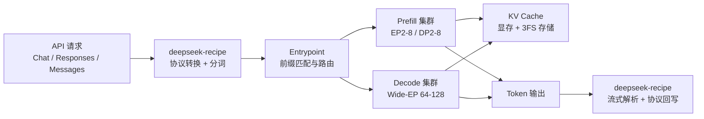

---
title: DeepInfer：DeepSeek 的生产级推理框架
description: DeepInfer 是什么、为什么开源、基于什么、与 DeepSeek 及其他开源模型权重的关系，开源前社区怎么部署权重，以及性能提升到底明不明显。
weight: 1
---

DeepInfer 不是新模型，也不是又一份权重。它是 DeepSeek 用来把 V4.1-Flash 跑成线上服务的推理框架，2026-10-20 以 Apache 2.0 协议开源。本文只回答六个问题：它是什么、为什么开源、基于什么、和权重是什么关系、开源前社区怎么用权重、性能提升是否明显。

> 事实核对时点：2026-10-24。主要依据是 [DeepInfer 仓库 README（中文记录）](/docs/01-deepseek/推理基础设施/deepinfer仓库readme/) 与 [DeepSeek V4.1 Flash 推理部署问答（中文记录）](/docs/01-deepseek/推理基础设施/deepseek-v4.1-flash推理部署问答/)，以及 deepseek-recipe 仓库和 DeepSeek-V4.1-Flash-1017 的 Hugging Face 模型卡。

## 为什么需要 DeepInfer？（痛点引入）

把「模型开源」理解成「下载权重就能对外服务」，是这一轮开源潮里最贵的误会。权重只决定模型会什么，不决定它一天能服务多少人、每次请求等多久、每百万 token 烧多少电。中间那层把 GPU、显存、网络、缓存和请求调度组织起来的软件，才是推理成本的分水岭。

- 权重下载下来，用通用引擎能跑通，但吞吐和延迟经常离生产要求差一截；长上下文、[MoE](#term-moe)、多模态叠加时，差距会被放大。
- 同样的模型，换一套并行策略、KV Cache 策略或批调度，单位 GPU 的 token 产出可能差出数倍；这不是模型能力差异，是系统工程差异。
- 生产服务不只需要「能生成」，还需要前缀复用、负载均衡、故障转移、结构化输出、确定性采样；这些能力散落在不同项目里，拼起来本身就是一项工程。
- 硬件也不再只有 NVIDIA 一条路。同一套服务要同时跑在 NVIDIA 与昇腾上，靠社区各自打补丁，成本高且难以维护。

| 阶段 | 你手里有什么 | 能做什么 | 缺什么 |
|------|--------------|----------|--------|
| 只有权重 | Hugging Face 上的 checkpoint | 用通用引擎单机或多机跑通 | 面向具体模型的深度调优、生产级缓存与调度 |
| 权重 + 通用引擎 | vLLM、SGLang 等 | 对外提供 OpenAI 兼容接口 | 针对 DeepSeek 架构的算子融合、并行与解码优化 |
| 权重 + DeepInfer | V4.1-Flash 权重 + 官方生产框架 | 按官方给出的并行与缓存策略部署离线推理 | 完整在线服务所需的 KV Cache 系统与跨副本负载均衡仍需自建 |

> ### 💡 新人小结：权重是菜谱，推理框架是厨房
>
> - **权重**像一份写得很详细的菜谱：它决定这家店会做什么菜、味道上限在哪。
> - **通用推理引擎**像一套标准厨房：能开火、能出餐，但动线不是为这道菜设计的。
> - **DeepInfer**像 DeepSeek 为自己这道菜改造过的后厨：灶台、传菜、备菜顺序都按这道菜调过。
> - 菜谱没变，所以菜的味道不变；后厨变了，所以出餐速度和成本会变。
>
> **DeepInfer 优化的是「怎么把权重跑得又快又便宜」，不是「模型有多聪明」。**

**学习路线图**

```text
定位 → 开源动机 → 技术底座 → 与权重的关系 → 开源前的做法 → 性能口径 → 适用边界
是什么   为什么开     基于什么     谁服务谁       社区怎么跑       有没有提升     你该不该用
```

---

## 一句话定位：它不是模型，是服务模型的那层软件

DeepInfer 的官方定义很直接：**支撑 DeepSeek 大规模生产服务的高性能推理框架**；这次开源的是带核心能力的离线推理版本。它调用 DeepSeek 已经开源的算子库，把模型权重组织成可调度的计算图，再通过并行、缓存、[投机解码](#term-spec-decode)和批处理把吞吐与延迟压到生产可用的区间。

| 对象 | 是什么 | 不是什么 |
|------|--------|----------|
| DeepInfer | 推理框架 / 引擎，负责调度计算、显存、并行与输出 | 不是模型，不产生新的能力 |
| DeepSeek-V4.1-Flash | 模型与权重，决定知识、推理与多模态能力 | 不是服务框架，单独不能对外提供高并发 API |
| deepseek-recipe | Token 编解码与 API 协议转换组件，Rust 实现并带 Python 绑定 | 不是推理后端，不负责模型计算 |
| 完整在线服务 | 引擎 + KV Cache + 路由/负载均衡 + 运维体系 | 不是本次开源的全部内容 |

仓库当前写明的支持范围很窄，也很清楚：

- **支持模型**：DeepSeek-V4.1-Flash，且只列出这一款。
- **支持硬件**：NVIDIA SM100 GPU、华为昇腾 950 NPU。
- **许可证**：Apache 2.0。
- **交付形态**：源码构建，[README](/docs/01-deepseek/推理基础设施/deepinfer仓库readme/) 未给出 pip 安装路径（入口是 `./build.sh`）。
- **默认 checkpoint**：`deepseek-ai/DeepSeek-V4.1-Flash-1017`，首次运行会从 Hugging Face 缓存拉取。

这五个事实放在一起，说明它不是「下载即用」的通用加速器，而是面向特定模型、特定硬件、特定部署方式的工程底座。

> ### 💡 新人小结：先分清「模型、权重、引擎、服务」四层
>
> - **模型**回答「它能做什么」；**权重**是模型训练出来的参数文件。
> - **引擎**回答「怎么把参数变成 token」；**服务**回答「怎么让很多人同时用，还不崩」。
> - DeepInfer 在第三层，`deepseek-recipe` 在请求进出的边界上，两者都不改变第一层。
> - 看到「DeepInfer 开源」时，不要把它读成「DeepSeek 又发了一个新模型」。

---

## 为什么开源？官方给出的三条理由

[仓库内的部署问答](/docs/01-deepseek/推理基础设施/deepseek-v4.1-flash推理部署问答/)把动机写得很直白：

> A model defines the boundary of what is possible; serving those capabilities to a massive user base at a reasonable cost is the core problem an inference framework has to solve.

翻成中文：**模型定义能力边界，而如何以合理成本把这些能力服务给海量用户，是推理框架必须解决的核心问题。** 这句话解释了为什么 DeepSeek 在开源权重和算子之后，还要把引擎拿出来。

| 官方理由 | 具体表述 | 对应动作 |
|----------|----------|----------|
| 降低推理成本与能耗 | 推理框架效率直接决定算力成本与电力消耗；分享生产栈帮助开发者提升吞吐、降低延迟 | 开源并行、调度、投机解码、结构化输出等核心能力 |
| 让智能更可负担 | 用更少算力与能源服务更多请求，让智能服务以更低价格触达更多人 | 给出可复现的 benchmark 脚本与部署问答 |
| 补齐开源栈 | 此前已开源 TileLang 与 FlashMLA、DeepGEMM、DeepEP 等算子/通信库，但缺少把它们组装成完整引擎的骨架 | DeepInfer 作为集成者，把算子、调度、并行与解码串起来 |

还有两条长期承诺写在[问答](/docs/01-deepseek/推理基础设施/deepseek-v4.1-flash推理部署问答/)里：

1. **未来 DeepSeek 新模型的推理代码会继续进入同一仓库**，后续性能优化也会持续开源。
2. **deepseek-recipe 与官方 API 的处理逻辑对齐**，第三方部署可以复现官方 API 的行为，而不是只得到一个「相似」的接口。

但开源边界同样明确。[问答](/docs/01-deepseek/推理基础设施/deepseek-v4.1-flash推理部署问答/)里写明：**KV Cache 管理与负载均衡组件和 DeepSeek 内部基础设施耦合很深，这部分代码尚未完全开源**。[README](/docs/01-deepseek/推理基础设施/deepinfer仓库readme/) 也列出完整在线服务还缺的三块：KV Cache 系统、[VE](#term-ve)/[Prefill](#term-prefill)/[Decode](#term-decode) 拆分部署、跨数据并行副本的负载均衡。换句话说，开源的是「引擎核心 + 算子 + 编解码」，不是「DeepSeek 线上全套基础设施」。

| 已开源 | 未完全开源 | 对使用者的影响 |
|--------|------------|----------------|
| 推理引擎核心、并行策略、DSpark 投机解码、SWA bounded replay、结构化输出 | KV Cache 管理系统 | 需要自建或接入缓存层，才能做跨请求前缀复用 |
| FlashMLA、DeepGEMM、DeepEP、TileKernels、DeepSelect 等算子库 | Prefill/Decode 拆分部署的完整编排 | 离线推理可直接跑；完整在线服务要补部署与路由 |
| deepseek-recipe 的协议转换与分词 | 跨 DP 副本的负载均衡 | 单副本能跑，多副本的流量分配要自己做 |
| Apache 2.0 许可 | 与内部集群强耦合的运维组件 | 可商用、可修改、可再分发，但不等于开箱即用 |

> ### 💡 新人小结：开源的是「方法」，不是「整套机房」
>
> - 官方把「怎么把 V4.1-Flash 跑得快」的方法交出来了：并行、解码、调度、算子。
> - 但「怎么在你自己的机房里做缓存、做路由、做容灾」仍然要自己补。
> - 这就像公开了发动机图纸，不等于连加油站和公路一起送你。
> - 评价这次开源，重点应放在「引擎核心是否可复用」，而不是「能不能一键复刻 DeepSeek 云服务」。

---

## 基于什么？它站在 vLLM 与 DeepSeek 算子库的肩膀上

[DeepInfer 的 README](/docs/01-deepseek/推理基础设施/deepinfer仓库readme/)在致谢里写得很清楚：**最初主要基于 vLLM 构建，同时借鉴了 SGLang 与 TensorRT-LLM 的设计**。这不是一句客套话，它说明了三件事：

1. 社区此前用通用引擎服务 DeepSeek 模型的做法是有效的，DeepInfer 没有另起炉灶。
2. 它把通用引擎的调度骨架保留下来，换上了更贴合 DeepSeek 架构的算子、并行和解码策略。
3. 它仍然是「引擎」，不是「模型运行时」的全部；请求协议、分词与输出解析被拆到 deepseek-recipe。

在算子层，DeepInfer 集成了 DeepSeek 此前陆续开源的组件：

| 组件 | 作用 | 在 DeepInfer 中的位置 |
|------|------|------------------------|
| FlashMLA | MLA 注意力内核 | Attention 计算 |
| DeepGEMM | 矩阵乘法内核 | MoE/稠密层矩阵计算 |
| DeepEP | MoE 专家并行通信库 | 专家并行与跨卡通信 |
| TileKernels | 用 TileLang 编写的内核集合 | 模型执行中的定制算子 |
| DeepSelect | 选择类算子 | 路由/选择逻辑 |
| TileLang 自定义内核 | 面向特定形状与硬件的融合算子 | `deepinfer/model_executor/layers/tilelang_ops` |

系统层的关键设计可以概括为「一拆、两并行、三加速」：



- **一拆**：[Vision Encoder](#term-ve)、[Prefill](#term-prefill)、[Decode](#term-decode) 分阶段部署，各自按负载扩缩容，[TTFT](#term-ttft) 与 [TBT](#term-tbt) 可以独立优化。
- **两并行**：Attention 侧用[数据并行（DP）](#term-dp)或均衡的[上下文并行（CP）](#term-cp)；MoE 侧用[专家并行（EP）](#term-ep)加 [EPLB](#term-eplb) 负载均衡，Decode 走 [Wide-EP](#term-wide-ep)，把每步的专家内存流量摊薄。
- **三加速**：[DSpark 投机解码](#term-dspark)用草稿 token 加置信度调度验证；[SWA bounded replay](#term-swa-replay) 只重算最近一段窗口，降低长上下文 prefill 成本；[异步调度](#term-async-sched)把 CPU 的批调度与 GPU 执行重叠起来。

此外还有几项面向生产的能力：

| 能力 | 作用 | 边界 |
|------|------|------|
| Batch-invariant 推理 | 不同批次组成下结果保持一致 | 仅 NVIDIA |
| 确定性采样 | 相同输入与采样参数得到相同输出 | 仅 NVIDIA，且需关闭变长[投机解码](#term-spec-decode) |
| 结构化输出 | 约束为 regex、JSON Schema 或 EBNF | 需要引擎侧约束解码支持 |
| 异步调度 | 隐藏 CPU 调度与后处理开销 | 默认开启，原理见[术语表](#term-async-sched) |
| SWA bounded replay | 减少 Decoder prefill 的重算量 | 需要覆盖 SWA 窗口与最大回溯长度，原理见[术语表](#term-swa-replay) |

构建环境也不是「有张显卡就行」：

```bash
# 官方 README 给出的前置条件与构建方式
# Linux + GCC >= 13 + Python 3.12 + CUDA 13（NVIDIA）或 CANN 9.2（昇腾）
export DEEPINFER_ACCELERATOR=nvidia   # 昇腾平台改为 ascend
./build.sh

# 默认会拉取 DeepSeek-V4.1-Flash-1017；也可以指向本地权重目录
export DEEPINFER_HF_MODEL_DIR=/path/to/DeepSeek-V4.1-Flash-1017
python examples/offline_inference.py
```

这段命令的重点不是「复制就能跑」，而是三个约束：**源码构建、Linux 环境、指定加速卡**。它和 `pip install` 之后在笔记本上跑一个小模型，是两种完全不同的使用场景。

> ### 💡 新人小结：DeepInfer 是「组装好的整机」，不是「万能插头」
>
> - 它的底盘来自 vLLM，零件来自 DeepSeek 自己的算子库，接口层由 deepseek-recipe 补齐。
> - 它把「通用引擎 + 零散算子 + 自写调度」的组合，收成了一套官方验证过的装配。
> - 但装配规格是围绕 V4.1-Flash 与 SM100/昇腾 950 定的，换模型或换卡就不是同一台机器。
> - 所以它更像「为一道菜定制的整套后厨」，而不是「任何食材都能进的通用厨房」。

---

## 它和 DeepSeek 权重、其他开源模型权重是什么关系？

先把结论放在前面：**DeepInfer 与权重是「播放器与片源」的关系，不是「新版模型与旧版模型」的关系。** 它不产出一个新的 checkpoint，也不改变 V4.1-Flash 的参数；它只决定这份权重在特定硬件上以多快、多便宜的方式运行。

| 对象 | 归属 | 与 DeepInfer 的关系 |
|------|------|----------------------|
| DeepSeek-V4.1-Flash-1017 权重 | Hugging Face 模型仓库，按模型许可发布 | DeepInfer 的默认加载对象；权重不变，能力不变 |
| DeepInfer 引擎 | GitHub `deepseek-ai/DeepInfer`，Apache 2.0 | 负责加载权重、组织计算、输出 token |
| deepseek-recipe | GitHub `deepseek-ai/deepseek-recipe`，MIT | 负责请求协议、Prompt 渲染、分词与流式解析 |
| 其他开源模型权重 | 各自的模型仓库与许可证 | 当前 DeepInfer 不支持；继续使用各自的推理引擎 |

三个容易混淆的点，需要逐个拆开：

1. **「支持 V4.1-Flash」不等于「支持所有 DeepSeek 模型」。** [README 的 Supported models](/docs/01-deepseek/推理基础设施/deepinfer仓库readme/)只列了 V4.1-Flash 一款；[问答](/docs/01-deepseek/推理基础设施/deepseek-v4.1-flash推理部署问答/)里承诺的是未来 DeepSeek 新模型的推理代码继续进入该仓库，并没有承诺兼容 V3、R1 或更早的权重。
2. **「开源引擎」不等于「开源权重」。** V4.1-Flash 的权重本来就在 Hugging Face 上单独发布；DeepInfer 开源的是运行这些权重的软件。两者的许可证也各自独立：引擎是 Apache 2.0，recipe 是 MIT。
3. **「其他开源模型」不会因为 DeepInfer 出现就自动获得加速。** DeepInfer 的并行策略、算子和默认配置都围绕 DeepSeek 的 MLA/MoE 架构；它不是 vLLM 那种「尽量支持所有模型」的通用引擎。其他模型仍然走 vLLM、SGLang、TensorRT-LLM、llama.cpp 等各自路线。

可以用一张更直观的对照来记：

| 问题 | 答案 |
|------|------|
| DeepInfer 会让 V4.1-Flash 变聪明吗？ | 不会。权重没变，模型能力不变。 |
| DeepInfer 会让 V4.1-Flash 跑得更快吗？ | 在它支持的硬件与部署方式下，官方给出了吞吐/延迟曲线；不是所有环境都更快。 |
| 我能用 DeepInfer 跑 Qwen、Llama 或 DeepSeek-V3 吗？ | 当前公开版本不支持；仓库只列 V4.1-Flash。 |
| 我能不能只拿 DeepInfer 的某个算子到别的引擎里？ | 算子库本身是独立开源的，可以研究或复用；但整套引擎的默认配置不是为其他模型准备的。 |

> ### 💡 新人小结：权重决定「会不会」，引擎决定「快不快、贵不贵」
>
> - 同一份 V4.1-Flash 权重，放进不同引擎，回答质量应当一致，吞吐和成本可以差很多。
> - DeepInfer 没有偷偷换权重，也没有蒸馏出一个小模型；它改的是计算的组织方式。
> - 其他开源模型的权重，仍然由它们自己的社区引擎服务；DeepInfer 不是「万能加速外挂」。
> - 判断一次发布的价值，先问「它动的是哪一层」，再问「这一层对我有没有用」。

---

## 在 DeepInfer 开源之前，社区是怎么用这些权重的？

答案并不神秘：**下载权重，交给通用推理引擎，再自己补生产化组件。** Hugging Face 的 DeepSeek-V4.1-Flash-1017 模型卡至今仍直接给出 vLLM 与 SGLang 的启动命令，这说明「用第三方引擎加载官方权重」本来就是官方认可的路径。

| 使用场景 | 开源前的典型做法 | 主要代价 |
|----------|------------------|----------|
| 快速验证 / 研究 | 从 Hugging Face 或 ModelScope 下载权重，用 vLLM、SGLang 起一个 OpenAI 兼容服务 | 需要自己处理并行度、显存、上下文长度与采样参数 |
| 本地 / 量化实验 | 使用 llama.cpp、Ollama 等本地引擎，或社区量化版本 | 大模型需要量化与裁剪，能力与速度都要重新评估 |
| 生产部署 | 通用引擎 + 自建 KV Cache、路由、负载均衡、监控与容灾 | 工程量大，且不同团队重复造轮子 |
| 底层优化 | 直接复用 FlashMLA、DeepGEMM、DeepEP 等算子库，或给引擎打补丁 | 需要理解模型架构与硬件，门槛高 |
| 不想自建 | 直接调用 DeepSeek 官方 API | 成本与数据边界受服务商约束 |

模型卡给出的两条命令，基本就是「开源前社区路径」的缩影：

```bash
# vLLM：把权重起成 OpenAI 兼容服务
vllm serve deepseek-ai/DeepSeek-V4.1-Flash-1017 \
  --tensor-parallel-size 8

# SGLang：另一种通用引擎路径
python -m sglang.launch_server \
  --model-path deepseek-ai/DeepSeek-V4.1-Flash-1017 \
  --host 0.0.0.0 \
  --port 30000
```

这两条命令能跑通，但「跑通」和「跑得便宜」之间还有很长的距离：

- **并行怎么切**：[张量并行](#term-tp)、[数据并行](#term-dp)、[专家并行](#term-ep)怎么组合，直接决定显存占用与通信开销。
- **缓存怎么复用**：多轮对话、Agent 长任务、代码库问答都依赖前缀缓存；缓存放在哪、保留多久、怎么命中，是另一套系统。
- **请求怎么分**：Prefill 与 Decode 的负载特征不同，长请求与短请求混在一起时，简单的轮询会把 GPU 利用率拉低。
- **输出怎么约束**：JSON Schema、工具调用、流式解析，需要引擎与协议层配合，而不是在应用层补正则。

DeepInfer 的出现，相当于 DeepSeek 把「我们内部怎么切并行、怎么调度、怎么解码」这一层公开了；但它没有把 KV Cache 与跨副本负载均衡一起交出来，所以「开源前自己拼」和「开源后自己拼」并不是完全替代关系，而是**少拼了引擎核心那一大块**。

> ### 💡 新人小结：开源前不是「不能用」，而是「要自己组装」
>
> - 权重一直能下载，vLLM/SGLang 一直能起服务，社区并不是在黑暗里摸索。
> - 真正缺的是「针对 DeepSeek 架构调过的引擎核心」和「官方验证过的生产参数」。
> - DeepInfer 把这两样补上了，但缓存、路由、容灾仍要自己接。
> - 所以它降低的是「从能跑到跑得好」的门槛，不是把门槛直接拆掉。

---

## 性能提升明显吗？先看官方证据的边界

这是最容易得到错误结论的一节。正确的读法是：**先问「和谁比、在什么硬件上、跑什么流量」，再看数字。** [DeepInfer 的 README](/docs/01-deepseek/推理基础设施/deepinfer仓库readme/)只给了两张 Pareto 曲线，没有给出「相对 vLLM 快多少倍」的对照表；[官方问答](/docs/01-deepseek/推理基础设施/deepseek-v4.1-flash推理部署问答/)给出的是生产集群指标和若干局部优化收益，也不是通用加速比。

| 官方给出的证据 | 具体内容 | 能推断什么 | 不能推断什么 |
|----------------|----------|------------|--------------|
| Prefill 曲线 | 4 张 SM100，非缓存输入吞吐 vs 延迟 | 在该硬件与配置下的吞吐-延迟取舍 | 不能换算成其他 GPU 的倍数 |
| Decode 曲线 | 64 张 SM100，输出吞吐 vs 单用户速度 | 高并发解码的吞吐上限形状 | 不能证明单卡或小集群同样提升 |
| 生产集群指标 | 单集群每天 155 万亿 token；按谷时电价折合每 GPU 小时 38 美元 | 官方生产系统在自身流量下的规模与成本 | 不是「每个请求快多少」的延迟指标 |
| 动态长度验证 | 生产工作点约 60 并发/rank 时，相对固定 5 个草稿 token 提升 4%–7% | 投机解码内部策略的局部收益 | 不是端到端相对其他引擎的收益 |
| 负载均衡 | 达到「完美均衡离线基准」约 80% | 调度策略缩小了与理想状态的差距 | 不是模型推理本身的加速 |
| SWA bounded replay | Decoder 侧只重算最近窗口，官方称可将近乎减半 prefill 计算 | 长上下文场景的结构性优化 | 实际收益仍取决于命中率与上下文形态 |

动态长度验证的完整表格更能说明「收益是条件性的」：

| 并发（seqs/rank） | 固定 5 草稿的估算吞吐（tok/s/rank） | 动态长度估算吞吐（tok/s/rank） | 相对变化 |
|-------------------|--------------------------------------|--------------------------------|----------|
| 16 | 4,891 | 4,816 | -1.5% |
| 32 | 8,964 | 9,111 | +1.6% |
| 48 | 12,032 | 12,467 | +3.6% |
| 60 | 13,730 | 14,466 | +5.4% |
| 72 | 14,962 | 15,961 | +6.7% |
| 96 | 16,817 | 18,660 | +11.0% |

同一项优化，在低并发时甚至是负收益，到了高并发才变成两位数。这说明「DeepInfer 更快」不是一句无条件成立的话，而是一组「硬件 + 模型 + 流量形态 + 参数」共同决定的结论。

再看适用场景：

| 你的场景 | 可能的性能结论 | 原因 |
|----------|----------------|------|
| V4.1-Flash + SM100/昇腾 950 + 大规模在线服务 | 有机会获得明显收益 | 官方正是按这套硬件与流量做的并行、缓存与调度优化 |
| V4.1-Flash + 小规模离线批处理 | 收益取决于 batch 与上下文；未必明显 | 官方曲线是特定规模下的吞吐-延迟取舍，离线脚本也需自行调参 |
| 其他开源模型 | 不能直接套用 | 当前只支持 V4.1-Flash，引擎不是通用模型运行时 |
| A100/H100/消费级显卡 | 不能按官方数字推断 | 公开版只列 SM100 与昇腾 950，未承诺其他硬件 |
| 已经高度调优的 vLLM/SGLang 集群 | 需要实测对比 | 官方没有发布与这些引擎的同条件 head-to-head 数据 |

因此，对「会带来明显的性能提升吗」最准确的回答是：

1. **对 DeepSeek 自己那套生产条件，提升是真实的**：155 万亿 token/天、每 GPU 小时 38 美元、局部优化 4%–7% 等数字都来自官方生产或官方基准。
2. **对「所有 DeepSeek 用户」，提升不是自动的**：硬件、模型、并发、上下文长度、缓存命中率都会改变结论。
3. **对「其他开源模型」，当前谈不上提升**：它只支持 V4.1-Flash，其他权重不在支持列表里。
4. **对「小团队 / 单机」，很可能用不上**：官方建议的高效部署单元是 64 卡 Prefill + 64 卡 Decode，源码构建与 Linux/CUDA 13 环境也不是轻量路线。

> ### 💡 新人小结：看到「性能提升」先问三个问题
>
> - **和谁比？** [官方 README](/docs/01-deepseek/推理基础设施/deepinfer仓库readme/)没有给「相对 vLLM 快 N 倍」的结论，只有自身吞吐-延迟曲线。
> - **在哪跑？** 曲线来自 4 卡 Prefill、64 卡 Decode 的 SM100；换硬件就不是同一张图。
> - **跑什么？** 长上下文、Agent、缓存命中高的流量，和短请求、低并发流量的收益完全不同。
> - 把这三个问题答完，再看「明显不明显」，才不会被一个漂亮的百分比带走。

---

## 适用边界：谁应该现在试，谁应该再等等

DeepInfer 更像一份「生产级参考实现」，而不是「人人可装的加速包」。它的边界在 [README](/docs/01-deepseek/推理基础设施/deepinfer仓库readme/) 与[问答](/docs/01-deepseek/推理基础设施/deepseek-v4.1-flash推理部署问答/)里写得很清楚，选型时可以直接对照：

| 条件 | 现在适合试 | 建议再等等 |
|------|------------|------------|
| 模型 | 只跑 DeepSeek-V4.1-Flash | 还要跑 V3、R1、Qwen、Llama 等 |
| 硬件 | 有 SM100 或昇腾 950 | 只有 A100/H100/消费级显卡 |
| 场景 | 大规模离线推理、私有化部署、研究官方并行与缓存设计 | 单机实验、轻量应用、快速原型 |
| 工程能力 | 能读源码、能调并行与缓存、能补路由/监控 | 希望 pip 安装后开箱即用 |
| 服务形态 | 可接受先跑离线推理，再自建在线层 | 需要完整在线服务一键复刻 |
| 合规 | 接受 Apache 2.0，并能保留 NOTICE | 需要厂商级 SLA 与托管运维 |

如果只看「能不能跑」，答案是：满足硬件与模型条件就能按 [README](/docs/01-deepseek/推理基础设施/deepinfer仓库readme/) 构建；如果看「值不值得投入」，还要把缺失的 KV Cache、Prefill/Decode 拆分部署、跨副本负载均衡算进工程量。官方把这三项明确列为「完整服务所需、但本次未包含」，这不是文档遗漏，而是开源边界。

---

## 要点总结

1. **DeepInfer 是推理框架，不是新模型。** 它服务 DeepSeek-V4.1-Flash，不改变权重与模型能力。
2. **开源的动机是成本与效率。** 官方原话是：模型定义能力边界，推理框架解决「以合理成本服务海量用户」的核心问题。
3. **技术底座是 vLLM 加 DeepSeek 算子库。** [README](/docs/01-deepseek/推理基础设施/deepinfer仓库readme/)明确写「主要基于 vLLM，借鉴 SGLang 与 TensorRT-LLM」，并集成 FlashMLA、DeepGEMM、DeepEP、TileKernels、DeepSelect 与 TileLang 自定义内核。
4. **它和权重是两层东西。** 权重在 Hugging Face 单独发布；DeepInfer 是加载权重的引擎；其他开源模型当前不在支持列表里。
5. **开源前社区靠通用引擎加自建生产层。** vLLM/SGLang 起服务、llama.cpp/Ollama 做本地量化、自建 KV Cache 与负载均衡，是之前的常态。
6. **性能提升有条件。** 官方只给特定硬件与流量下的曲线和局部优化数字；没有「相对所有引擎统一加速 N 倍」的结论，小团队与其他模型不能直接套用。

---

## 接下来读什么

- 想确认 V4.1-Flash 与 1017 版本的日期落点：[模型发布时间线](/docs/01-deepseek/模型全景/模型发布时间线/)
- 想核对 V4.1-Flash 的规格口径与参数缺口：[模型参数对比](/docs/01-deepseek/模型全景/模型参数对比/)
- 想补上算子库、许可证与开源周的前史：[开源策略与生态](/docs/01-deepseek/发展历程/开源策略与生态/)
- 想把这些模型接进终端 Agent 工具：[DSH 是什么](/docs/03-dsh/认识DSH/DSH是什么/)

---

## 常见问题（FAQ）

**DeepInfer 是 DeepSeek 的新模型吗？**
不是。它是推理框架，模型仍然是 DeepSeek-V4.1-Flash，权重不变。

**它能让 V4.1-Flash 的回答质量变好吗？**
不能。它优化吞吐、延迟与成本，不改变模型参数与训练目标。

**它能跑 DeepSeek-V3、R1 或其他厂商的开源权重吗？**
当前公开版本只列 DeepSeek-V4.1-Flash 一款；官方承诺的是未来 DeepSeek 新模型的推理代码继续进入该仓库，没有承诺兼容其他模型。

**它比 vLLM 快多少？**
官方 [README](/docs/01-deepseek/推理基础设施/deepinfer仓库readme/) 没有给出同条件 head-to-head 倍数，只给 4 卡 Prefill / 64 卡 Decode 的 Pareto 曲线；不能用一个数字概括所有场景。

**普通显卡能跑吗？**
公开版列出的硬件是 NVIDIA SM100 与华为昇腾 950；A100、H100、消费级显卡不在支持列表内，不能按官方数字推断。

**开源版包含完整的在线服务吗？**
不包含。[README](/docs/01-deepseek/推理基础设施/deepinfer仓库readme/) 明确列出还需自建 KV Cache 系统、VE/Prefill/Decode 拆分部署、跨数据并行副本的负载均衡。

**许可证是什么？**
DeepInfer 是 Apache 2.0；配套的 deepseek-recipe 是 MIT。

---

## 术语表

> 正文中的 [术语](#术语表) 链接都指向本节。词条按「正文首次出现顺序」排列。

### 大模型架构基础 {#term-arch}

#### MLA（Multi-Head Latent Attention）多头潜在注意力 {#term-mla}

DeepSeek 系列模型使用的注意力机制：把每个 token 的 KV（键值）状态压缩成低秩「潜在向量」存储，相比标准 Multi-Head Attention 大幅压缩 KV Cache 的显存占用。硬件内核对应开源库 [FlashMLA](https://github.com/deepseek-ai/FlashMLA)。

#### MoE（Mixture of Experts）混合专家 {#term-moe}

一种稀疏激活架构：Transformer 的前馈层替换为多个「专家」子网络，路由器每个 token 只激活其中少数几个。总参数量大、单 token 计算量小，代价是专家间负载不均与跨卡通信，需要 [EP](#term-ep) + [EPLB](#term-eplb) 配合。

#### KV Cache（键值缓存） {#term-kv}

推理时缓存每个 token 的注意力键值状态，避免每生成一个 token 就重算全部历史。是显存的主要消耗者，也是前缀复用、多请求分摊的计算基础；KV Cache 管理系统是本次 DeepInfer 开源边界中「未完全开源」的部分。

#### SWA（Sliding Window Attention）滑动窗口注意力 {#term-swa}

只让每个 token 关注最近 W 个 token 的窗口，而不是全部历史。窗口外注意力权重可近似丢弃，KV Cache 与长上下文计算量大幅下降；代价是丢失窗口外的细粒度记忆。V4.1-Flash 采用 SWA，因此才有 [SWA bounded replay](#term-swa-replay) 这项优化空间。

### 请求生命周期 {#term-lifecycle}

#### Vision Encoder（VE）视觉编码器 {#term-ve}

多模态模型里把图像编码成 token 序列的视觉侧网络。它的负载（用户发不发图）与文本侧完全不同，所以在「一拆」架构里作为独立部署阶段。

#### Prefill（预填充）阶段 {#term-prefill}

处理输入 prompt 的阶段：一次性并行计算全部输入 token，产出 KV Cache 与第一个输出 token。特征是计算密集、单请求高算力，吞吐以「输入 token/s」衡量。

#### Decode（解码）阶段 {#term-decode}

逐 token 生成的阶段：每步只算一个 token，反复读取整份 KV Cache。特征是访存密集、并发才是吞吐关键，吞吐以「输出 token/s」衡量。Prefill 与 Decode 资源画像完全不同，所以「一拆」把它们拆成独立集群。

#### TTFT（Time To First Token）首 token 延迟 {#term-ttft}

从发出请求到收到第一个输出 token 的时间。主要由 Prefill 时长决定，交互体验的「响应快不快」就是它。

#### TBT（Time Between Tokens）token 间延迟 {#term-tbt}

流式输出中相邻两个 token 之间的间隔，决定「打字机」的流畅程度。主要由 Decode 阶段单步时长决定。TTFT 与 TBT 由不同阶段主导，所以拆分部署后可以各自独立优化。

### 并行策略 {#term-parallel}

#### 数据并行（DP，Data Parallelism） {#term-dp}

把不同请求分发到不同副本上，每个副本持有完整模型。推理服务最基础的扩展方式；「跨 DP 副本的负载均衡」是完整在线服务需自建的三块之一。

#### 上下文并行（CP，Context Parallelism） {#term-cp}

把**一个长序列**沿时间维切开，分给多张卡共同计算（每卡负责一段上下文），用于单请求上下文超出单卡承载的场景。「均衡的 CP」指配合负载均衡的切分方式。

#### 专家并行（EP，Expert Parallelism） {#term-ep}

[MoE](#term-moe) 专用的并行方式：把不同专家分布在不同卡上，token 经路由器跨卡送往所属专家。通信模式不规则，需要专门的通信库（[DeepEP](https://github.com/deepseek-ai/DeepEP)）与负载均衡（[EPLB](#term-eplb)）。

#### 张量并行（TP，Tensor Parallelism） {#term-tp}

把单个矩阵乘法沿张量维切开到多卡同时算，卡间每步都要通信。vLLM 的 `--tensor-parallel-size 8` 即此；通信最重，通常单机 8 卡内使用。

#### EPLB（Expert Parallelism Load Balancer）专家并行负载均衡器 {#term-eplb}

DeepSeek 开源的 [EPLB 项目](https://github.com/deepseek-ai/eplb)：依据专家热度做冗余专家复制与专家重排，让每张卡分到的计算量尽量相等。没有它，MoE 的热点专家会把个别卡打成瓶颈。官方负载均衡基准达到「完美均衡离线基准」约 80% 即与此相关。

#### Wide-EP（超宽专家并行） {#term-wide-ep}

把 EP 域开到极大（Decode 集群 64–128 卡一个 EP 域）的部署形态：所有专家摊在几百张卡上，每个 GPU 每步只承载极小的专家内存流量，配合 DeepEP 通信把「读专家权重」这个 Decode 主瓶颈摊薄。是 DeepSeek 生产 Decode 集群的标志性配置。

### 加速技术 {#term-accel}

#### 投机解码（Speculative Decoding） {#term-spec-decode}

用小得多的「草稿模型」（或草稿头）一次猜出若干候选 token，再用大模型一次性并行验证：被接受的直接复用、被拒绝的从验证点重算。数学上输出分布与不投机完全一致，单步可产出多个 token，从而加速 Decode。「置信度调度」指按草稿置信度动态决定本步生成多少草稿 token。

#### DSpark {#term-dspark}

DeepInfer 内置的投机解码子系统（见上一条原理），支持「变长草稿」：按置信度调整每步草稿 token 数。官方动态长度验证显示：高并发（96 seqs/rank）时比固定 5 草稿提升约 11%，低并发时可能为负收益。

#### SWA bounded replay（滑动窗口有界重放） {#term-swa-replay}

面向 [SWA](#term-swa) 模型的 Prefill 优化：多轮对话时，窗口内的近期 token 照常增量计算，只对「最近一段窗口边界之外的少量回溯 token」重放计算，而不是从对话开头整体重算。官方称可将 Decoder prefill 计算近乎减半。

#### 异步调度（Async Scheduling） {#term-async-sched}

把 CPU 侧的批次编排、输入准备、输出后处理与 GPU 的前向计算重叠执行：GPU 跑当前步时，CPU 已在准备下一步的批次。代价是调度复杂度上升，收益是 GPU 空闲等待减少。DeepInfer 中默认开启。

### 硬件与平台 {#term-hw}

#### SM100 {#term-sm100}

NVIDIA Blackwell 数据中心 GPU 架构代号（B200/GB200 一代）。DeepInfer 公开基准全部在 SM100 上测得，不支持列表外硬件（A100/H100 等）套用官方数字。

#### 昇腾 950 / CANN {#term-ascend}

华为昇腾 950 NPU 是 DeepInfer 支持的另一条硬件路线；CANN（Compute Architecture for Neural Networks）是昇腾的异构计算架构与算子库，对应 NVIDIA 的 CUDA。构建时用 `DEEPINFER_ACCELERATOR=ascend` 切换。

#### 3FS {#term-3fs}

DeepSeek 开源的分布式并行文件系统（Fire-Flyer File System），在架构图中给 KV Cache 提供显存之外的容量层：不常访问的 KV 状态可以落盘，需要时再取回。

---


- [DeepInfer 仓库 README（中文记录）](/docs/01-deepseek/推理基础设施/deepinfer仓库readme/)：定位、支持模型与硬件、功能、基准图、许可证与致谢；文末附英文原文链接。
- [DeepSeek V4.1 Flash 推理部署问答（中文记录）](/docs/01-deepseek/推理基础设施/deepseek-v4.1-flash推理部署问答/)：开源动机、生产指标、并行与缓存设计、未开源边界；文末附英文原文链接。
- [deepseek-recipe](https://github.com/deepseek-ai/deepseek-recipe)：API 协议转换、分词与流式解析，MIT 许可。
- [DeepSeek-V4.1-Flash-1017 模型卡](https://huggingface.co/deepseek-ai/DeepSeek-V4.1-Flash-1017)：权重与 vLLM/SGLang 使用示例。
- [DeepSeek API Change Log](https://api-docs.deepseek.com/updates/)：V4.1-Flash 与 V4.1-Flash-1017 的发布时间口径。
- [FlashMLA](https://github.com/deepseek-ai/FlashMLA)、[DeepGEMM](https://github.com/deepseek-ai/DeepGEMM)、[DeepEP](https://github.com/deepseek-ai/DeepEP)：DeepInfer 集成的底层算子与通信库。
- [DeepSeek V4.1 Flash 推理系统架构（知乎）](https://zhuanlan.zhihu.com/p/2095560295930508953)：官方问答引用的架构长文。
