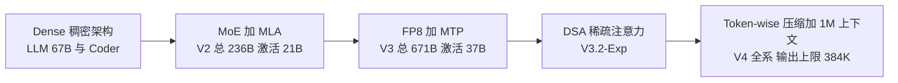

## 为什么需要一张「参数对比表」？（痛点引入）

给团队做模型选型，翻车的方式高度雷同，而且几乎都出在同一张表上：

- 看到「671B」就下结论「我们那几台 80G 的机器跑不动」，于是把 V3 从候选名单里划掉——其实这张表旁边还有一个 37B，那才是每个 token 真正过一遍的计算量。
- 预算表里填 2025 年 2 月的 V3 单价（输入 cache miss $0.27/M），漏掉 2025-09-29 那次 50%+ 的降价，也不知道 2026 年 8 月起已经改成峰谷两档计价，谷时是峰时半价。
- 在 benchmark 表里挑一行最漂亮的数字（比如 R1 的 AIME 2024 79.8）就定方案，没看这张表的日期、对照模型和测试条件（是 pass@1-CoT 还是带工具），上线后才发现业务场景根本不是那张表考的东西。

这三种错误的共同点只有一句话：**把表里的一个数字，当成了结论**。参数表真正的价值不在数字多，而在每个数字都带着口径——谁测的、什么时候测的、和谁比、在什么条件下比的。

| 维度 | 只看单个数字时 | 按口径读表之后 |
|------|----------------|----------------|
| 部署可行性 | 671B 太大，直接放弃 | 总参数 671B、激活参数 37B，按激活参数估算力账 |
| 成本估算 | 拿某个历史单价乘 token 量 | 日期 + 计费项 + 峰谷三件套一起写进预算 |
| 能力判断 | 挑 benchmark 最高的一行定方案 | 先看这张表考什么、和谁比、是哪一天的数字 |
| 上下文规划 | 上下文 1M 就等于能吐 1M | 上下文与最大输出是两个数，1M 对应输出上限 384K |
| 合规评估 | 看到「开源」就当成 MIT | 分清「MIT 代码 + Model License」与「MIT（含权重）」 |

> ### 💡 新人小结：「总参数」和「激活参数」到底差在哪？
>
> 把 MoE 模型想象成一家有 671 位厨师的中央厨房：
> - 菜单上登记了 671 位厨师（**总参数 671B**），决定这家店「会做」的菜系有多全。
> - 但每份订单只叫醒其中 37 位（**激活参数 37B**），他们才是真正动手的人。
> - 顾客为一碗面付的钱，按 37 位厨师的工时算，不按 671 位算。
> - 代价是厨房场地要放得下 671 位的工位——**显存按总参数买，算力按激活参数花**。
>
> **总参数管知识面与显存，激活参数管计算账与速度，这两个数从来不是一回事。**

**学习路线图**（本文按六段推进，读完能独立读任何一张参数表）

```text
参数总表 → 三个数字 → 四项架构 → 演进图 → 定价速查 → Benchmark → 选型
十五行看全   总/激活/上下文  MLA/FP8/DSA/压缩  五个阶段接力  每价带日期   三张表怎么读  五个维度落地
```

---

## 参数总表：十五行读完三年架构

下表逐行保留官方口径，核查日期 2026-10-24。数字来自 GitHub 官方仓库 README、arXiv 论文与 api-docs 新闻页；标 ⚠️ 的条目是本次未能直接从官方渠道核实的，原样保留标注，不做平滑处理。

| 模型 | 总参数 | 激活参数 | 上下文 | 训练量/成本 | 许可证 |
|---|---|---|---|---|---|
| DeepSeek LLM 67B | 67B（dense） | 67B | 4K | 2T tokens | MIT 代码 + Model License |
| DeepSeek Coder | 1B–33B（dense） | 同总参数 | 16K | 2T tokens（87% 代码） | MIT + Model License |
| **DeepSeek-V2** | **236B** | **21B** | **128K** | 8.1T tokens；较 67B 训练成本省 42.5%、KV cache 降 93.3%、吞吐 5.76× | MIT + Model License |
| V2-Lite | 16B | 2.4B | 32K | — | 同上 |
| Coder-V2 | 236B | 21B | 128K | V2 中间检查点 + 6T tokens | MIT + Model License |
| V2.5（=V2-0628 底座） | 236B | 21B | 128K | — | MIT + Model License |
| **DeepSeek-V3** | **671B** | **37B** | **128K** | **14.8T tokens；2.788M H800 GPU 小时（预训练 2.664M + 后续 0.1M）；$5.576M（论文按 $2/GPU·h，美元数以论文 PDF 为准）**；HF 权重总 685B = 671B 主模型 + 14B MTP | MIT 代码 + Model License |
| **DeepSeek-R1 / R1-Zero** | **671B** | **37B** | **128K** | V3-Base 底座 + 大规模 RL（R1 另含冷启动 SFT；蒸馏 800k 样本训练 6 个小模型） | **MIT（含权重）** |
| V3-0324 | 671B | 37B | 128K | — | 同 V3 |
| R1-0528 | 671B | 37B | 128K | — | MIT |
| V3.1 | 671B（V3 续训 840B tokens；官方未重申参数） | 37B | **128K（官方明示）** | — | ⚠️ 未直接核实（HF 卡抓取失败） |
| V3.2-Exp / V3.2 | 671B（推理 demo 配置 config_671B_v3.2.json 佐证） | 37B | ⚠️ 未直接核实（V3.1=128K 已证；1M 是 V4 起才默认） | — | **V3.2-Exp 确认 MIT（含权重）**；V3.2 正式版许可证未单独抓取 |
| **V4-Pro** | **1.6T** | **49B** | **1M（最大输出 384K，定价页）** | 论文《DeepSeek-V4: Towards Highly Efficient Million-Token Context Intelligence》（HF：deepseek-ai/DeepSeek-V4-Pro） | 开源（HF collection deepseek-v4；具体许可证文本未抓取） |
| **V4-Flash** | **284B** | **13B** | 1M | 同上 | 同上 |
| V4.1-Flash(-1017) | 官方未公布（⚠️ 第三方 NVIDIA/OpenRouter 称 552B/8B，非官方，待核） | — | 1M | — | HF 开放权重（news261017 给出链接） |

读这张表有三条纪律，比记住任何一个数字都重要：

1. **参数列要横着看两个数。** V2 是 236B/21B、V3 是 671B/37B、V4-Pro 是 1.6T/49B、V4-Flash 是 284B/13B。总参数一代比一代大，激活参数却始终克制在一代十几到几十 B 的量级——这是同一条架构路线的延续，不是巧合。
2. **上下文列只认「官方明示」。** V3.1 的 128K 是官方明示；V3.2 的上下文这次属于 ⚠️ 未直接核实，因为 1M 是 V4 起才成为全系默认的事。
3. **许可证列要分清「含不含权重」。** 「MIT 代码 + Model License」是代码与权重两套许可；从 R1 起的「MIT（含权重）」才是代码与权重统一到 MIT，明确允许蒸馏等衍生。

另外两个必答的疑问，先在这里说清：

- **为什么 V3 参数写 671B，下载下来的权重却是 685B？** 因为 HF 上的权重总量 = 671B 主模型 + 14B MTP 模块，685B 不是另一个模型，而是同一个模型打包后的体积。
- **V4.1-Flash 为什么没有参数？** 官方未公布。第三方（NVIDIA/OpenRouter）流传的 552B/8B 不是官方口径，本文按 ⚠️ 未核实处理，也不拿它做任何换算。

这张表只回答「模型多大、能吃多长」，每个型号的发布日期与版本特性放在[模型发布时间线](/docs/01-deepseek/模型全景/模型发布时间线/)里，两篇对照读才完整。

---

## 三个数字先分清：总参数、激活参数与上下文

### 总参数与激活参数：一个管显存，一个管算力

dense 架构（2023 年 11 月的 DeepSeek LLM 67B 与 Coder 系列）里，参数量就是计算量：每个 token 都要过一遍全部参数，67B 意味着 67B 的乘加。MoE（Mixture of Experts，混合专家）把 FFN 拆成许多「专家」，每个 token 只路由到其中一小部分，于是总参数与激活参数分家了。

V2 是第一次把这条路线跑通的版本：总参数 236B、激活参数 21B，配 128K 上下文、8.1T tokens 训练量。到了 V4-Pro，总参数 1.6T、激活参数 49B——总参数涨了将近七倍（相对 V2 的 236B），激活参数只从 21B 走到 49B。

### 上下文与最大输出：两个不能混用的数

上下文（context window）是模型一次能「看见」的 token 总量；最大输出是它一次最多能「写出」多少。V4 系列两者分别是 1M 与 384K：能读 1M，不等于能一次吐 1M。做长文生成、整库代码改写时，要按 384K 的输出上限切分任务，否则会在生成阶段被截断。

先把本文反复出现的术语一次列清，后面不再重复解释：

| 术语 | 全称 | 含义（用自己的话） | 在本文中的角色 |
|------|------|--------------------|----------------|
| dense | Dense Model | 每个 token 都要过全部参数的传统结构，参数量约等于计算量 | 2023 年首批 LLM/Coder 的架构基线 |
| MoE | Mixture of Experts，混合专家 | 把 FFN 拆成很多专家，每个 token 只唤醒一小部分，总参数与激活参数分离 | 解释 671B/37B、1.6T/49B 这类写法的前提 |
| 总参数 | Total Parameters | 权重文件里一共有多少参数，决定显存占用与知识面 | 参数表第二列，估显存用它 |
| 激活参数 | Activated Parameters | 处理一个 token 时真正参与计算的参数量 | 参数表第三列，估算力与吞吐用它 |
| 上下文 | Context Window | 一次请求能容纳的输入加输出 token 总量 | 参数表第四列，决定能塞多长的材料 |
| 最大输出 | Max Output | 单次请求最多生成的 token 数，与上下文是两件事 | V4 系列为 384K，长文生成要按它切分 |
| KV cache | Key-Value Cache | 推理时为已读 token 留存的注意力缓存，上下文越长占得越多 | MLA 压缩的对象，也是上下文能拉长的瓶颈 |
| MLA | Multi-head Latent Attention | 把注意力的 KV 信息压进一个低维潜在向量，推理时缓存的东西大幅变少 | V2 起采用，KV cache 降 93.3% 的来源 |
| FP8 | 8-bit Floating Point | 用 8 位浮点做训练与矩阵乘，省显存省带宽 | V3 把 14.8T tokens 训练压到 2.788M GPU 小时的工程手段之一 |
| MTP | Multi-Token Prediction | 训练时让模型一次预测多个 token，提高数据效率 | V3 的训练手段；HF 权重里那多出来的 14B 就是它 |
| DSA | DeepSeek Sparse Attention | 细粒度稀疏注意力，只让相关信息参与注意力计算 | V3.2-Exp（2025-09-29）首次实现 |
| Token-wise 压缩 | Token-wise Compression | 按 token 粒度压缩表示，把长上下文的计算与缓存成本压下来 | V4 系列 1M 上下文全系默认的前提 |

---

## 四项架构成就：MLA、FP8 加 MTP、DSA、Token-wise 压缩

### MLA：把 KV cache 压掉 93.3%

长上下文最贵的不是算力，是缓存。每多读一个 token，注意力就要为它留一份 Key/Value，上下文翻倍、缓存跟着翻倍，显存先撑不住。MLA 的做法是把每个头的 KV 压进一个低维潜在向量，推理时只存这个向量，需要时再投影回来。

V2 官方给出的三个横向数字放在一起看才有意义：相对 67B 路线，训练成本省 42.5%、KV cache 降 93.3%、吞吐 5.76×。这三个数不是三个独立优点，而是同一件事的三个侧面——缓存小了，同样显存能塞更长上下文，同样硬件能扛更高并发。

> ### 💡 新人小结：MLA 到底省了什么？
>
> 把 KV cache 想象成出差时带的行李：
> - 朴素做法（MHA）是每件衣服都带一份完整备份，箱子很快塞满（**每个头的 KV 全量缓存**）。
> - MLA 是只带一张写满搭配方案的索引卡，到地方按卡现配（**压进低维潜在向量，用时再投影**）。
> - 箱子空出来的空间，可以多装几天的量——这就是 93.3% 降幅换来更长上下文与更高吞吐的方式。
> - 索引卡不是免费的：多了一次投影计算，属于「拿一点算力换大量显存」。
>
> **MLA 不是让注意力变聪明，而是让它的记忆变紧凑，从而把上下文长度的天花板抬高。**

### FP8 加 MTP：14.8T tokens 只花 2.788M H800 小时

V3 的成本数字有两个口径，混用就翻车：**2.788M H800 GPU 小时**（预训练 2.664M + 预训练后阶段 0.1M）可以直接引官方 README；**$5.576M** 是论文按 $2/GPU·h 折算出来的美元数，以论文 PDF 为准。

支撑这个数字的工程手段写在 V3 的技术报告里：FP8 混合精度训练（大部分矩阵乘用 8 位浮点跑）、无辅助损失的负载均衡策略（省掉为平衡专家负载而加的辅助损失调参）、MTP（一次预测多个 token，提高每个 token 的训练效率）。三者叠加，才有 14.8T tokens 对应 2.788M GPU 小时这个比例。

### DSA：长上下文只算相关的那部分

V3.2-Exp（2025-09-29）首次实现 DSA（DeepSeek Sparse Attention）细粒度稀疏注意力，官方表述是长上下文的训练与推理效率大幅提升。它解决的问题很具体：上下文变长之后，注意力要两两比较的 token 对按平方增长，其中大部分比较是没有信息量的。DSA 只挑相关信息参与计算，把「平方」这一项按住。

这次更新在商业上还有一个动作：API 价格下调 50%+（具体数字在官方配图中，正文未列）。架构省钱，价格才敢降。

### Token-wise 压缩：1M 上下文与 384K 输出

V4（2026-04-24 Preview）把两件事叠在一起：Token-wise 压缩 + DSA。结果是 **1M 上下文成为全系默认**，最大输出 384K。同代两个型号的参数分别是 V4-Pro 1.6T/49B、V4-Flash 284B/13B——总参数差了一个数量级，激活参数 49B 与 13B 也差了近四倍，这正是「同一架构、两档规模」的标准做法。

---

## 架构演进：五个阶段怎么接力

把四年的架构变化画成一条线，能看清每一步都在解决上一步留下的瓶颈：



图后三条解读：

1. **每一步都在「省」一样具体的东西。** MLA 省 KV cache（降 93.3%）、FP8 与 MTP 省训练算力（14.8T tokens / 2.788M GPU 小时）、DSA 省注意力的平方项、Token-wise 压缩省长上下文的表示开销。架构演进不是堆参数，是逐项削成本。
2. **总参数涨、激活参数不失控。** 从 236B/21B 到 671B/37B 再到 1.6T/49B，总参数涨了数倍，激活参数只从 21B 走到 49B。这条曲线决定了「模型更强但单 token 成本没有同比例上涨」。
3. **上下文是攒出来的，不是一次给的。** 4K（LLM 67B）→ 16K（Coder）→ 128K（V2 起）→ 1M（V4 起默认），每一次跃升背后都有一个压缩手段先落地。

| 阶段 | 代表模型 | 核心抓手 | 省下的是什么 | 边界与代价 |
|------|----------|----------|--------------|------------|
| Dense | DeepSeek LLM 67B、Coder 1B–33B | 传统稠密结构 | 没有省，参数量即计算量 | 上下文只有 4K/16K |
| MoE 加 MLA | V2 236B/21B | 专家路由 + 低维 KV | KV cache 降 93.3%，训练成本较 67B 省 42.5% | 显存仍按 236B 买 |
| FP8 加 MTP | V3 671B/37B | 8 位浮点训练、多 token 预测 | 14.8T tokens 只用 2.788M H800 小时 | 权重总量变 685B（含 14B MTP） |
| DSA | V3.2-Exp 671B/37B | 细粒度稀疏注意力 | 长上下文的平方级注意力开销 | V3.2 上下文本次未直接核实 |
| Token-wise 压缩 | V4-Pro 1.6T/49B、V4-Flash 284B/13B | 按 token 压缩 + DSA | 1M 上下文的缓存与计算开销 | 输出上限 384K，长文要分片 |

---

## 定价速查：每个价格都要带日期

模型参数决定「能不能跑」，定价决定「值不值得跑」。下表逐行保留官方文本，注意每一行都必须连日期一起引用：

| 时点 | 价格 | 来源 |
|---|---|---|
| V3（2025-02-08 起） | 输入(cache miss) $0.27/M、输入(cache hit) $0.07/M、输出 $1.10/M | news1226 |
| V3.2-Exp 上线（2025-09-29） | API 价格下调 50%+（具体数字在官方配图中，正文未列） | news250929 |
| 当前（2026-10，V4.1 时代） | deepseek-flash 峰 $0.006/$0.3/$1.2（hit/miss-in/out per 1M），谷为峰半价；deepseek-v4-pro 峰 $0.044/$1.32/$3.96；Search/Fetch API $0.75/千次 | api-docs.deepseek.com/quick_start/pricing |
| V2「1 元/百万 tokens」价格战数字 | ⚠️ 未能直接核实（本次） | — |

三条规则，写进任何一份预算表都适用：

1. **日期先行。** 上表四行的日期分别是 2025-02-08、2025-09-29、2026-10 与「未能核实」，任何一个数字离开日期就没有意义。
2. **计费项要对齐。** 输入分 cache hit 与 cache miss 两档，输出单独一档；只写「输入多少钱」的报价，等于没报价。
3. **峰谷不是打折活动，是计价规则。** 2026 年 8 月起 V4 系列按高峰/低谷两档计费，谷时为峰时半价；批量任务排到谷时，等于直接把预算砍半。

这里还有一个反直觉的对照，值得单独点出来：拿今天的 deepseek-flash 与 2025-02-08 的 V3 比，**cache miss 输入是 $0.3 对 $0.27、输出是 $1.2 对 $1.10，基本在同一个量级**；真正拉开差距的是 cache hit，$0.006 对 $0.07，不到后者的十分之一。也就是说，「今天比去年便宜」这句话成立的前提是**你的请求能命中缓存**（固定的系统提示词、重复的长文档前缀）。命中率低的场景，别拿 cache hit 的单价去做预算。

> ### 💡 新人小结：为什么定价表要分峰谷两档？
>
> 把 API 计价想象成「错峰用电」：
> - 白天全城开空调，电网紧张，电价按高峰算（**峰时单价**）。
> - 凌晨没人用电，电厂也希望有人来用，于是半价（**谷时半价**）。
> - 你家洗衣机什么时候转，不影响电表怎么算——**但把洗衣时间挪到凌晨，账单立刻减半**。
> - 电器的功率（模型规模）和电价（单价）是两件事，预算要乘在一起看。
>
> **峰谷计价把「什么时候跑」变成了一个可以优化的成本变量，批量任务不排谷时就是白花钱。**

---

## Benchmark 对照：三张表与读表纪律

### V3 的成绩单：通用能力与代码能力分两张表

V3（Chat，2024-12-26）的官方表格对照 GPT-4o-0513 与 Claude-3.5-Sonnet-1022，逐行保留如下。注意最后一行是另一张 base 模型表里的数，不要和 Chat 表的数混着比：

| 项 | V3 | 对照 |
|---|---|---|
| MMLU | 88.5 | GPT-4o 87.2 |
| MMLU-Pro | 75.9 | — |
| DROP | 91.6 | — |
| GPQA-Diamond | 59.1 | — |
| MATH-500 | **90.2** | — |
| AIME 2024 | **39.2** | — |
| CNMO | 43.2 | — |
| GSM8K（base 表） | 89.3 | — |
| MATH（base 表） | 61.6 | — |
| LiveCodeBench（pass@1-CoT） | 40.5 | — |
| HumanEval-Mul | 82.6 | — |
| Codeforces 百分位 | 51.6 | — |
| SWE Verified | 42.0 | — |
| Base 表：MMLU / BBH / HumanEval | 87.1 / 87.5 / 65.2 | — |

### R1 的成绩单：推理项反超，通用项仍有差距

R1（2025-01-20）官方表格对照 OpenAI o1-1217。这张表最容易被断章取义——AIME 与 MATH-500 两行 R1 确实领先，但 MMLU 与 GPQA-Diamond 两行仍然落后，SWE Verified 一栏甚至没有对照数：

| 项 | R1 | o1-1217 |
|---|---|---|
| MMLU | 90.8 | 91.8 |
| MMLU-Pro | 84.0 | — |
| GPQA-Diamond | 71.5 | 75.7 |
| AIME 2024 | **79.8** | 79.2 |
| MATH-500 | **97.3** | 96.4 |
| CNMO | 78.8 | — |
| Codeforces 百分位 / Rating | 96.3 / **2029** | 96.6 / 2061 |
| LiveCodeBench-CoT | 65.9 | — |
| SWE Verified | 49.2 | — |

蒸馏线是这张表的另一半价值：R1-Distill-Qwen-32B 的 AIME 72.6 已超 o1-mini（63.6），R1-Distill-Llama-70B 的 MATH-500 是 94.5。对小团队来说，这两行比分比 671B 主模型那几行更有现实意义——它是「用 32B/70B 的量级拿到接近旗舰推理能力」的官方证据。

### 其他关键版本：升级幅度要按「相对谁」读

| 版本 | 关键数字 | 来源 |
|---|---|---|
| R1-0528（2025-05-28） | AIME 2025 70.0→**87.5**、GPQA 71.5→81.0、LCB_v6 73.3、Aider 71.6、Tau-bench 53.5(航空)/63.9(零售) | 官方 Change Log |
| V3-0324 | MMLU-Pro 75.9→81.2、GPQA 68.4、AIME 59.4、LiveCodeBench 49.2 | 官方 Change Log 2025-03-24 |
| V3.1 | SWE-bench Verified 66.0、SWE-bench Multilingual 54.5、Terminal-bench 31.3 | news250821 |
| V3.2-Exp vs V3.1-Terminus（推理模式无工具） | MMLU-Pro 85.0/85.0、GPQA-Diamond 79.9/80.7、AIME 2025 89.3/88.4、Codeforces Rating 2121/2046、HLE 19.8/21.7；工具：BrowseComp 40.1/38.5、SWE Verified 67.8/68.4 | DeepSeek-V3.2-Exp README |
| V4.1-Flash（2026-09-10） | GPQA Diamond 90.9、Codeforces Rating 3471、HLE 36.8（纯文本子集 39.1）、Terminal-Bench 2.1 90.6、DeepSWE v1.1 74.2 | 官方 Change Log |
| V4.1-Flash-1017（2026-10-17） | HLE 42.6（44.0*）、Terminal-Bench 4.0 42.3、DeepSWE v1.1 77.0 | news261017 |
| V4-Pro-0813 GA | HLE 42.7/60.0、Terminal-Bench 2.1 87.9、DeepSWE 62.7 | 官方 Change Log |

三条读表纪律：

1. **先看这一行是「绝对值」还是「相对上一版的变化」。** R1-0528 那行写的是 AIME 2025 从 70.0 提到 87.5，V3-0324 那行写的是 MMLU-Pro 从 75.9 提到 81.2——箭头两边是同一套测试的两个版本，不能跨表比较。
2. **看清测试条件。** V3.2-Exp 那行特意标注「推理模式无工具」，工具项（BrowseComp、SWE Verified）单列，因为带不带工具是两种考法；LiveCodeBench 标了 pass@1-CoT 也不是随手写的。
3. **同列对比只认同代同条件。** V3.2-Exp 与 V3.1-Terminus 那行用「A/B」写法并列，是为了让你看清「稀疏注意力换来了什么、又让出了什么」——AIME 89.3 对 88.4 是涨的，GPQA-Diamond 79.9 对 80.7 是降的，HLE 19.8 对 21.7 也是降的。任何单项都能被挑出来当结论，所以不能只挑一项。

`44.0*` 里的星号是官方公告原文的写法，本文照原样保留，不做二次解读。

对着 benchmark 表做规划时，还要把「哪些版本已经退役」算进去，这条线索在[公司历程与里程碑](/docs/01-deepseek/发展历程/公司历程与里程碑/)的 API 现状一节；把模型接进 Agent 工作流时的工具调用与上下文编排，见[终端 Agent 工具](/docs/02-agent-tools/)。

---

## 选型建议：按五个维度做决定

参数、定价、benchmark 三张表看完，选型其实就剩五个问题。下面每一行的依据都能回到本文前面的表，没有额外数字：

| 维度 | 先看哪一列 | 落在哪一档 | 依据 |
|------|-----------|-----------|------|
| 超长上下文（合同、整库代码、长报告） | 上下文与最大输出 | deepseek-v4-pro 或 deepseek-flash，1M 上下文、输出上限 384K | V4 起 1M 成为全系默认；输出 384K 决定分片粒度 |
| 成本敏感（大批量、可延迟） | 定价表 + 峰谷规则 | deepseek-flash，任务排到谷时 | 谷时为峰时半价；cache hit 单价远低于 miss |
| 复杂推理（数学、竞赛、难 debug） | R1 与 V4 的 HLE/GPQA 行 | 推理线的最新版本，而不是参数最大的版本 | R1 的 AIME/MATH-500 反超 o1-1217，但 MMLU/GPQA 仍落后 |
| 多模态（图、表、界面截图） | 版本说明而非参数表 | flash 线的最新多模态版本 | 参数总表不含模态列，模态能力要看版本公告 |
| 许可合规（要权重、要商用、要蒸馏） | 许可证列 | MIT（含权重）的版本优先 | V2/V3 是「MIT 代码 + Model License」两套；R1 起才是 MIT 含权重 |

把上面五条压成一个执行顺序，落到纸面就是下面这段决策清单：

```text
# ========== 选型决策顺序（2026-10 口径） ==========
# 每一步只回答一个问题，答完才进下一步；任一步的答案都能回到本文的某张表

STEP 1  需求里有「一次读很长」吗
        有  -> 上下文 1M、输出 384K 的两个型号，进入 STEP 2
        无  -> 128K 档的历史型号仍可评估（V3 / R1 / V3.2-Exp）

STEP 2  预算是硬约束吗
        是  -> deepseek-flash，批量任务排谷时，并核对 cache hit 比例
        否  -> deepseek-v4-pro（V4-Pro 1.6T/49B）

STEP 3  任务是否以推理为主
        是  -> 看 R1 线与 V4 的 HLE / GPQA 行，别只看参数规模
        否  -> 留在 STEP 2 的结论

STEP 4  是否需要图像输入
        是  -> 查 flash 线最新版本的模态说明（参数表不记录模态）
        否  -> 跳过

STEP 5  是否需要权重与蒸馏权
        是  -> 要求 MIT（含权重），排除许可证未核实或未抓取的条目
        否  -> API 调用即可

# 输出: 一份「型号 + 上下文档 + 计价档 + 许可结论」四字段的选型结论
```

每一步的判据与对应的表列：

| 步骤 | 判据 | 对应表列 |
|------|------|----------|
| STEP 1 | 单次材料能否装进上下文 | 参数总表的「上下文」列 |
| STEP 2 | 单价 × 峰谷 × token 量 | 定价速查表的「价格」列 |
| STEP 3 | 推理项是否显著领先 | R1 表与「其他关键版本」表 |
| STEP 4 | 是否有视觉输入 | 版本说明（参数表无模态列） |
| STEP 5 | 是否要拿权重做衍生 | 参数总表的「许可证」列 |

两条容易踩的补充说明：

- **不要用「参数最大」当「能力最强」。** V4-Pro 的 1.6T/49B 是旗舰规模，但推理项的领先要看具体那几行；反过来，R1-Distill 系列用 32B/70B 的量级拿到 AIME 72.6、MATH-500 94.5，小场景未必需要旗舰。
- **不要用「开源」当「可商用」的充分条件。** 「MIT 代码 + Model License」与「MIT（含权重）」是两种许可结构；V3.1 的许可证本次是 ⚠️ 未直接核实，V4 系列只确认了「开源/开放权重」，具体文本未抓取——合规评审必须回到许可证原文，不能用本文的代称下结论。

---

## 常见误区自检（✅ 与 ❌ 对照）

| 场景 | ❌ 容易做错的判断 | ✅ 按口径应有的判断 |
|------|-------------------|----------------------|
| 估显存与算力 | 「671B 太大，跑不动」 | 显存按总参数 671B 估，算力按激活参数 37B 算 |
| 引用 V3 成本 | 「$5.576M，官方 README 说的」 | GPU 小时 2.788M 引 README，美元数引论文（按 $2/GPU·h 折算） |
| 引用价格 | 「输入 $0.27/M」 | 必须带日期与计费项：2025-02-08 的 V3 cache miss 输入 $0.27/M |
| 估算今天成本 | 拿 cache hit 单价乘全部 token | 先算缓存命中率，miss 输入 $0.3 与历史 V3 的 $0.27 是同一量级 |
| 看 V3.2 上下文 | 「V3.2 也是 1M」 | V3.2 上下文本次 ⚠️ 未直接核实，1M 是 V4 起才默认 |
| 看 benchmark 选型 | 挑 AIME 79.8 一行定方案 | 同表里 MMLU 90.8 对 91.8、GPQA 71.5 对 75.7 是落后的 |
| 看许可证 | 「都叫 MIT」 | 分清「MIT 代码 + Model License」与「MIT（含权重）」 |
| 看 V4.1-Flash 规模 | 用第三方 552B/8B 做容量规划 | 官方未公布，第三方数字标 ⚠️ 待核，不进容量模型 |

---

## 要点总结

1. **两个参数，两笔账。** 总参数（V3 671B、V4-Pro 1.6T）决定显存与知识面，激活参数（37B、49B）决定算力与速度；V3 的 HF 权重 685B = 671B 主模型 + 14B MTP，不是另一个模型。
2. **上下文是攒出来的。** 4K → 16K → 128K（V2 起）→ 1M（V4 起默认），每一次跃升都先有一个压缩手段：MLA 让 KV cache 降 93.3%，DSA 按住注意力的平方项，Token-wise 压缩把 1M 变成全系默认；输出上限单独记，是 384K。
3. **成本数字必带口径。** 训练侧：2.788M H800 GPU 小时引 README，$5.576M 引论文。价格侧：2025-02-08 的 $0.27/$0.07/$1.10、2025-09-29 的降 50%+、2026-10 的峰谷两档，任何一句都要带日期。
4. **Benchmark 是成绩单，不是结论。** R1 在 AIME 2024（79.8 对 79.2）与 MATH-500（97.3 对 96.4）反超 o1-1217，但 MMLU（90.8 对 91.8）与 GPQA-Diamond（71.5 对 75.7）仍落后；蒸馏线上 R1-Distill-Qwen-32B 的 AIME 72.6 已超 o1-mini 的 63.6。
5. **选型是五道判断题。** 上下文、成本、推理、多模态、许可，逐题过一遍，答案自然收敛到 deepseek-flash 或 deepseek-v4-pro 这一档；参数表里没有的列（模态），就去版本公告里找，不靠推断。

---

> ### 💡 新人小结：参数表读完了，记住这 4 点
>
> 1. **先看那个小数字。** 671B 是厨房的工位数，37B 才是同时开火的人数，付钱按后者算。
> 2. **上下文和输出是两码事。** 1M 的「阅读量」配 384K 的「写作量」，长文生成按 384K 切。
> 3. **每个价格都拴着日期。** 离开日期的单价、离开计费项的报价、离开峰谷的预算，三者都不可信。
> 4. **benchmark 只回答它问的那个问题。** 挑一行定方案，等于用体检报告的一项指标决定要不要手术。
