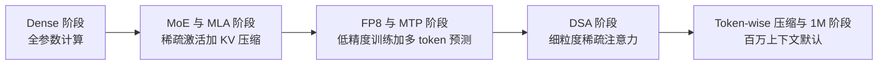
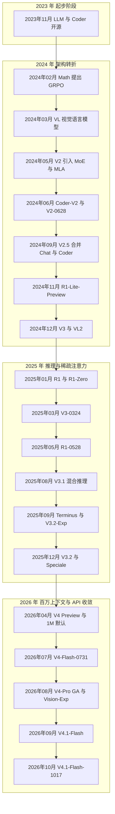

## 为什么需要一条模型发布时间线？（痛点引入）

做模型选型、写预算、接 API 的人，几乎都在「版本」这道题上栽过，而且栽法高度雷同：

- 汇报里写「V3 上下文 128K，够用」，结果新需求是整仓代码审阅，而 1M 上下文从 V4（2026-04-24）起才是全系默认——你引的是两年前那一档。
- 采购单上写「等 R2 出来再压价」，可官方渠道到 2026-10-24 从未发布过 R2，推理线早就并进了 V3.2-Speciale 与 V4 thinking 模式。
- 新写的接入代码里 `model` 还填 `deepseek-chat`，这个模型名 2026-07-24 已退役，上线当天 404。
- 复盘会上说「V3.2 是 9 月发的」，同事查到的却是 2025-09-29 的 V3.2-Exp 与 2025-12-01 的 V3.2 正式版——同一个名字，两个日期，两套能力。
- 把 V3-0324 的 AIME 59.4 当成 V3 首发成绩，benchmark 对比表整列错位。

这些错误的共同点是：**名字像、日期近、口径混**。DeepSeek 的命名里有 `-Exp`、`-Terminus`、`-0628`、`-0731`、`-0813`、`-1017` 这类后缀，还有 V3 与 V3.1、V3.2 这种「小数点后一位」的代际差别；发布日期又分散在 GitHub README、arXiv 论文、官方 Change Log 与新闻页四个地方。不建一条逐条核过的时间线，选型、预算、接入三件事都会连锁出错。

| 维度 | 没有时间线时的典型错误 | 有了时间线之后 |
|------|------------------------|----------------|
| 选型 | 拿 V3 时代的 128K 去规划长上下文任务 | 知道 1M 是 V4（2026-04-24）起的全系默认 |
| 预算 | 按旧版单价估 2026 年的量 | 知道 V3.2-Exp（2025-09-29）起降价 50%+，且现行峰谷计价 |
| API 接入 | 继续调用 deepseek-chat 与 deepseek-reasoner | 知道两者 2026-07-24 退役，在售名只剩两个 |
| 路线规划 | 给「R2」留一栏 | 知道官方渠道从未发布 R2，推理线并入 V3.2-Speciale 与 V4 thinking |
| 技术对比 | 把升级版（0324、0528）的数字当成首发版 | 能按「首发 / 小升级 / 重训」分清每个数字属于哪一行 |

> ### 💡 新人小结：模型发布时间线到底解决什么问题？
>
> 把 DeepSeek 的模型家族想象成「手机年款」：
> - 同一个系列名会连着出好几代（V3、V3.1、V3.2、V4），就像「Pro」这个词每年都在用，但配置完全不同。
> - 后缀是年款标记：`-0324`、`-0528`、`-1017` 相当于「3 月款」「5 月款」，配置小改，名字不变。
> - API 模型名是「运营商定制机型号」，跟市面上的商品名不一定同名，还可能停售（2026-07-24 那批）。
> - 买配件要看年款，接 API 要看模型名——两者都不能靠印象。
>
> **一条按官方日期逐行核过的时间线，就是这张「年款对照表」：谁在哪天发布、属于哪条线、今天还能不能调用。**

**学习路线图**（本文按六段推进，读完即可独立核对任何一条版本信息）

```text
痛点 → 日期口径 → 主时间线 → 四条主线 → 年份图与 R2 澄清 → 读法与选型
为什么  怎么算数    26 行全表   架构能力推理API   分组看与辟谣      怎么用
```

---

## 先立规矩：日期口径与「已核实」标记

时间线最容易出错的地方不是记不住，而是**同一个日期有四种来源，精度各不相同**。源文件把每一行的出处都写进了表里，这里先把四种口径摊开：

| 口径 | 典型条目 | 精度 | 正文怎么写 |
|------|----------|------|------------|
| README Release 节 | DeepSeek-VL 2024-03-11、DeepSeek-VL2 2024-12-13 | 日 | 直接写日期，出处标 README |
| README News 节 | V2 2024-05-06、V2-Lite 2024-05-16 | 日 | 直接写日期，出处标 README News 节 |
| 论文提交月份 | DeepSeekMath 2024-02、DeepSeek LLM 论文 2024-01 | 月 | 写「论文 2024-02」，不冒充发布日 |
| Change Log 与新闻页 | V3-0324 为 2025-03-24，新闻页标 03-25 | 日，但两处不一致 | 两个日期都留，注明以哪处为准 |
| 无官方发布记录 | R2 | 无 | 留空并写明核对结论，不猜日期 |

四条写作用法，建议直接固化成模板：

1. **有确切日期的，写日。** 例如 V3 是 2024-12-26（news1226），R1 是 2025-01-20，V4 Preview 是 2026-04-24。
2. **只有月份的，保留限定语，绝不补日。** 不能把「2023-11（README 无确切日期）」改写成「2023-11-01」，那是制造伪精确。
3. **两处日期不一致的，两个都留。** V3-0324 在 Change Log 是 2025-03-24、在新闻页标 03-25，这属于口径差异而不是笔误，删掉一个就查不回去了。
4. **没有发布记录的，写「未见发布」。** R2 这一行没有日期，因为官方新闻列表与 Change Log 全量核对后确实没有这条发布。

把上面四条落成可直接抄的引用模板：

```text
# ========== ✅ 推荐写法：按精度分级，保留限定语 ==========
# 有确切日期
DeepSeek-VL        2024-03-11      # README Release 节
DeepSeek-V3        2024-12-26      # news1226
DeepSeek-R1        2025-01-20      # DeepSeek-R1 仓库 + arXiv:2501.12948

# 只有月份：保留「README 无确切日期」这半句
DeepSeek LLM 7B/67B   2023-11      # README 无确切日期；论文 arXiv:2401.02954 提交 2024-01
DeepSeek Coder        2023-11      # README 无确切日期；论文 arXiv:2401.14196

# 只有论文月份
DeepSeekMath 7B       2024-02      # 论文 arXiv:2402.03300

# 两处口径不一致：都留
DeepSeek-V3-0324      2025-03-24   # Change Log；新闻页标 03-25

# 无发布记录：写结论，不填日期
R2                    —            # 官方渠道至 2026-10-24 未见任何发布
```

源文件里带 ⚠️ 的条目，本文一律保留原口径，不做「看起来更整洁」的修补：

- **VL2 的激活参数**：行内已注明 demo 注释的总参数（3.37B/16.1B/27.5B）与 README 的 4.5B 激活数「略有出入」，表中照抄，不加自己的换算。
- **V3.2 的上下文长度**：源文件标 ⚠️ 未直接核实（V3.1 的 128K 已证；1M 是 V4 起才默认），引用时说「未直接核实」，不说「128K」也不说「1M」。
- **V3.1 的许可证文本**：抓取失败，未直接核实；需要写许可证时绕开这一行，写 V3 或 R1 这两条已核实的。

> ### 💡 新人小结：为什么不能把「2023-11」写成「2023-11-01」？
>
> 想象你在超市拿起一盒牛奶：
> - 盒盖上印的是**生产日期**（README 里能查到的确切日）。
> - 货架标签写的是**上架日期**（Change Log 与新闻页的条目）。
> - 有些进口奶只在箱子上印**批次月份**（论文提交月份）——这时候你说「11 月 1 日生产」，就是自己编的。
> - 还有一款根本没进货（R2），你却在盘点表上给它留了位置。
>
> **日期口径的本质是「这句话有没有出处」：能查到日就写日，只能查到月就写月，查不到就写「未见发布」，绝不用伪精确填补空白。**

---

## 主时间线：源文件逐行保留

下表是源文件「主时间线」的全表逐行照录，共 26 行，包含最后的 R2 澄清行。列结构保持「模型 / 发布日期 / 类型 / 关键特性 / 来源」五列，未做抽样、未做合并，括号里的限定语原样保留。

| 模型 | 发布日期 | 类型 | 关键特性 | 来源 |
|---|---|---|---|---|
| DeepSeek LLM 7B/67B | 2023-11（README 无确切日期；论文 arXiv:2401.02954 提交 2024-01） | Dense LLM | 2T tokens 中英预训练；67B Chat HumanEval 73.78、GSM8K 84.1；4096 上下文 | github.com/deepseek-ai/DeepSeek-LLM |
| DeepSeek Coder 1B/5.7B/6.7B/33B | 2023-11（README 无确切日期；论文 arXiv:2401.14196） | 代码模型 | 2T tokens（87% 代码），16K 窗口 + FIM；Base-33B 开源代码 SOTA；7B≈CodeLlama-34B | github.com/deepseek-ai/DeepSeek-Coder |
| DeepSeekMath 7B | 论文 2024-02（arXiv:2402.03300） | 数学模型 | Coder-v1.5-7B 初始化 + 500B tokens；MATH 51.7%；**提出 GRPO** | github.com/deepseek-ai/DeepSeek-Math |
| DeepSeek-VL 1.3B/7B | 2024-03-11（README Release 节） | 视觉语言 | 逻辑图表/网页/公式/文献理解；4096 上下文 | github.com/deepseek-ai/DeepSeek-VL（arXiv:2403.05525） |
| DeepSeek-Prover V1/V1.5 | V1.5 论文 2024-08（arXiv:2408.08152）；7B | Lean 4 定理证明 | V1.5：RLPAF + RMaxTS，miniF2F-test 63.5%、ProofNet 25.3% | github.com/deepseek-ai/DeepSeek-Prover-V1.5 |
| **DeepSeek-V2 / V2-Lite** | **2024-05-06 / 2024-05-16**（README News 节） | MoE + MLA | 236B/21B（Lite 16B/2.4B）、128K、8.1T tokens、KV cache 降 93.3% | github.com/deepseek-ai/DeepSeek-V2（arXiv:2405.04434） |
| DeepSeek-Coder-V2 | 2024-06（0614 版 API 升级 2024-06-14，Change Log；0724 版 2024-07-24） | MoE 代码模型 | 236B/21B（Lite 16B/2.4B）、128K、支持语言 86→338、追加 6T tokens 续训 | github.com/deepseek-ai/DeepSeek-Coder-V2（arXiv:2406.11931）+ /updates |
| DeepSeek-V2-0628 | 2024-06-28（Change Log） | Chat 升级 | 换 Coder-V2-base 底座 | /updates |
| DeepSeek-V2.5 | 2024-09-05（官方新闻；1210 版 2024-12-10） | Chat+Coder 合并 | ArenaHard 76.3%、HumanEval 89%；1210 版 MATH-500 74.8→82.8 | news0905 + /updates |
| DeepSeek-R1-Lite-Preview | 2024-11-20（新闻列表） | 推理模型预览 | — | 官方新闻列表 |
| **DeepSeek-V3** | **2024-12-26** | MoE 671B/37B | 14.8T tokens、FP8 训练、无辅助损失负载均衡、MTP；60 tokens/s | news1226 + github.com/deepseek-ai/DeepSeek-V3 |
| DeepSeek-VL2（tiny/small/base） | 2024-12-13（README Release 节） | MoE 视觉语言 | 激活 1.0B/2.8B/4.5B（demo 注释：总 3.37B/16.1B/27.5B，与 README 4.5B 激活数略有出入） | github.com/deepseek-ai/DeepSeek-VL2（arXiv:2412.10302） |
| **DeepSeek-R1 / R1-Zero** | **2025-01-20** | 推理模型（V3-Base + RL） | 纯 RL 涌现推理（R1-Zero）；R1 含冷启动数据；6 个蒸馏模型（Qwen/Llama 1.5B–70B） | github.com/deepseek-ai/DeepSeek-R1（arXiv:2501.12948） |
| DeepSeek-V3-0324 | 2025-03-24（Change Log；新闻页标 03-25） | V3 小升级 | MMLU-Pro 81.2、AIME 59.4、前端代码/中文写作增强 | /updates 2025-03-24 |
| DeepSeek-R1-0528 | 2025-05-28 | R1 升级 | AIME 2025 87.5、GPQA 81.0；幻觉减少；支持 JSON/函数调用 | news250528 |
| DeepSeek-V3.1 | 2025-08-21 | 混合推理 | Think/Non-Think 双模式；Base 在 V3 上追加 840B tokens 续训做长上下文扩展；128K 上下文 | news250821 |
| V3.1-Terminus | 2025-09-22 | V3.1 修订 | 修复中英混杂、优化 Code/Search Agent | /updates |
| V3.2-Exp | 2025-09-29 | DSA 稀疏注意力 | 首次实现细粒度稀疏注意力 DSA；MIT 开源；API 降价 50%+ | news250929 + DeepSeek-V3.2-Exp 仓库 |
| **V3.2 / V3.2-Speciale** | **2025-12-01** | 思考融入工具调用 / 推理特化 | 首个「思考融入工具调用」模型；Speciale 达 IMO/CMO/ICPC/IOI 2025 金牌级（临时端点至 2025-12-15） | news251201 |
| **V4 Preview（V4-Pro + V4-Flash）** | **2026-04-24** | 新一代架构 | Pro 1.6T/49B、Flash 284B/13B；Token-wise 压缩 + DSA；**1M 上下文成为全系默认**；Thinking/Non-Thinking 双模式；开源权重+技术报告 | news260424 |
| V4-Flash-0731 | 2026-07-31 | V4-Flash 重训 | Agent 能力大幅超 V4-Pro-Preview；原生 Responses API | /updates |
| V4-Pro GA（0813） | 2026-08-13 | GA | HLE 42.7/60.0、Terminal-Bench 2.1 87.9；thinking effort 三档；峰谷定价 2026-08-16 生效 | /updates + news260813 |
| V4-Flash-Vision-Exp | 2026-08-21 | 多模态视觉（实验） | 多模态 Agent 接近 Opus-4.8 | /updates |
| **V4.1-Flash** | **2026-09-10** | 新架构家族最小模型 | 原生多模态；GPQA 90.9、Codeforces 3471；V4 Flash/Vision-Exp 退役 | /updates + news260910 |
| **V4.1-Flash-1017** | **2026-10-17** | 当前 flash 线最新 | RL+self-feedback 端到端项目开发；性能-成本 Pareto 改进；同日开放自研 Search/Fetch API（$0.75/千次） | news261017 |
| R2 | — | — | **官方渠道（至 2026-10-24）未见任何「R2」发布**；推理线并入 V3.2-Speciale 与 V4 thinking 模式 | 官方新闻列表 /updates 全量核对 |

读这张表有三条纪律：

1. **加粗行才是代际节点。** 全表 26 行里加粗的 7 行（V2 / V3 / R1 / V3.2 / V4 Preview / V4.1-Flash / V4.1-Flash-1017）是换代的锚点，其余多是同一代内的小升级、重训或实验分支。
2. **破折号是「源文件未给出」，不是「没有能力」。** R1-Lite-Preview 的关键特性写着「—」，意思是官方材料没列具体指标，不要理解成「空模型」。
3. **括号里的补充是口径，不是笔误。** 像 V3-0324 的两个日期、VL2 的「略有出入」，都属于审计留痕，转述时应原样带上。

七个代际节点的速查视角：

| 代际节点 | 日期 | 一句话意义 |
|----------|------|------------|
| DeepSeek-V2 / V2-Lite | 2024-05-06 / 2024-05-16 | 架构换轨：MoE + MLA，KV cache 降 93.3% |
| DeepSeek-V3 | 2024-12-26 | 工程换轨：671B/37B、FP8 训练、MTP，14.8T tokens |
| DeepSeek-R1 / R1-Zero | 2025-01-20 | 推理换轨：纯 RL 涌现推理，并开源 6 个蒸馏模型 |
| V3.2 / V3.2-Speciale | 2025-12-01 | 形态换轨：思考融入工具调用；Speciale 走推理特化 |
| V4 Preview（V4-Pro + V4-Flash） | 2026-04-24 | 上下文换轨：1M 成为全系默认，Token-wise 压缩 + DSA |
| V4.1-Flash | 2026-09-10 | 家族换轨：新架构最小模型，原生多模态 |
| V4.1-Flash-1017 | 2026-10-17 | 当前落点：flash 线最新，RL+self-feedback |

---

## 四条演进主线

26 行平铺着看，容易只记住「谁在哪天发」。真正的规律要按主线切：同一段时间里，架构、能力、推理、API 四条线在并行推进，节奏并不一致。

### 架构线：从全参数计算走到百万上下文

这条线的规律是**每一代只解决一个主要瓶颈**：

| 阶段 | 代表节点 | 架构抓手 | 可核实证据 |
|------|----------|----------|------------|
| Dense | DeepSeek LLM / Coder（2023-11） | 每个 token 过全部参数，67B 就是 67B 的计算量 | README 与论文 arXiv:2401.02954 / 2401.14196 |
| MoE + MLA | V2 / V2-Lite（2024-05-06） | 稀疏激活把计算量与总参数解耦；MLA 压缩 KV cache | 236B/21B、KV cache 降 93.3%（V2 README） |
| FP8 + MTP | V3（2024-12-26） | 8 位浮点训练 + 多 token 预测，把训练成本压下来 | 14.8T tokens、FP8 训练、MTP（V3 README） |
| DSA | V3.2-Exp（2025-09-29） | 细粒度稀疏注意力，长上下文只算相关信息 | news250929 与 V3.2-Exp 仓库 |
| Token-wise 压缩 + 1M | V4 Preview（2026-04-24） | 压缩 + DSA 组合，1M 上下文成为全系默认 | news260424 |



把这张图和上面的表对着看，会发现一个不容易注意到的事实：**V2 与 V3 都是 MoE，但解决的问题完全不同**。V2 的功绩是「用 21B 激活撑起 236B 的知识面」，V3 的功绩是「671B/37B 只用 2.788M H800 GPU 小时就训完 14.8T tokens」——前者是结构，后者是工程。到了 V3.2-Exp，问题变成「上下文一长，注意力计算就爆」，于是有了 DSA；到 V4，问题变成「1M 上下文怎么在成本上成立」，答案才是 Token-wise 压缩 + DSA 的组合。

> ### 💡 新人小结：架构演进像一家餐馆的后厨改造
>
> 把每一代架构想成后厨的一次改造：
> - **Dense**：所有厨师一起上，做一道菜全员动手——菜好吃，人工贵。
> - **MoE + MLA**：改成按单派单，每道菜只叫相关厨师（激活 21B / 37B / 49B）；MLA 相当于把菜谱压缩成一张卡片，冰箱不再塞满原件。
> - **FP8 + MTP**：把食材计量从「克」改成「大约一撮」，一次备两道菜的料——省时省钱。
> - **DSA**：只挑这道菜真正需要的食材下锅，不再把整柜子搬出来。
> - **Token-wise 压缩 + 1M**：整本菜单压成索引，一次能翻完一百万字的单子。
>
> **架构线的主语一直是「成本」：同样的钱，能算多长的上下文、能训多大的模型。**

### 能力线：先分工专精，再合并回主线

早期 DeepSeek 是「一个场景一个模型」，2024 年下半年开始收拢：

| 阶段 | 节点 | 能力主题 | 走向 |
|------|------|----------|------|
| 通用起步 | LLM 7B/67B（2023-11） | 中英通用对话与预训练底座 | 主线起点 |
| 专精分工 | Coder（2023-11）、Math（2024-02）、VL（2024-03-11）、Prover（2024-08） | 代码、数学、视觉语言、Lean 4 定理证明 | 四条支线并行 |
| 合并回主线 | V2.5（2024-09-05） | Chat 与 Coder 合并为一个模型 | 支线开始收拢 |
| 主线强化 | V3（2024-12-26）、V3-0324（2025-03-24） | 通用能力 + 前端代码与中文写作增强 | 一支模型打全部 |
| 推理与 Agent | R1（2025-01-20）、V3.1（2025-08-21）、V3.2（2025-12-01）、V4（2026-04-24） | 推理、双模式、思考融入工具调用、多模态 | 能力叠加到同一条主线 |

两个值得记住的「合并信号」：

1. **V2.5 是第一次合并**——Chat 与 Coder 不再是两个模型，ArenaHard 76.3%、HumanEval 89% 是这次合并的成绩单。
2. **V3.2 是第二次合并**——「思考融入工具调用」，把推理能力塞进 Agent 的工具调用循环，这也是后面 V4 双模式（Thinking/Non-Thinking）的前身。

### 推理模型线：从预览到并入主线

这条线最容易被传闻污染，所以单独拉出来逐条排：

| 时间 | 节点 | 推理能力以什么形式存在 |
|------|------|------------------------|
| 2024-11-20 | DeepSeek-R1-Lite-Preview | 推理模型的公开预览（新闻列表口径） |
| 2025-01-20 | DeepSeek-R1 / R1-Zero | 独立推理模型；R1-Zero 证明纯 RL 可涌现推理，R1 另含冷启动数据 |
| 2025-05-28 | DeepSeek-R1-0528 | 同一条线的升级：AIME 2025 87.5、GPQA 81.0，支持 JSON/函数调用 |
| 2025-08-21 | V3.1 | 推理从「独立模型」变成「一个模型的模式」：Think/Non-Think 双模式 |
| 2025-12-01 | V3.2 / V3.2-Speciale | 思考融入工具调用；Speciale 走推理特化，达 IMO/CMO/ICPC/IOI 2025 金牌级 |
| 2026-04-24 | V4 Preview | Thinking/Non-Thinking 双模式进入 V4 全系 |

线到 2025-08-21 出现了一个结构性转折：推理不再是「另一个模型」，而是「同一个模型的一个开关」。这也解释了后面 R2 为什么没有出现——当推理变成模式，独立命名的推理模型就没有必要了。

### API 模型名线：双名时代的结束

模型发布是一回事，API 上叫什么名字是另一回事，这条线独立于前三条：

| 时间 | API 模型名 | 对应版本 | 状态 |
|------|-----------|----------|------|
| 2025-01-20 起 | deepseek-reasoner | 推理线（R1 及后续升级） | 2026-07-24 退役 |
| V3 时代 | deepseek-chat | 通用对话线 | 2026-07-24 退役 |
| 2026-07-24 之后 | deepseek-flash | V4.1-Flash-1017 | 在售 |
| 2026-07-24 之后 | deepseek-v4-pro | V4-Pro-0813 | 在售 |

两个在售名的共同规格（2026-10-24 口径）：1M 上下文、最大输出 384K、峰谷计价。切换时最容易踩的坑，是把「版本号」当「模型名」——`V4.1-Flash-1017` 是版本，`deepseek-flash` 才是要填进 `model` 字段的值。

---

## 按年份看：关键节点分组

把 26 行按年份归堆，节奏立刻清楚：2023 年打地基，2024 年换架构，2025 年补推理与 Agent，2026 年把上下文与 API 一起收敛。



图后解读三点：

1. **2024 年是密度最高的一年**：从 5 月的 V2 到 12 月的 V3，七个月里完成了架构换轨、代码模型换代、Chat/Coder 合并、推理预览四个动作。
2. **2025 年节奏最碎**：V3-0324、R1-0528、V3.1、V3.1-Terminus、V3.2-Exp、V3.2 六次更新集中在 3 月到 12 月，其中 9 月一个月里就有 Terminus 与 V3.2-Exp 两次。
3. **2026 年从「发模型」转向「收口」**：V4 之后是重训（0731）、GA（0813）、实验分支（Vision-Exp）、家族换代（V4.1-Flash）、末次迭代（1017），同期把 API 名与计价方式一起改掉。

---

## 澄清：官方渠道从未发布 R2

这一节只讲一件事：**截至 2026-10-24，官方新闻列表与 Change Log 全量核对，均没有「R2」这条发布记录。** 这不是「还没查到」，而是核对结论。推理能力的演进，走的是另外两条路：

| 落点 | 时间 | 推理能力以什么形式提供 |
|------|------|------------------------|
| DeepSeek-R1 / R1-Zero | 2025-01-20 | 独立推理模型，含 6 个蒸馏小模型（Qwen/Llama 1.5B–70B） |
| DeepSeek-R1-0528 | 2025-05-28 | 同线升级，AIME 2025 87.5、GPQA 81.0 |
| V3.1 的 Think 模式 | 2025-08-21 | 推理变成同一个模型的开关（Think/Non-Think） |
| V3.2-Speciale | 2025-12-01 | 推理特化版本，IMO/CMO/ICPC/IOI 2025 金牌级；临时端点至 2025-12-15 |
| V4 Thinking 模式 | 2026-04-24 起 | V4 全系双模式，推理作为模式而非独立模型 |

> [!NOTE] 版本适用：「R2 不存在」这条结论的边界
> 结论的核对时点是 2026-10-24，依据是官方新闻列表与 Change Log 全量核对。写路线图时不要给 R2 留位置；需要表达「更强的推理」时，指向 V3.2-Speciale（2025-12-01）或 V4 的 Thinking 模式（2026-04-24 起）。此前的媒体传闻不作为发布事实引用。

> ### 💡 新人小结：为什么「R2」会一直被人提起？
>
> 把官方发布渠道想象成小区的**物业公告栏**：
> - 公告栏上贴的每一张纸（新闻页、Change Log）都有编号和日期，这是唯一算数的来源。
> - 邻居群里传的「下个月要停水」「要装新电梯」，传得再像也不会上公告栏。
> - R2 就是那张「群里传了很久、公告栏上始终没有」的通知：截至 2026-10-24 全量核对，公告栏上没有它。
> - 真正的变化以另一种方式发生了——电梯没换新的，但每户都装了一个「上行/下行」开关（Think/Non-Think）。
>
> **读时间线的第一条纪律：只认公告栏。传闻可以听，但不能写进排期表。**

---

## 2026-07-24 的断点：API 模型名怎么迁

模型名这条线有一个硬断点：`deepseek-chat` 与 `deepseek-reasoner` 于 2026-07-24 退役（出处：api-docs.deepseek.com/updates）。此前的「双模型名时代」——一个通用、一个推理——正式结束，取而代之的是：

- `deepseek-flash`，对应 V4.1-Flash-1017（2026-10-17，flash 线最新）
- `deepseek-v4-pro`，对应 V4-Pro-0813（2026-08-13，GA 版）

```text
# ========== ✅ 推荐写法：2026-10-24 之后的模型名 ==========
# 出处：api-docs.deepseek.com/updates

deepseek-chat       -> 已于 2026-07-24 退役
deepseek-reasoner   -> 已于 2026-07-24 退役
deepseek-flash      -> V4.1-Flash-1017
deepseek-v4-pro     -> V4-Pro-0813

# 两个在售名的共同规格
context     1M
max_output  384K
pricing     峰谷两档

# ========== 不推荐写法（仅展示） ==========
# ❌ 沿用已退役的旧名字，调用会失败
model = "deepseek-chat"
model = "deepseek-reasoner"
```

迁移时按这三步走：

1. **先查名，再查版本。** `model` 字段填的是 `deepseek-flash` 或 `deepseek-v4-pro`；`V4.1-Flash-1017` 这类字符串只用于写文档和对比，不用于调用。
2. **按 1M 上下文重排分片策略。** 1M 是 V4（2026-04-24）起的全系默认，最大输出 384K；从 V3 时代迁过来的切片逻辑通常切得过碎。
3. **把计价方式一起改。** 峰谷两档从 2026-08-16 生效，批量任务排到谷时是纯收益，不涉及模型能力变化。

这条断点也是「为什么要一条时间线」的最好例证：模型能力是连续的，API 名字是离散的，两者不在同一张日历上。

---

## 怎么读这条时间线：五步法

拿到任何一条 DeepSeek 版本信息，按下面五步核对，基本不会错：

| 步骤 | 做什么 | 产出 |
|------|--------|------|
| 一 | 先在主时间线里定位这一行，确认它是不是加粗的代际节点 | 知道它是「换代」还是「同代小升级」 |
| 二 | 看发布日期列有没有括号限定语 | 知道这个日期是日级、月级还是待核 |
| 三 | 把这一行归到四条主线之一 | 知道它是架构、能力、推理还是 API 的变化 |
| 四 | 若是推理相关，先排掉 R2 这个干扰项 | 指向 V3.2-Speciale 或 V4 Thinking |
| 五 | 若是接入相关，落到两个在售模型名 | 得到可直接写进配置的 `model` 值 |

再补三个实操习惯：

- **引用数字时带行号语境。** 说「AIME 87.5」要说明是 R1-0528（2025-05-28），而不是 R1 首发；说「AIME 59.4」要说明是 V3-0324（2025-03-24），而不是 V3（2024-12-26）。
- **比较模型时先对齐「同代同形态」。** V3.2-Exp 与 V3.1-Terminus 的对比是同一代内的稀疏注意力验证；拿 V3.2-Exp 直接对 V4 比，跨了两代架构。
- **遇到 ⚠️ 就停手核实。** 源文件标了未核实的项（如 V3.2 的上下文长度、V3.1 的许可证），引用时保留「未直接核实」这半句，比补一个看起来合理的数字安全得多。

> ### 💡 新人小结：五步法其实是「先分类，再引用」
>
> 把它想成查词典而不是背词典：
> - 第一步是找到词条（哪一行）。
> - 第二步是看词条的注音（日期精度）。
> - 第三步是看词性（属于哪条主线）。
> - 第四步是排除形近词（R2 这个不存在的词条）。
> - 第五步才是造句（写进配置或文档）。
>
> **时间线不是用来背的，是用来查的；查的顺序对了，错误自然少一半。**

---

## 选型建议：从时间线推出来的判断

时间线最大的实用价值，是让选型判断有出处。下面六条都能在上表里找到对应行：

| 你的场景 | 时间线里该看的一段 | 判断 |
|----------|--------------------|------|
| 新项目接 API | API 线 2026-07-24 之后 | 只用 deepseek-flash 与 deepseek-v4-pro，1M 上下文、最大输出 384K |
| 整仓代码或长文档 | V4 Preview（2026-04-24）起 | 1M 是全系默认，不要按 V3 时代的 128K 做分片 |
| 成本敏感的批处理 | V3.2-Exp（2025-09-29）起 | 该版本 API 降价 50%+；现行峰谷计价，批量排到谷时 |
| 竞赛数学与高难推理 | 推理线 2025-12-01 与 2026-04-24 | 看 V3.2-Speciale 与 V4 Thinking，不给 R2 留位 |
| 前端代码与中文写作 | V3-0324（2025-03-24） | 该版本的增强点就是这两项，指标是 MMLU-Pro 81.2、AIME 59.4 |
| Agent 与工具调用 | V3.2（2025-12-01）到 V4-Flash-0731（2026-07-31） | 思考融入工具调用起于 V3.2；0731 起有原生 Responses API |

选型之外还有两条工程提醒：

1. **旧版本名不等于旧入口还在。** 2026-07-24 之后，`deepseek-chat` 与 `deepseek-reasoner` 两个入口都已关闭，在售的只有 deepseek-flash 与 deepseek-v4-pro；排迁移计划时不要假设「旧名还能兜底」。
2. **同一代内的差异要看后缀。** V3.1 与 V3.1-Terminus 差在修复中英混杂与 Code/Search Agent 优化；V4.1-Flash 与 V4.1-Flash-1017 差在 RL+self-feedback 与性能-成本 Pareto。后缀不同，结论不能互相套用。

模型规模、上下文与许可证的横向对照，见[模型参数对比](/docs/01-deepseek/模型全景/模型参数对比/)；公司与价格战的背景见[公司历程与里程碑](/docs/01-deepseek/发展历程/公司历程与里程碑/)；把模型接进 Agent 工具链的实践见[Agent 工具](/docs/02-agent-tools/)与[DSH 指南](/docs/03-dsh/)。

---

## 常见误区自检（✅ 与 ❌ 对照）

| 场景 | ❌ 容易做错的判断 | ✅ 按时间线应有的判断 |
|------|-------------------|------------------------|
| 写推理路线图 | 给「R2」留一栏并标注「预计」 | 官方渠道至 2026-10-24 从未发布 R2，推理看 V3.2-Speciale 与 V4 Thinking |
| 引用 V3.2 日期 | 「V3.2 是 2025 年 9 月发的」 | 2025-09-29 是 V3.2-Exp；V3.2 正式版是 2025-12-01 |
| 引用上下文 | 「V3 系列都是 128K，V3.2 也一样」 | 128K 是 V3.1 的已证口径；V3.2 的上下文源文件标未直接核实；1M 是 V4 起默认 |
| 引用早期模型日期 | 「DeepSeek LLM 发布于 2023-11-01」 | README 无确切日期，只能写 2023-11，并带上论文提交月份 2024-01 |
| 接 API | 继续用 deepseek-chat 与 deepseek-reasoner | 两者 2026-07-24 退役，改 deepseek-flash 与 deepseek-v4-pro |
| 对比 benchmark | 拿 V3-0324 的 AIME 59.4 当 V3 首发成绩 | 59.4 属 2025-03-24 的小升级行，V3 首发是 2024-12-26 那一行 |

---

## 概念速查（术语表）

| 术语 | 全称 | 含义（用自己的话） | 在时间线里的角色 |
|------|------|--------------------|------------------|
| Dense | Dense Model（稠密模型） | 每个 token 都要过全部参数，参数量即计算量 | 2023-11 首批 LLM/Coder 的架构基线 |
| MoE | Mixture of Experts（混合专家） | 把网络拆成很多专家，每个 token 只唤醒一小部分 | V2 起的主线架构，V3、V4 沿用 |
| MLA | Multi-head Latent Attention | 把注意力的 KV 信息压进小向量，推理时要存的东西大幅变少 | V2（2024-05-06）引入，KV cache 降 93.3% |
| KV cache | Key-Value Cache | 推理时为已读 token 保存的「记忆」，上下文越长越占显存 | MLA 压缩的对象，长上下文的成本瓶颈 |
| FP8 | 8-bit Floating Point | 用 8 位浮点做训练与矩阵乘，省显存省算力 | V3（2024-12-26）的工程手段 |
| MTP | Multi-Token Prediction | 训练时一次多预测几个 token | V3 与 FP8 一起构成其训练效率 |
| DSA | DeepSeek Sparse Attention | 自研细粒度稀疏注意力，只挑相关信息参与计算 | V3.2-Exp（2025-09-29）的核心特性 |
| Token-wise 压缩 | — | 按 token 粒度压缩表示，配合 DSA 支撑超长上下文 | V4 Preview（2026-04-24）的架构抓手 |
| GRPO | Group Relative Policy Optimization | DeepSeekMath 论文提出的强化学习算法 | 2024-02 那条 Math 行的标志性贡献 |
| RL | Reinforcement Learning（强化学习） | 靠试错与奖励信号自我改进 | R1-Zero 证明纯 RL 可涌现推理 |
| SFT | Supervised Fine-Tuning（监督微调） | 用人工示范数据直接教模型 | R1 在 RL 之外加入的冷启动阶段 |
| FIM | Fill-In-the-Middle | 在代码中间挖空让模型补全的训练目标 | 2023-11 Coder 的能力标签 |
| Preview / Exp | — | 预览版与实验版，能力方向已定但可能被后续版本替换 | R1-Lite-Preview、V3.2-Exp、V4-Flash-Vision-Exp |
| GA | General Availability | 正式可用版本 | V4-Pro GA（0813） |
| Terminus | — | 同一代的修订版后缀，用于修缺陷而非换架构 | V3.1-Terminus（2025-09-22） |
| 上下文 | Context Window | 一次能读入的 token 上限 | 4096 → 16K → 128K → 1M 的主线刻度 |
| 峰谷计价 | — | 按高峰与低谷时段分别计费 | 2026-08-16 起生效，影响预算口径 |

---

## 要点总结

1. **日期分四级，写法不能混。** 日级（2024-12-26 V3）、月级（2023-11 的 LLM 与 Coder，README 无确切日期）、双口径（V3-0324 的 2025-03-24 与新闻页 03-25）、无记录（R2）——引用时保留限定语，不补伪精确日期。
2. **七个代际节点撑起整条线。** V2（2024-05-06）换架构、V3（2024-12-26）换工程、R1（2025-01-20）换推理范式、V3.2（2025-12-01）把思考融进工具调用、V4（2026-04-24）把 1M 变默认、V4.1-Flash（2026-09-10）换代家族、V4.1-Flash-1017（2026-10-17）是当前落点。
3. **四条主线节奏不同步。** 架构线五段递进（Dense → MoE+MLA → FP8+MTP → DSA → Token-wise 压缩 + 1M）；能力线先专精后合并（V2.5 与 V3.2 两次合并）；推理线从独立模型变成模式（2025-08-21 起）；API 线在 2026-07-24 断成两截。
4. **R2 不存在于官方记录。** 截至 2026-10-24，官方新闻列表与 Change Log 全量核对均无 R2；推理能力的正主是 V3.2-Speciale 与 V4 thinking 模式。
5. **接入只看两个名字。** 2026-07-24 之后，deepseek-chat 与 deepseek-reasoner 退役，在售的只有 deepseek-flash（= V4.1-Flash-1017）与 deepseek-v4-pro（= V4-Pro-0813），1M 上下文、最大输出 384K、峰谷计价。

---

> ### 💡 新人小结：时间线学完了，记住这 5 点
>
> 1. **先看行，再看名**：加粗的七行是换代，其余是同代升级，别把 0324 的数字算到 V3 首发头上。
> 2. **日期带限定语**：能查到日写日，只能查到月写月，查不到写「未见发布」。
> 3. **四条主线分开读**：架构看成本、能力看合并、推理看形态、API 看断点，混着读必然串行。
> 4. **R2 是空白格**：推理能力去 V3.2-Speciale 与 V4 Thinking 里找。
> 5. **今天的门牌只有两个**：deepseek-flash 与 deepseek-v4-pro，写新代码从它们开始。
