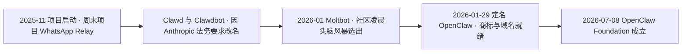
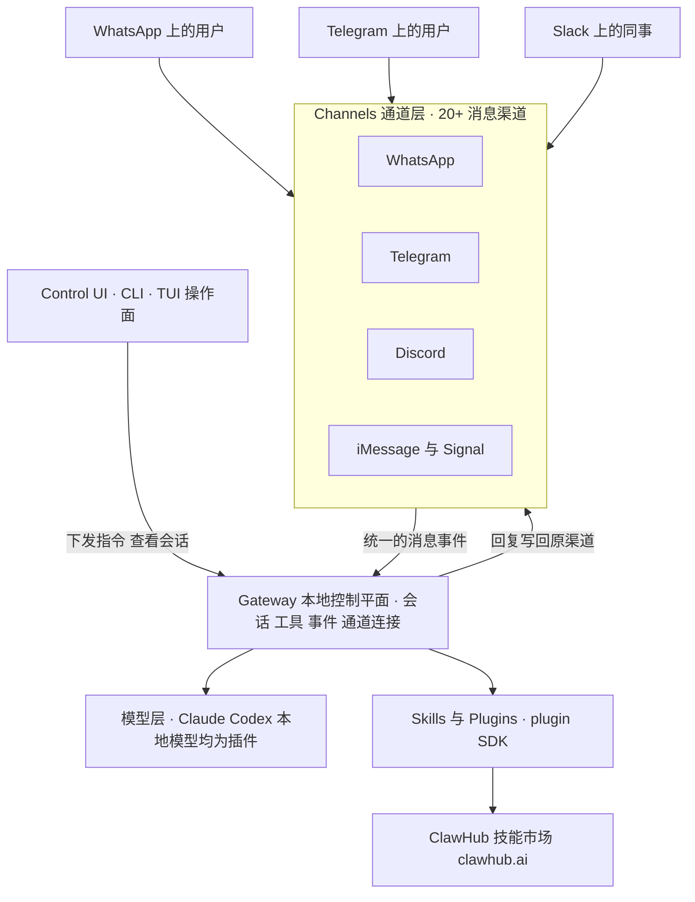

## 为什么需要「住在消息软件里」的 AI？（痛点引入）

上一篇讲的是终端编码代理：它们住在终端里，服务对象是写代码的人（/docs/02-agent-tools/编码代理/终端编码代理浪潮/）。但把镜头从工位挪开看一天：一个开发者真正盯着终端的时长可能不到两小时，剩下的时间他在 WhatsApp 里回朋友、在 Telegram 群里看消息、在 Slack 里对接同事、在 iMessage 里跟家人说话。

三个几乎人人都遇到过的场景：

- **手机上没有入口**：你在通勤路上想让 AI 帮忙把明天会议的三个要点理一理，但 agent 装在公司的终端里，手机打不开，只能等回到工位。
- **资料不在仓库里**：家里长辈发来一张体检报告照片，你想让 AI 先读一遍解释指标，但报告躺在聊天记录里，终端里的 agent 拿不到这个「上下文」。
- **换设备就重来**：你在电脑上配好的偏好、装好的技能，换到手机要重新来一遍，两边互不知情。

| 维度 | 没有跨渠道个人助手时的痛苦 | 有了之后 |
|------|----------------------------|----------|
| 入口 | agent 只在终端或网页，离开工位就用不上 | 直接在你本来就在用的消息软件里对话 |
| 上下文 | 聊天记录、图片、语音这类生活资料进不了 agent | 消息渠道本身就是数据入口 |
| 常驻性 | 关掉终端，agent 就消失 | 常驻后台，随时被叫醒 |
| 扩展 | 每加一个入口就要改一次主体代码 | 渠道与技能都从插件体系接入 |
| 可迁移性 | 偏好与技能绑在单台机器上 | 会话、工具、通道连接集中在同一个控制平面 |

> ### 💡 新人小结：OpenClaw 到底在解决什么？
>
> 把它想象成「一个同时驻场在二十多个门卫室的管家」：
> - 门卫室就是消息渠道（WhatsApp、Telegram、Slack 这些你本来就在用的软件）；
> - 不管你从哪个门卫室喊他，他都听得到，因为所有门卫室都连着同一个中控室（Gateway）；
> - 他手上有工具箱（Skills），缺什么工具就去技能市场（ClawHub）装；
> - 他认哪家的大脑（模型）可以换，Claude、Codex 或本地模型都行。
>
> **OpenClaw 卖的不是「更强的模型」，而是「让同一套 agent 出现在你所有通讯入口里」的运行时。**

**学习路线图**（本文按十段推进）

```text
痛点引入 → 身份与仓库 → 三次更名 → Gateway 架构 → 消息渠道 → 技能市场与扫描 → 安全时间线 → 定位差异 → 基金会 → 对 harness 的启示 → 要点总结
为什么     它是谁        名字怎么变    内部怎么转     怎么接进来     技能从哪来        出过什么事      和编码代理比    谁在治理    留下了什么
```

> [!NOTE] 版本适用：本文引用的 star 数、fork 数为 2026-10-24 的快照值，最新版本号取自仓库 CHANGELOG，历史事件日期取自官方博文与官方博客索引。工具生态变化极快，阅读时请以官方仓库的当下数据为准；文中标注「未核实」的条目，请保持同样的谨慎。

---

## 项目身份：一个周末项目，长成 392,888 stars 的仓库

先把它「是谁」钉死，后面所有叙事才有落点。下表每一行都有直接来源：

| 项 | 值 | 出处 |
|----|----|------|
| 仓库 | github.com/openclaw/openclaw，创建于 2025-11-24 | GitHub API，2026-10-24 |
| 前身 | clawdbot/clawdbot，301 重定向至 openclaw/openclaw（同一 repo id 1103012935） | GitHub API，2026-10-24 |
| 创始人 | Peter Steinberger（账号 steipete，README 署名 "Clawfather"） | 官方博文，2026-01-29 |
| 语言 / 开源协议 | TypeScript / MIT | GitHub API，2026-10-24 |
| 官方自述 | "The AI that really does things. Any OS. Any Platform." | 官方 README，2026-10-24 |
| Stars / Forks | 392,888 / 82,569（2026-10-24 快照） | GitHub API，2026-10-24 |
| 最新版本 | 2026.10.6 | 仓库 CHANGELOG |

「前身」这一行值得单独解释。GitHub 上把仓库改名或转移之后，旧地址不会 404，而是返回 301 重定向到新地址；这次的 301 指向同一个 repo id（1103012935），说明它不是「另起一个新仓库、把旧代码拷过去」，而是**同一个仓库换了名字与归属**。这也是后面「三次更名」能被仓库元数据交叉验证的原因。

再看那个 star 数：392,888（2026-10-24 快照）不只是个人助手品类的第一名，它比整个编码代理赛道里任何一家都高——上一页的排名图里它排在第一，而它卖的并不是编码能力。

> ### 💡 新人小结：怎么理解「301 重定向证实同一仓库」？
>
> 把仓库想象成一个人的身份证：
> - 改名字不会换身份证号（repo id 不变）；
> - 户口迁到新地址，旧地址会留一张「已迁往新址」的条子（301 重定向）；
> - 所以「Clawdbot 是 OpenClaw 的前身」不是传闻，而是可以查证的行政记录。
>
> **判断两个仓库是不是同一个项目，看 repo id，不看仓库名。**

---

## 三次更名：Clawdbot → Moltbot → OpenClaw

这是全网最容易传错的一段历史，先把正确版本摆出来。下图是按官方博文整理的更名与治理时间线：



逐条落到表格里，日期一个不省：

| 时间 | 事件 | 出处 |
|------|------|------|
| 2025-11 | 项目启动：博文自述 "Two months ago, I hacked together a weekend project"，起点是 "WhatsApp Relay" | 官方博文《Introducing OpenClaw》，2026-01-29 |
| 2025-11 → 2026-01 | 第一名 Clawd / Clawdbot：Claude 的谐音加「爪子」，因 Anthropic 法务要求改名 | 官方博文，2026-01-29 |
| 2026-01（更名过渡） | 第二名 Moltbot：社区凌晨 5 点在 Discord 头脑风暴选出，取「蜕皮」隐喻 | 官方博文，2026-01-29 |
| 2026-01-29 | 定名 OpenClaw：商标检索清白、域名已购、迁移代码完成；同文记录当时已超 100,000 stars、单周 200 万访客 | 官方博文，2026-01-29 |
| 2026-07-08 | OpenClaw Foundation 成立（独立 501(c)(3) 非营利） | 官方博文《Introducing the OpenClaw Foundation》 |

> [!IMPORTANT] 勘误：两个流传很广的错误日期
> 坊间常见的说法是「OpenClaw 始于 2025 年初」「2025 年 3 月或 4 月改名为 OpenClaw」。两条都不成立：
> - **起点是 2025-11，不是 2025 年初**：官方博文写于 2026-01-29，文中自述「两个月前」做了这个周末项目；GitHub API 显示仓库创建于 2025-11-24。两个独立来源互相印证。
> - **定名是 2026-01-29，不是 2025 年 3 月或 4 月**：官方博文《Introducing OpenClaw》的发布日期就是定名日期。
>
> 引用这段历史时，请以「2025-11 起步、2026-01-29 定名」为准。

三个名字各有各的故事，但读法不同：

1. **Clawd / Clawdbot 是「借来的名字」**：Claude 的谐音加 claws（爪子），指向它接的是 Anthropic 的模型。名字借得越像，越容易被法务找上门——官方博文明确写了改名原因是 Anthropic 的法务要求。
2. **Moltbot 是「社区起的名字」**：凌晨 5 点的 Discord 头脑风暴，取螃蟹蜕壳（molt）的意象。它存在的时间很短，是两次正式名字之间的过渡。
3. **OpenClaw 是「能拿去注册商标的名字」**：定名同时完成了商标检索、域名购买、代码迁移三件事。一个开源项目走到这一步，说明它已经不是在给周末玩具起名，而是在给一个要长期存在的品牌起名。

时间线里还有两个数字需要连同口径一起记：2026-01-29 官方博文记录的是「已超 100,000 stars、单周 200 万访客」；2026-10-24 的 GitHub API 快照是 392,888 stars。前者是定名当天的历史记录值，后者是九个月后的快照值，两者不矛盾，也不可互相替换。

> ### 💡 新人小结：为什么一个项目要改三次名？
>
> 想象你开了一家小店：
> - 第一块招牌是「小克劳德」，因为你觉得这名字亲切（Clawdbot，借 Claude 的谐音）；
> - 隔壁大品牌说这名字侵权，你连夜换成「蜕壳」（Moltbot，社区临时起意）；
> - 最后你注册了「开爪」（OpenClaw）：查过商标、买好域名、把货架标签全换掉。
>
> **名字从「借来的」变成「自己的」，是一个项目从玩具变成品牌的标志；改名的成本不在改字，而在迁移所有引用。**

---

## Gateway：二十多个渠道汇到同一个控制平面

名字讲完，看内部。官方 README 与文档把架构拆成五块，其中最核心的一块叫 **Gateway**：本地控制平面，负责会话、工具、事件与通道连接。



图后解读，三条最重要的关系：

1. **Gateway 是唯一的「有状态」的地方。** 会话、工具调用、事件与通道连接都归它管；渠道层只负责把外部消息接进来。这解释了为什么它被称作「本地控制平面」——它跑在你自己的机器上，而不是某个云端租户里。
2. **模型层是可插拔的。** Claude、Codex、本地模型都以插件形式接入，意味着换模型不改主体代码。控制平面与模型解耦，是这类系统能长期演进的前提。
3. **操作面与数据面分开。** Control UI、CLI、TUI 三个操作面都对着同一个 Gateway 说话，你在终端里下的指令和在图形界面里点的按钮，落到的是同一份会话状态。

| 组件 | 职责 | 在架构里的位置 |
|------|------|----------------|
| Gateway | 本地控制平面：会话、工具、事件、通道连接 | 中心，唯一持有状态 |
| Control UI / CLI / TUI | 操作面：下指令、看会话、管技能 | 旁路接入，不持有状态 |
| Channels | 消息通道：WhatsApp、Telegram、Discord、Slack、Teams、iMessage、Signal 等 20+ | 入口层，负责收发 |
| Skills / Plugins | 插件体系（plugin SDK），技能市场为 ClawHub（clawhub.ai） | 能力层，按需加载 |
| 模型层 | 可插拔：Claude、Codex、本地模型均为插件 | 推理层，可替换 |

（出处：官方 README 与官方文档，2026-10-24 抓取。）

---

## 20+ 消息渠道：渠道是插头，不是功能

「支持 20+ 渠道」这句话在宣传里像个体力活，落到架构上其实是设计选择。官方 README 列出的渠道包括 WhatsApp、Telegram、Discord、Slack、Teams、iMessage、Signal 等，总数 20+。这些渠道分属两类完全不同的场景：

| 渠道 | 典型场景 | 对 agent 意味着什么 |
|------|----------|---------------------|
| WhatsApp | 个人与家人朋友的日常通讯 | 私聊语境，消息里常带图片与语音 |
| Telegram | 个人群组与频道 | 群聊语境，一个群里可能多人同时叫它 |
| Discord | 社区与技术群组 | 频道化结构，同一服务器内多个话题并存 |
| Slack | 工作协作 | 团队语境，权限与频道成员关系复杂 |
| Teams | 企业协作 | 组织账号体系，接入要走企业侧配置 |
| iMessage / Signal | 端到端加密的私人通讯 | 消息不出设备，接入必须发生在本地 |

（渠道清单出处：官方 README，2026-10-24 抓取；「对 agent 意味着什么」一列是按渠道性质做的解读，不是官方原文。）

把「渠道」当插件而不是功能，带来三个直接后果：

1. **主体不用为每个渠道写一套逻辑**：渠道只做「消息进来、回复出去」，语义统一交给 Gateway。
2. **加渠道不需要动模型与技能**：新渠道只是新增一个通道连接，工具与技能照旧复用。
3. **安全边界被渠道放大**：接进来的每一个渠道，都是一条可以被外人触发 agent 的路径。这也是为什么第三篇讲协议时，ACP 这类「连接」协议会被单独拿出来讨论。

下面是按官方架构表归纳的一次消息往返，注意「谁持有状态」这件事：

```text
# ========== 渠道消息到回复的一次往返（按官方架构表归纳） ==========
用户在 WhatsApp 发一句 → Channels 接入（WhatsApp）
                      → Gateway 建立或恢复会话（会话 · 工具 · 事件 · 通道连接）
                      → 模型层推理（Claude / Codex / 本地模型，均为插件）
                      → Skills / Plugins 按需调用外部能力
                      → Gateway 汇总结果 → Channels 写回 WhatsApp
# 输出: 用户在原渠道看到回复；会话与工具调用记录留在 Gateway 这一侧

# ========== 不推荐的理解方式（仅展示） ==========
# ❌ 把每个渠道当成一个独立产品：WhatsApp 版一个模型配置、Telegram 版另一套技能
#    官方架构里 Channels 只是通道层，状态集中在 Gateway，分开配会立刻不一致
```

参数解释：

| 环节 | 归谁管 | 为什么要这样切 |
|------|--------|----------------|
| 接入 | Channels | 每个渠道的接入方式不同，差异应该被关在这一层 |
| 会话 | Gateway | 同一个人从手机换到电脑，会话要能接上 |
| 工具与技能 | Skills / Plugins | 能力是共享资产，不该按渠道复制 |
| 推理 | 模型层 | 模型会换、会降价、会本地化，必须可插拔 |

> ### 💡 新人小结：渠道为什么必须做成「插头」？
>
> 想象你家里有二十多个国家的电源插座：
> - 每个插座形状不同（渠道协议不同），但你不会为每个插座买一台新电器；
> - 你买一个万能转换头（Channels 通道层），电器本身不动；
> - 真正供电的那台发电机（Gateway）只有一台，插哪都供同一份电。
>
> **渠道越多，越要把差异压在入口层；一旦差异漏到主体里，加第三个渠道就开始还债。**

---

## ClawHub 与安全扫描：技能市场的「出厂检测」

技能是 OpenClaw 的能力来源：Skills / Plugins 通过 plugin SDK 开发，公开市场叫 **ClawHub**（clawhub.ai）。技能市场的价值和一个应用商店完全一样——它让「别人写好的能力」可以一键装到你自己的助手上；代价也和应用商店一样：你装的是别人的代码，而这段代码会以你的身份、在你的机器上、接触你的消息。

所以 ClawHub 的演进重点不在「技能数量」，而在「扫描链」。官方博客索引里能查到四层动作：

| 时间 | 扫描或治理动作 | 出处 |
|------|----------------|------|
| 2026-02-07 | ClawHub 上的 skills 接入 VirusTotal 扫描 | 官方博客索引 |
| 2026-06-01 | 与 NVIDIA 合作 Skill Card 与 SkillSpector 扫描 | 官方博客索引 |
| 2026-09-21 | 经 OpenAI "Patch the Planet" 完成 Trail of Bits 安全审计 | 官方博客索引 |
| 2026-10-02 | Tencent AIG 加入 ClawScan | 官方博客索引 |

四种手段的分工可以这样理解：VirusTotal 查「这段文件是不是已知恶意样本」；SkillSpector 与 Skill Card 查「这个技能声明的能力与它实际做的事是否一致」；Trail of Bits 的审计查的是「整个项目在外部专家眼里有多少结构性问题」；ClawScan 则引入又一家厂商的检测视角。它们覆盖的是不同层次，任何一层都不能替代另一层。

> ### 💡 新人小结：技能市场为什么要多层扫描？
>
> 把 ClawHub 想象成小区的快递柜：
> - 第一道是「安检机」：包裹里有没有刀（VirusTotal 查已知恶意样本）；
> - 第二道是「面单核对」：写着衣服的箱子里是不是真装着衣服（Skill Card 与 SkillSpector 核对声明与行为）；
> - 第三道是「物业请第三方做消防检查」（Trail of Bits 审计）；
> - 第四道是「再请一家安保公司复查」（ClawScan）。
>
> **装技能等于把别人的代码请进自己的家；扫描链越长，你能接受的风险阈值才越高。**

---

## 2026 年安全争议与加固时间线（逐条保留）

OpenClaw 的 2026 年是一半增长、一半救火。下表按官方博客索引逐条保留，一条不删：

| 时间 | 事件 | 出处 |
|------|------|------|
| 2026-01-29 | 更名发布时打入 34 个安全相关 commit；发布机器可检查的安全模型；官方承认 prompt injection 为行业未解问题 | 官方博文，2026-01-29 |
| 2026-02-07 | ClawHub skills 接入 VirusTotal 扫描 | 官方博客索引 |
| 2026-04-30 | 《How OpenClaw Got Safer in Public》发布 | 官方博客索引 |
| 2026-05-05 | 《OpenClaw Had a Rough Week》发布（2026.4.24 / 4.29 两个版本的事故复盘） | 官方博客索引 |
| 2026-06-01 | 与 NVIDIA 合作 Skill Card 与 SkillSpector 扫描 | 官方博客索引 |
| 2026-09-21 | 经 OpenAI "Patch the Planet" 完成 Trail of Bits 安全审计 | 官方博客索引 |
| 2026-10-02 | Tencent AIG 加入 ClawScan | 官方博客索引 |

读这条时间线，有四件事值得记住：

1. **安全是发布的一部分，不是补丁**：定名当天就打入 34 个安全相关 commit，并发布「机器可检查的安全模型」——把安全策略写成了可以被工具检查的规则，而不是文档里的一段口号。
2. **官方自己承认了最难的那一类问题**：prompt injection 被明确写成「行业未解问题」。这句话很重要——它意味着任何「我的助手绝对安全」的承诺，在 2026 年都站不住。
3. **事故复盘是公开的**：2026-05-05 那篇《OpenClaw Had a Rough Week》直接复盘了 2026.4.24 与 2026.4.29 两个版本的事故，标题里就写了「rough week」。
4. **外部审计是分水岭**：2026-09-21 由 Trail of Bits 完成审计，走的是 OpenAI "Patch the Planet" 通道；一个月后 Tencent AIG 加入 ClawScan。从「自己说自己安全」变成「第三方说它查过」。

> [!WARNING] 未核实说法：Sandfly 报告
> 坊间还流传一条「2026-01 Sandfly 报告针对 OpenClaw 用户的密钥窃取恶意软件」。核查结果是：sandflysecurity.com 官网存在，但推测的博文 URL 均返回 404，站内未见该报告，因此**无法证实也无法证伪**。本文的安全叙事以上表的官方时间线为主论据；若要引用 Sandfly 这条说法，必须同样标注「未核实」。

> ### 💡 新人小结：为什么「承认未解问题」反而加分？
>
> 想象你请的保安坦白说：「小区围墙我守得住，但有人冒充业主打电话骗开门，这类事全行业都没解。」
> - 听起来像示弱，实际上他告诉你该防哪里（prompt injection）；
> - 他给每把钥匙编号、留记录（34 个安全 commit、可检查的安全模型）；
> - 他还请了外部公司来查自己（Trail of Bits 审计）。
>
> **安全成熟度不看「有没有出事」，看「出事前后有没有留下可核查的制度」。**

---

## 与终端编码代理的定位差异：编码工作流 vs 全渠道个人生活

把 OpenClaw 和上一页的三巨头放在一起比，最容易犯的错是按 star 数排名次。它们卖的是两种东西：

| 维度 | 终端编码代理（Codex CLI / Gemini CLI / Claude Code） | OpenClaw |
|------|------------------------------------------------------|----------|
| 服务对象 | 开发者的编码工作流 | 全渠道的个人 AI 助手 |
| 工作面 | 本地仓库：读文件、改文件、跑命令 | 消息渠道：对话、图片、群组、日程类日常事务 |
| 常驻位置 | 终端（以及 IDE、桌面与云端延伸） | 后台常驻，经 20+ 消息渠道触达 |
| 扩展方式 | 工具接入（MCP 等开放协议）、技能 | Skills / Plugins，加 ClawHub 技能市场 |
| 模型关系 | 通常绑定自家模型 | 可插拔，Claude / Codex / 本地模型均为插件 |
| 治理主体 | 大厂产品线 | 社区基金会（2026-07 成立） |
| 典型任务 | 跨文件重构、跑测试、提交前审查 | 回消息、整理资料、跨渠道提醒、日常问答 |

（出处：官方 README 的 Channels / Skills 架构与各家官方 README，2026-10-24；「典型任务」一列是按定位做的归纳。）

差异之外还有一层共同点，恰恰是本文最想让你记住的：**两者共享同一批底层模型与同一套插件化思路**。OpenClaw 的模型层就是把 Claude、Codex 这些模型以插件形式接进来的（出处：官方 README）。所以「从编码代理到个人助手」不是两条平行赛道，而是一次重心迁移：同一批模型，从「只服务代码」挪到「服务一个人的全部入口」。

治理模式的差异也值得单独看一眼：编码代理三巨头归属于大厂产品线，OpenClaw 走的是社区基金会路线（2026-07 成立，出处：官方博文）。同一个技术底座，两种完全不同的组织形态。

---

## 基金会治理：从个人项目到 501(c)(3)

2026-07-08，OpenClaw Foundation 成立：一个独立的 501(c)(3) 非营利组织（501(c)(3) 是美国税法下的慈善组织类别）。捐赠方名单里有 OpenAI、Amazon、Red Hat、NVIDIA 四家，官方对其中最敏感的一条给了明确口径——**"OpenAI is a donor, not an owner"**（OpenAI 是捐赠者，不是所有者）。

这句话为什么值得单独引？因为它回答的是「模型厂商会不会通过资本控制这个助手」这个具体担忧。把「捐赠者」与「所有者」分开写进官方口径，等于给社区一个可引用的承诺：钱可以进来，控制权不进董事会。

对读者的实际意义有三条：

1. **商标与域名有了托管主体**：从「个人项目 + 个人账号」变成「基金会持有」，项目不会因为创始人忙碌而突然消失。
2. **安全与治理有了对外接口**：外部审计（Trail of Bits，2026-09-21）需要一个能签合同、能承诺整改的主体。
3. **多厂商共存成为可能**：捐赠方里有模型厂商、有云厂商、有芯片厂商，任何一家都不希望这个助手只服务别人的模型。

> ### 💡 新人小结：开源项目为什么要「成立基金会」？
>
> 把项目想象成一家从夫妻店长起来的餐馆：
> - 夫妻店阶段，招牌是老板的名字，老板病了就关门；
> - 成立基金会相当于注册成「非营利合作社」：招牌归合作社，谁捐钱都欢迎，但没人能凭出钱多就把菜单改成自家菜；
> - 这样才能请得动第三方来做卫生检查（外部审计）。
>
> **治理结构的价值不在今天，而在「创始人不再每天上线」的那一天。**

---

## 对 DSH 这类 harness 的启示：三样东西都被插件化之后

把 OpenClaw 拆到最里层，它其实回答了 harness（运行时框架）必须回答的一个问题：**当模型、工具、渠道三样东西都被插件化之后，运行时靠什么组织它们？**

OpenClaw 给出的答案是分层加一个中心：

- **中心**：Gateway 持有会话、工具调用、事件与通道连接，是唯一有状态的地方。
- **两侧**：入口（Channels）与能力（Skills / Plugins）都是可替换的插头，模型层同样是插件。
- **操作面**：Control UI、CLI、TUI 三个入口共用同一个控制平面。

这套结构对 DSH 这类 harness 的启示，可以压成四个问题：

| harness 必须回答的问题 | OpenClaw 的答案 | 对 harness 的含义 |
|------------------------|-----------------|-------------------|
| 状态放哪里 | 集中在 Gateway，渠道与技能都不持有会话 | 运行时要有唯一的状态中心，否则多入口必然不一致 |
| 组合怎么定 | 模型、技能、渠道都按插件接入，由配置决定装什么 | 「装什么」必须是数据，不是改代码 |
| 入口怎么加 | 新增渠道只是新增通道连接 | 入口数量不应改变主体复杂度 |
| 安全边界画在哪 | 技能市场多层扫描、外部审计、可检查的安全模型 | 插件越开放，扫描与审计越要前置 |

DSH 的解法是把「装什么」进一步收成一份有名字的配置：以 DSH 为例，它把 SDK 与 ACP 都做成 profile（出处：README.zh.md 首段），启动器按名字找到对应的插件组合并拉起（详见 /docs/03-dsh/认识DSH/DSH是什么/）。OpenClaw 的 Gateway 加插件层，与 profile 加插件组合，解决的是同一个问题的两个侧面：**运行时不该内置能力，只该内置「如何组织能力」**。

反过来看，OpenClaw 也把这类系统的风险暴露得很清楚：入口越多，被外部触发的面越大；技能越开放，供应链越长；模型越可换，行为一致性越难保证。这三条不是 OpenClaw 的缺点，而是「插件化运行时」这个形态自带的代价。

> ### 💡 新人小结：插件化之后，harness 到底在管什么？
>
> 想象一个剧场的舞台监督：
> - 演员（模型）可以换，今天请话剧团、明天请歌剧团；
> - 道具（技能）从仓库领，领之前要验货；
> - 观众从好几个门进场（渠道），但后台只有一本场次表（会话状态）。
> - 舞台监督自己不上台演戏，他管的是「谁在第几分钟从哪个门上、用哪件道具」。
>
> **harness 不生产智能，它组织智能；插件化程度越高，「组织」这件事越值钱。**

---

## 常见误区自检（✅ 与 ❌ 对照）

| 场景 | ❌ 容易做错的判断 | ✅ 应有的判断 |
|------|-------------------|----------------|
| 引用起源时间 | 说 OpenClaw 始于 2025 年初、2025 年 3 月改名 | 2025-11 起步（周末项目 WhatsApp Relay），2026-01-29 定名（官方博文 + 仓库创建时间双重证实） |
| 理解更名次数 | 以为只有 Clawdbot → OpenClaw 一次改名 | 实际是 Clawdbot → Moltbot → OpenClaw 三次定名，中间那次是社区凌晨头脑风暴的过渡名 |
| 判断项目归属 | 当成某个模型厂商的官方产品 | 2026-07-08 起由独立 501(c)(3) 基金会治理；OpenAI 是捐赠者不是所有者 |
| 比较热度 | 用 392,888 stars 证明它比编码代理「更强」 | 品类不同：它服务全渠道个人生活，编码代理服务工作流；star 数是关注度，不是能力 |
| 评估安全 | 看到多层扫描就认为「已经安全」 | 官方自己承认 prompt injection 是行业未解问题；扫描降低概率，不消灭风险 |
| 引用历史数据 | 把 100,000 stars 当成当前值 | 那是 2026-01-29 博文记录值；当前快照是 392,888（2026-10-24） |

---

## 要点总结

1. **身份先钉死**：github.com/openclaw/openclaw 创建于 2025-11-24，创始人 Peter Steinberger，TypeScript / MIT；clawdbot/clawdbot 经 301 重定向证实为同一仓库（repo id 1103012935）。
2. **时间是 2025-11 起步、2026-01-29 定名**：Clawdbot（因 Anthropic 法务要求改名）→ Moltbot（社区凌晨 5 点选出）→ OpenClaw（商标检索清白、域名已购、迁移代码完成）。「2025 年初起步」与「2025 年 3/4 月改名」都是错的。
3. **架构是「一个中心加三圈插头」**：Gateway 是唯一有状态的控制平面，Channels 是入口、Skills / Plugins 是能力、模型层可插拔，Control UI / CLI / TUI 共用同一份会话状态。
4. **热度与安全同时发生**：定名当天超 100,000 stars、单周 200 万访客；2026-10-24 快照 392,888 stars。安全侧从 34 个 commit 起步，经 VirusTotal、SkillSpector、Trail of Bits 审计到 ClawScan，prompt injection 仍是官方承认的未解问题。
5. **它给 harness 的启示是「组织能力」而非「内置能力」**：模型、工具、渠道都插件化之后，运行时的价值在于状态中心、组合顺序、入口抽象与安全前置——DSH 用 profile 承接同一件事。

---

> ### 💡 新人小结：OpenClaw 现象学完了，记住这 5 点
>
> 1. **一个管家，二十多个门卫室**：Gateway 是唯一中控室，渠道只是插头。
> 2. **名字改了三次，起点是 2025-11**：Clawdbot → Moltbot → OpenClaw，2026-01-29 定名。
> 3. **它和编码代理不是同一个品类**：一个服务编码工作流，一个服务全渠道个人生活，只是共用同一批模型。
> 4. **技能市场靠扫描链站住**：VirusTotal、SkillSpector、外部审计、ClawScan，层层加码。
> 5. **插件化是能力也是风险**：入口越多、技能越开放，运行时越要把状态、组合与安全边界管住。

---

下一篇把镜头从「一个项目」拉到「一层基础设施」：无论 OpenClaw 的 20+ 渠道、编码代理的工具调用，还是 DSH 的 profile 启动，底下都踩着两张接口网——MCP 与 ACP（/docs/02-agent-tools/协议标准/MCP与ACP协议/）。那一页讲完，我们就正式进入本站的主角 DeepSeek Harness（/docs/03-dsh/）。
