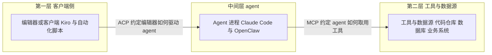

## 为什么需要 MCP 与 ACP？（痛点引入）

一个团队把 agent 接进日常研发，通常从「三个 agent、四个数据源」开始：Claude Code 写代码、Kiro 做规格驱动开发、OpenClaw 管消息渠道；数据源是代码仓库、工单系统、数据库和内部文档站。听起来不多，但第一周就会撞上同一堵墙——**每一条「agent 到工具」的连线，都要单独写一份适配代码**。

三个 agent 乘四个数据源就是十二条连线，再叠上两个编辑器入口，连线数还要翻倍。更麻烦的是这些连线会跟着版本漂移：模型换代、编辑器升级、工具接口调整，任何一端动了，对应的适配层就得重写一遍。

- **适配层按「组合」增长，不按「产品」增长**：来了第三个 agent，不是加一个插件，而是给它和每个工具之间各加一条通路。
- **换模型要重写一遍**：今天用某家模型跑通的工具调用，换一家模型后参数拼装、工具清单、结果解析全要重新对一遍。
- **换编辑器要再重写一遍**：团队从编辑器 A 换到编辑器 B，agent 本身没变，但「编辑器怎么把会话交给 agent」这段接线要从头再接。
- **没有人能回答「它到底能连什么」**：适配代码散在各处，能力边界只存在于写代码那个人的记忆里，评审时说不清、交接时更说不清。

| 维度 | 没有互操作协议时的痛苦 | 有了互操作协议之后 |
|------|------------------------|--------------------|
| 集成成本 | N 个 agent 乘 M 个工具，成本按乘积增长 | 每个 agent 实现一次协议，每个工具实现一次协议 |
| 换模型 | 工具适配层跟着模型重写 | agent 换掉即可，工具侧不动 |
| 换编辑器 | 编辑器与 agent 的接线重新做 | 编辑器按同一份规范接任意 agent |
| 能力发现 | 能连什么只能问写代码的人 | 协议层面约定「怎么列举、怎么调用」 |
| 生态扩展 | 每家工具自己造轮子 | 新工具生在开放协议之上即可被复用 |

> ### 💡 新人小结：这两个协议到底在省什么事？
>
> 把它想象成「出国旅行时的插座」：
> - 每个国家的墙插形状不同，你带一堆转换插头（**每对 agent 与工具写一份适配层**）；
> - 转换插头按「国家乘电器」增长，行李箱越来越重（**成本按乘积增长**）；
> - 一旦有了统一插座标准，你只需要一根线（**协议只实现一次，双方各自遵守**）；
> - 但插座标准分两种：墙上的和电器端的，接反了不通电（**MCP 与 ACP 分管不同的两端**）。
>
> **互操作协议不是让连线变多，而是把「按组合增长」改成「按产品增长」。**

**学习路线图**（本文按八段推进）

```text
痛点引入 → 两层连接 → MCP → ACP → 分工对比 → DSH 视角 → 落地检查 → 要点总结
为什么     谁接谁      接工具   接编辑器  各管一段    都是 profile  接入前问什么  带走什么
```

> [!NOTE] 事实口径：本文全部事实取自 2026-10-24 的核查快照，来源为官方公告页、GitHub API 与各家官方文档。文中两处保留「未核实」标注：MCP 的 2024-11-25 是广泛记录值（公告正文已核实，但页面未印日期）；ACP 首发博文的具体 URL 未能定位。

---

## 两层连接：先看清谁接谁

把上面那堆连线按「两端是谁」分类，会发现它们其实只有两种：一种是**编辑器或客户端对接 agent**，另一种是**agent 对接工具与数据源**。这两层各自需要一个协议，而不是一个协议包办全部。



图后解读，三条最重要的关系：

1. **上层换编辑器、下层换模型，改动落在不同协议上。** 编辑器换成另一家，动的是 ACP 那一侧；工具换成另一套，动的是 MCP 那一侧。两个方向互不牵连，这正是「按产品增长」的来源。
2. **agent 站在两层之间，是唯一同时说两种协议的角色。** 它向上被编辑器驱动，向下调用工具。所以一个 agent 产品要接入生态，通常要同时实现这两侧——2026 年的 Kiro 就是这样：它既在 MCP 支持名单里，又在 ACP 兼容名单里。
3. **两层协议的出现顺序不一样。** 下层（MCP，Anthropic，2024-11）先成熟并成为事实标准，上层（ACP，Zed 团队，2025-06 建仓）后起，到 2026 年仍在向 v2 演进。

> ### 💡 新人小结：为什么不能一个协议全包？
>
> 把它想象成「公司里的两种门禁」：
> - 员工通道刷工牌，进门的是人（**编辑器把控制权交给 agent**）；
> - 仓库门刷提货单，进门的是货（**agent 去取工具和数据**）；
> - 两种门的读卡器、权限名单、审计口径都不一样，硬做成一个读卡器，谁的权限都说不清；
> - 所以标准也是两套，各管一段，接缝处由 agent 承担翻译。
>
> **判断某个协议归哪一层，只看它两端的角色是谁：编辑器对 agent 归 ACP，agent 对工具归 MCP。**

---

## MCP：把工具接到 agent 手上的那一层

MCP（Model Context Protocol，模型上下文协议）由 Anthropic 推出，官方公告页把它定位为 "a new standard for connecting AI assistants to the systems where data lives"——连接 AI 助手与数据所在系统（内容仓库、业务工具、开发环境）的新标准。公告署名的作者是 David Soria Parra 与 Justin Spahr-Summers。

| 项 | 值 | 出处与核实状态 |
|----|----|----------------|
| 推出方 | Anthropic | 官方公告页 anthropic.com/news/model-context-protocol，正文已核实 |
| 发布时间 | 2024-11-25 | 广泛记录值；公告正文已核实，但页面未印日期 |
| 官方定位 | 连接 AI 助手与数据所在系统的新标准 | 公告原文 |
| 开放性 | 开源协议：规范加 SDK；Claude Desktop 支持本地 MCP server；预置 server 有开源仓库 | 公告原文 |
| 早期采用者 | Block、Apollo；Zed、Replit、Codeium、Sourcegraph 已集成 | 公告原文 |
| 2026 现状 | 成为工具接入的事实标准：Gemini CLI、Claude Code、Kiro、OpenClaw 均支持 | 各工具官方文档与官网，2026-10-24 |

这张表里最该记住的是「开放性」那一行。MCP 交出来的是一套**规范加 SDK 加预置 server 仓库**的组合：规范说清双方怎么说话，SDK 降低实现成本，预置 server 让人开箱就能连上常见数据源。三者凑齐，一个协议才有机会从「某家公司的内部约定」变成「大家默认都实现的东西」——2026 年四家主流工具全部支持，就是这套组合生效的结果。

关于日期，需要保留原有的谨慎：**2024-11-25 是广泛记录值，公告正文已核实，但页面本身未印日期**。引用时写「2024 年 11 月」是稳的；要精确到日，就得连同这条标注一起带上。

> ### 💡 新人小结：MCP 解决的是「手边没有工具」的问题
>
> 把 MCP 想象成「新同事桌上的那根 USB 集线器」：
> - 集线器只有一种插口标准，键盘、显示器、硬盘都往同一个口插（**工具按同一份规范暴露能力**）；
> - 你换一台电脑，集线器不用换（**agent 换代，工具侧不动**）；
> - 集线器本身不认识硬盘里的文件，它只负责把通路接上（**协议只约定怎么连，不约定业务语义**）；
> - 出厂时附赠几根常用线（**预置 server 仓库降低上手成本**）。
>
> **MCP 管的是「agent 的手能够到哪些工具」，它不负责决定谁来驱动这个 agent。**

---

## ACP：把任意 agent 装进任意编辑器的那一层

ACP（Agent Client Protocol，agent 客户端协议）由 Zed 团队推出，官网在 agentclientprotocol.com。仓库描述只有一句定位："A protocol for connecting any editor to any agent"——连接任意编辑器与任意 agent 的协议。

| 项 | 值 | 出处与核实状态 |
|----|----|----------------|
| 推出方 | Zed 团队 | 官网 agentclientprotocol.com |
| 仓库与建仓时间 | agentclientprotocol/agent-client-protocol，创建于 2025-06-23（zed-industries 旧地址 301 重定向证实） | GitHub API，2026-10-24 |
| 官方定位 | 连接任意编辑器与任意 agent 的协议 | 仓库描述 |
| 语言与许可证 | Rust / Apache-2.0 | GitHub API |
| 版本 | Rust crate v1.12.0（2026-10-16）；schema v1.26.0 稳定，v2.0.0-alpha.9 开发中 | GitHub Releases，2026-10-24 |
| Stars | 4,492（2026-10-24 快照） | GitHub API |
| 生态采用 | Kiro 官网证实其 agent 已兼容 ACP；OpenClaw 文档含 ACP agents 接入指南 | kiro.dev 与 OpenClaw 官方文档 |

这张表要读出三层信息：

1. **它的年龄比 MCP 小约七个月。** MCP 在 2024 年 11 月发布，ACP 仓库 2025-06-23 才创建。所以 2026 年看到的现象是：MCP 已经是既成事实，ACP 还在铺路。
2. **版本要分两个维度看。** Rust crate 是 v1.12.0（2026-10-16），这是实现库的版本；schema 是 v1.26.0 稳定、v2.0.0-alpha.9 开发中，这是协议本身的版本。**实现库版本与协议 schema 版本不是同一个号**，引用时必须说明是哪一个，否则「ACP 是 v1 还是 v2」会吵成一团。
3. **生态采用是判断协议生命力的硬指标。** 仓库描述谁都能写，真正说明问题的是别人愿不愿意接：Kiro 官网证实其 agent 已兼容 ACP，OpenClaw 文档里已经有 ACP agents 的接入指南。

另有一处必须保留的未核实标注：**ACP 首发博文的具体 URL 未能定位**（Zed 博客列表翻页未找到）。因此本文只写「Zed 团队推出」「仓库 2025-06-23 创建」这两个已核实事实，不写首发公告的日期。

> ### 💡 新人小结：ACP 解决的是「agent 只认自家编辑器」的问题
>
> 把它想象成「公司大门的通用门禁协议」：
> - 以前每来一位外包同事，就要单独给他配一套门禁卡和读卡器（**每个编辑器为每个 agent 写一套集成**）；
> - 现在门禁读卡器按统一格式验卡，谁家的卡只要是这个格式就能进（**任意编辑器驱动任意 agent**）；
> - 门禁只管「进不进得来、进来后听谁调度」，不管屋里的人用什么工具干活（**工具那一层是 MCP 的事**）；
> - 新版本还在试运行，老版本仍要能用（**v1.26.0 稳定，v2.0.0-alpha.9 开发中**）。
>
> **ACP 管的是「谁来驱动 agent」，至于 agent 手里有哪些工具，它不插手。**

---

## 分工对比：一个管上，一个管下

把两个协议并排放，差别会非常清楚。下表逐维度对照，是本文最该背下来的一张表：

| 维度 | MCP | ACP |
|------|-----|-----|
| 解决什么 | agent 与工具、数据源之间的连接，即给 agent 接上手 | 编辑器、客户端与 agent 之间的连接，即把任意 agent 装进任意编辑器 |
| 推出方与时间 | Anthropic，2024-11（2024-11-25 为广泛记录值） | Zed 团队，2025-06（仓库创建于 2025-06-23） |
| 形态 | 开放规范加 SDK 加预置 server 仓库 | 开放规范（schema）加 Rust 参考实现 |
| 版本口径（2026-10-24） | 源材料未给出协议自身的版本号 | crate v1.12.0；schema v1.26.0 稳定、v2.0.0-alpha.9 开发中 |
| 2026 生态位 | 工具接入的事实标准，Gemini CLI、Claude Code、Kiro、OpenClaw 均支持 | 从编辑器与 agent 的连接切入，生态采用方含 Kiro、OpenClaw |
| 说话的两端 | agent 与工具 server | 编辑器、客户端与 agent 进程 |

一次完整的「让 agent 改一个文件」，会同时穿过这两层。下面这条链路只描述**角色与顺序**，不涉及任何报文格式：

```text
# 一次改文件的请求，要经过哪两层协议

① 客户端侧   在编辑器里写下需求
             向下交给 agent 进程        <- 这一段由 ACP 约定

② agent 侧   读需求、拆步骤、决定要动哪个文件
             向工具请求「读文件」        <- 这一段由 MCP 约定

③ 工具侧     文件系统 server 返回文件内容
             结果回到 agent              <- 同样是 MCP 这一层

④ agent 侧   生成改动，交回编辑器呈现
             这一段回到 ACP 这一层

# 结论：
# 编辑器不需要认识工具，agent 不需要认识编辑器内部实现
# 每一侧只要实现对端那一份协议，就能和整个生态互接
```

从上往下读这条链路，可以总结出一句判断口诀：**看两端的角色，不看产品的名字**。同一个产品完全可能同时出现在两张名单上——Kiro 就是这样，它既支持 MCP（向下取工具），也兼容 ACP（向上被编辑器驱动）。所以「某工具支持 ACP 吗」这类问题，必须先问清「它支持的是哪一层」。

### 两张协议网的成型顺序

把已核实的时间点排在一起，能看清这两张网是错开成型的：

| 时间 | 事件 | 出处与核实状态 |
|------|------|----------------|
| 2024-11 | MCP 由 Anthropic 发布，定位为连接 AI 助手与数据所在系统的标准 | 公告正文已核实；2024-11-25 为广泛记录值 |
| 2024-11 公告中 | MCP 早期采用者：Block、Apollo，以及 Zed、Replit、Codeium、Sourcegraph 的集成 | 公告原文 |
| 2025-06-23 | ACP 仓库创建，定位为连接任意编辑器与任意 agent | GitHub API，2026-10-24 |
| 2026-10-16 | ACP 的 Rust crate 发布 v1.12.0 | GitHub Releases，2026-10-24 |
| 2026-10-24 | ACP schema 为 v1.26.0 稳定、v2.0.0-alpha.9 开发中；stars 4,492 | GitHub API 与 Releases 快照 |

读法很直接：下层协议先跑了约七个月，把「工具怎么接」这件事定下来；上层协议随后从编辑器与 agent 的连接切入，到 2026 年还在向 v2 走。这也解释了为什么 2026 年的新工具可以直接生在协议之上——Kiro 的兼容清单里同时出现 MCP 与 ACP，说明它入场时两层都已就位，不必自建围墙。

> ### 💡 新人小结：两个协议的分界线画在哪？
>
> 把它想象成「快递的两个环节」：
> - 寄件人把包裹交给快递员，用的是什么单据格式（**ACP，客户端把任务交给 agent**）；
> - 快递员到了驿站，用什么格式调取货架上的包裹（**MCP，agent 去取工具和数据**）；
> - 单据标准和取货标准是两套东西，一个是寄件侧的约定，一个是取货侧的约定；
> - 同一个人既可能寄件也可能取货，所以一个产品同时支持两套标准并不矛盾。
>
> **一句话分工：MCP 让 agent 够得着工具，ACP 让编辑器够得着 agent。**

---

## DSH 视角：两个协议都以 profile 形态出现

DSH（DeepSeek Harness）在这个格局里的位置值得单独说，因为它不是「只押一边」，而是两侧都留了入口，且入口形态相同——**都是 profile**（出处：@deepseek-ai/dsh 的 README.zh.md 首段，原文表述为 SDK 与 ACP 都是 profile）。

| 协议侧 | 在 DSH 里的形态 | 入口与行为 | 是否默认 |
|--------|-----------------|------------|----------|
| ACP | profile | `dsh --profile acp`，通过 ACP stdio 为自动化客户端提供服务，直至客户端断开连接 | 需要显式指定 profile |
| MCP | 可选覆盖层 | 生态里有「记忆 MCP 服务器」这类可选覆盖层，放在 config/examples/ 下 | 不属于默认 profile，须显式接入 |
| SDK | profile | 同样以 profile 形态承载，需要显式指定 | 需要显式指定 profile |

表里最需要分清的是前两行：

- **ACP 那一行是「入口模式」层面的能力。** `dsh --profile acp` 通过 ACP stdio 为自动化客户端提供服务，直到连接断开。这句话的信息量在于「stdio」和「直至断开」两点：前者说明这一侧面向的是能接标准输入输出的自动化客户端，后者说明它的生命周期跟着连接走——连上即服务，断开即结束，不常驻。
- **MCP 那一行是「可选覆盖层」层面的能力。** DSH 生态里有「记忆 MCP 服务器」这类覆盖层，例子放在 config/examples/ 下。关键在于它**不属于默认 profile**：默认形态不启用，要用就得按可选覆盖层的说明显式接入。把可选覆盖层说成默认能力，是这一节最容易犯的错。

> ### 💡 新人小结：profile 这个词在这里指什么？
>
> 把 DSH 想象成「一把多功能工具钳」：
> - 主体是同一套内核（**同一个 dsh 程序**）；
> - 换一个 profile 等于换一只钳头，SDK 头、ACP 头各是各的（**同一内核的两种对外形态**）；
> - 钳头不装上去，功能就不存在（**profile 要显式指定才生效**）；
> - 附赠的小配件放在工具箱侧袋里，用之前得自己拿出来装（**可选覆盖层不在默认 profile 内**）。
>
> **DSH 把「以什么身份对外」做成了 profile 开关，ACP 与 SDK 是同一层的两个开关，MCP 覆盖层则是另配的附件。**

这也解释了本站为什么要把两个协议放在同一篇里讲：终端 agent 生态的两张接口网，DSH 都有对应的落点，只是形态不同——一张做成 profile，一张做成可选覆盖层。要理解 DSH 整体怎么运转，可以接着看本站的 [DSH 指南](/docs/03-dsh/)。

---

## 落地检查表：接入前先问清四件事

协议名字对了，不代表接得上。真正决定能不能用的，是下面四类信息；下表把「该问什么」「本文能回答到什么程度」「源材料缺什么」并排放好：

| 检查项 | 要问清楚什么 | 本文能给出的答案 | 源材料没有的部分 |
|--------|--------------|------------------|------------------|
| 支持哪个协议 | 是上层还是下层，别把两层混成一个 | MCP 管 agent 与工具；ACP 管编辑器或客户端与 agent | 具体产品支持到哪一层，需逐家查其官方文档 |
| 版本 | 实现库版本与协议 schema 版本要分开写 | ACP：crate v1.12.0（2026-10-16），schema v1.26.0 稳定、v2.0.0-alpha.9 开发中 | MCP 协议自身的版本号，源材料未给出 |
| 传输方式 | 用什么通道承载，进程内还是跨进程 | ACP：DSH 侧为 stdio，服务至连接断开 | MCP 的传输方式，源材料未给出 |
| 鉴权边界 | 谁能调、调什么、凭据放哪 | 两协议均未在源材料中涉及 | MCP 与 ACP 的鉴权方式，源材料均未给出 |
| 默认开关 | 是默认开还是显式开 | DSH 的 ACP 与 SDK 走 profile，MCP 侧为可选覆盖层、不属于默认 profile | 其他产品是否默认启用，需查各自文档 |
| 时间口径 | 日期是公告日、建仓日还是发版日 | MCP 2024-11-25 为广泛记录值；ACP 以 2025-06-23 建仓为准 | ACP 首发博文 URL 未定位 |

按这张表逐行过一遍，能避免绝大多数「以为支持、其实不支持」的事故。三处「源材料未给出」都不是笔误，而是核查结论：MCP 协议自身的版本号、MCP 的传输方式、两协议的鉴权边界，在本次核查的来源里都没有对应内容，因此本文不做任何推定。

---

## 常见误区自检（对照表）

| 场景 | 容易做错的判断 | 应有的判断 |
|------|----------------|------------|
| 给编辑器选 agent | 认为「支持 MCP 的 agent 就能被任意编辑器驱动」 | MCP 管工具那一侧；被编辑器驱动要看 ACP 这一侧 |
| 给 agent 接数据 | 认为「支持 ACP 就够了，工具自然能连」 | ACP 只管客户端与 agent；取工具仍需 MCP |
| 引用 MCP 日期 | 直接写「2024-11-25 发布」而不加标注 | 写 2024 年 11 月，若要精确到日须注明为广泛记录值 |
| 引用 ACP 版本 | 把 crate v1.12.0 当作协议版本 | 实现库版本与 schema 版本分开表述 |
| 看 ACP 生态 | 只数 stars 判断成熟度 | 4,492 是 2026-10-24 快照；成熟度看谁真的接了，如 Kiro、OpenClaw |
| 理解 DSH 形态 | 认为记忆 MCP 服务器默认就在跑 | 那是可选覆盖层，不属于默认 profile |
| 判断协议归属 | 把 Apache-2.0 当成「协议」 | 那是许可证；MCP 与 ACP 才是互操作规范 |

---

## 概念速查（术语表）

| 术语 | 全称 | 含义（用自己的话） | 在本文中的角色 |
|------|------|--------------------|----------------|
| MCP | Model Context Protocol，模型上下文协议 | 把 AI 助手接到数据所在系统的开放标准，Anthropic 推出 | 下层协议，管 agent 与工具 |
| ACP | Agent Client Protocol，agent 客户端协议 | 让任意编辑器能驱动任意 agent 的开放标准，Zed 团队推出 | 上层协议，管客户端与 agent |
| agent | 智能体 | 不只回答、还能自主调用工具完成多步任务的程序 | 同时说两种协议的那一端 |
| server（预置 server） | MCP server | 按 MCP 规范把某个工具或数据源暴露出来的服务端 | MCP 生态里的「工具适配器」 |
| schema | 协议模式定义 | 协议本身的结构定义文件，决定双方能说什么 | ACP 的协议版本看 schema 而不是 crate |
| crate | Rust 软件包 | Rust 生态里的库发布单位 | ACP 的 v1.12.0 是这个版本号 |
| stdio | 标准输入输出 | 用进程的标准输入输出做通道的传输方式 | DSH 以 `dsh --profile acp` 经此提供服务 |
| profile | 运行形态 | 同一个程序以不同身份对外服务的开关 | DSH 承载 ACP 与 SDK 的形态 |
| 覆盖层 | overlay | 在内核之外额外挂载的一层能力 | DSH 的记忆 MCP 服务器属此类，不在默认 profile |
| 事实标准 | de facto standard | 没有强制力、但生态普遍实现的标准 | MCP 在 2026 年的位置 |
| Apache-2.0 | 开源许可证 | 法律层面的使用授权条款 | ACP 的许可证，与互操作协议不同义 |

---

## 要点总结

1. **痛点是乘法，协议是加法。** 没有协议时，集成成本是 N 个 agent 乘 M 个工具；有了协议，每个产品各自实现一次，换模型、换编辑器都不再重写整条适配层。
2. **两层各有一个协议。** MCP（Anthropic，2024-11）管 agent 与工具、数据源；ACP（Zed 团队，仓库 2025-06-23 创建）管编辑器、客户端与 agent。判断归属只看两端角色。
3. **MCP 已成事实标准。** 到 2026 年，Gemini CLI、Claude Code、Kiro、OpenClaw 均支持 MCP；它的开放性由规范、SDK、预置 server 三件套支撑。2024-11-25 为广泛记录值，公告正文已核实但页面未印日期。
4. **ACP 仍在演进。** Rust 实现为 Apache-2.0，crate v1.12.0（2026-10-16），schema v1.26.0 稳定、v2.0.0-alpha.9 开发中；生态采用方含 Kiro 与 OpenClaw。首发博文 URL 未能定位，本文不写首发日期。
5. **DSH 两侧都留了入口，但形态不同。** ACP 与 SDK 都是 profile，`dsh --profile acp` 通过 ACP stdio 服务自动化客户端直至断开；MCP 侧的记忆服务器是可选覆盖层，不属于默认 profile。
6. **接入前先问四件事。** 谁支持哪个协议、版本是什么口径、传输方式是什么、鉴权边界在哪；源材料没覆盖的部分（MCP 协议版本、两协议传输细节与鉴权）一律写「源材料未给出」，不做推定。

---

> ### 💡 新人小结：这一篇学完了，记住这 5 点
>
> 1. **先问层级再问产品**：编辑器对 agent 是 ACP，agent 对工具是 MCP，同一个产品可能两层都占。
> 2. **乘法变加法**：协议的收益不在「多了一个标准」，而在把集成成本从乘积降成加和。
> 3. **日期带口径**：MCP 的 2024-11-25 是广泛记录值，ACP 的 2025-06-23 是建仓日，两者都不是「发布公告日」。
> 4. **版本分两个维度**：ACP 的 crate 版本与 schema 版本不是同一个号，引用时必须说明是哪一个。
> 5. **DSH 用 profile 承载协议**：ACP 与 SDK 是同一层的开关，MCP 覆盖层是另配的附件，默认不启用。
>
> 想先把这套接口网用起来的场景，可以回看 [终端编码代理浪潮](/docs/02-agent-tools/编码代理/终端编码代理浪潮/) 里的入场顺序，以及 [OpenClaw 现象](/docs/02-agent-tools/个人助手/OpenClaw现象/) 那条支线；想看 DSH 怎么把这套协议落成运行形态，往下走就是 [DSH 指南](/docs/03-dsh/)。
