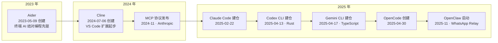
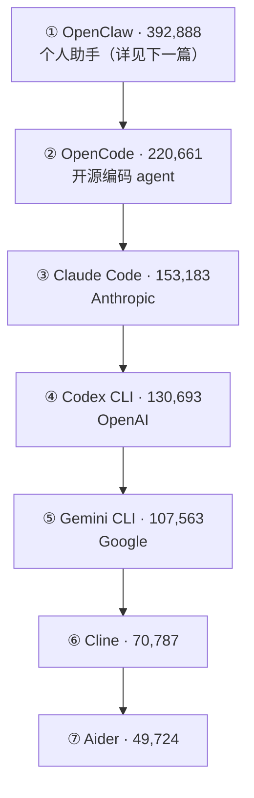

## 为什么需要终端编码代理？（痛点引入）

本站第一章讲完了 DeepSeek 代表的模型底座（/docs/01-deepseek/）：模型能力以肉眼可见的速度变强。但对每天写代码的人来说，2024 年之前的真实体验是——模型住在浏览器里的聊天框中，代码住在编辑器和仓库里，两边之间的「搬运工」只能是你自己。

两个几乎每个团队都经历过的场景：

- **跨文件重构的复制粘贴马拉松**：让网页聊天框里的 AI 做一个涉及 5 个文件的重构。把第一个文件贴进去，等回复；把建议的改动复制回编辑器；贴到第三个文件时上下文超限，只好开新会话重贴一遍。一下午过去，提交历史里多了十几次细碎改动，一半是在搬运过程中出的错。
- **AI 参与的代码没有审计线索**：团队里每人各自开着聊天窗口，「这段代码是谁依据哪次对话让 AI 写的」无从追溯，代码评审只能靠猜，出了问题连回放现场都做不到。

| 维度 | 没有终端编码代理时的痛苦 | 有了终端编码代理之后 |
|------|--------------------------|----------------------|
| 上下文搬运 | 网页聊天框与编辑器之间手动复制粘贴，贴多了上下文超限 | agent 直接在你本地的仓库里读文件、改文件 |
| 操作执行 | AI 只能「给建议」，动手改全靠人 | agent 自己执行修改与命令，人负责审查 |
| 审计线索 | 对话散落在各家网页里，与提交记录对不上 | 会话发生在终端工作目录内，过程可回放 |
| 接入门槛 | 每个模型一套网页入口，来回切换 | 统一的 CLI 入口，用账号或 API key 登录 |
| 生态扩展 | 工具接入各自为政，重复造轮子 | MCP/ACP 等开放协议统一接入（详见本站协议篇） |

> ### 💡 新人小结：终端编码代理到底是什么？
>
> 把它想象成「一位住在你终端里的常驻老师傅」：
> - 你不用把活儿搬到他面前（网页聊天框）——他直接走进你的工地（本地仓库）看现场；
> - 他不只会嘴上指点——能自己拿起工具动手改；
> - 他随身带着工牌（账号或 API key），进出你的项目有记录可查。
>
> **终端编码代理 = 能在你终端和代码仓库里直接动手干活的 AI，而不是只在聊天框里给建议的客服。**

**学习路线图**（本文按七段推进）

```
痛点引入 → 三巨头总览 → 逐家细看 → 大厂跟进 → 同期开源工具 → 2026 趋势 → 要点总结
为什么     谁在何时登场   各家定位    还来了谁    开源生态长什么样   往哪里去    带走什么
```

> [!NOTE] 版本适用：本文引用的 star 数、fork 数与 release 版本号均为 2026-10-24 前后的快照值。终端编码代理生态的发版与热度变化极快（如 Claude Code 保持日更节奏），阅读时请以各官方仓库的当下数据为准；文中标注「未核实」的条目，请保持同样的谨慎。

---

## 三巨头总览：2025 年，三家在四个月里全部到齐

「三巨头」指 OpenAI Codex CLI、Google Gemini CLI、Anthropic Claude Code——三家模型大厂官方出品的终端编码 agent。先看它们与前作在时间上如何排布。下图是 2023—2025 年代表性工具与协议的涌现时间线，图上全部日期来自仓库元数据或官方页面的核实结果：



图后解读，三条最重要的信息：

1. **需求早于三巨头**：Aider（2023-05-09 创建）与 Cline（2024-07-06 创建）证明「终端/编辑器里的 AI 结对」在 2023 年就有真实用户。三巨头入场，是把一个已被验证的品类收编进官方产品线。
2. **爆发集中在 2025 年 2 月至 6 月**：Claude Code（2025-02-22 建仓）→ Codex CLI（2025-04-13 建仓）→ Gemini CLI（2025-04-17 建仓，2025-06-25 公开发布）→ OpenCode（2025-04-30 创建）。从第一家到最后一家，前后只隔四个月。
3. **2024-11 的 MCP 是伏笔**：它在三巨头登场前就已发布，后来成为图上这些工具共同依赖的接入协议——展开见本站协议篇（/docs/02-agent-tools/协议标准/MCP与ACP协议/）。

### 三巨头身份速览

| 项 | OpenAI Codex CLI | Google Gemini CLI | Anthropic Claude Code |
|----|------------------|-------------------|------------------------|
| 仓库（创建时间） | github.com/openai/codex（2025-04-13） | github.com/google-gemini/gemini-cli（2025-04-17） | github.com/anthropics/claude-code（2025-02-22） |
| 语言 / 开源协议 | Rust / Apache-2.0 | TypeScript / Apache-2.0 | 来源未给出 |
| 官方一句话定位 | "Lightweight coding agent that runs in your terminal" | "An open-source AI agent that brings the power of Gemini directly into your terminal" | 终端编码 agent，GA 随 Claude 4（Opus 4/Sonnet 4）公告 |
| 最新 release（快照） | rust-v0.164.0（2026-10-23） | 活跃发版：preview / stable / nightly 三通道 | v2.1.310（2026-10-23，日更节奏） |
| Stars（2026-10-24 快照） | 130,693（Forks 20,611） | 107,563 | 153,183 |

（出处：GitHub API 与各家官方 README / releases，2026-10-24。Claude Code 的仓库主语言与开源许可证，源材料未给出，本文不做断言。）

> ### 💡 新人小结：agent 和聊天机器人差在哪？
>
> 想象你在陌生城市问路：
> - 聊天机器人像「指路的路人」——告诉你怎么走，路还得你自己走；
> - agent 像「代驾司机」——你说目的地，它自己打方向盘、换挡、停车；
> - 终端编码 agent 再进一步，是「拿着你车库钥匙的代驾」——能直接进你的仓库动手。
>
> **判断一个产品是不是 agent，看它能不能自己调用工具执行动作，而不只是输出文字。**

---

## OpenAI Codex CLI：Rust 写的轻量终端 agent

Codex CLI 的官方描述只有一句——"Lightweight coding agent that runs in your terminal"（运行在你终端里的轻量编码 agent）。拆开看有两个关键词：**runs in your terminal** 说它住在终端里而不是网页里，正是本篇开头两个痛点（上下文搬运、审计线索）的直接回应；**lightweight** 说官方把它定位成「轻量」形态，与此同时还有 IDE 集成、桌面 App 与云端 Codex Web——终端不是唯一入口，而是整套形态中最贴近仓库的那一层。

| 项 | 值 | 出处 |
|----|----|------|
| 仓库 | github.com/openai/codex，创建于 2025-04-13 | GitHub API openai/codex，2026-10-24 |
| 语言 / 协议 | Rust / Apache-2.0 | GitHub API + 官方 README，2026-10-24 |
| 官方描述 | "Lightweight coding agent that runs in your terminal" | 官方 README，2026-10-24 抓取 |
| 登录方式 | ChatGPT 账号（Plus/Pro/Business/edu/Enterprise）或 API key | 官方 README，2026-10-24 |
| 形态延伸 | IDE 集成、桌面 App、云端 Codex Web | 官方 README，2026-10-24 |
| 最新 release | rust-v0.164.0（2026-10-23） | github.com/openai/codex/releases |
| Stars / Forks | 130,693 / 20,611（2026-10-24 快照） | GitHub API，2026-10-24 |

登录方式一栏值得多看一眼：它同时接受 ChatGPT 订阅账号与 API key——前者把 Codex CLI 变成 ChatGPT 会员权益在终端的延伸，后者面向工程化调用。快照时的最新 release 是 rust-v0.164.0（2026-10-23），版本号里的 rust 前缀也印证了主语言。

> [!NOTE] 表述纪律：关于「TypeScript 首发、数日后转 Rust 重写」——OpenAI 官宣博文直抓返回 403，这一细粒度叙事未能核实原始博文，本文不做断言。已核实的事实是：仓库创建于 2025-04-13、主语言为 Rust（出处：GitHub API openai/codex）。「2025 年 4 月发布」与建仓时间吻合。

---

## Google Gemini CLI：靠免费额度拉开的入口

如果说 Codex CLI 的记忆点是 Rust，Gemini CLI 的记忆点就是免费额度。它的建仓时间（2025-04-17）与 Codex CLI 只差四天，公开发布则在 2025-06-25（官宣博文未能直抓，该日期为广泛记录值；仓库元数据已核实）。

| 项 | 值 | 出处 |
|----|----|------|
| 仓库 | github.com/google-gemini/gemini-cli，创建于 2025-04-17 | GitHub API google-gemini/gemini-cli，2026-10-24 |
| 语言 / 协议 | TypeScript / Apache-2.0 | GitHub API + 官方 README |
| 官方描述 | "An open-source AI agent that brings the power of Gemini directly into your terminal" | 官方 README |
| 公开发布 | 2025-06-25（官宣博文未能直抓，为广泛记录值；仓库元数据已核实） | 标注：未直抓官宣页 |
| 发版节奏 | 仍在活跃发版：preview / stable / nightly 三通道 | GitHub API，2026-10-24 |
| Stars | 107,563（2026-10-24 快照） | GitHub API |

免费额度是它当时的招牌（出处：geminicli.com 配额与定价文档，2026-10-24）：

| 登录 / 订阅方式 | 每日请求额度 |
|----------------|--------------|
| Google 账号登录（Gemini Code Assist 个人版） | 1,000 请求/天 |
| Gemini API key 免费层 | 250/天 |
| AI Pro | 1,500/天 |
| AI Ultra | 2,000/天 |

把第一行和第二行放在一起看：Google 账号登录（Gemini Code Assist 个人版）给到 1,000 请求/天，是 API key 免费层 250/天的四倍。对尝鲜用户来说，这个量级足以支撑一整天的日常编码辅助——终端编码 agent 第一次有了「零成本入门」的通道。

> [!NOTE] 版本适用：上面的免费额度表只到 2026-06-18 为止。官方 README（2026-10-24 抓取）写道 "Unpaid tier and Google One users: Gemini CLI was replaced by Antigravity CLI on June 18th, 2026"——免费层与 Google One 用户已迁移至 Antigravity CLI。README 同时说明：Gemini CLI 未对 Gemini 4 Argon 优化；项目文档站已迁移至 geminicli.com。引用这份额度表时，务必连同这条迁移说明一起引用。

---

## Anthropic Claude Code：从研究预览到日更节奏

三巨头里最早建仓的是 Claude Code（2025-02-22）。它的节奏可以概括为「预览四个月，GA 即平台化」：

| 项 | 值 | 出处 |
|----|----|------|
| 仓库 | github.com/anthropics/claude-code，创建于 2025-02-22 | GitHub API anthropics/claude-code，2026-10-24 |
| 研究预览 | 2025 年 2 月末开始（原公告页已 404；GA 公告中 "After receiving extensive positive feedback during our research preview" 确认存在预览阶段） | anthropic.com/news/claude-4，2026-10-24 |
| GA | 2025-05-22 随 Claude 4（Opus 4/Sonnet 4）公告 "Claude Code is now generally available"，同日发布 VS Code/JetBrains 扩展、GitHub Actions 后台任务、Claude Code SDK | anthropic.com/news/claude-4（正文已核实；页面未印日期，2025-05-22 为广泛记录值） |
| 最新 release | v2.1.310（2026-10-23，日更节奏） | github.com/anthropics/claude-code/releases |
| Stars | 153,183（2026-10-24 快照） | GitHub API |
| 2026 功能面 | Cloud sessions、Code Review、Claude Tag、Agent SDK、子代理（fork subagents） | release notes，2026-10 |

三行时间线读出三层信息：

1. **预览期**：2025 年 2 月末开始研究预览——原公告页现已 404，但预览阶段的存在由 GA 公告原文（"After receiving extensive positive feedback during our research preview"）反向确认。
2. **GA 的真正信息量在「打包」**：2025-05-22 转正同日带来编辑器扩展（VS Code/JetBrains）、CI 集成（GitHub Actions 后台任务）与 Claude Code SDK——Anthropic 是把它当平台发布，而不是单个命令行工具。
3. **快照时的状态**：v2.1.310（2026-10-23）仍在日更节奏；2026 年的功能面（Cloud sessions、Code Review、Claude Tag、Agent SDK、fork subagents）显示它已长成带云会话与子代理体系的完整产品。

---

## 大厂跟进：Kiro 与 Copilot CLI

三巨头之外，两家大厂的动作常被并提：Amazon Kiro 与 GitHub Copilot CLI。两者在本站的核实状态不同，必须分开表述。

### Amazon Kiro（部分核实）

| 项 | 值 | 核实状态 |
|----|----|----------|
| 出品方 | AWS（官网自述 "Built and operated by AWS"） | 已核实：kiro.dev，2026-10-24 抓取 |
| 定位 | spec-driven agentic engineering：提示 → 需求/设计/任务清单 → 并行 agent 实现 + property-based tests | 已核实：kiro.dev |
| 形态 | IDE、CLI（cli.kiro.dev）与云端 | 已核实：kiro.dev |
| 协议兼容 | ACP、AGENTS.md、Skills.md、MCP | 已核实：kiro.dev |
| 首发时间 | 据广泛记录为 2025-07 公测 | 未能从直抓页面确认 |

Kiro 的定位关键词 spec-driven（规格驱动）与三巨头的「直接对话改码」是两种流派：先让 AI 生成需求/设计/任务清单，再由并行 agent 照单实现，配套 property-based tests 做验证。它的兼容清单（ACP、AGENTS.md、Skills.md、MCP）也说明 2026 年入场的新工具直接生在开放协议之上，而不是自建围墙。

### GitHub Copilot CLI（未核实）

github.blog 上的候选公告 URL 均已 404 或移动，「2025-02 公测」为广泛记录时间线，未能直接核实原始来源。本文不引用它的具体日期与数据——来源未给出。

---

## 同期开源工具全景：不止三巨头

开源阵营在同一年给出了自己的答案。下表四行逐条来自 GitHub API repos 端点（2026-10-24），一行都不少：

| 工具 | 定位/描述 | 创建时间 | 语言/协议 | Stars（2026-10-24 快照） | 备注 |
|------|-----------|----------|-----------|--------------------------|------|
| OpenCode | "The open source coding agent"（opencode.ai） | 2025-04-30 | TypeScript / MIT | 220,661 | ⚠️ sst/opencode 已重定向至 anomalyco/opencode（归属已变化） |
| Aider | "aider is AI pair programming in your terminal" | 2023-05-09 | Python / Apache-2.0 | 49,724 | 终端 AI 结对编程先驱；⚠️ 最后 push 2026-05-22，近 5 个月无提交，更新放缓 |
| Cline | "Autonomous coding agent as an SDK, IDE extension, or CLI assistant" | 2024-07-06 | TypeScript / Apache-2.0 | 70,787 | 活跃（pushed 2026-10-24）；起点为 VS Code 扩展，后扩展出 CLI/SDK 形态 |
| Cursor CLI | — | — | — | — | ⚠️ 本站未核实，不引用具体日期 |

（各行出处：GitHub API repos 端点，2026-10-24。）

逐行解读：

- **OpenCode**：以 220,661 stars 成为开源编码 agent 的头名；⚠️ 备注里的重定向（sst/opencode → anomalyco/opencode）意味着项目归属已经变化，引用时要留意它当下的归属主体。
- **Aider**：资历最老（2023-05-09 创建），「终端里的 AI 结对编程」这句自我描述后来被整条赛道兑现；但最后 push 停在 2026-05-22，近 5 个月无提交——先驱与赢家不是同一个人。
- **Cline**：从 VS Code 扩展起步，长成「SDK / IDE 扩展 / CLI 助手」三种形态的自主编码 agent，快照当天仍有 push。
- **Cursor CLI**：本站未核实，其定位、创建时间、语言、协议与 star 数来源未给出——按表述纪律，不引用任何具体日期。

### 怎么正确引用这张表：一张引用卡

这张表里的数据各有各的核实状态，引用方式必须区别对待：

```text
# ========== ✅ 推荐写法：引用快照数据，注明日期与出处 ==========
# Codex CLI：仓库创建于 2025-04-13，主语言 Rust / Apache-2.0，
#           stars 130,693（2026-10-24 快照；出处：GitHub API openai/codex）
# Aider：最后 push 2026-05-22，快照时近 5 个月无提交（出处：GitHub API paul-gauthier/aider 仓库元数据）

# ========== 不推荐写法（仅展示） ==========
# ❌ 把未核实的细粒度叙事当事实：Codex CLI 以 TypeScript 首发、数日后转 Rust 重写
#    —— 官宣博文直抓 403，该叙事未核实，只能写「主语言为 Rust（已核实）」
# ❌ 引用未核实工具的具体日期：Cursor CLI 于 2025 年某月发布
#    —— 本站未核实，来源未给出，正确做法是不引用
# ❌ 把快照 star 数当实时数据：Claude Code 有 153,183 stars
#    —— 必须写成「153,183（2026-10-24 快照）」
# 输出: 来源未给出输出样例
```

参数解释：

| 字段 | 含义 | 注意 |
|------|------|------|
| 创建时间 | 仓库的 created_at | 与「公开发布」不一定是同一天（如 Gemini CLI 建仓 2025-04-17、公开发布 2025-06-25） |
| 语言/协议 | 仓库主语言与开源许可证 | 此处「协议」指 license（Apache-2.0/MIT），与 MCP/ACP 那种互操作「协议」不同义 |
| Stars（快照） | GitHub star 计数 | 一律注明快照日期；发版节奏快的项目，数据随时变化 |
| 备注 ⚠️ | 重定向/停滞/未核实标记 | 带 ⚠️ 的条目按原粒度表述，不得升级成已核实事实 |

---

## 2026 年趋势：五条主线

把上面所有材料放在一起，2026 年的终端 agent 生态呈现出五条清晰的主线：

1. **多 agent / 子代理成为标配**：Claude Code v2.1.x release notes 出现 fork subagents 与 Agent SDK（2026-10）；Gemini CLI 文档含 Subagents/Remote subagents；OpenClaw 文档含 Multi-agent routing、Sub-agents、Swarm、ACP agents；Kiro 主打 parallel agents。单打独斗的 agent 让位给「主 agent 调度子 agent」的结构。
2. **Skills 标准化与市场化**：Kiro 支持 AGENTS.md 与 Skills.md；OpenClaw 有 ClawHub 技能市场 + Skill 格式规范 + ClawScan/VirusTotal/NVIDIA SkillSpector 多层扫描；Gemini CLI 文档含 Agent Skills 体系。技能从「各家自定义插件」走向「有格式规范、有市场、有安全扫描」的公共品类。
3. **开放协议互操作**：MCP（2024-11，Anthropic）成为工具接入事实标准——Gemini CLI/Claude Code/Kiro/OpenClaw 均支持；ACP（2025-06，Zed）从编辑器-agent 连接切入，并在 2026 年演进到 v2 alpha。
4. **治理与安全制度化**：OpenClaw 设立基金会（2026-07）、引入外部审计（Trail of Bits，2026-09）与多方安全扫描；各家持续发布安全修复。安全从「发版说明里的一行」变成有组织、有第三方的制度。
5. **市场格局按 stars 洗牌**（GitHub Stars，2026-10-24 快照）：OpenClaw 392,888 > OpenCode 220,661 > Claude Code 153,183 > Codex CLI 130,693 > Gemini CLI 107,563 > Cline 70,787 > Aider 49,724。Aider 停滞、Gemini CLI 免费层被 Antigravity CLI 取代（2026-06-18）是年度最显著的洗牌信号。

第 5 条画成图更直观。下图按 2026-10-24 快照的 star 数从高到低排列：



图后解读：榜首 OpenClaw 甚至不是编码代理，而是个人助手（下一篇的主角）——它以 392,888 stars 领跑整个 agent 赛道；编码代理赛道内部，开源第一是 OpenCode（220,661），大厂出品第一是 Claude Code（153,183）；垫底的恰是资历最老的 Aider（49,724，更新放缓）。热度与资历、热度与出品方都不画等号。

> ### 💡 新人小结：怎么一眼看懂这张排名图？
>
> 把整个生态想象成「一条餐饮街」：
> - star 数是「打卡人数」，代表关注度，不代表收入、质量或技术优劣；
> - 快照是「某天中午的街拍」，下个月招牌可能就换了；
> - OpenClaw 排第一，但它卖的是「家常菜」（全渠道个人助手），不是「工作餐」（编码代理）——品类不同，别直接比。
>
> **看任何热度排名，先问两件事：它是什么品类、数据是哪天的快照。**

---

## 概念速查（术语表）

| 术语 | 全称 | 含义（用自己的话） | 在本文中的角色 |
|------|------|--------------------|----------------|
| CLI | Command-Line Interface，命令行界面 | 在终端里以文字命令交互的程序形态 | 三巨头共同的交付形态：装在终端里用 |
| agent | 智能体 | 不只回答问题、还能自主调用工具完成多步任务的 AI 程序 | 「编码 agent」= 能自己读改代码的 AI，本文主角的品类 |
| MCP | Model Context Protocol | 给 agent 接工具与数据源的开放协议（Anthropic，2024-11） | 趋势主线三的主角，详见协议篇 |
| ACP | Agent Client Protocol | 把任意 agent 接进任意编辑器的开放协议（Zed，2025-06） | Kiro 兼容清单里的开放标准，详见协议篇 |
| Skills | 技能 | 可安装到 agent 上的能力扩展包，有格式规范也有市场 | 趋势主线二：各家把技能标准化、市场化 |
| AGENTS.md / Skills.md | — | 约定的文件名与格式，向 agent 声明项目规范或技能 | Kiro 兼容清单中的开放标准 |
| subagent | 子代理 | 由主 agent 派生出来并行干活的下级 agent | 趋势主线一：fork subagents、parallel agents 都属此类 |
| spec-driven | 规格驱动 | 先让 AI 生成需求/设计/任务清单，再照单实现的开发范式 | Kiro 定位的关键词 |
| property-based tests | 基于属性的测试 | 用「性质断言」自动生成大量随机用例的测试方法 | Kiro 流水线里与并行 agent 配套的验证手段 |
| research preview | 研究预览 | 面向公众收集反馈的早期实验版本 | Claude Code 2025-02 至 2025-05 所处阶段 |
| GA | General Availability，正式可用 | 产品结束预览、对外承诺可用的节点 | Claude Code 于 2025-05-22 随 Claude 4 GA |
| stars 快照 | — | 某一日期抓取的 GitHub star 计数 | 本文全部热度数据的计量口径（2026-10-24） |
| fork（Forks 计数） | 仓库复刻 | 把仓库复制到自己名下再修改 | 身份表里的 Forks 20,611；与 fork subagents 不同义 |
| Antigravity CLI | — | 接棒 Gemini CLI 免费层的 CLI（官方 README 表述为 replaced by） | 2026-06-18 免费层迁移事件的主角 |

---

## 常见误区自检（✅ 与 ❌ 对照）

| 场景 | ❌ 容易做错的判断 | ✅ 应有的判断 |
|------|-------------------|----------------|
| 引用发布细节 | 把「TypeScript 首发、数日后转 Rust 重写」当事实写进文档 | 只写已核实的 2025-04-13 建仓与主语言 Rust；细粒度叙事标注未核实 |
| 看热度排名 | 把 2026-10-24 的 star 快照当实时排名 | 引用一律注明快照日期；日更节奏的项目数据随时变化 |
| 判断 Gemini CLI 现状 | 以为免费层现在仍是 1,000 请求/天 | 2026-06-18 起免费层与 Google One 用户迁往 Antigravity CLI（官方 README） |
| 评估 Aider | 当作活跃主力工具推荐 | 最后 push 2026-05-22，快照时近 5 个月无提交 |
| 理解「三巨头」 | 以为终端 agent 只有这三家 | OpenCode/Cline 等同期工具与 OpenClaw 个人助手同场竞争 |
| 区分两种「协议」 | 把 Apache-2.0 与 MCP 混为一谈 | license 是法律授权；MCP/ACP 是互操作规范，两码事 |

---

## 要点总结

1. **一年成军**：2025-02-22 Claude Code 建仓 → 2025-04-13 Codex CLI 建仓 → 2025-04-17 Gemini CLI 建仓（2025-06-25 公开发布），三巨头前后四个月全部登场，把 2023 年起由 Aider/Cline 验证的品类收编进大厂产品线。
2. **三种入场姿态**：Codex CLI 靠 Rust 轻量内核与 ChatGPT 账号体系；Gemini CLI 靠免费额度（1,000 请求/天，2026-06-18 起免费层迁往 Antigravity CLI）；Claude Code 靠「GA 即平台化」（扩展/CI/SDK 同日发布）。
3. **生态不止三巨头**：OpenCode（220,661 stars，归属已变化）与 Cline 活跃，Aider 更新放缓（最后 push 2026-05-22），Cursor CLI 本站未核实、不引用日期。
4. **2026 五条主线**：多 agent/子代理、Skills 标准化与市场化、开放协议（MCP/ACP）、治理与安全制度化、stars 洗牌（OpenClaw 392,888 领跑全场）。
5. **数据要带口径**：全部 star 数为 2026-10-24 快照；未核实条目（Copilot CLI 日期、Cursor CLI、Codex 语言转写叙事）按原粒度表述，不升级为事实。

---

> ### 💡 新人小结：终端编码代理浪潮学完了，记住这 5 点
>
> 1. **先有需求后有巨头**：Aider（2023-05）与 Cline（2024-07）先验证品类，三巨头 2025 年四个月内全部入场。
> 2. **三者姿态不同**：Rust 轻量内核（Codex CLI）、免费额度（Gemini CLI）、GA 即平台化（Claude Code）——记关键词就记这三个。
> 3. **免费额度有时效**：Gemini CLI 免费层 2026-06-18 起被 Antigravity CLI 接棒，旧额度表别再当现状引用。
> 4. **排名要带快照日期**：所有 star 数都是 2026-10-24 快照，热度与质量、资历都不画等号。
> 5. **未核实就别写死**：Copilot CLI 日期、Cursor CLI、Codex 转写叙事，一律按「据广泛记录/来源未给出」的粒度表述。

---

下一篇，我们看这场浪潮里最出人意料的分支：一个从周末项目起步、一年内三改其名、以 392,888 stars 领跑全场的个人 AI 助手——OpenClaw（/docs/02-agent-tools/个人助手/OpenClaw现象/）。而无论编码代理还是个人助手，它们底层都踩着同两张「接口网」——MCP 与 ACP（/docs/02-agent-tools/协议标准/MCP与ACP协议/），那是本分类的最后一篇，也是通向本站主角 DeepSeek Harness（/docs/03-dsh/）的跳板。
