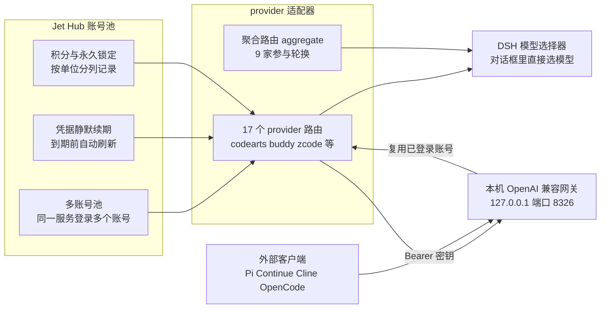

## 为什么需要 providers-hub？（痛点引入）

现在的 AI 编程服务，几乎每家都自带一套账号体系：注册一个、收一次验证码、点一次浏览器授权，然后拿到一个额度池。用得多了，麻烦会以几种固定形态出现：

- **账号和凭据各存一份**：CodeArts 一个、CodeBuddy 一个、ZCode 一个，token 散落在各个客户端的配置文件里，换台机器就要重新登一遍。
- **续期全靠手动**：凭据到期那天，编辑器里的补全和对话突然全部报错，你得回到浏览器把登录流程再走一遍，手头的工作被迫中断。
- **切换没有依据**：哪家还剩多少额度、今天签到没签到、哪个账号被限流，全靠自己记；想换一家试试，先改配置再重启。
- **额度悄悄过期**：每家都有每日签到、每日领取、临时额度，临时的那部分到期就作废，而人不会天天记得去点。
- **接不进 DSH**：DSH 的模型选择器只列出插件注册进来的模型，手工往配置文件里塞账号，界面里根本看不见。

`dsh-providers-hub` 要把这些事收进一个地方：登录、状态、续期、积分领取全部在 Web 界面里的 **Jet Hub 设置页**完成，登录过的渠道则直接出现在 DSH 的模型选择器里，按渠道名和模型名挑就行。

| 维度 | 没有 providers-hub 的日常 | 装了 providers-hub 之后 |
|------|---------------------------|--------------------------|
| 账号管理 | 每家一个客户端、一份配置，凭据分散 | 17 个渠道的账号统一收在 Jet Hub 账号池 |
| 凭据续期 | 到期报错才发现，手动重登 | 到期前静默刷新，无需再次打开浏览器 |
| 同服务多号 | 想同时用两个号得手工改配置 | 多账号池，按可用性自动选号 |
| 额度利用 | 临时额度靠记性，过期作废 | 一键领取积分，聚合路由优先烧临期额度 |
| 接入 DSH | 模型选择器里看不到这些渠道 | 渠道模型直接出现在 DSH 模型选择器 |
| 对外复用 | 每个客户端各配一次上游凭据 | 本机 OpenAI 兼容网关，客户端只拿网关密钥 |

> ### 💡 新人小结：providers-hub 是一张「放所有会员卡的钱包」
>
> 把各家 AI 编程服务想象成不同品牌的超市：
> - **每家一张会员卡** = 每个渠道一个账号，卡里各自有余额和每日优惠；
> - **钱包** = Jet Hub 账号池，卡都在里面，出门只带钱包；
> - **卡片到期自动续** = 凭据静默续期，不用再去柜台排队（重新登录）；
> - **优惠券快过期先花掉** = 聚合路由按最快作废的额度优先使用；
> - **钱包里的卡能借给朋友刷** = 本机 OpenAI 网关，别的客户端用网关密钥就能复用这些账号。
>
> **它不是一个新模型，而是一层「账号与额度」的统一管理，让已有订阅真正被 DSH 用起来。**

**学习路线图**（本文按十段推进）

```text
痛点引入 → 插件身份 → 17 个渠道 → 架构全景 → 四项功能 → 聚合路由 → 安装入口 → 本机网关 → 配置文件 → 排障
为什么     它是什么     接哪些服务     数据怎么流     怎么用      怎么轮换   怎么装    怎么复用     落在哪      卡住了看哪
```

---

## 插件身份：包名、改名与升级代价

先说清「它是谁」，因为这个名字曾经变过，而改名是升级时最容易踩的坑。

包名 `dsh-providers-hub`，当前安装版本 `0.2.1-rc.2`。包自带描述是一句话概括：`one hub for AI coding providers — account login, multi-account pools, silent credential refresh, credit claiming, and a local OpenAI-compatible gateway`。

| 项 | 值 |
|---|---|
| 包名 | `dsh-providers-hub` |
| 当前版本 | `0.2.1-rc.2` |
| 原包名 | `dsh-codearts-auth` |
| 改名起点 | `0.2.0-rc.11` 起改名为 `dsh-providers-hub` |
| 分发方式 | 尚未发布到 npm registry，从 git 仓库安装 |
| 声明的 bundle 补丁 | `dsh.bundle` 补丁（`cordis.patch.yml`） |
| 依赖的宿主服务 | `credentials`、`commands`、`llm`（由 dsh base 提供） |
| 路由数量 | 17 个 provider 路由，外加 1 个聚合路由 `aggregate` |

17 个路由之间**互不覆盖、可以同时使用**；`aggregate` 是独立的一层，后文单独讲。

### 改名带来的后果：插件会「消失」

老 profile 里如果还锁着旧名 `dsh-codearts-auth`，插件会**加载失败并被自动禁用**：宿主报 `N entry did not activate`，界面上直接看不到它，Jet Hub 设置页也不会出现。很多人以为是自己装坏了，其实是名字对不上。

升级时要把**两处一起改**：

| 位置 | 改什么 | 不改的后果 |
|------|--------|------------|
| `dependencies` | 依赖名从 `dsh-codearts-auth` 换成 `dsh-providers-hub` | 安装阶段就解析不到包 |
| `dsh.profile.bundles` | 列表里的名字同样换新 | 组合包层找不到条目，插件不激活 |
| 推荐做法 | 用 `dsh plugin --profile <name>` 的 `remove` 与 `add` 各走一遍，让工具自己写这两处 | 手改容易漏一处，漏了就是上面两种报错 |

落盘形态就是 profile 目录下的 `package.json`，两处正好在同一份文件里（下面是 web profile 的实测原文）：

```json
{
  "name": "dsh-profile-web",
  "private": true,
  "dependencies": {
    "dsh-providers-hub": "https://gitee.com/iJetLi/deepseek-harness-codearts.git"
  },
  "dsh": {
    "profile": {
      "bundles": [
        "@deepseek-ai/dsh-base",
        "@deepseek-ai/dsh-web-app",
        "dsh-providers-hub"
      ]
    }
  }
}
```

参数解释：

| 字段 | 作用 | 注意 |
|------|------|------|
| `dependencies` | 记录树外插件依赖，这里的值直接是 git 仓库地址 | 改名的第一处 |
| `dsh.profile.bundles` | profile manifest 里**按顺序排列**的组合包列表 | 改名的第二处，顺序就是叠加顺序 |
| 前两个 bundle | `@deepseek-ai/dsh-base` + `@deepseek-ai/dsh-web-app`，随 dsh 交付 | 从 dsh 安装目录解析 |
| 第三个条目 | `dsh-providers-hub`，树外插件 | 从 profile 自身的 `node_modules` 解析 |

> ### 💡 新人小结：改名就像「换了身份证号」
>
> - 你在宿舍登记表上写的还是旧名字（`dependencies` 与 `bundles` 两处），门禁按新名册点名，自然点不到你；
> - 点名不到不会报「名字错了」，只会说「这个人没到」（`N entry did not activate`）；
> - 所以换名要**两本册子一起改**，只用工具 `remove` + `add` 走一遍最稳。
>
> **插件「装了却看不见」，第一反应应该是查包名，而不是查安装目录。**

---

## 支持的 17 个渠道（逐行保留）

下表按渠道表原文逐行保留，17 行一行不少。它决定了你能接哪些服务、每家怎么登录、以及有没有积分可领。

| id | 渠道 | 登录方式 | 积分能力 |
|---|---|---|---|
| `codearts` | CodeArts（华为云） | 浏览器回调 | 余额 + 每日签到 |
| `buddy` | CodeBuddy（腾讯） | 浏览器授权 + 轮询 | 余额 + 每日签到 + 成长任务 + 锁定永久积分 |
| `workbuddy` | WorkBuddy（国际版） | 同上 | 余额 + 锁定永久积分（**无签到**） |
| `lobsterai` | LobsterAI（有道） | 浏览器回调 | 余额 + 每日签到 |
| `qoder` | Qoder（阿里系） | 设备码轮询 | 余额 + 每日领取 |
| `qodercn` | Qoder 中国版 | 同上（共用实现） | 余额 + 每日领取 |
| `trae` | TRAE（字节跳动） | 浏览器回调 | 余额 + 签到 |
| `cline` | Cline | WorkOS 设备码轮询 | 余额 |
| `loomy` | Loomy（讯飞） | 短信验证码 | 余额（两个池）+ 每日额度 + 新手任务 |
| `raccoon` | Raccoon Work（商汤） | 微信扫码 / 短信 | 余额 + 一次性登录奖励 |
| `minimax` | MiniMax Code (中国版) | OAuth 设备码 + PKCE | 余额 + 每日签到 |
| `minimaxintl` | MiniMax Code (国际版) | 同上（共用实现） | 余额 + 每日签到 |
| `zcode` | ZCode（智谱 z.ai） | OAuth 设备码 | 余额 + 每日领取（含**营销活动**投放，如 1024 程序员节 5 亿 token） |
| `opencode` | OpenCode | — | 余额 |
| `gemini` | Gemini Code Assist | 浏览器回调 | 余额 |
| `officeace` | OfficeAce（华为 MaaS / 果办） | 华为云 OAuth PKCE | 余额 + 自动领取（**无手动签到入口**） |
| `accio` | Accio（阿里） | 浏览器回调 | 余额（三类桶；**无签到**） |

把「积分能力」一列按可操作性归一下类，排障时更好对号入座（17 个渠道全部覆盖，无遗漏无重复）：

| 积分能力归类 | 渠道 | 依据（渠道表原文） |
|---|---|---|
| 每日签到 / 每日领取 | `codearts`、`lobsterai`、`trae`、`minimax`、`minimaxintl`、`qoder`、`qodercn`、`zcode` | 「余额 + 每日签到」或「余额 + 每日领取」 |
| 签到 + 任务或奖励 | `buddy`、`loomy`、`raccoon` | 「成长任务」「新手任务」「一次性登录奖励」 |
| 无签到 | `workbuddy`、`accio`、`officeace` | 「无签到」「无手动签到入口」 |
| 只有余额 | `cline`、`opencode`、`gemini` | 积分能力一列仅写「余额」 |

两个细节值得先记住：

- `qodercn` 与 `qoder`、`minimax` 与 `minimaxintl` 是「同上（共用实现）」，登录流程一致，但**账号体系不同**，是两个渠道。
- `opencode` 的登录方式一列在渠道表里写的是「—」，源材料未给出具体登录流程；`officeace` 只有自动领取、没有手动签到入口。

> ### 💡 新人小结：这 17 家就是「钱包里的 17 张卡」
>
> - **卡面**（id）是你在模型选择器里看到的前缀，比如 `zcode`、`codearts`；
> - **开卡方式**（登录方式）分三种手感：点浏览器回调的、扫设备码的、收短信或扫码的；
> - **卡的权益**（积分能力）各不相同，有的每天能领、有的一次性、有三家根本没有签到；
> - **别把同品牌的两张卡当一张**：Qoder 与 Qoder 中国版、MiniMax 中国版与国际版都是独立渠道。
>
> **接之前先看清「这张卡能不能签、怎么签」，就不会在「为什么没有签到按钮」上浪费时间。**

---

## 架构全景：从 Jet Hub 账号池到模型选择器

一句话概括数据流：账号进**账号池**，账号池喂给**适配器**，适配器同时供两个出口——DSH 自己的模型选择器，和给外部客户端的本机 OpenAI 网关。



图后四条关系：

1. **账号池是唯一事实来源**：账号、有效期、限流标记都持久化在同一份状态文件里，适配器读它，界面也读它。
2. **适配器只做翻译**：把 DSH 的请求翻译成各渠道的协议，所以 17 家能并存、互不覆盖。
3. **两个出口共用同一批账号**：DSH 模型选择器与本机网关都走适配器，网关**不把上游凭据复制到客户端**。
4. **聚合路由是适配器之上的再一层**：它在同一个真实模型的多个渠道条目之间挑一个发出去，属于「选路」而不是「新渠道」。

> ### 💡 新人小结：这套结构像「公司总机 + 分机」
>
> - **账号池** = 人事档案柜，谁在岗、证件几号到期都记在这里；
> - **适配器** = 总机接线员，你说要找谁，它翻译成对方听得懂的内线号；
> - **模型选择器** = 你桌上的电话，按键就能拨；
> - **聚合路由** = 「打给任意一个能接的人」这种拨法，接线员替你挑最闲的那条线；
> - **本机网关** = 给外单位开的一条专线，对方只拿专线号码，碰不到内部档案。
>
> **记住一句话：所有出口都经过适配器，账号只有一份，不存在「两套凭据各管一半」。**

---

## 功能一：多账号池与凭据静默续期

同一家服务可以登录多个账号，插件把它们组成一个**账号池**，请求时**按可用性自动选号**——某个号被限流或额度耗尽，就换下一个。

续期是静默的：凭据**到期前自动刷新，无需再次打开浏览器**。这也是它相对「手工管 token」最大的省心点。

所有操作都在 **Jet Hub 设置页**完成，插件**不注册任何斜杠命令**——登录、看状态、续期、领积分都是界面按钮，不是聊天框里的指令。

| 要做的事 | 在哪做 | 说明 |
|---|---|---|
| 登录新渠道 | Jet Hub 设置页对应的 provider 面板 | 不走斜杠命令 |
| 同一服务加第二个号 | 同一个面板再登录一次 | 组成账号池，按可用性自动选号 |
| 查看凭据状态 | 面板内 | 账号、有效期、限流标记持久化在状态文件 |
| 续期 | 自动完成 | 到期前静默刷新，无需重开浏览器 |
| 领取积分 | 面板标题栏「一键领取积分」 | 顺序处理该面板下的所有账号 |

一个常见误解：**「不注册斜杠命令」不等于「没有入口」**。入口在 Web GUI 的设置页里，属于界面能力；在对话里敲命令找不到它，是因为它本来就不在那儿。

---

## 功能二：一键领取积分与永久积分锁定

在对应面板的标题栏点「一键领取积分」，插件会**顺序**处理该面板下的所有账号（避免并发请求），并**逐账号显示结果与原因**——哪个号领到了、哪个号为什么没领到，一眼能看到。

汇总时有一个关键设计：**按单位分列，不跨量纲求和**。ZCode 的额度单位是 token，其余渠道是积分，两者不可折算，所以显示形如 `+100.00MToken, +100积分`，而不是加成一个数。

| 行为 | 具体做法 | 原因 |
|------|----------|------|
| 领取范围 | 面板标题栏的「一键领取积分」 | 一次处理该面板下全部账号 |
| 处理顺序 | 顺序处理，不并发 | 避免并发请求打爆上游 |
| 结果呈现 | 逐账号显示结果与原因 | 失败的账号能直接定位 |
| 汇总口径 | 按单位分列，不跨量纲求和 | token 与积分不可折算 |
| 永久积分 | 锁定后只消耗临时积分 | 用完明确报错，不偷偷烧永久积分 |

### 永久积分锁定：15 天规则

`buddy`、`workbuddy`、`loomy` 三家支持锁定永久积分。判定规则只有一条：

- **距扣费截止不足 15 天的算临时积分**，优先消耗；
- **其余算永久积分**，锁定后不再被日常消耗。

锁定之后，插件只烧临时积分；临时积分用完时**明确报错**，而不是悄悄把永久积分用掉。这相当于给「月底可能清零的那部分」和「真金白银买来的那部分」之间修了一道闸门。

锁定的记录**不与账号池同放**：它写在 `$DSH_HOME/jet-hub/` 下的独立 JSON 文档里，避免多个 profile 之间互相覆盖。

> ### 💡 新人小结：两种积分就像「鲜奶与奶粉」
>
> - **临时积分** = 鲜奶，保质期短（距扣费截止不足 15 天），先喝它；
> - **永久积分** = 奶粉，放得住，锁进柜子（锁定永久积分）；
> - **一键领取** = 每天去奶站取一次，取完登记「谁取到了、谁没有」；
> - **按单位分列** = 牛奶按升记、奶粉按罐记，绝不加在一起算总数。
>
> **先花会过期的，锁住不会过期的，账目按单位分开记——这就是它的全部额度策略。**

---

## 功能三：模型列表黑名单

每个 provider 的面板都有「显示列表」按钮，可以逐个开关模型，控制它**是否出现在对话框的模型选择器里**。

规则有两条，都不难记：

- **黑名单制，默认全部显示**：不点开关就是显示，关掉才隐藏；
- **按 provider 隔离**：关掉 `zcode` 的某个模型，不影响别的渠道同名或同族的模型。

黑名单记录同样落在账号池状态文件里（即 `state.json` 的「模型黑名单」字段），跟着状态文件走，而不是只存在界面里。

另有一个环境变量参与筛选：`DSH_HIDE_MODELS_WITHOUT_ACCOUNT` 设为真值时，**没有已登录账号的渠道在模型选择器里整体隐藏**。它和「显示列表」是两个层次——一个按渠道整体隐藏，一个按单个模型开关。

---

## 聚合路由：9 家渠道如何轮换

同一个真实模型（比如某个通用大模型）往往在多个渠道都能用。聚合路由把「同一个真实模型」在各渠道的条目归到一个**规范名**下，请求时自动挑一个渠道发出去。

排序原则很实用：**按「最快作废的额度优先用」自动排序**，先把临期积分烧掉——这和上一节「15 天规则」是同一个思路的延伸。

使用方式两步：

1. 在模型选择器里选 `aggregate` 分组；
2. 不挑模型就选该分组下的 `auto`；想指定模型就选具体的规范名。

容错行为有一条硬边界：某渠道失败时换下一个候选重试，但**只在还没吐出任何可见内容时才切换**——已经流式输出给你的内容不会被「换一家重新说一遍」。

| 分组 | 渠道 |
|------|------|
| 参与轮换（9 家） | `buddy`、`workbuddy`、`loomy`、`codearts`、`zcode`、`lobsterai`、`trae`、`accio`、`officeace` |
| 暂不参与（8 家） | `qoder`、`qodercn`、`cline`、`raccoon`、`minimax`、`minimaxintl`、`opencode`、`gemini` |
| 不参与的渠道还能用吗 | 能，仍可直连使用，只是不进 `aggregate` 的候选池 |

9 加 8 正好是渠道表里的 17 个路由，没有第三个分类。

---

## 安装：交给本机实操教程

该包尚未发布到 npm，安装要走 git 源、先失败一次拿到 `allowBuilds` 键、再重跑；这是操作流程，已收在[Jet Hub 安装与升级](/docs/04-hands-on/JetHub与升级/JetHub安装与升级/)。本节不再重复命令与日志，只保留一条与插件身份相关的结论：包名与 `bundles` 两处必须一起改，旧包名 `dsh-codearts-auth` 残留会导致插件加载失败并被自动禁用。

## 本机 OpenAI 兼容网关：4 个端点复用已登录账号

插件启动后会在 `127.0.0.1:8326` 提供**两套**标准 OpenAI 接口，供 Pi、Continue、Cline、OpenCode、Codex 或其他兼容客户端使用。网关**复用 Jet Hub 已登录账号和现有 provider 适配器，不把上游凭据复制到客户端**。

端点清单（4 个，原文照抄）：

```text
GET  http://127.0.0.1:8326/v1/models
GET  http://127.0.0.1:8326/v1/reasoning-efforts   ← 思考档位对照表
POST http://127.0.0.1:8326/v1/chat/completions    ← OpenAI Chat Completions
POST http://127.0.0.1:8326/v1/responses           ← OpenAI Responses API
```

端点解释：

| 方法与路径 | 用途 | 注意 |
|---|---|---|
| `GET /v1/models` | 列出可用模型 | 客户端初始化时通常先调它 |
| `GET /v1/reasoning-efforts` | 思考档位对照表 | 用来对齐各家的 reasoning 档位 |
| `POST /v1/chat/completions` | OpenAI Chat Completions | 老牌客户端走这条 |
| `POST /v1/responses` | OpenAI Responses API | 新式客户端走这条 |

两套协议**同时可用，没有「格式开关」**，用哪套由客户端请求路径决定——客户端自己会拼路径，你不需要配置。

### 地址、密钥与安全边界

- **host 与端口可改**：`DSH_OPENAI_GATEWAY_HOST` / `DSH_OPENAI_GATEWAY_PORT`。
- **鉴权**：`Authorization: Bearer <网关 API Key>`。密钥优先读 `DSH_OPENAI_GATEWAY_API_KEY`；未设置时，首次启动在 DSH home 的 `openai-gateway/api-key` 生成并持久化，重启不变。
- **默认只绑 `127.0.0.1`，并拒绝通配地址**（`0.0.0.0` / `::`）：填了通配地址会被拒绝并跳过启动。
- **网关是旁路功能**：关闭或启动失败**不影响插件其余功能**，登录、续期、模型选择器照常工作。

> ### 💡 新人小结：网关是「给外单位开的取号窗口」
>
> - **窗口地址** = `127.0.0.1:8326`，只在你自己机器上开；
> - **窗口号码**（Bearer 密钥）= 客户端拿这个来取号，首启自动生成并存在 `openai-gateway/api-key`；
> - **窗口后面还是同一批柜员**（已登录账号与适配器），客户端碰不到你的上游凭据；
> - **窗口不开门也不影响营业** = 旁路功能，失败不拖垮插件其余部分；
> - **只开在本地** = 通配地址一律拒绝，避免把窗口开到大街上。
>
> **它是「复用」而不是「转发凭据」——这是设计上最要紧的一条边界。**

---

## 配置与状态文件速查

插件的数据全部落在 DSH home 下，两个目录各管一摊：

| 项 | 位置 | 说明 |
|---|---|---|
| 账号池 | `$DSH_HOME/jet-hub/state.json` | 账号、有效期、限流标记、模型黑名单、provider 顺序 |
| 网关开关 | 同上，`gatewayEnabled` 字段 | 缺省启用 |
| 供应商显示顺序 | 同上，`providerOrder` | 纯展示偏好，拖动行调整 |
| 永久积分锁定 | `$DSH_HOME/jet-hub/*.json`（独立文档） | 不与账号池同放，避免多 profile 互相覆盖 |
| Token 账本 | `~/.dsh/jet-hub/token-ledger.json` | 历史日聚合（按 UTC+8 日界，90 天） |
| 网关密钥 | DSH home 的 `openai-gateway/api-key` | 未设置环境变量时首启生成并持久化 |

### 常用环境变量

| 变量 | 默认 | 说明 |
|---|---|---|
| `DSH_HIDE_MODELS_WITHOUT_ACCOUNT` | 关闭 | 设为真值时，没有已登录账号的渠道在模型选择器里整体隐藏 |
| `DSH_OPENAI_GATEWAY_ENABLED` | `1` | 设为 `0` / `false` / `off` / `no` 时完全不启动网关 |
| `DSH_OPENAI_GATEWAY_HOST` | `127.0.0.1` | 网关监听地址；填 `0.0.0.0` / `::` 等通配地址会被拒绝并跳过启动 |
| `DSH_OPENAI_GATEWAY_PORT` | `8326` | 网关监听端口 |
| `DSH_OPENAI_GATEWAY_API_KEY` | 自动生成 | 网关 Bearer 密钥 |

两点补充：

- **关闭网关有两条路**：把 `gatewayEnabled` 置为关闭，或设 `DSH_OPENAI_GATEWAY_ENABLED` 为 `0` / `false` / `off` / `no`。后者是进程级的，前者是状态文件级的。
- **别名不要混用**：`providerOrder` 只影响设置页里的显示顺序，不参与选号，也不影响聚合路由的排序——后者只看额度作废速度。

---

## 排障清单：四个高频卡点

> 安装与 `allowBuilds` 相关的报错（`ERR_PNPM_...`、旧包名残留）见[Jet Hub 安装与升级](/docs/04-hands-on/JetHub与升级/JetHub安装与升级/)，本节只列 Jet Hub 运行期的问题。

| 症状 | 最可能的原因 | 怎么确认与修复 |
|------|--------------|----------------|
| 网关连不上 | 端口被占用，或 host 填了 `0.0.0.0` / `::` | 改 `DSH_OPENAI_GATEWAY_PORT`；host 保持 `127.0.0.1`（通配地址会被拒绝并跳过启动） |
| 网关返回鉴权失败 | 缺 `Authorization: Bearer <网关 API Key>` | 用 `DSH_OPENAI_GATEWAY_API_KEY`，或读 DSH home 的 `openai-gateway/api-key` |
| 某渠道找不到签到按钮 | 该渠道本身没有签到 | `workbuddy` / `accio` 无签到；`officeace` 只有自动领取、无手动签到入口 |
| 领取结果看起来「加不起来」 | 额度单位不同 | ZCode 是 token，其余是积分，按单位分列显示，不折算 |

补一句边界：**网关起不来不代表插件坏了**。它是旁路功能，先确认 DSH 里模型选择器是否正常、Jet Hub 设置页是否能打开，再判断问题范围。

---

## 要点总结

1. **身份**：包名 `dsh-providers-hub`、版本 `0.2.1-rc.2`，原名 `dsh-codearts-auth`（`0.2.0-rc.11` 起改名）；升级必须同时改 `dependencies` 与 `dsh.profile.bundles`，否则宿主报 `N entry did not activate` 并自动禁用。
2. **覆盖**：17 个 provider 路由互不覆盖、可同时使用，外加 1 个聚合路由 `aggregate`；登录、状态、续期、领取全在 Jet Hub 设置页，**不注册斜杠命令**。
3. **额度策略**：一键领取按单位分列（token 与积分不折算）、逐账号顺序处理；`buddy` / `workbuddy` / `loomy` 支持永久积分锁定，距扣费截止不足 15 天算临时、优先消耗。
4. **安装**：包未上 npm，安装步骤与 `allowBuilds` 键轮换见[Jet Hub 安装与升级](/docs/04-hands-on/JetHub与升级/JetHub安装与升级/)；本篇只保留「装完两处都要写」的结论。
5. **两个出口共用一套账号**：DSH 模型选择器与本机 OpenAI 兼容网关（`127.0.0.1:8326`，4 个端点，Bearer 密钥，拒绝通配地址）；网关是旁路，失败不影响其余功能。

---

## 接下来读什么

- profile、bundle 与 patch 的基础概念：[DSH 是什么](/docs/03-dsh/认识DSH/DSH是什么/)
- Web GUI 的运行形态与会话环境变量：[WebGUI](/docs/03-dsh/运行形态/WebGUI/)
- 插件如何声明 `dsh.bundle` 补丁并注入服务：[Cordis 插件体系](/docs/03-dsh/运行形态/Cordis插件体系/)
- 从 Git 源安装、升级与 allowBuilds 排障：[Jet Hub 安装与升级](/docs/04-hands-on/JetHub与升级/JetHub安装与升级/)
- 模型服务的协议背景：[MCP 与 ACP 协议](/docs/02-agent-tools/协议标准/MCP与ACP协议/)
- 生态板块总览：[生态实践](/docs/03-dsh/)

---

> ### 💡 新人小结：providers-hub 学完了，记住这 5 点
>
> 1. **它的价值是「整合」而不是「新模型」**：把 17 个渠道的账号、凭据、额度收进一个 Jet Hub 账号池，再统一接进 DSH 模型选择器。
> 2. **改过名，所以升级要看两处**：`dsh-codearts-auth` 到 `dsh-providers-hub`，`dependencies` 与 `dsh.profile.bundles` 少改一个就是「插件消失」。
> 3. **额度要按单位看**：ZCode 的 token 与别家的积分不能相加；临期积分优先烧，永久积分锁住不动。
> 4. **安装流程不在本篇展开**：先失败、照抄报错键、再重跑的三步见教程；本篇只记「装完两处都要写」。
> 5. **网关是旁路，不是主路**：4 个端点跑在 `127.0.0.1:8326`，只为复用已登录账号；它挂了，插件其余功能照常。
