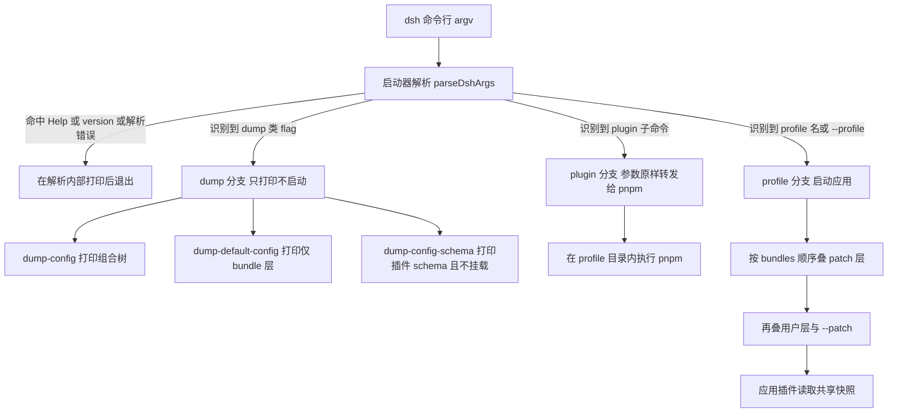

## 为什么需要一份 dsh CLI 参考？（痛点引入）

装好 `dsh` 之后，真正让人停在原地的往往不是「不会敲命令」，而是「敲完不知道发生了什么」：

- `dsh --help` 只有一屏，七个 flag 里三个都叫 dump，光看名字分不清哪个会启动、哪个只打印、哪个连 profile 都不挂载。
- 想给 Web 应用换个端口，把 `--port` 写在 `--profile` 前面，结果启动器不认这个 flag，命令直接失败退出，而真实原因藏在「谁能解析这个参数」这条规则里。
- 想改一份 profile 的配置，却不知道改动到底落在 `cordis.patch.yml`、`--patch` 还是 dump 出来的那棵树里，只能反复启动看效果。
- 想给某个 profile 装插件，翻遍 `dsh` 的帮助也找不到 `install` 子命令，因为插件安装能力根本不在 `dsh` 自己身上。
- 写脚本批量调用时，最怕命令失败了却返回 0，只能靠肉眼看输出判断成败。

这些问题的共同点是：**`dsh` 是一个启动器，它只解析自己认识的那部分参数，剩下的全部转手给被启动的应用**。不理解这条分工，就会一直把「启动器的规矩」和「应用的规矩」混在一起。

| 维度 | 没有参数参考时的痛苦 | 读完本文之后 |
|------|----------------------|----------------|
| 看清入口 | 只看到一屏帮助，猜每个 flag 的行为 | 七个 flag 逐个对照：语义、是否启动、是否携带应用参数 |
| 换端口 | 把 `--port` 当启动器 flag，命令失败 | 明确 `--port` 属于 web 应用，必须写在 profile 名之后 |
| 查配置 | 只能真启动一次再看效果 | 三个 dump flag 各管一段，不启动即可检查组合后的树 |
| 装插件 | 在 `dsh` 里找 install 子命令 | `dsh plugin` 把参数原样转发给 pnpm，能力由 pnpm 提供 |
| 写脚本 | 失败与成功无法自动区分 | 无效命令、跨模式选项、致命错误都以非零状态退出 |

> ### 💡 新人小结：dsh 的命令行像什么？
>
> 把 `dsh` 想象成写字楼一层的「前台接线员」：
> - **前台只认自己的登记表**：`--profile`、`--patch`、三个 dump flag 就是登记表上那几项，别的一概不接。
> - **访客证交给里面的人**：从第一个它不认识的词开始，剩下的原封不动交给被启动的应用。
> - **有三条不同的通道**：正常通道（启动）、查档案通道（dump）、找外包通道（plugin 转 pnpm）。
> - **说不清就当场拒绝**：无效命令、走错通道的选项，一律非零退出，不会假装成功。
>
> **本文把这张登记表逐行摊开：谁解析、谁执行、写错了会怎样。**

**学习路线图**（按命令实际执行顺序推进）

```text
版本对齐 → 帮助原文 → 七个 flag → dump 三兄弟 → 应用参数分界 → plugin 子命令 → invocation 类型 → 门禁与排查 → 要点总结
先确认版本  逐字保留    逐个语义    对比与选型      第一条规矩        转发 pnpm      解析器的四种结果    非零退出与保留名
```

---

## 第一件事：用 dsh --version 确认你在哪一版

任何命令行参考都要先对齐版本——同一个 flag 在不同版本上的行为可能不同，而本文的每一条事实都锁定在下面这个版本上。

```sh
# ========== ✅ 推荐写法：动手前先确认版本 ==========
dsh --version
# 输出: 0.2.1-rc.2
```

（出处：本机实测，2026-10-24；与 package.json `version: "0.2.1-rc.2"` 一致。）

版本事实速查：

| 项 | 值 | 说明 |
|----|----|------|
| 版本号 | `0.2.1-rc.2` | `dsh --version` 实测输出，与 package.json 的 `version` 同值 |
| npm 包名 | `@deepseek-ai/dsh` | 包身份，安装来源 |
| 可执行命令 | `dsh` | `bin` 指向 `lib/bin.js`，包内仅此一个 bin |
| 包描述 | `dsh CLI: profile launch, plugin management, and configuration inspection` | 三件事正好对应本文三段：启动、插件管理、配置检查 |

（出处：package.json `name` / `version` / `bin` / `description`；`dsh --version` 本机实测，2026-10-24。）

包描述里的三件事值得单独记一笔：**启动、插件管理、配置检查**。本文后面所有章节都挂在这三件事上——理解了这一点，就不会指望在 `dsh` 里找到一个「编辑配置」的子命令，因为配置检查只提供打印，不提供写入。

> ### 💡 新人小结：为什么第一件事是查版本？
>
> 把版本号想成「说明书上的印刷批次」：
> - 同一个 flag，不同批次的说明书可能写法不同，照着旧说明书拧螺丝会拧坏；
> - `dsh --version` 就是你手上这本说明书的批次号；
> - 版本兼容检查也以这个值为准——插件声明的 `engines.dsh` 范围，比对的就是它。
>
> **先确认批次，再照说明书动手；版本不符时，先解决版本问题，再谈参数。**

---

## dsh --help 原文：启动器自己说了什么

下面是本机实测的完整帮助输出，逐字保留，未做任何删减或改写。它是本文所有 flag 语义的第一手依据。

```text
Usage: dsh [--profile] <name> [options] [app-args...]
       dsh plugin --profile <name> <pnpm-args...>

dsh: boot a DeepSeek Harness profile — an ordered stack of plugin-bundle patch
layers under your own overrides.

Arguments:
  args                           arguments for the booted profile's app (see:
                                 dsh --profile <name> --help)

Options:
  -V, --version                  output the version number
  --profile <name>               the profile under $DSH_HOME/profiles to boot
  --from-default-profile <name>  replace a custom profile with a fresh copy of a
                                 shipped profile template
  --patch <path>                 extra patch-list overlay applied after the
                                 profile layer (repeatable)
  --dump-config                  print the composed profile tree and exit
  --dump-config-schema           print JSON Schema for profile entries and
                                 patches without mounting
  --dump-default-config          print the profile tree without its user layer
                                 or --patch overlays and exit

Examples:
  dsh web                                   boot the web profile (same as: dsh --profile web)
  dsh rescue --from-default-profile web
                                            recreate rescue from the shipped web template, then boot it
  dsh headless "run the tests"              answer one task, print the result, and exit
  dsh tui --patch ./extra.yml               boot a custom profile with one extra overlay
  dsh tui --resume <session>                arguments after the launcher flags reach the app
  dsh web --help                            the web app's own flags and help
  dsh plugin --profile tui add <package>    install a plugin into the tui profile
```

（出处：本机实测 `dsh --help`，2026-10-24。）

这段输出可以拆成四个区块，每一块的职责都不一样：

| 区块 | 内容 | 你要从这里拿到什么 |
|------|------|--------------------|
| Usage | 两行语法 | 一行是常规启动（`--profile` 可省），一行是 plugin 子命令 |
| 描述段 | boot a DeepSeek Harness profile | 启动器把 profile 定义为「插件组合包 patch 层的有序堆叠」 |
| Arguments | `args` | 应用参数属于「被启动的 profile 的应用」，取帮助要再进一层 |
| Options | 七个 flag | 启动器只解析这七项，其余一概不管 |
| Examples | 七条示例 | 每条示例就是一段可直接照抄的场景 |

有两处细节最容易看漏：

1. **Arguments 里只有 `args` 一项**，而它的说明带着一句指路「see: `dsh --profile <name> --help`」——应用自己的 flag 不在这一屏里，要看应用的帮助得再问一次（出处：`dsh --help` 实测）。
2. **`--patch` 的说明标着 `(repeatable)`**，并且是「applied after the profile layer」——它叠在 profile 层之后，而且可以给多次（出处：`dsh --help` 实测）。

> ### 💡 新人小结：一屏帮助为什么看不懂？
>
> 把它想成「电梯里的楼层指示牌」：
> - 指示牌只列这部电梯能停的楼层（七个 flag），不会告诉你每层楼里长什么样；
> - `Arguments` 那一行相当于「到站后请换乘另一部电梯」，应用参数的世界在另一块指示牌上；
> - `Examples` 是物业贴的「常去楼层」便利贴，照抄最不容易错。
>
> **帮助输出只回答「能写什么」，不回答「写了会怎样」——后者才是本文的主体。**

---

## 七个启动器 flag 逐个讲透

启动器只解析下表这七项。任何一项理解错，命令的行为都会和你预期的不一样。

| Flag | 语义 | 是否启动 profile | 出处 |
|------|------|------------------|------|
| `-V, --version` | 输出版本号后退出（实测输出 `0.2.1-rc.2`） | 否 | `dsh --help` 实测；args.d.ts 注明版本与错误在解析内部退出 |
| `--profile <name>` | 启动 `$DSH_HOME/profiles` 下的指定 profile；`dsh <name>` 是它的缩写 | 是 | `dsh --help` 实测；README.zh.md §入口模式 |
| `--from-default-profile <name>` | 用随附模板的全新副本替换该自定义 profile，然后启动它 | 是 | `dsh --help` 实测；README.zh.md §入口模式 |
| `--patch <path>` | 在 profile 层之后追加的额外 patch-list 覆盖层，可重复，按 argv 顺序依次应用 | 是（跟随所在的启动请求） | `dsh --help` 实测；args.d.ts `ProfileInvocation.patches` |
| `--dump-config` | 打印组合后的 profile 树并退出 | 否 | `dsh --help` 实测；args.d.ts `DumpConfigInvocation` |
| `--dump-config-schema` | 不挂载 profile，打印描述 profile entry 与 patch 的 JSON Schema | 否，且不挂载 | `dsh --help` 实测；args.d.ts `DumpConfigSchemaInvocation` |
| `--dump-default-config` | 打印不含用户层与 `--patch` 覆盖层的 profile 树并退出 | 否 | `dsh --help` 实测；args.d.ts `defaultOnly` |

（出处：`dsh --help` 本机实测，2026-10-24；`lib/types/args.d.ts` 对应接口注释。）

### --profile 与它的缩写形式

`dsh <name>` 与 `dsh --profile <name>` 完全等价：帮助的 Examples 第一行写得很直白——`dsh web` 就是 `dsh --profile web`（出处：`dsh --help` Examples 实测；args.d.ts 模块注释「`dsh <name>` abbreviates `dsh --profile <name>`」）。所以本文后面出现的 `dsh web`、`dsh tui` 都要读成「`--profile` 被省略的写法」。

### --from-default-profile 是替换，不是追加

这个 flag 的动词是 **replace**：用随附模板的**全新副本替换**一个自定义 profile，然后启动它（出处：`dsh --help` 实测；README.zh.md §入口模式）。帮助里的示例 `dsh rescue --from-default-profile web` 就是从随附 web 模板重建 `rescue` 再启动（出处：`dsh --help` Examples 实测）。

```sh
# ========== ✅ 推荐写法：用一个随附模板重建自定义 profile，再启动 ==========
dsh rescue --from-default-profile web

# ========== 不推荐写法（仅展示） ==========
# ❌ 把它当成「给已有 profile 打补丁」：动词是 replace，
#    你以为在追加，其实旧内容被整份替换掉了
dsh rescue --from-default-profile web   # 已有 rescue 改动会随替换消失
```

### --patch 是覆盖层，而且可以叠多层

`--patch <path>` 指定的是「在 profile 层之后应用的额外 patch-list 覆盖层」，帮助文案标了 `(repeatable)`，args.d.ts 进一步写明按 **argv 顺序**应用（出处：`dsh --help` 实测；args.d.ts `ProfileInvocation.patches`）。

```sh
# ========== ✅ 推荐写法：需要临时试一层覆盖时，把 --patch 写在 profile 名之后 ==========
dsh tui --patch ./extra.yml      # 启动 tui profile，并在 profile 层之后叠一层 extra.yml

# ========== 不推荐写法（仅展示） ==========
# ❌ 把 --patch 当成持久配置手段：它只影响这一次启动，
#    要长期生效得写进 profile 的 cordis.patch.yml
```

### 三个 dump flag：不启动也能看配置

三个 dump flag 打印的东西完全不同，先看对比表再动手：

| Flag | 打印内容 | 是否启动 profile | 是否挂载 profile | 典型用途 |
|------|----------|------------------|------------------|----------|
| `--dump-config` | 组合后的 profile 树，含用户层与 `--patch` 覆盖层 | 否 | 是（需要组合） | 排查「现在生效的到底是哪一层」 |
| `--dump-default-config` | 不含用户层与 `--patch` 覆盖层的 profile 树，即仅 bundle 层 | 否 | 是（需要组合） | 看清模板/默认组合长什么样 |
| `--dump-config-schema` | 描述 profile entry 与 patch 的 JSON Schema | 否 | 否（without mounting） | 检查插件声明了哪些配置项，不执行插件 |

（出处：`dsh --help` 三个 flag 的帮助文案实测；args.d.ts 对应接口注释；README.zh.md §Profile。）

三条必须记住的差别：

1. **`--dump-config` 是「加上你的覆盖」，`--dump-default-config` 是「去掉你的覆盖」**：args.d.ts 的 `defaultOnly` 注释原话是「Omit the profile's user layer and --patch overlays; print bundle layers only」（出处：args.d.ts `DumpConfigInvocation.defaultOnly`）。
2. **`--dump-config-schema` 打印的是 schema，不是配置值**，而且它**不挂载** profile；检查不受信任的插件前，应先阅读 schema dump 的安全性与范围说明（出处：README.zh.md §Profile）。
3. **dump 类模式不接收应用参数**：`DumpConfigInvocation` 与 `DumpConfigSchemaInvocation` 这两个接口里都没有 `args` 字段，只有 `ProfileInvocation` 带 `args`（出处：args.d.ts 四个接口定义）。

```sh
# ========== ✅ 推荐写法：排障时按「默认 → 组合 → schema」三层递进 ==========
dsh --profile web --dump-default-config   # 先看只有 bundle 层时是什么样
dsh --profile web --dump-config           # 再看叠上用户层与 --patch 之后是什么样
dsh --profile web --dump-config-schema    # 最后看插件声明的 schema，不挂载、不执行

# ========== 不推荐写法（仅展示） ==========
# ❌ 对 dump 结果追加应用参数：dump 类调用不携带 args 字段，
#    这些词不归它管（出处：args.d.ts 四个 interface 定义）
dsh --profile web --dump-config --port 8080
```

（出处：README.zh.md §Profile「使用 `--dump-default-config` 和 `--dump-config` 可在不启动的情况下检查组合后的配置树」。）

源材料未给出三个 dump 命令的输出样例——组合树的打印格式、schema 的字段形态，素材都没有收录，本文因此不写任何「预期输出」。

> ### 💡 新人小结：dump 三兄弟怎么记？
>
> 把配置树想成一件「可以分三段拆开看的外套」：
> - `--dump-default-config` = 只看出厂内胆（bundle 层），把你加的所有东西拿掉；
> - `--dump-config` = 穿上你所有配件后的完整样子（含用户层与 `--patch`）；
> - `--dump-config-schema` = 只看吊牌上写的「这件衣服有哪些可调部位」，连衣服都不上身（不挂载）。
>
> **要判断「某项配置是谁给的」，先看内胆，再看完整版，两层一对比，出处就出来了。**

---

## 应用参数：从第一个不认识的 token 开始

这是整个 CLI 里最容易被忽略、又最容易踩坑的一条规则：

- 启动器**只解析自身的 flag**，并把其后的所有内容交给已启动的 profile；注入该 profile 的任意应用插件都可以解析这份**共享的不可变快照**（`dsh-cmdline`）。
- 启动器无法识别的**第一个 token** 标志着应用参数的开始。（出处：README.zh.md §应用参数。）

args.d.ts 的模块注释表述同义：「the first token this parser does not recognize starts the inner arguments」。注释里给了两个例子：`dsh --profile tui --resume abc` 启动 tui profile 并把 `--resume abc` 交给它；`dsh --profile web -h` 打印的是 **web 应用的**帮助，而不是启动器的（出处：args.d.ts 模块注释）。

README「应用参数」节的示例原文共 5 行，全量保留如下：

```sh
dsh --profile web --port 8080       # --port belongs to the web app
dsh --profile tui --resume <id>     # example, assuming the tui profile is installed; --resume belongs to the terminal app
dsh --profile headless "run the tests"
dsh --profile web --help            # the web app's flags, not the launcher's
dsh --help                          # the launcher's own help
```

（出处：README.zh.md §应用参数代码块；README.md §App arguments 逐行一致。）

逐行拆解这 5 行：

| 命令行 | 谁的参数 | 分界点在哪 | 结论 |
|--------|----------|------------|------|
| `dsh --profile web --port 8080` | `--port` 属于 web 应用 | 启动器不认 `--port`，它成为第一个应用 token | 端口这类应用配置写在 profile 名之后 |
| `dsh --profile tui --resume <id>` | `--resume` 属于终端应用 | 同上，`--resume` 起为应用参数 | 前提是该 tui profile 已安装 |
| `dsh --profile headless "run the tests"` | 整句任务文本属于 headless 应用 | 引号里的字符串不是启动器 flag | 带空格的参数要整体加引号 |
| `dsh --profile web --help` | `--help` 被当成应用参数 | 启动器只在自身 flag 集合里找，`--help` 不在其中 | 打印的是 web 应用的帮助 |
| `dsh --help` | 启动器自己的帮助 | 位置在所有应用参数之前 | 打印启动器帮助 |

最后一行与第四行的对照最值得记住：**同一个 `--help`，写在 profile 名之前是启动器的，写在之后是应用的**。想看应用的 flag 清单，就得用 `dsh --profile <name> --help` 这种形态（出处：`dsh --help` Arguments 段的指路说明）。

```sh
# ========== ✅ 推荐写法：先看启动器帮助，再看应用帮助 ==========
dsh --help                    # 启动器自己的七个 flag
dsh --profile web --help      # web 应用自己的 flag

# ========== 不推荐写法（仅展示） ==========
# ❌ 想查启动器帮助却写成了 dsh web -h：
#    -h 落在应用参数区，打印的是 web 应用的帮助（出处：args.d.ts 模块注释）
dsh web -h
```

三个由此推出的实践结论：

1. **顺序即语义**：启动器 flag 必须在应用参数之前，一旦出现它不认识的词，后面的内容它一概不看。
2. **应用参数是共享快照**：注入 profile 的任意应用插件都能读到同一份不可变快照 `dsh-cmdline`，所以同一个参数可以被多个插件各自解释（出处：README.zh.md §应用参数）。
3. **不确定时先分层问帮助**：先 `dsh --help` 确认启动器能写什么，再 `dsh --profile <name> --help` 确认应用能写什么。

> ### 💡 新人小结：第一个不认识的词，就是换岗的信号
>
> 把它想成「机场的国内出发与安检口」：
> - 值机柜台（启动器）只办它认识的业务：七个 flag；
> - 一旦递上的材料它没见过（第一个不认识的 token），就当场把你送到安检口（应用）；
> - 过了安检口之后的材料，柜台不再复核，全由里面的人处理；
> - 所以 `--port`、`--resume`、`--help` 这些词放在哪一侧，决定了谁来回话。
>
> **参数不是按含义分家的，是按位置分家的：第一个启动器不认识的词，就是分界线。**

---

## dsh plugin：把 pnpm 请进 profile 目录

插件安装能力不在 `dsh` 自己身上。`dsh plugin` 做的是**转发**：在 profile 目录内，把参数原样（verbatim）交给 pnpm。

- 语法：`dsh plugin --profile <name> <pnpm-args...>`（出处：`dsh --help` Usage 第二行，实测）。
- 语义：管理 profile 的插件依赖，做法是**在 profile 目录内把 `args` 原样转发给 pnpm**（出处：args.d.ts `PluginInvocation`）。
- 边界：npm CLI 会拒绝针对 `desktop` 的插件管理请求；只有 Desktop 的安装载体能管理它（出处：args.d.ts `parseDshArgs.manageDesktopProfile` 注释）。

| 事实 | 说明 |
|------|------|
| 能力边界 | `dsh plugin` 没有自己的子命令表；它能做什么取决于你递给 pnpm 什么参数 |
| 共享写锁 | 插件管理器与 `dsh plugin` 共享包操作和 profile 写锁，避免两边同时改坏依赖 |
| 实操入口 | 安装、`allowBuilds`、升级与排障见[配置、插件与日常运维](/docs/04-hands-on/配置与日常/配置插件与日常运维/) |

---

## 四种 invocation：解析器只会产出这四种结果

`lib/types/args.d.ts` 把命令行解析的结果定义成了一个联合类型，只有四种可能。理解这四种形态，比记住七个 flag 更有用——因为它回答了「这条命令最终会去做什么」。

| 类型 | mode 值 | 携带字段 | 用途 |
|------|---------|----------|------|
| `ProfileInvocation` | `profile` | `profile` / `fromDefaultProfile`（可选）/ `patches` / `args` | 启动指定 profile，并把内部参数原样交给它 |
| `DumpConfigInvocation` | `dump-config` | `profile` / `fromDefaultProfile`（可选）/ `defaultOnly` / `patches` | 打印组合后的 profile 树、不启动；`defaultOnly` 为真时对应 `--dump-default-config` |
| `DumpConfigSchemaInvocation` | `dump-config-schema` | `profile` / `fromDefaultProfile`（可选）/ `patches` | 不挂载 profile，打印声明的插件 schema |
| `PluginInvocation` | `plugin` | `profile` / `args` | 在 profile 目录内把 args 原样转发给 pnpm |

（出处：args.d.ts `DshInvocation` 类型及其四个 interface；字段注释逐条摘译。）

下表把四种形态的字段差异摊平看，重点看 `args` 出现在哪一行：

| 能力 | ProfileInvocation | DumpConfigInvocation | DumpConfigSchemaInvocation | PluginInvocation |
|------|-------------------|----------------------|----------------------------|------------------|
| 指定 profile | 有 | 有 | 有 | 有 |
| 用模板替换并重建 | 有 | 有 | 有 | 无 |
| 叠加 `--patch` 覆盖层 | 有 | 有 | 有 | 无 |
| 携带应用参数 | **有** | 无 | 无 | 有（但语义是 pnpm 参数） |
| 是否启动应用 | 是 | 否 | 否 | 否（只跑 pnpm） |

（出处：args.d.ts 四个 interface 定义的字段清单。）

下图是启动器从收到命令行到分流的全貌：



图后解读三点：

1. **退出与执行是两条路**：Help、version 与错误都在 `parseDshArgs` **内部**打印并退出，函数签名是 `parseDshArgs(argv, version, manageDesktopProfile?)`，一次解析只产出一个 invocation（出处：args.d.ts 声明及注释）。
2. **dump 分支不进入应用**：它消费 profile / fromDefaultProfile / patches，没有 `args` 字段，所以打印完就结束（出处：args.d.ts 四个 interface 定义）。
3. **plugin 分支连 profile 都不挂载**：它只是换个工作目录去跑 pnpm，profile 的插件真正被加载发生在下一次启动时（出处：args.d.ts `PluginInvocation` 注释）。

> ### 💡 新人小结：为什么解析器只给四种结果？
>
> 把它想成「快递分拣线上的四个筐」：
> - 一个筐装「要送出去的件」（启动 profile）；
> - 一个筐装「要复印的存档」（打印配置树）；
> - 一个筐装「要查的清单」（打印 schema）；
> - 一个筐装「要转给外协的活」（转 pnpm）。
>
> 每个件只能落进一个筐，落筐之后行为就定了。**看懂自己这件货落在哪个筐里，比记住 flag 拼写更能避免误操作。**

---

## 无效输入、非零退出与 desktop 保留名

这三件事放在一起讲，因为它们都关于「启动器什么时候说不」。

```sh
# ========== ✅ 推荐写法：用退出码判断成败，而不是靠肉眼读输出 ==========
dsh --profile web --dump-config
echo $?          # 0 表示本次调用正常结束；打印本身成功即为成功
# 说明: 源材料未给出 dump 成功时的具体退出码取值，此处只演示判断方式
```

（出处：README.zh.md 首段——无效命令、来自其他模式的选项，以及致命的配置或启动错误都会以非零状态退出。）

| 情况 | 结果 | 依据 |
|------|------|------|
| 无效命令 | 以非零状态退出 | README.zh.md 首段 |
| 来自其他模式的选项 | 以非零状态退出 | README.zh.md 首段 |
| 致命的配置错误 | 以非零状态退出 | README.zh.md 首段 |
| 致命的启动错误 | 以非零状态退出 | README.zh.md 首段 |
| 解析阶段的 Help / version | 在 `parseDshArgs` 内部打印并退出 | args.d.ts `parseDshArgs` 注释 |
| 对 `desktop` 的启动请求 | 被 CLI 拒绝 | README.zh.md §入口模式表后段落 |
| 对 `desktop` 的配置 dump 请求 | 被 CLI 拒绝 | README.zh.md §入口模式表后段落 |
| 对 `desktop` 的插件管理请求 | npm CLI 拒绝，Desktop 安装载体可用 `manageDesktopProfile` 管理 | args.d.ts `parseDshArgs.manageDesktopProfile` 注释 |

关于 `desktop` 这个名字，需要把三层关系说清：

- `desktop` 名称**保留给 Electron 持有的 profile**，因此 CLI 会拒绝针对它的**启动**和**配置 dump**请求（出处：README.zh.md §入口模式表后段落）。
- npm CLI 也会拒绝它的**插件管理**请求；Desktop 内置命令可以使用该安装的运行时管理已初始化的 Desktop profile（出处：README.zh.md §入口模式表后段落）。
- 代码层面的开关是 `parseDshArgs` 的第三个参数 `manageDesktopProfile`：只有 Desktop 的安装载体（installed carrier）才被允许管理它的保留 profile（出处：args.d.ts `parseDshArgs` 声明）。

```sh
# ========== ✅ 推荐写法：自己的实验就用非保留名 ==========
dsh --profile tui --dump-config      # 普通 profile 可以正常 dump

# ========== 不推荐写法（仅展示） ==========
# ❌ 用保留名做实验：desktop 归 Electron 持有的 profile，
#    CLI 拒绝它的启动与配置 dump 请求（出处：README.zh.md §入口模式表后段落）
dsh --profile desktop
```

源材料未给出拒绝时的具体提示文案与退出码数值，因此本文不给「预期输出」，只给结论：**这条路会被拒绝**。

> ### 💡 新人小结：非零退出为什么值得单独记？
>
> 把退出码想成「门禁的放行灯」：
> - 绿灯（0）= 这次调用按规矩走完了；
> - 红灯（非零）= 命令无效、选项走错门、配置致命、启动失败——四类事故统一亮红灯；
> - 灯是给脚本看的，不是给人看的：人眼容易把一段报错当成噪音滑过去，脚本则只会看灯。
>
> **凡是要写进脚本的 dsh 调用，都以退出码为准；报错文案不保证稳定，退出码是契约。**

---

## 常见误用与排查

下面这张表按「症状 → 原因 → 正确做法」组织，覆盖本文讲过的所有规则。

| 症状 | 最可能的原因 | 正确做法 | 依据 |
|------|--------------|----------|------|
| 加了 `--port` 后命令直接失败 | `--port` 是应用参数，写在了 profile 名之前被当成启动器 flag 校验 | 写成 `dsh web --port 8080` 或 `dsh --profile web --port 8080` | README.zh.md §应用参数 |
| 想查启动器帮助，却看到应用的 flag | `--help` 落在应用参数区（第一个不认识的 token 起） | 启动器帮助用 `dsh --help`，应用帮助用 `dsh --profile <name> --help` | `dsh --help` Arguments 段；args.d.ts 模块注释 |
| dump 时附带的应用参数没有生效 | dump 类 invocation 没有 `args` 字段 | dump 只用来打印，不要指望它接收应用参数 | args.d.ts 四个 interface 定义 |
| 以为 `--dump-config-schema` 会打印当前配置值 | 它打印的是 schema，不是值，且不挂载 profile | 要看值用 `--dump-config`，要看可配项用 `--dump-config-schema` | `dsh --help` 实测；README.zh.md §Profile |
| 在 `dsh` 里找不到安装插件的子命令 | 安装能力由 pnpm 提供，`dsh` 只做转发 | 用 `dsh plugin --profile <name>` 加 pnpm 参数 | args.d.ts `PluginInvocation` |
| 用 `--from-default-profile` 后自定义改动没了 | 它的动词是 replace，用全新副本替换整个 profile | 需要保留改动就不要用替换；替换前先备份 profile 目录 | `dsh --help` 实测；README.zh.md §入口模式 |
| 启动 `desktop` 被拒 | `desktop` 是保留给 Electron 持有 profile 的名字 | 换一个非保留名做实验 | README.zh.md §入口模式表后段落 |
| 脚本把失败当成功 | 没有检查退出码 | 用 `if dsh ...; then` 或检查 `$?` | README.zh.md 首段 |

（出处：逐行依据见表内「依据」列。）

排查顺序建议固定成三步，避免在多个假设之间来回跳：

1. **先分层**：这是启动器的问题，还是应用的问题？看参数落在分界线的哪一侧。
2. **再看模式**：这条命令属于启动、dump 还是 plugin？dump 与 plugin 都不启动应用，很多「没生效」其实是「根本没启动」。
3. **最后看名字**：profile 名是否命中保留名，路径是否在 `$DSH_HOME/profiles/<name>` 下。

> ### 💡 新人小结：排查为什么建议「先分层再查细节」？
>
> 把它想成「家里跳闸」：
> - 先看是这一路电跳了，还是整栋楼都停了（分层：启动器还是应用）；
> - 再看是哪个开关模式不对（模式：启动、dump、plugin）；
> - 最后才逐个电器拔插（名字、路径、参数拼写）。
>
> **顺序对了，八成的「命令没反应」在第一层就能定位。**

---

## 要点总结

1. **先对版本再动手**：本机 `dsh --version` 输出 `0.2.1-rc.2`，与 package.json 的 `version` 同值；版本兼容检查比对的就是这个值。
2. **启动器只认七个 flag**：`-V/--version`、`--profile`、`--from-default-profile`、`--patch`、`--dump-config`、`--dump-config-schema`、`--dump-default-config`，别的一概不解析。
3. **第一个不认识的 token 起为应用参数**：这是全篇最重要的一条规则，`--port`、`--resume`、`--help` 放在 profile 名之后都归应用；`dsh --profile web --help` 问的是 web 应用。
4. **dump 三兄弟分工明确**：`--dump-config` 看组合后（含用户层与 `--patch`）、`--dump-default-config` 只看到 bundle 层、`--dump-config-schema` 只看插件声明的 schema 且不挂载；三者都不启动、都不携带应用参数。
5. **`dsh plugin` 只是 pnpm 的转发口**：`dsh plugin --profile <name> <pnpm-args...>` 在 profile 目录内把参数原样交给 pnpm；它与管理器共享写锁，更新依赖会保留已停用的组合包选择。
6. **四种 invocation 覆盖全部结果**：`profile`、`dump-config`、`dump-config-schema`、`plugin`；只有 `profile` 与 `plugin` 带 `args`，前者是应用参数、后者是 pnpm 参数。
7. **失败一定有声**：无效命令、跨模式选项、致命配置或启动错误都非零退出；`desktop` 是保留名，启动、dump、插件管理三条路都被 CLI 拒绝。

---

> ### 💡 新人小结：dsh CLI 学完了，记住这 5 点
>
> 1. **命令只有一个入口，行为分三条通道**：启动、dump、plugin，先认清自己在哪条通道上。
> 2. **参数按位置分家，不按含义分家**：`dsh --help` 是启动器的，`dsh --profile web --help` 是应用的。
> 3. **dump 只读不跑**：想看配置就用 dump，别为了看配置先启动一次；想看 schema 就别期待配置值。
> 4. **装插件是 pnpm 的活**：`dsh plugin` 递单子，能力与 pnpm 一致，写锁与插件管理器共用。
> 5. **退出码是契约**：写脚本只信非零退出，不信报错文案。

---

## 接下来读什么

- profile 与配置树的完整概念：[DSH 是什么](/docs/03-dsh/认识DSH/DSH是什么/)
- Web profile 的运行形态与环境变量：[Web GUI](/docs/03-dsh/运行形态/WebGUI/)
- patch 方言、热重载与版本豁免：[Cordis 插件体系](/docs/03-dsh/运行形态/Cordis插件体系/)
