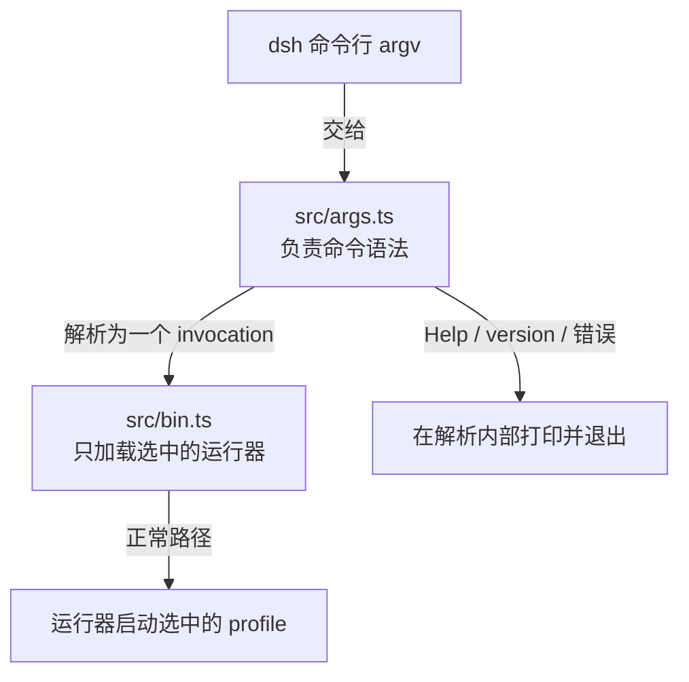
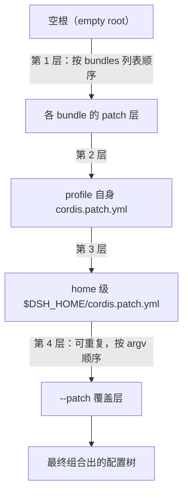

## 为什么需要 DSH？（痛点引入）

想在自己的机器上跑一套「带 Web 界面、能挂插件、能接 SDK」的智能体运行时，通常会在三件事上反复碰壁：

- **攒环境靠手工**：从仓库拉代码、装依赖、拷配置文件，换一台机器就要重做一遍；团队里每个人攒出来的东西还不一样。
- **配置说不清来源**：插件开关散落在好几处，出了问题没人能回答「现在生效的到底是哪一层配置」。
- **多种入口各自为政**：Web 一套启动方式、无头任务一套、SDK 接入又一套，彼此没有统一的「配置组装 + 启动」入口。

DSH（DeepSeek Harness）针对的正是这三件事：它把「插件组合 + 你自己的覆盖配置」变成一份份有名字、可重复启动的 profile，并给出唯一的官方启动入口。

| 维度 | 没有统一启动器的痛苦 | 有了 DSH 之后 |
|------|----------------------|----------------|
| 环境搭建 | 手工拉代码、装依赖、拷配置，不可复现 | `dsh web` 一条命令启动完整 Web profile |
| 配置来源 | 散落多处，说不清哪层生效 | 配置树按固定顺序分层叠加，逐层可查 |
| 多入口适配 | Web、无头任务、SDK 各搞一套 | 同一套 profile 机制覆盖 web/headless/sdk/sdk-minimal/acp 五种入口 |
| 配置检查 | 只能真启动一次再看效果 | 提供不启动即可检查组合后配置树的 dump 手段 |
| 机器迁移 | 重头再攒一遍 | profile 集中放在 `~/.dsh/profiles/<name>`，随 Home 目录走 |

> ### 💡 新人小结：DSH 到底是什么？
>
> 把 DSH 想象成「一台全自动咖啡机 + 官方胶囊套餐」：
> - **bundle（插件组合包）** = 官方预配好的胶囊套装，一共六种，拆开就能用；
> - **profile** = 你那只专属杯子，统一放在杯架 `~/.dsh/profiles/<name>` 上；
> - **cordis.patch.yml** = 你往杯里加的糖和奶，属于你的私人口味；
> - **`--patch`** = 出杯前临时再淋上的那泵酱，只影响这一杯；
> - **DSH 启动器** = 按固定顺序把这些层叠成最终那杯并递给你的机器。
>
> **一句话总结：DSH 不是又一个智能体应用，而是把「插件组合 + 你的覆盖」按固定顺序叠成配置树并启动它的官方启动器。**

**学习路线图**（本文按七段推进，读完即可建立完整全景）

```text
痛点引入 → 定位与包身份 → profile → bundle 与 patch 叠加 → 入口模式 → 特殊规则与兼容 → 概念速查
为什么     它是什么       你的那份   配置树怎么叠出来     八种打开   desktop 与豁免     术语对齐
```

---

## DSH 是什么：定位与包身份

`dsh` 是 DeepSeek Harness 的命令行入口，npm 包名 `@deepseek-ai/dsh`。README 对它的产品定位只有一句重话：**「dsh 是唯一受支持的 Node 应用启动器」**（出处：README.zh.md 首段）。它启动的对象是 profile；**SDK 与 ACP（Agent Client Protocol）也都是 profile**，而不是独立的公开可执行命令（出处：README.zh.md 首段）。Python 运行时 wheel 包中也包含同一个命令；SDK 默认使用 `sdk`，极简示例选择 `sdk-minimal`（出处：README.zh.md 首段）。

包身份速查（全部来自包内一手文件）：

| 项 | 值 | 出处 |
|---|---|---|
| npm 包名 | `@deepseek-ai/dsh` | package.json `name` |
| 版本 | `0.2.1-rc.2`（`dsh --version` 实测同值） | package.json `version`；`dsh --version` 实测 |
| 包描述 | `dsh CLI: profile launch, plugin management, and configuration inspection` | package.json `description` |
| 可执行命令 | `dsh`（bin 指向 `lib/bin.js`，仅此一个 bin） | package.json `bin` |
| 许可证 | MIT | package.json `license` |
| 仓库 | github.com/deepseek-ai/deepseek-harness（目录 apps/cli） | package.json `repository` |
| 产品定位 | 「dsh 是唯一受支持的 Node 应用启动器」 | README.zh.md 首段 |

> [!NOTE] 版本适用：本文全部版本号事实——`0.2.1-rc.2`、六个内置 bundle 的精确依赖版本、`@deepseek-ai/dsh-hmr 0.2.1-rc.2`——均取自 `@deepseek-ai/dsh` 0.2.1-rc.2 的 package.json 与本机 `dsh --version` 实测。升级 DSH 后，请以 `dsh --version` 与当前包的 package.json 为准。

```sh
# ========== ✅ 推荐写法：读本文前先确认本机 dsh 版本，对照上方版本适用说明 ==========
dsh --version
# 输出: 0.2.1-rc.2

# ========== 不推荐写法（仅展示） ==========
# ❌ desktop 是保留名，留给 Electron 持有的 profile：
#    CLI 会拒绝针对它的启动请求（出处：README.zh.md §入口模式表后段落）
dsh --profile desktop
# 输出: 来源未给出输出样例（拒绝提示的具体文案，素材未收录；但「以非零状态退出」有据：README.zh.md 首段）
```

参数解释：

| 命令 / 项 | 含义 | 注意 |
|-----------|------|------|
| `dsh --version` | 输出版本号后退出 | 与 package.json `version` 一致（0.2.1-rc.2） |
| `dsh --profile <name>` | 启动 `$DSH_HOME/profiles/<name>` 的 profile | `dsh <name>` 是它的缩写形式 |
| `desktop` | 保留给 Electron 持有的 profile | npm CLI 拒绝对它的启动、配置 dump 与插件管理请求 |
| 非零退出 | 无效命令、来自其他模式的选项、致命配置/启动错误的统一结局 | 出处：README.zh.md 首段 |

### 语法与加载的职责分工

源码层面只有两条分工：`src/args.ts` 负责命令语法，`src/bin.ts` 只加载选中的运行器（出处：README.zh.md 首段）。下图是 `dsh` 从命令行到运行器的最小链路：



图后解读，三条关系：

1. **语法与加载是分开的两步**：args.ts 只决定「这条命令是什么」，bin.ts 只负责「加载对应的运行器」，两者不越界（出处：README.zh.md 首段）。
2. **一次解析只产生一个结果**：Help、version 与错误都在参数解析内部打印并退出，不会走到加载运行器那一步（出处：args.d.ts `parseDshArgs` 注释）。
3. **失败不静默**：无效命令、来自其他模式的选项、致命的配置或启动错误，都以非零状态退出（出处：README.zh.md 首段）——脚本里可以放心用退出码判断。

---

## 核心概念一：profile：你的那份可启动配置

profile 是 DSH 世界里的基本单位。README 对它的构成描述是：profile 由多个**插件组合包 patch 层按顺序叠加**而成，其上再应用用户自己的覆盖配置（出处：README.zh.md 首段）。落到磁盘上，profile 是 `$DSH_HOME/profiles/<name>` 下的一个目录（出处：README.zh.md §入口模式表第 1 行），里面至少有两类关键内容：

- `package.json`：记录树外插件依赖，以及 profile manifest（元数据清单）`dsh.profile`——其中是**按顺序排列**的 `bundles` 列表；
- `cordis.patch.yml`：保存用户自己的 patch 层。

（两条均出自 README.zh.md §Profile。）

```text
# ========== ✅ 实测清单：profile 目录长什么样（以 ~/.dsh/profiles/web 为例） ==========
# 出处：本机 ~/.dsh 实测（2026-10-24）；前两行是 README 声明的必备内容
package.json         # 树外插件依赖 + profile manifest（dsh.profile，含按顺序的 bundles 列表）
cordis.patch.yml     # 用户自己的 patch 层
cordis.yml           # 实测存在的另一 YAML；README 未述其作用，此处仅登记存在性
pnpm-lock.yaml       # pnpm 锁文件
pnpm-workspace.yaml  # pnpm workspace 配置
node_modules/        # pnpm 安装的树外插件
.plugin-manager/     # 插件管理器数据（实测存在）

# ========== 不推荐认知（仅展示） ==========
# ❌ 把 profile 目录放到任意位置期望被 dsh 发现：
#    入口模式表第 1 行明确 profile 位于 $DSH_HOME/profiles/<name>，按名启动只认这个位置
```

参数解释：

| 条目 | 含义 | 注意 |
|------|------|------|
| `package.json` | 树外插件依赖 + `dsh.profile` manifest | `bundles` 列表**按顺序**排列，顺序就是叠加顺序 |
| `cordis.patch.yml` | 用户自己的 patch 层 | 配置树第 2 层（详见下一节） |
| `node_modules/` | pnpm 安装树外插件的目录 | bundle 解析的第二个查找位置 |
| `pnpm-lock.yaml` / `pnpm-workspace.yaml` | pnpm 的锁文件与 workspace 配置 | 实测存在；README 未述细节 |
| `cordis.yml` / `.plugin-manager/` | 实测存在 | README 未述其作用，仅登记存在性 |
| workspace 根目录 | 运行命令时所在的目录 | 即默认 workspace 根目录（出处：README.zh.md §入口模式表后段落） |

**bundle 从哪里解析**：`dsh.profile.bundles` 中列出的组合包**先从 dsh 安装目录解析**，**再从 profile 自身的 `node_modules` 解析**；pnpm 会将树外插件安装到该目录（出处：README.zh.md §Profile）。

> ### 💡 新人小结：profile 不是一份配置，而是一间「宿舍」
>
> 把 profile 想象成学校统一分配的宿舍：
> - 宿舍楼号固定——所有宿舍都在 `~/.dsh/profiles/<name>` 这栋楼上；
> - 屋里的家具由学校套餐提供——`bundles` 列表里的插件组合包；
> - 你自己的私人物品——`cordis.patch.yml` 里的用户 patch 层；
> - 宿舍登记表——`package.json`，记着住了谁（依赖）和选了哪些套餐（`dsh.profile.bundles`）。
>
> **profile 是磁盘上真实存在的目录实体，有名字、有登记表、有私人物品，启动器按名字找到它并开灯。**

---

## 核心概念二：bundle 与 patch：按顺序叠出来的配置树

**bundle（插件组合包）** 是官方预配好的插件组合；**patch（配置层）** 是一层可叠加的配置修改。`dsh.profile.bundles` 中可从 dsh 安装目录解析的组合包共六个（出处：README.zh.md §Profile）：

| # | bundle 包名 | 依赖版本 | 出处 |
|---|---|---|---|
| 1 | `@deepseek-ai/dsh-base` | `0.2.1-rc.2`（精确版本） | package.json `dependencies` |
| 2 | `@deepseek-ai/dsh-web-app` | `0.2.1-rc.2`（精确版本） | package.json `dependencies` |
| 3 | `@deepseek-ai/dsh-headless` | `0.2.1-rc.2`（精确版本） | package.json `dependencies` |
| 4 | `@deepseek-ai/dsh-sdk-app` | `0.2.1-rc.2`（精确版本） | package.json `dependencies` |
| 5 | `@deepseek-ai/dsh-sdk-minimal` | `0.2.1-rc.2`（精确版本） | package.json `dependencies` |
| 6 | `@deepseek-ai/dsh-acp-app` | `0.2.1-rc.2`（精确版本） | package.json `dependencies` |

配置树以**空根**为起点，依次叠加以下四层（出处：README.zh.md §Profile；README.md §Profiles 表述一致）：

1. `dsh.profile.bundles` 中各组合包的 patch（按 bundles 列表顺序）；
2. profile 自身的 `cordis.patch.yml`；
3. home 级的 `$DSH_HOME/cordis.patch.yml`；
4. `--patch` 指定的覆盖层（可重复，按 argv 顺序）。

下图是这四层的叠加顺序：



图后解读，四条最重要的关系：

1. **起点是空根**：配置树不是「在默认配置上改」，而是从空开始一层层组合出来（出处：README.md §Profiles "The tree composes over an empty root"）。
2. **顺序完全确定**：先 bundle 层（且严格按 `bundles` 列表顺序），再 profile 用户层，再 home 层，最后命令行 `--patch` 覆盖层——帮助文案称 `--patch` 为「applied after the profile layer (repeatable)」的覆盖层（出处：`dsh --help` 实测）。
3. **层的确切优先级、flag、关闭行为、部署默认值与源码执行方式，以 CLI 行为参考（reference/README.zh.md）为准**（出处：README.zh.md §Profile 末段的原话指向）。
4. **排障按层核对**：怀疑某项配置来路不明时，沿「bundle 层 → profile 层 → home 层 → 命令行层」逆序排查，最后应用的层最先看。

```sh
# ========== ✅ 推荐写法：不启动 profile，先看组合后的配置树长什么样 ==========
dsh --profile web --dump-config
# 输出: 来源未给出输出样例（组合树的打印格式，素材未收录）

# ========== 不推荐写法（仅展示） ==========
# ❌ 对 desktop 做 dump：CLI 会拒绝针对它的配置 dump 请求（出处：README.zh.md §入口模式表后段落）
dsh --profile desktop --dump-config
```

参数解释：

| 命令 | 含义 | 注意 |
|------|------|------|
| `dsh --profile web --dump-config` | 打印组合后的 profile 树并退出（不启动） | 含用户层与 `--patch` 覆盖层（出处：`dsh --help` 实测） |
| `dsh --profile desktop --dump-config` | 对保留名做 dump | 被拒绝；desktop 留给 Electron 持有的 profile |
| 三个 dump flag 的逐个语义 | `--dump-config` / `--dump-default-config` / `--dump-config-schema` | 细节在下一篇《CLI 参考》展开：[/docs/03-dsh/认识DSH/CLI参考/](/docs/03-dsh/认识DSH/CLI参考/) |

### 配置改了什么时候生效：dsh-hmr 热重载

在 YAML 中启用的 `dsh-hmr` 会**监视 profile manifest、profile 与 home 级 patch 文件**，再通过**统一串行重载**（one serialized reload）重新组合所有层；**未启用 HMR 时，更改在重启后生效**；监听器注册期间发生的编辑与后续编辑使用相同的非致命重载错误报告（出处：README.zh.md §Profile；README.md 同义）。dsh 包对 `@deepseek-ai/dsh-hmr` 的依赖版本为 `0.2.1-rc.2`（出处：package.json `dependencies`）。

> ### 💡 新人小结：配置树就是一块「千层饼」
>
> - 官方饼底——bundle 层，六种套餐选几层、按列表顺序码放；
> - 你的奶油——profile 的 `cordis.patch.yml`，只抹在自己这只杯子里；
> - 全家共享的酱——home 级 `$DSH_HOME/cordis.patch.yml`，本机所有 profile 都能叠到；
> - 出品前现挤的糖浆——`--patch`，只影响这一次启动，还能连挤几泵（按 argv 顺序）。
>
> **四层顺序固定、起点是空根；想看成品横切面，用 dump 命令，不用真咬一口（启动）。**

---

## 入口模式一览：dsh 的八种打开方式

一张表覆盖 `dsh` 的全部入口模式（逐行对应 README.zh.md §入口模式表；英文版 README.md §Entry modes 逐行一致）：

| 命令 | 用途 |
|---|---|
| `dsh <name>` / `dsh --profile <name>` | 启动位于 `$DSH_HOME/profiles/<name>` 的指定 profile。 |
| `dsh --profile <name> --from-default-profile <template>` | 用随附模板的全新副本替换自定义 profile，然后启动它。 |
| `dsh --profile acp` | 通过 ACP stdio 为自动化客户端提供服务，直至断开连接。 |
| `dsh --profile headless "job"` | 运行一个全新的持久化会话，打印最终答案并退出。 |
| `dsh --profile sdk` | 通过 JSON-RPC stdio 为 SDK 客户端提供服务，直至关闭或断开连接。 |
| `dsh --profile sdk-minimal` | 以独立极简 agent（智能体）配置树为 SDK 客户端提供服务。 |
| `dsh web` | 启动 Web profile。 |
| `dsh plugin --profile <name> <pnpm args>` | 通过在 profile 目录中转发给 pnpm 来管理该 profile 的插件。 |

表后三条使用要点：

- **自动初始化**：`web`、`headless`、`sdk`、`sdk-minimal` 和 `acp` 这五个 profile 在**首次使用时会从随附模板自动初始化**（出处：README.zh.md §入口模式表后段落）。
- **在非内置名称处建 profile**：用 `--from-default-profile` 可以基于这些模板之一，在**非内置名称**处创建或重置其他 profile；帮助输出的示例是 `dsh rescue --from-default-profile web`——从随附 web 模板重建 rescue 并启动（出处：README.zh.md §入口模式表第 2 行；`dsh --help` Examples 实测）。
- **以 base 为基础初始化**：通过 `dsh plugin` 则可以初始化一个以 base 为基础的 profile（出处：README.zh.md §入口模式表后段落）。

> ### 💡 新人小结：五个内置 profile 像「预铺好的宿舍」
>
> - 预铺宿舍——`web`、`headless`、`sdk`、`sdk-minimal`、`acp` 五间，第一次刷卡进门时学校自动把床品铺好（首次使用自动初始化）；
> - 按样板间重铺——`--from-default-profile` 把某间自定义宿舍**整个换成**样板间的新副本再入住；
> - 校长专用宿舍——`desktop`，学生（npm CLI）进不去，只有 Desktop 内置命令能管理。
>
> **内置名自动铺、非内置名用模板铺、desktop 不许碰——这就是入口模式表的全部门禁规则。**

---

## 特殊规则：desktop 保留名与 workspace

### desktop 保留名

`desktop` 名称**保留给 Electron 持有的 profile**，因此 CLI 会拒绝针对它的启动和配置 dump 请求；npm CLI 也会拒绝其插件管理请求；Desktop 内置命令可以使用该安装的运行时管理已初始化的 Desktop profile（出处：README.zh.md §入口模式表后段落）。

Desktop 与 CLI 在代码层面共享生命周期：`@deepseek-ai/dsh/profile-boot` 导出向 **Desktop Host** 提供共享 profile 生命周期；已解析的应用 profile 为运行时包解析指定**自己的安装锚点**（installation anchor），同时沿用 Harness home patch、代理环境、遥测开关、patch 热重载和有界关闭（bounded shutdown）；打包安装通过**同一个 `runCli()` 入口**传入包管理器可执行文件；安装包提供的包管理环境**仅用于插件包操作**，调用目录、普通 profile 选择与 agent shell 的 PATH 保留 CLI 语义（出处：README.zh.md §开发；package.json `exports` 中确有 `"./profile-boot"`）。

| 对 desktop 的操作 | npm CLI | Desktop 内置命令 |
|------|---------|------------------|
| 启动 | ❌ 拒绝 | 可管理已初始化的 Desktop profile |
| 配置 dump | ❌ 拒绝 | 来源未给出 |
| 插件管理 | ❌ 拒绝（除非 Desktop 安装载体经 `manageDesktopProfile` 参数） | ✅ 可以（出处：args.d.ts `parseDshArgs.manageDesktopProfile` 注释） |

### 插件管理：交给教程篇

`dsh plugin` 的安装、allowBuilds 与排障属于操作流程，已收在[配置、插件与日常运维](/docs/04-hands-on/配置与日常/配置插件与日常运维/)；CLI 侧的转发语义与参数规则见[CLI 参考](/docs/03-dsh/认识DSH/CLI参考/)。本节不再重复。

---

## 版本兼容与豁免（概览）

DSH 对「哪个插件能装进哪个运行时」有明确门槛：

- **安装和 profile 启动**会按声明的 `engines.dsh` 范围（**未声明时按 DSH peer 范围**），检查与 `dsh --version` 显示值相同的运行时版本（出处：README.zh.md §Profile「安装和 profile 启动」段）。
- **不兼容插件需要用户明确确认精确版本豁免**（explicitly acknowledged exact-version exemption）（出处：README.zh.md §Profile 同段）。
- 插件管理器的兼容性参考（`packages/boot/plugin-manager` 的「version-compatibility-and-exemptions」节）说明 `version-exemptions`、`allow-version`、`revoke-version`、持久化规则与风险（出处：README.zh.md §Profile 同段）。

| 检查时机 | 检查依据 | 不兼容时的出路 |
|----------|----------|----------------|
| 安装时 / profile 启动时 | 插件声明的 `engines.dsh` 范围；未声明时按 DSH peer 范围 | 用户明确确认精确版本豁免 |
| 比对对象 | 与 `dsh --version` 显示值相同的运行时版本 | 豁免有持久化规则与风险说明（plugin-manager 参考） |

---

## DSH home：~/.dsh 的路径约定

`DSH_HOME` 的完整目录布局、备份与迁移属于本机操作，已收在[配置、插件与日常运维](/docs/04-hands-on/配置与日常/配置插件与日常运维/)。本篇只保留与 profile 概念直接相关的两个路径约定：`$DSH_HOME/profiles/<name>` 是 profile 目录，`$DSH_HOME/cordis.patch.yml` 是 home 级 patch 层（出处：README.zh.md §入口模式、§Profile）。

---

## 包结构速查（package.json）

| 项 | 值 | 出处 |
|---|---|---|
| `bin` | `dsh` → `lib/bin.js` | package.json |
| `type` | `module` | package.json |
| `files` | `lib/*.js`、`lib/types/*.d.ts` | package.json |
| `exports` | `./profile-boot`、`./lib/*`、`./package.json` | package.json |
| 关键依赖 | `@deepseek-ai/cordis ~4.0.5`、`@deepseek-ai/dsh-hmr 0.2.1-rc.2`、`commander ^15.0.0`、`js-yaml ^4.3.2`、`@deepseek-ai/schemastery ~3.18.5` 等；六个内置 bundle 均为 `0.2.1-rc.2` | package.json `dependencies` |

另一个容易误解的点：`config/examples/` 交付 **GitHub 评审 webhook、记忆 MCP 服务器、运行时 Cordis 工具**的可选覆盖层（opt-in overlays），它们**绝不属于默认 profile**（"They are never part of a default profile"）；设置与安全说明由用户指南与开发实战指南负责（出处：README.zh.md §可选覆盖层）。

---

## 对比与选型：三条获得 profile 的途径

| 途径 | 适用名字 | 行为 | 出处 |
|------|----------|------|------|
| 首次使用自动初始化 | 仅内置名：`web` / `headless` / `sdk` / `sdk-minimal` / `acp` | 首次使用时从随附模板自动初始化 | README.zh.md §入口模式表后段落 |
| `--from-default-profile <template>` | 非内置名称（如 `rescue`） | 用随附模板的**全新副本替换**该 profile，然后启动 | README.zh.md §入口模式表第 2 行 |
| `dsh plugin` | 自定义名称 | 初始化一个以 base 为基础的 profile | README.zh.md §入口模式表后段落 |

结论：想体验官方形态就用内置名直接启动；想要一份自己的实验环境，用 `--from-default-profile` 在非内置名处从模板复制一份——注意它替换的是「全新副本」，已有的自定义改动会随替换而消失。

---

## 概念速查（术语表）

| 术语 | 全称 | 含义（用自己的话） | 在本文中的角色 |
|------|------|--------------------|----------------|
| DSH | DeepSeek Harness | DeepSeek 的智能体运行时框架，dsh 是它的 CLI 入口 | 本文的主角 |
| dsh | — | npm 包 `@deepseek-ai/dsh` 提供的可执行命令，唯一 bin | 全文命令的入口 |
| Node | Node.js | JavaScript 运行时，DSH 是 Node 应用启动器 | 定位语句的定语 |
| npm | Node Package Manager | Node 的包管理器，`@deepseek-ai/dsh` 通过它分发 | 包身份一节的载体 |
| profile | — | `~/.dsh/profiles/<name>` 下的一份可启动配置实体（目录） | 核心概念一 |
| bundle | 插件组合包 | 官方预配好的插件组合，六个内置，按列表顺序叠加 | 核心概念二 |
| patch | 配置层 | 一层可叠加的配置修改，四层叠加成配置树 | 核心概念二 |
| 配置树 | composed tree | 从空根起逐层组合出的最终配置 | 叠加顺序 mermaid 的终点 |
| manifest | `dsh.profile` 元数据清单 | profile 的 `package.json` 里记录 bundles 列表的那份清单 | profile 构成 |
| DSH_HOME | — | DSH 的 home 目录（本机实测为 `~/.dsh`），profile 与 home 级 patch 都在这里 | 目录清单一节 |
| pnpm | — | Node 包管理器，`dsh plugin` 把参数原样转发给它 | 插件管理一节 |
| node_modules | — | 依赖安装目录；bundle 解析的第二个查找位置 | bundle 解析顺序 |
| 树外插件 | out-of-tree plugins | 不随 dsh 发布、由 profile 自行依赖安装的插件 | profile 构成 |
| HMR | Hot Module Replacement（热重载） | `dsh-hmr` 监视配置文件并串行重载的机制 | 配置生效时机 |
| engines.dsh | — | 插件声明的 DSH 版本兼容范围 | 版本兼容一节 |
| peer 范围 | DSH peer range | 插件未声明 `engines.dsh` 时采用的兜底兼容范围 | 版本兼容一节 |
| 版本豁免 | exact-version exemption | 不兼容插件经用户明确确认后按精确版本放行 | 版本兼容一节 |
| ACP | Agent Client Protocol | 面向自动化客户端的智能体接入协议；在 DSH 中以 profile 形式提供 | 入口模式表第 3 行 |
| SDK | Software Development Kit | 软件开发包；在 DSH 中以 profile 形式提供（`sdk` / `sdk-minimal`） | 入口模式表第 4-5 行 |
| JSON-RPC | — | 基于 JSON 的远程过程调用协议，`sdk` profile 经 stdio 提供服务 | 入口模式表 |
| stdio | standard input/output | 标准输入输出流，ACP 与 SDK profile 的通信通道 | 入口模式表 |
| Electron | — | 跨平台桌面应用框架，Desktop 基于它 | desktop 保留名一节 |
| Desktop | — | Electron 持有的 profile 形态，名称 `desktop` 被保留 | 特殊规则一节 |
| JSON Schema | — | 描述 JSON 数据结构的规范语言，`--dump-config-schema` 打印它 | dump 手段的产出物 |
| workspace | — | 运行 dsh 命令时所在目录即默认 workspace 根目录 | profile 参数表 |
| MIT | MIT License | 宽松开源许可证，dsh 包采用 | 包身份表 |
| rc | release candidate | 发布候选版，`0.2.1-rc.2` 的后缀 | 版本适用 callout |
| profile-boot | `@deepseek-ai/dsh/profile-boot` | 包的导出子路径，向 Desktop Host 提供共享 profile 生命周期 | desktop 一节 |

---

## 常见误区自检（✅ 与 ❌ 对照）

| 场景 | ❌ 容易做错的判断 | ✅ 应有的判断 |
|------|-------------------|----------------|
| 看到 SDK / ACP 接入方式 | 以为是独立于 dsh 的可执行命令 | SDK 与 ACP 都是 profile，经 `dsh --profile sdk` / `dsh --profile acp` 启动（出处：README.zh.md 首段） |
| 理解配置来源 | 以为配置只有一层，改完即全局 | 配置树从空根起四层叠加：bundle 层 → profile 层 → home 层 → `--patch` |
| 调整 bundles 列表 | 以为列表顺序无关紧要 | bundle patch 严格按 `bundles` 列表顺序叠加（出处：README.zh.md §Profile） |
| 想启动 desktop | `dsh --profile desktop` | 被拒绝；desktop 保留给 Electron 持有的 profile（出处：README.zh.md §入口模式表后段落） |
| 版本不匹配的插件 | 直接安装使用 | 安装与启动按 `engines.dsh`（未声明按 peer 范围）检查；不兼容需明确确认精确版本豁免 |
| 定位 profile 目录 | 在任意磁盘位置建目录 | profile 按名位于 `$DSH_HOME/profiles/<name>`（出处：README.zh.md §入口模式表第 1 行） |
| 用模板重建 profile | 以为 `--from-default-profile` 是「追加更新」 | 它用随附模板的全新副本**替换**该 profile 再启动（出处：README.zh.md §入口模式表第 2 行） |

---

## 要点总结

1. **定位一句话**：`dsh` 是唯一受支持的 Node 应用启动器（npm 包 `@deepseek-ai/dsh`，0.2.1-rc.2，MIT），SDK 与 ACP 都以 profile 形式提供，不是独立命令。
2. **profile 是实体**：`$DSH_HOME/profiles/<name>` 下的目录，`package.json`（依赖 + `dsh.profile` manifest 的顺序 `bundles` 列表）加 `cordis.patch.yml`（用户层）；运行时所在目录即默认 workspace 根目录。
3. **配置树四层叠加**：空根 → bundle patch（按列表顺序）→ profile `cordis.patch.yml` → home 级 `$DSH_HOME/cordis.patch.yml` → `--patch`（可重复，argv 顺序）；bundle 先从 dsh 安装目录解析、再从 profile `node_modules` 解析。
4. **入口与门禁**：八种入口模式覆盖启动、模板重建、ACP/headless/SDK 服务与插件管理；五个内置 profile 首次使用自动初始化；`desktop` 保留给 Electron，npm CLI 对它一律拒绝。
5. **兼容有门槛**：安装与启动按 `engines.dsh`（未声明按 peer 范围）检查运行时版本，不兼容插件需用户明确确认精确版本豁免。

---

## 接下来读什么

- 命令行逐参数细节（七个 flag、应用参数分界、dump 三兄弟、plugin 子命令）：[CLI 参考](/docs/03-dsh/认识DSH/CLI参考/)
- 从零安装到第一次打开 Web UI：[安装与首次启动](/docs/04-hands-on/安装启动/安装与首次启动/)
- 配置、插件与日常运维的实操步骤：[配置、插件与日常运维](/docs/04-hands-on/配置与日常/配置插件与日常运维/)
- Web profile 的运行形态：[WebGUI](/docs/03-dsh/运行形态/WebGUI/)
- 插件体系与组合机制：[Cordis 插件体系](/docs/03-dsh/运行形态/Cordis插件体系/)
- ACP 的协议背景：[MCP 与 ACP 协议](/docs/02-agent-tools/协议标准/MCP与ACP协议/)

---

> ### 💡 新人小结：DSH 是什么学完了，记住这 5 点
>
> 1. **dsh 是启动器，不是应用**：它启动的是 profile；咖啡机不产咖啡豆，只负责把胶囊和你的口味叠成那一杯。
> 2. **profile = 目录 + 登记表 + 私人物品**：位置固定在 `~/.dsh/profiles/<name>`，别处不认。
> 3. **配置树永远是四层按序叠加**：bundle 列表顺序 → 你的 patch → home 的 patch → 命令行 `--patch`，起点是空根。
> 4. **内置名免配置、非内置名靠模板、desktop 碰不得**：web/headless/sdk/sdk-minimal/acp 首次使用自动初始化。
> 5. **版本不匹配不能硬装**：`engines.dsh` 检查在前，精确版本豁免需要你明确确认。
