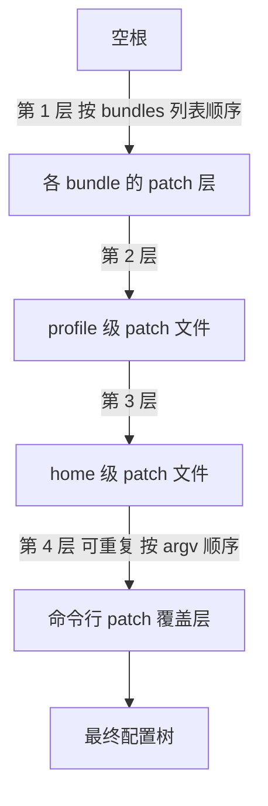
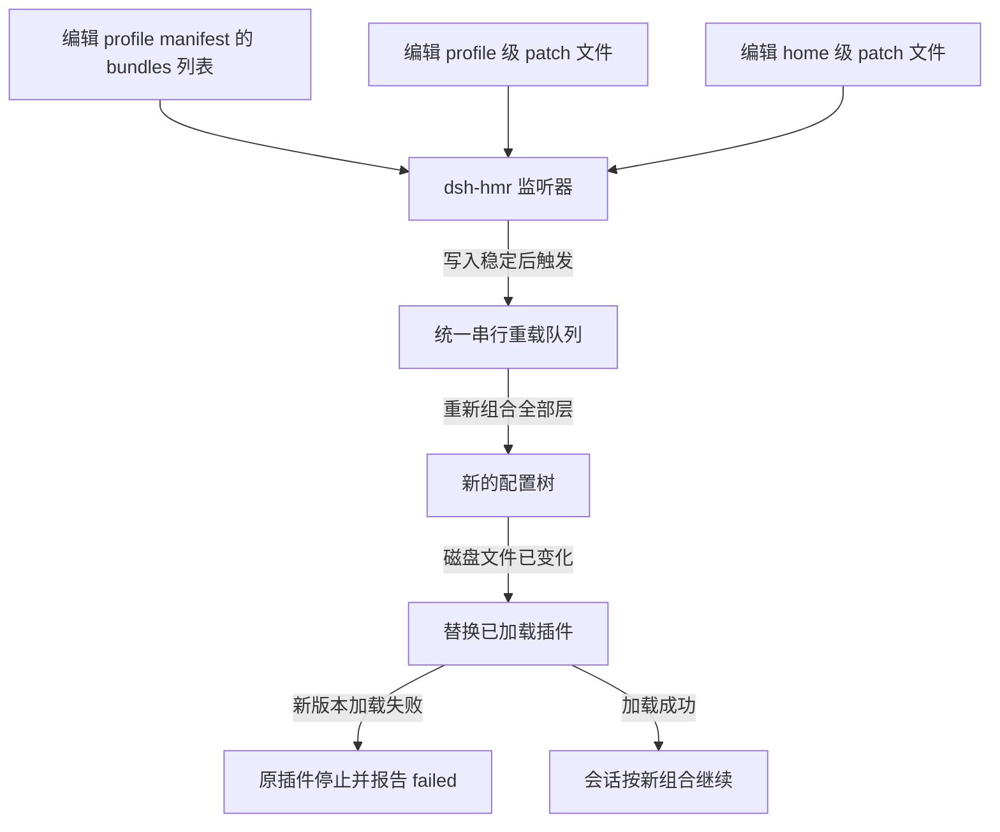

## 为什么需要分层配置？（痛点引入）

DSH 的插件树不是「一份配置文件定终身」。一旦你既想用官方组合包、又想保留自己的开关、还想临时试一组参数，单层配置立刻会露出五个窟窿：

- **升级即回退**：官方 bundle 一升级，你手改过的开关被整份覆盖，昨天调好的设置今天全丢。
- **来源说不清**：界面里某个插件被关掉了，是 bundle 默认关的、你自己关的、还是同事在共享配置里关的，没人答得上来。
- **多 profile 复制粘贴**：同一台机器上 web、headless 两个 profile 想共享一条设置，只能各改一遍，漏一处就出现「两个入口行为不一致」。
- **临时试验污染配置**：排障时想试一组参数，改完忘了还原，配置文件里从此多出一条来历不明的覆盖。
- **第三方插件插不进去**：想把自己的插件塞进官方组合的某一层，又不想动官方文件。

分层配置针对的正是这五件事：配置树以**空根**为起点，官方组合包一层层叠上去，你的覆盖再叠上去，最后一层只影响这一次启动。

> 插件的安装、`allowBuilds` 与升级步骤已收在[配置、插件与日常运维](/docs/04-hands-on/配置与日常/配置插件与日常运维/)；本篇只讲配置树、patch 方言与运行时机制，不重复安装流程。

| 维度 | 只有一份配置文件 | 分层叠加之后 |
|------|------------------|--------------|
| 升级官方 bundle | 手改内容被整份覆盖 | 你的覆盖层独立存在，升级只换下层 |
| 定位某项设置 | 靠翻历史记录猜 | 沿四层逆序核对，最后应用的层最先看 |
| 多 profile 共享 | 逐个复制，容易漏 | home 级 patch 一处生效 |
| 临时试验 | 改完容易忘还原 | `--patch` 只影响这一次启动 |
| 接入第三方插件 | 只能改官方文件 | 插件自带 patch 层，按 bundles 顺序叠加 |

> ### 💡 新人小结：配置树就是四张透明胶片
>
> 把配置树想象成投影仪上叠着的四张透明胶片：
> - **第一叠（bundle 层）** 是官方印好的底图，按 `bundles` 列表顺序一张张压上去；
> - **第二张** 是你这只杯子的私人口味，也就是 profile 的 patch 文件；
> - **第三张** 是全家共用的，home 级 patch 文件，本机所有 profile 都能沾到；
> - **第四张** 是开会前临时手写的一张，`--patch` 只在这一次启动时压在最上面。
>
> **下层永远在，上层永远赢；要看成品长什么样，用 dump 命令照一下，不用真启动。**

**学习路线图**

```text
四层叠加 → patch 方言 → 真实样例 → preset 与 skill → 热重载 → 版本兼容 → 客户端 HMR → 检查工具 → 常见坑
谁盖住谁   怎么写       七条长什么样   谁负责写什么     改完何时生效  装不进去怎么办  前端怎么热更     怎么查         哪些必须避开
```

---

## 四层叠加：配置树是怎么长出来的

配置树以空根为起点，依次叠加四层（出处：README.zh.md「Profile」节）：

| 顺序 | 层 | 内容 | 影响范围 |
|------|----|------|----------|
| 1 | `dsh.profile.bundles` 中各组合包的 patch | 按 manifest 中有序的 `bundles` 列表叠加；`dsh.bundle.patch` 指定一个 patch 文件或有序文件列表 | 该 profile 的全部插件行 |
| 2 | profile 自身的 `cordis.patch.yml` | 用户覆盖层，profile 级 | 该 profile |
| 3 | home 级 `$DSH_HOME/cordis.patch.yml` | 用户覆盖层，home 级 | 本机所有 profile |
| 4 | `--patch` 指定的覆盖层 | 单次启动的覆盖，优先级最高 | 只影响这一次启动 |



图后四条关键关系：

1. **起点是空根**：不是「在默认配置上打补丁」，而是从什么都没有开始，一层层组合出来。
2. **顺序完全确定**：bundle 层严格按 `bundles` 列表顺序，再 profile 层、home 层，最后命令行覆盖层（可重复，按 argv 顺序）。
3. **bundle 从两处解析**：`dsh.profile.bundles` 中列出的组合包**先从 dsh 安装目录解析**，再**从 profile 自身的 `node_modules` 解析**（出处：README.zh.md「Profile」节）。
4. **失败处置分两档**：组合包解析、manifest 读取或 patch 加载失败时，**跳过该组合包**且不改变其选择状态；profile 和用户 patch 出错则**直接启动失败**（出处：dsh-app-boot README.zh.md）。

三个容易忽略的细节：

- **插件开关不是独立字段**：开关只更新 profile `cordis.patch.yml` 中**最后一条匹配覆盖项**的 `disabled`；没有匹配项时追加；若已处于所请求状态则**移除**该覆盖项，让 patch 只记录与组合包不同的设置（出处：dsh-plugin-manager README.zh.md）。
- **停用的组合包选择会被保留**：更新依赖不会把你停用过的组合包重新打开（出处：README.zh.md「Profile」节）。
- **桌面端共享同一套生命周期**：已解析的应用 profile 沿用 Harness home patch、patch 热重载与有界关闭（出处：README.zh.md「开发」节）。

> ### 💡 新人小结：为什么最后一层永远赢？
>
> 把四层想成「四个人先后在同一张表格上写字」：
> - 第一个人写底稿（bundle 层），后面的人只能覆盖、不能擦掉他没提到的格子；
> - 第二个人是你的 profile，第三个人是所有 profile 的共享约定；
> - 第四个人只在这次开会时发言，会后记录就作废（`--patch`）。
>
> **后写的人赢，但只赢他写到的字段；没写到的字段仍然听下层的。**

---

## patch YAML 方言：一张表认全

Loader 的 patch 方言来自 cordis-composition-reference skill。一个 patch 是一个**映射**，profile 在组合包条目列表之上组合有序的 patch 层（出处：cordis-composition-reference skill）。

| 要素 | 语法 | 语义 |
|------|------|------|
| 追加条目 | `insert: [rows]` | 追加行；若带 `id` 且指向既有 `group: true` 行，则追加进该 group 的 `config` 列表内部 |
| 按 id 覆盖 | 有 `id`、无 `insert` | 定向替换既有行：提供的字段替换该行字段；`config` **整体替换、绝不深合并**；truthy `name` 只是断言既有插件名，不是改名 |
| 无 id 非插入 | 只有 `name`、`config` | 没有非空 `id` 的非插入 patch，以及匹配不到行的目标，会被警告并跳过 |
| 行结构 | `id`、`name`、`config`、`disabled`、`inject`、`intercept`、`isolate` | `name` 是插件包说明符；插入行里的相对路径锚定在 patch 文件旁 |
| 分组 | `group: true` 配 `name: cordis:group` | `config` 成为嵌套条目列表，允许后续 patch 按 id 向组内插入 |
| 包含 | `name: cordis:include` | 从 `config.path` 加载字面 YAML/JSON 条目列表 |
| 条件禁用 | `disabled` | 接受 boolean、null 或 `!!js` 表达式；`!!js` 在每次挂载决策时对 Loader 上下文求值；禁用行可省略必需 `config`，除非 `group: true` 强制激活 |
| JS 表达式 | `!!js`，不是 `!js` | 标量为 Loader 表达式；`config` 内的表达式在该行声明的注入激活后、对该插件的上下文求值，例如 `!!js dshHomePath('sessions')`；其余行元数据保持字面 |
| 服务隔离 | `isolate` | 服务名映射到 `true` 或 realm 标签；提供服务的 preset 插件会把提供方与全部消费方一起隔离 |

「Scope」与「isolate」是两件不同的事，混起来最容易写错配置：

| 控制项 | 控制什么 | 典型误用 |
|--------|----------|----------|
| Scope | 贡献与事件的可见性 | 以为 scope 相同就能拿到同一个服务实例 |
| `isolate` | 服务实例本身 | 想隔离贡献却只写了 `isolate` |

另外两个回调字段出现在行结构里，但源材料只列出字段名与所属层级，没有给出取值示例：

| 字段 | 所在位置 | 源材料给出的信息 |
|------|----------|------------------|
| `inject` | 行结构 | 仅列为行字段；取值与求值时机源材料未给出 |
| `intercept` | 行结构 | 仅列为行字段；取值与求值时机源材料未给出 |

插件管理器工具侧的读法也值得先记住：`plugin_manager` 的 `list_plugins` 会报告每行的 `enabled` 标志与 `fiberPhase`；`set_plugin`、`set_bundle` 在更高优先级层获胜时回答 `overridden`（出处：cordis-composition-reference skill）。

> ### 💡 新人小结：patch 是「贴纸」，不是「涂改液」
>
> 把按 id 覆盖想成往一页表格上贴贴纸：
> - 贴纸只盖住它自己那一块（你写的字段）；
> - 但它盖住的是**整块** `config`，不是逐格补丁——这就是「整体替换、绝不深合并」；
> - 想改一个字段却只写一个字段，这一行的其余字段就会跟着消失。
>
> **写覆盖前先想清楚：这一行的 `config` 原本有哪些字段，我得全部重述一遍。**

---

## 真实样例：web profile 的七条覆盖

下面是一份真实的 profile 级 patch 文件全文。开头两行是文件自带注释，其后共 **7 个** patch 条目（出处：源材料记录的 web profile `cordis.patch.yml` 原文）：

```yaml
# Your patch layer for this dsh profile, applied after every bundle layer:
# a top-level YAML array of loader patch entries (id-targeted config
# overrides, disables, and insert lists; `!!js` expressions allowed).
- id: ui-settings-general
  name: "@deepseek-ai/dsh-client-ui-settings-general"
  config:
    welcomeNoticeVersion: 2026-09-28.1
- id: agent-default-model
  name: "@deepseek-ai/dsh-agent-default-model"
  config:
    provider: zcode
    model: GLM-5.3
    reasoningEffort: max
- id: ui-theme
  name: "@deepseek-ai/dsh-client-ui-theme"
  config:
    preference: system
- id: llm-deepseek
  name: "@deepseek-ai/dsh-llm-deepseek-api-key"
  config:
    models: []
- id: llm-pi-ai
  name: "@deepseek-ai/dsh-llm-pi-ai"
  config:
    providers: {}
- id: session-log-deepseek
  name: "@deepseek-ai/dsh-session-log-deepseek"
  config:
    enabled: false
- id: agent-preset-registry
  name: "@deepseek-ai/dsh-agent-preset-registry"
  config:
    default: standard
    selectedDefault: cordis
```

七条逐个对照（出处：同一份文件）：

| # | `id` | `name`（目标插件） | `config` 要点 |
|---|------|--------------------|----------------|
| 1 | `ui-settings-general` | `@deepseek-ai/dsh-client-ui-settings-general` | `welcomeNoticeVersion: 2026-09-28.1` |
| 2 | `agent-default-model` | `@deepseek-ai/dsh-agent-default-model` | `provider: zcode`、`model: GLM-5.3`、`reasoningEffort: max` |
| 3 | `ui-theme` | `@deepseek-ai/dsh-client-ui-theme` | `preference: system` |
| 4 | `llm-deepseek` | `@deepseek-ai/dsh-llm-deepseek-api-key` | `models: []` |
| 5 | `llm-pi-ai` | `@deepseek-ai/dsh-llm-pi-ai` | `providers: {}` |
| 6 | `session-log-deepseek` | `@deepseek-ai/dsh-session-log-deepseek` | `enabled: false` |
| 7 | `agent-preset-registry` | `@deepseek-ai/dsh-agent-preset-registry` | `default: standard`、`selectedDefault: cordis` |

读这份文件的三个要点：

- **全部是「按 id 覆盖」形态**：每条都带 `id`、不带 `insert`，所以它们替换的是 bundle 层已经存在的那一行。
- **`name` 是断言**：写在这里的包名必须与既有行的插件名一致，否则不是改名而是匹配失败。
- **空值也是覆盖**：`models: []` 与 `providers: {}` 看起来「什么都没写」，实际是**把该行 `config` 整体换成空集合**，因为不深合并。

最小可用 patch 示例（同一套方言，取自上面真实行）：

```yaml
# ========== ✅ 推荐写法：只记录与 bundle 不同的设置 ==========
# 按 id 定向覆盖；config 整体替换，所以该行需要的字段要重述
- id: session-log-deepseek
  name: "@deepseek-ai/dsh-session-log-deepseek"
  config:
    enabled: false

# 想整行关掉时用 disabled；禁用行可以省略必需的 config
- id: llm-pi-ai
  disabled: true

# ========== 不推荐写法（仅展示） ==========
# ❌ 没有 id 又不是 insert：源材料写明这类匹配不到行的目标会被警告并跳过
- name: "@deepseek-ai/dsh-client-ui-theme"
  config:
    preference: system
```

字段解释：

| 片段 | 作用 | 注意 |
|------|------|------|
| `id` | 定位既有行 | 非空 `id` 是「按 id 覆盖」的入场券 |
| `name` | 插件包说明符，同时充当断言 | 与既有行不一致会匹配失败，不会改名 |
| `config` | 该行的完整配置 | 整体替换，不是深合并 |
| `disabled` | 关闭该行 | 接受 boolean、null、`!!js` |

`--patch` 层与它同构，只是只影响这一次启动：

```bash
# ========== ✅ 推荐写法：临时试验放进单独文件，不改 profile ==========
# --patch 覆盖层排在四层最后，可重复出现，按 argv 顺序叠加
dsh --profile web --patch extra.patch.yml

# ========== 不推荐写法（仅展示） ==========
# ❌ 把一次性试验直接写进 profile 的 cordis.patch.yml：
#    下次启动仍然生效，且很难回想这条覆盖是为哪次排障加的
```

参数解释：

| 片段 | 作用 | 注意 |
|------|------|------|
| `--profile web` | 指定要组合的 profile | profile 位于 `$DSH_HOME/profiles/<name>` |
| `--patch extra.patch.yml` | 追加一层覆盖 | 示例文件名；可重复，按 argv 顺序 |
| 输出 | 源材料未给出输出样例 | 与 dump 命令配合可在不启动的情况下核对 |

---

## agent preset 与两个 skill：谁负责写什么

agent preset 并不神秘：它是**由 bundle patch 携带的普通 `@deepseek-ai/dsh-agent-preset` 声明**。声明不可原地编辑，只能通过安装一个声明或覆盖它的 bundle 来创建与变更（出处：editing-cordis-compositions skill）。

声明行的 `config` 字段：

| 字段 | 是否必需 | 取值与语义 |
|------|----------|------------|
| `id` | 必需 | 小写字母、数字、连字符 |
| `plugins` | 必需 | Cordis 条目列表 |
| `name` | 可选 | 展示名 |
| `description` | 可选 | 描述 |
| `order` | 可选 | 排序 |

Loader 行 id 按约定为 `preset-<id>`（出处：editing-cordis-compositions skill）。随产品交付的 Web preset 是 `@deepseek-ai/dsh-web-app` bundle 的 `presets/<id>.patch.yml`，id 为 `standard`、`ptc`、`minimal`、`cordis`；每个浏览器会话选择一个 preset，默认 `standard`；「Agent 预设」设置页的保存结果持久化到 `$DSH_HOME/profiles/web/cordis.patch.yml`（出处：editing-cordis-compositions skill、dsh-web-app README.zh.md）。

变更 shipped preset 时按 Loader 行 id 覆盖，例如 `- id: preset-standard`；override 替换完整 `config`，必须重述 `id`、`plugins` 及全部字段（出处：editing-cordis-compositions skill）。

**放置决策**只有一句话：Host 插件提供共享服务，preset 插件向这些注册表贡献带作用域的内容。

| 类型 | 提供什么 | 举例 |
|------|----------|------|
| Host 插件 | 共享服务与注册表 | 工具与提示词注册表、Agent 循环、会话、持久化、设置、沙箱策略、模型路由、子 agent 后端 |
| preset 插件 | 向注册表贡献带作用域的内容 | 工具、persona、提示词段、策略 |

两个 skill 的职责边界（出处：两个 skill 的描述与内容）：

| skill | 负责什么 | 不负责什么 |
|-------|----------|------------|
| `cordis-plugin-development` | 设计、评审、启用、禁用、安装、配置、调试插件与 bundle，以及 feature、page、panel、tool、MCP connection；处理 shipped plugin 默认禁用；不点名的可视对象请求落在已安装的 Harness Web UI 插件上 | 不负责写 preset 的 composition 结构 |
| `editing-cordis-compositions` | 创建、变更、校验 agent preset 或 Cordis composition；决定 host 与 preset 的放置；校验 authored preset 是否挂载 | 不负责插件本身的实现细节 |

一句话记法：**写插件用 `cordis-plugin-development`，写 composition（preset）用 `editing-cordis-compositions`**；后者的 patch 方言与可安装插件包清单反过来引用前者与 cordis-composition-reference（出处：两个 skill 的内容）。

安装与启用有四条约定，违反它们最常见的后果是「看起来装了，其实没生效」：

- **用普通工作区文件编写，再安装**：以 `plugin_manager` 的 `install_bundle`（target 为包目录绝对路径）安装到当前 profile；不要手写 profile 的 `package.json` 或 `cordis.patch.yml`，不要在 `$DSH_HOME` 下建包，也不要在 profile 目录里跑 pnpm——`install_bundle` 自己完成这些步骤（出处：cordis-plugin-development skill）。
- **启用 shipped 但默认禁用的插件**：其行 id 与禁用原因在 shipped patch（`packages/bundle/*/cordis.patch.yml`）中；写一个工作区 bundle，其 patch 以 `disabled: false` 覆盖该行并插入它依赖的 Host 行（源码 checkout 的 `apps/cli/config/examples/<feature>/cordis.yml` 列出这些行），再 `install_bundle`。
- **安装需要授权**：安装会执行插件代码于 Host 进程，因此需要 Full access 或批准；安装结果以 `application` 与 `warnings` 判定是否生效，而不是日志或进程列表。
- **结果要看 nextStep**：实时 profile 立即应用插件变更，包括已安装包的升级；未随结果应用（`not applied`）时结果携带 `nextStep` 指示后续动作（出处：plugin_manager 工具描述）。

激活失败也有明确语义：激活失败的声明**留在 preset 名册上并附诊断**，在 bundle 修复重装前无法组合会话；既有会话及其子会话保持启动时的插件版本（出处：editing-cordis-compositions skill）。

> ### 💡 新人小结：插件是「螺丝」，preset 是「装配单」
>
> 把这一节想成装修：
> - `cordis-plugin-development` 负责造螺丝、装螺丝（插件与 bundle）；
> - `editing-cordis-compositions` 负责写装配单（preset），决定哪颗螺丝拧在哪个位置；
> - `install_bundle` 是那把电动螺丝刀，不要自己拿手去拧（手写 `package.json` 与 patch）。
>
> **写插件与写装配单是两份工，混着来就会出现「装上了但没挂载」。**

---

## dsh-hmr：改完配置什么时候生效

在 YAML 中启用的 `dsh-hmr` 会**监视 profile manifest、profile 与 home 级 patch 文件**，再通过**统一串行重载**重新组合所有层；**未启用 HMR 时，更改在重启后生效**（出处：README.zh.md「Profile」节）。



逐条拆开看：

- **监视对象**：dsh-hmr 在初始化时注册 profile manifest 与两份用户 patch（profile 级加 home 级）的监听；**manifest 通知仅在有序的 `dsh.profile.bundles` 列表变化时触发重载**（出处：dsh-hmr README.zh.md）。改 manifest 里的其他字段不会触发。
- **一个队列**：模块替换、Include 刷新与 profile 配置变更共用一个队列（`runExclusive()` 串行化，拒绝嵌套事务）；包安装与删除在队列之外执行；DSH HMR 把这些重载与插件管理器的配置写入串行化（出处：dsh-hmr README.zh.md、dsh-app-boot README.zh.md）。
- **插件也会被换掉**：profile 监听和 Plugin Manager 的重新组合还会替换 profile 目录下已加载且磁盘文件变化的插件（含 `node_modules` 下的已安装包与已链接包目标）；替换版本加载失败时原插件停止并报告 `failed`，文件修复后下次重新组合即启动，**无需重启**（出处：dsh-hmr README.zh.md）。
- **`awaitWriteFinish` 默认开**：配置监听默认 `awaitWriteFinish: true`（Chokidar 2 秒写入稳定窗口）；Plugin Manager 直接发起的操作无需等待文件事件即可应用（出处：dsh-hmr README.zh.md）。
- **监听源码模块要额外开一层**：需在启动前通过 profile patch 配置 base 组合包的 `hmr` 条目（`root: ["."]`）；Web 模板会实时重载，其他随附模板只在启动时应用 patch（出处：dsh-hmr、dsh-app-boot README.zh.md）。
- **兼容性检查只在组合行时跑**：启动、profile 重新组合、preset 挂载时检查；Loader 导入模块时不做检查（出处：dsh-hmr README.zh.md）。

> ### 💡 新人小结：为什么要等 2 秒？
>
> 把编辑器保存想成「往杯子里倒水」：
> - 很多编辑器保存时会先写临时文件、再改名、再落盘，中途几个瞬间文件是半截的；
> - `awaitWriteFinish` 就是那个「等水面不晃了再端走」的 2 秒窗口；
> - 于是你只保存一次，重载也只发生一次，不会在半截 YAML 上报一堆语法错。
>
> **热重载不是立刻重载，而是「等写稳了再一次重载」；真想立刻生效就用 Plugin Manager 的操作，它不等文件事件。**

---

## engines.dsh：装不进去的插件怎么办

DSH 对「哪个插件能装进哪个运行时」有明确门槛：安装和 profile 启动会按声明的 `engines.dsh` 范围（**未声明时按 DSH peer 范围**）检查与 `dsh --version` 显示值相同的运行时版本；不兼容插件需要用户**明确确认精确版本豁免**（出处：README.zh.md「Profile」节）。

| 检查时机 | 检查依据 | 不兼容时的出路 |
|----------|----------|----------------|
| 安装时 | 插件声明的 `engines.dsh` | 申请精确版本豁免 |
| profile 启动时 | 同上；未声明则按 DSH peer 范围 | 申请精确版本豁免 |
| 比对对象 | 与 `dsh --version` 显示值相同的运行时版本 | 豁免带持久化规则与风险说明 |

拒绝时的错误码是 `incompatible-version`，并附每个被拒绝包的 `name`、`version`、`runtimeVersion` 与未满足的 `requirements`（键为 `engines.dsh` 或 DSH peer 包名）（出处：dsh-plugin-manager README.zh.md）。

豁免走 CLI 或工具两条路：

```bash
# 查看当前 profile 已登记的豁免
dsh plugin --profile web version-exemptions

# 授予精确版本豁免：授权前会打印风险警告
dsh plugin --profile web allow-version "<package@version>" \
  --dsh-version "<runtime>" --accept-risk

# 撤销豁免
dsh plugin --profile web revoke-version "<package@version>" \
  --dsh-version "<runtime>"
```

参数解释：

| 参数 | 含义 | 注意 |
|------|------|------|
| `--profile <profile>` | 作用于哪个 profile | 与安装、启动共用同一份 profile |
| `version-exemptions` | 列出已授予的豁免 | 只读 |
| `allow-version` | 授予豁免 | 必须带 `--accept-risk` |
| `--dsh-version` | 豁免针对的运行时版本 | 精确版本，不写范围 |
| `revoke-version` | 撤销豁免 | 撤销后该插件重新受检查 |

工具侧还有一对：`list_version_exemptions` 列出豁免，`set_version_exemption` 授予或撤销。源材料对这一对工具的口径很重：**版本豁免有崩溃与数据丢失风险**，须警告用户并获得对确切插件与运行时版本的明确许可后才可授予（出处：plugin_manager 工具描述）。

> ### 💡 新人小结：豁免不是「跳过检查」
>
> 把 `engines.dsh` 想成药盒上的适用体重：
> - 不匹配的药不是不能吃，而是**你要在知情的情况下自己签字**；
> - 签字只对**这一盒、这一批**有效（精确版本），换了版本要重签；
> - 撤销就是把签字划掉，重新回到检查队列里。
>
> **豁免是「我确认过风险」的记录，不是「以后都不检查」的开关。**

---

## 客户端插件 HMR 与 `pnpm run dev:web`

服务端插件能被替换，浏览器里的插件则是另一套机制。客户端模块系统分成两侧：Node 半侧负责组合与提供（`ctx.clientModules`，`ClientModuleRegistry`），浏览器半侧负责加载（`ctx.modules`，`ClientModuleSystem`）；两侧之间的协议是**启动图——以 `window.__DSH_BOOT__` 注入的 `WebBootEntry` 行**，其中 `<` 已被转义，插件控制的字符串无法逃出 script 元素（出处：dsh-client-modules README.zh.md）。

因此 apps/web 的 Vite 入口**只构建 shell，不是独立应用**：只有 `dsh web` 注入 `window.__DSH_BOOT__`，离开该注入浏览器无从获得启动图（出处：dsh-harness-dev-context README.zh.md 的 GUI 更新约定、dsh-client-modules README.zh.md）。

改了什么之后要不要刷新，可以直接查表：

| 改动对象 | 是否需要刷新页面 | 前置条件 |
|----------|------------------|----------|
| client-plugin | 无需刷新即重载 | 同一 checkout 中同时运行 `pnpm run dev:web` 以重建其 bundle |
| apps/web shell | 需要 | 重建受影响的 Web 产物后在此 URL 刷新 |
| 普通包 | 需要 | 同上 |

三条纪律：

- **先验证再承诺**：客户端插件 HMR 接收器处于活动状态，但「无需刷新即重载」只有在 `pnpm run dev:web` 也在同一 checkout 中运行时才成立；承诺自动更新前先验证该 watcher（出处：dsh-harness-dev-context README.zh.md 的 GUI 更新约定）。
- **另起服务器不算更新**：启动另一个服务器不会更新此 GUI（出处：同上）。
- **生产要先构建**：在仓库根目录单独运行 `pnpm run build`，然后用 `pnpm dsh <args...>` 运行 TypeScript 入口（出处：README.zh.md「开发」节）。

```bash
# ========== ✅ 推荐写法：开发时让前端 bundle 也被重建 ==========
pnpm run dev:web      # 与 dsh web 在同一 checkout 中运行

# ========== 不推荐写法（仅展示） ==========
# ❌ 只改 client-plugin 就期待浏览器自动更新，但没跑 dev:web：
#    接收器在活动状态，但没人重建 bundle，页面不会拿到新代码
```

---

## 检查与调试：inspect 工具与 dump 三兄弟

**先看再写**是这套体系里最省时间的习惯。`cordis_inspect_list` 与 `cordis_inspect_query` 读取当前 Host 与 Client 的 Inspect Provider 清单与只读方法，覆盖六类信息（出处：cordis_inspect 工具描述）：

| 能查什么 | 内容 | 能不能改 |
|----------|------|----------|
| Service 方法 | 已注册服务的只读方法面 | 不能调业务 Service 方法 |
| Event 模式 | 事件形状 | 不能修改运行时 |
| Config schema | 配置字段结构 | 只读 |
| Tool schema | 工具参数结构 | 只读 |
| 主题 token | 主题变量 | 只读 |
| Slot 树 | 界面插槽层级 | 只读 |

纪律只有一条：写或配置插件前先 `cordis_inspect_list`，再选方法查询；不要把 Inspect 方法当作插件代码可调用的业务 Service（出处：cordis_inspect_list 工具描述）。

配置树本身则用 dump 三兄弟照：

| 命令 | 打印什么 | 是否启动 |
|------|----------|----------|
| `dsh --profile <name> --dump-config` | 组合后的配置树，含用户层与 `--patch` 覆盖层 | 否 |
| `dsh --profile <name> --dump-default-config` | 不含用户层与 `--patch` 的树，只看组合包层 | 否 |
| `dsh --profile <name> --dump-config-schema` | 描述 entry 与 patch 的 JSON Schema，而非配置值 | 否，且不挂载 profile |

```bash
# ========== ✅ 推荐写法：先照横切面，再动手改 patch ==========
dsh --profile web --dump-default-config   # 只看 bundle 层长什么样
dsh --profile web --dump-config           # 加上你的覆盖与 --patch 后的成品
dsh --profile web --dump-config-schema    # 字段结构，不是取值

# ========== 不推荐写法（仅展示） ==========
# ❌ 直接改 patch 再启动看效果：错了就是启动失败，而且不知道错在哪一层
```

输出格式源材料未给出样例；命令语义来自 README.zh.md「Profile」节与工具描述。

> ### 💡 新人小结：dump 是「不开火试菜」
>
> 把 dump 想成厨房里的试味勺：
> - `--dump-default-config` 尝的是底汤（只有 bundle 层）；
> - `--dump-config` 尝的是整锅（含你的覆盖与临时调料）；
> - `--dump-config-schema` 看的不是味道，是配料表（字段结构）。
>
> **先尝再上桌，比端出去被退回来便宜得多。**

---

## 常见坑：四个一次说清

| 坑 | 错误做法 | 正确做法 |
|----|----------|----------|
| `config` 不深合并 | 只写要改的那个字段，其余字段被抹掉 | 重述该行 `config` 需要的每个字段 |
| 表达式写错前缀 | 写 `!js` | 写 `!!js`；`config` 内表达式在该行注入激活后求值 |
| 遗留 preset 目录 | 继续往 `$DSH_HOME/.agent-presets/<id>/` 里放 `preset.yml` 与 `agent.cordis.yml` | 改写成 bundle 并安装，然后删除遗留目录 |
| 无 id 非插入 patch | 以为能按 `name` 改配置 | 加 `id` 定向覆盖，或用 `insert` 追加 |

**坑一：`config` 整体替换。** 覆盖 `preset-standard` 这类行时，override 会替换完整 `config`，必须重述 `id`、`plugins` 及全部字段（出处：editing-cordis-compositions skill）。上面的 `models: []`、`providers: {}` 也是同一回事：空集合不是「不写」，而是「写成了空」。

**坑二：`!!js` 不是 `!js`。** 标量位置写 `!!js` 才是 Loader 表达式；`config` 内的表达式在该行声明的注入激活后、对该插件的上下文（`ctx.<service>`）求值，例如 `!!js dshHomePath('sessions')`；其余行元数据保持字面（出处：cordis-composition-reference skill）。

**坑三：遗留 preset 目录已无代码读取。** `$DSH_HOME/.agent-presets/<id>/` 目录（含 `preset.yml` 与 `agent.cordis.yml`）已无任何代码读取；迁移方式是按声明格式重写为 bundle 并安装，然后删除遗留目录（出处：editing-cordis-compositions skill）。留着它不会报错，只会让你误以为还有一个 preset 在生效。

**坑四：无 id 的 patch 是噪音。** 没有非空 `id` 的非插入 patch，以及匹配不到行的目标，会被警告并跳过（出处：cordis-composition-reference skill）。日志里出现警告却「配置没生效」，先回头看这一条。

和本页相关的另外两个页面：Web 侧的启动与环境变量见 [WebGUI](/docs/03-dsh/运行形态/WebGUI/)；profile、bundle、patch 三层概念的总览见 [DSH 是什么](/docs/03-dsh/认识DSH/DSH是什么/)。

---

## 要点总结

1. **四层固定、起点是空根**：bundle 层（按 `bundles` 列表顺序）→ profile `cordis.patch.yml` → home 级 `$DSH_HOME/cordis.patch.yml` → `--patch`（可重复，argv 顺序）；后写的层赢，但只赢它写到的字段。
2. **patch 是映射，不是补丁片段**：`insert` 追加行，有 `id` 无 `insert` 定向替换，`group: true` 配 `name: cordis:group` 建分组，`name: cordis:include` 从 `config.path` 加载条目列表，`disabled` 接受 boolean/null/`!!js`。
3. **`config` 整体替换、绝不深合并**：覆盖一行就要重述该行需要的每个字段；`name` 在覆盖里是断言，不是改名。
4. **preset 是 bundle 携带的声明**：不可原地编辑，行 id 约定 `preset-<id>`；写插件找 `cordis-plugin-development`，写 composition 找 `editing-cordis-compositions`；安装统一走 `install_bundle` 并用 `application` 与 `warnings` 判定。
5. **热重载有明确边界**：dsh-hmr 监视 profile manifest 与两份 patch，走 `runExclusive()` 串行队列，`awaitWriteFinish` 默认开；未启用 HMR 时更改重启后生效；manifest 只有 `bundles` 列表变化才触发。
6. **版本与前端各有门槛**：`engines.dsh`（未声明按 peer 范围）在安装与启动时检查，`incompatible-version` 可经 `allow-version` 精确豁免；客户端插件免刷新只在同 checkout 跑 `pnpm run dev:web` 时成立。

---

> ### 💡 新人小结：Cordis 插件体系学完了，记住这 5 点
>
> 1. **先分层再动手**：任何「配置不生效」的问题，都沿 bundle → profile → home → `--patch` 逆序找最后动过的那层。
> 2. **写覆盖就是重写整行**：把 `config` 想成一张整张贴纸，贴上去以后旧字段不会自己回来。
> 3. **`!!js` 两个感叹号**：少一个就不是表达式；`isolate` 管服务实例，Scope 管贡献与事件可见性，两件事别混。
> 4. **改完先看有没有热重载**：有 dsh-hmr 就等 2 秒写稳，没有就重启；manifest 只有 `bundles` 列表变化才算数。
> 5. **装不进去不要硬来**：`engines.dsh` 检查在前，精确版本豁免是「知情签字」，不是关掉检查。
