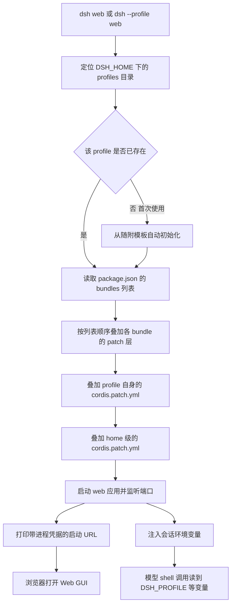

## 为什么需要一份 Web GUI 的运行形态全景？（痛点引入）

`dsh web` 大概是 DSH 里最容易「起得来但说不清」的一条命令：一条命令之后浏览器里就出现了界面，可界面背后的东西全在暗处。刚上手时最常见的卡点有五类：

- 命令敲完，终端刷过一行带长串随机字符的地址，不知道那行能不能截图发群、能不能贴进工单。
- 浏览器开在别的端口上打得开、开在 `127.0.0.1:3080` 上打不开，分不清哪个端口是产品默认、哪个是自己机器上碰巧占到的。
- 模型在终端里跑命令时能看到 `DSH_PROFILE`、`DSH_WEB_URL` 这些变量，自己开一个终端却看不到，以为是环境装坏了。
- 想改一个界面设置，改完发现它落在 `~/.dsh/profiles/web/cordis.patch.yml` 里，而这个文件既像配置又像代码，不敢动。
- 会话记录、启动日志、贴进去的图片到底存在哪，出问题要取证时只能全盘搜索。

这些问题的答案都不在界面上，而在**会话环境与磁盘目录**两层。启动命令、端口与公告 URL 的基础操作已收在[安装与首次启动](/docs/04-hands-on/安装启动/安装与首次启动/)；本文只拆开界面背后真正难查的部分。

| 维度 | 只把 Web GUI 当黑盒 | 读完本文之后 |
|------|---------------------|----------------|
| 启动与地址 | 只会抄 `dsh web`，不知道 token URL 从哪来 | 基础流程见本机教程；本文只解释 `DSH_WEB_URL` 的注入边界 |
| 环境 | 以为环境变量是全局的 | 知道那是 `dsh-shell-env` 注入每次模型 shell 调用的 |
| 配置 | 改了不知道落在哪一层 | 知道 GUI 设置会持久化到 profile 的 `cordis.patch.yml` |
| 取证 | 出问题只能猜 | 知道 sessions、logs、attachments 各自的落盘规则 |
| 安全 | 把打印的 URL 随手发群 | 知道 URL 含进程凭据，以及 `printUrl` 的边界 |

> ### 💡 新人小结：Web GUI 到底是什么？
>
> 把 `dsh web` 想象成「在自己家里开一间对外营业的小店」：
> - **profile 目录** = 店面的装修图纸和你的私人物品，放在 `~/.dsh/profiles/web`；
> - **`dsh web`** = 开门那一下，它按图纸把货架摆好（叠 patch 层）再通电；
> - **公告 URL** = 门口挂的营业牌，上面带着只有店员看得懂的内部编号（进程凭据）；
> - **会话环境变量** = 每个进店干活的人（模型 shell 调用）手里的工牌，写着这是哪家店、哪个班次。
>
> **界面只是门脸；真正的信息在启动命令、会话环境、磁盘目录这三处。**

**学习路线图**（按「界面在用什么 → 东西落在哪」推进）

```text
会话环境 → DSH_HOME 深层落盘 → web profile 解剖 → 数据落盘 → 凭据与安全 → 排障与总结
工牌上的变量   更细的目录        店面图纸          会话与日志    谁能看 URL    症状与原因
```

---

## 启动与公告地址：见本机实操教程

`dsh web` 的三种等价写法、`--port` 参数归属、token URL 与默认端口，属于本机启动流程，已收在[安装与首次启动](/docs/04-hands-on/安装启动/安装与首次启动/)。本节只保留一个与运行形态相关的差异点：`DSH_WEB_URL` 不是系统环境变量，而是 `dsh-shell-env` 注入给每次模型 shell 调用的上下文；`surfaceContext` 为 `false` 时不注册（出处：dsh-web-app、dsh-shell-env README.zh.md）。完整变量表见下一节。

---

## 会话环境变量：模型 shell 每次调用都能看到什么

下面六个变量由 `dsh-shell-env` 插件注入每一次模型 shell 调用（出处：dsh-shell-env README.zh.md；本机取值实测，2026-10-24）。

| 变量 | 本机取值 | 含义 |
|------|----------|------|
| `DSH_HOME` | 用户主目录下的 `.dsh`（即默认位置 `~/.dsh`） | Harness 主目录绝对路径；解析顺序为 `dshHome` 配置、环境变量 `$DSH_HOME`、默认 `~/.dsh` |
| `DSH_PROFILE` | `web` | 当前 profile 名；不带 profile 启动的组合则无此变量 |
| `DSH_PROFILE_DIR` | `~/.dsh/profiles/web` | profile 目录绝对路径；其 `node_modules` 只存放 profile 自行安装的包，随产品交付的组合包从 dsh 安装目录解析 |
| `DSH_SESSION_ID` | `session-` 前缀加一个 UUID | 调用方会话的 id，agent 的每次 shell 调用都会收到 |
| `DSH_SHELL` | `1` | 标记本次调用是模型 shell 调用 |
| `DSH_WEB_URL` | `http://127.0.0.1:3080` | Web GUI 的公告应用 URL；`surfaceContext` 为 `false` 时不存在 |

（出处：dsh-shell-env README.zh.md；本机实测，2026-10-24。）

三条配套规则：

1. **内置键是保留的**：`DSH_HOME`、`DSH_SHELL`、`DSH_SESSION_ID`、`DSH_PROFILE`、`DSH_PROFILE_DIR` 属于注册表保留键，插件 contributor 不能声称拥有它们（出处：dsh-shell-env README.zh.md）。
2. **`DSH_HOME` 有三级解析顺序**：显式配置的路径最优先，其次环境变量 `$DSH_HOME`，最后默认 `~/.dsh`；**空白 `$DSH_HOME` 视为未设置**（出处：dsh-home-paths README.zh.md）。
3. **`DSH_PROFILE` 不一定存在**：不带 profile 启动的组合没有这个变量（出处：dsh-shell-env README.zh.md）。

下图把「启动命令 → profile 组合 → 界面与会话环境」串成一条链：



图后解读三条：

1. **叠加顺序是固定的**：bundles 列表顺序 → profile 的 `cordis.patch.yml` → home 级 `$DSH_HOME/cordis.patch.yml` → `--patch` 覆盖层（出处：README.zh.md §Profile）。
2. **界面与会话环境同源**：两者都来自同一次启动，所以 `DSH_WEB_URL` 必然等于启动时打印的那个 URL（出处：dsh-web-app README.zh.md）。
3. **首次启动会多一步初始化**：`web` 在首次使用时从随附模板自动初始化（出处：README.zh.md §入口模式表后段落）。

> ### 💡 新人小结：六个变量怎么一眼看明白？
>
> 把它们想成一次出差的行前清单：
> - `DSH_HOME` = 你住的城市（全局根目录）；
> - `DSH_PROFILE` / `DSH_PROFILE_DIR` = 这次住哪家酒店、房间号（profile 名与目录）；
> - `DSH_SESSION_ID` = 本次出差的单据号（会话 id，每次调用都带着）；
> - `DSH_SHELL` = 证明「我确实是在执行任务的员工」，不是一个路过的访客；
> - `DSH_WEB_URL` = 目的地的门牌地址。
>
> **这六项合起来回答一个问题：这次调用是谁、在哪、属于哪个会话、对应哪个界面。**

---

## DSH_HOME 的深层落盘位置

`DSH_HOME` 的解析顺序与基础目录表已收在[配置、插件与日常运维](/docs/04-hands-on/配置与日常/配置插件与日常运维/)；这里只保留排查时才需要的深层细节。

| 路径 | 本机实测细节 |
|------|--------------|
| `attachments/v1` | 对象按 `sha256` 去重，永不自动删除；另有请求图片缓存 `<DSH_HOME>/cache/attachments/request-images/` |
| `cache/models-dev.json` | 模型目录缓存 |
| `jet-hub/` | providers-hub 的账号池、Token 账本、签到与永久积分锁定 JSON |
| `openai-gateway/api-key` | 本机网关的随机密钥，明文持久化，重启不变 |
| `sessions/` | 会话按 workspace 路径分目录，目录名把路径分隔符转写为 `-` |
| `storages/` | 存储栈根，本机含 `session_projcache` 与 `workspace.json` |
| `$DSH_HOME/.env` | 机器级默认值（如代理变量），小写优先；项目 `.env` 不能携带同名变量 |
| `$DSH_HOME/AGENTS.md` | 用户全局指令链，进入 agent 首次请求的持久基线消息 |

（出处：本机实测，2026-10-24；dsh-attachment-local、dsh-providers-hub、dsh-sdk-minimal、dsh-session-projection-cache、dsh-launch-environment、dsh-http-proxy、dsh-agent-instructions README.zh.md。）

> ### 💡 新人小结：`DSH_HOME` 像什么？
>
> 把它想成「一间工作室的总钥匙柜」：
> - `profiles/` = 几个不同用途的工作间，`web` 是其中一间；
> - `sessions/` = 每个工作间的值班记录本，按项目（workspace 路径）分册；
> - `logs/` = 门口的进出登记，每次启动一页；
> - `attachments/` = 贴过便签与图纸的档案柜，按指纹（sha256）归类，从不主动销毁；
> - `.credentials.yaml` = 上锁的抽屉，钥匙不在柜子里。
>
> **出问题先来钥匙柜看一圈：谁在跑、跑过什么、留下了什么，都在这里。**

---

## web profile 目录解剖：`~/.dsh/profiles/web` 里有什么

profile 是磁盘上真实存在的目录，`web` 这个 profile 的全部可变状态都在这个目录里。本机实测清单如下（出处：本机实测，2026-10-24）。

| 文件 / 目录 | 大小（本机实测） | 作用 |
|-------------|------------------|------|
| `package.json` | 321B | profile 包清单：树外插件依赖与 profile manifest `dsh.profile`，其中含按顺序排列的 `bundles` 列表 |
| `cordis.patch.yml` | 995B | 用户自己的 patch 层，即 web profile 的用户覆盖配置 |
| `cordis.yml` | 223B | profile 的入口配置文件（Loader 入口）；以 `cordis.yml` 或 `cordis.yaml` 结尾的配置在快照回放模式下映射到同级 `cordis.snapshot.yml` |
| `pnpm-lock.yaml` | 文件 | pnpm 锁文件；插件安装失败时会恢复 `package.json` 与本文件 |
| `pnpm-workspace.yaml` | 文件 | pnpm 工作区配置；pnpm 11 拦下依赖脚本时在此放行待决定的包名，且有意不恢复 |
| `node_modules/` | 目录 | pnpm 安装 profile 自行安装的组合包；本机实测含 `dsh-providers-hub` 及其依赖 |
| `.plugin-manager/` | 目录 | 插件管理器工作目录：`run.json` 记录进行中的 pnpm 运行，`logs/` 保留操作诊断日志 |

（出处：本机实测，2026-10-24；README.zh.md §Profile、dsh-app-boot、dsh-plugin-manager README.zh.md。）

三条容易误解的细节：

1. **插件开关只动 `cordis.patch.yml`，组合包开关动 `package.json`**：前者改的是用户覆盖层，后者的改动落在 `package.json` 的 `dsh.profile.bundles`（出处：README.zh.md §Profile、dsh-plugin-manager README.zh.md）。
2. **`node_modules/` 不是全部依赖**：bundle 列表里随产品交付的组合包**先从 dsh 安装目录解析**，再从 profile 自身的 `node_modules` 解析（出处：README.zh.md §Profile）。
3. **本机 web profile 的 `bundles` 有三项**：两个内置 bundle（`@deepseek-ai/dsh-base`、`@deepseek-ai/dsh-web-app`）加一个以 git 仓库地址安装的树外插件 `dsh-providers-hub`（出处：本机实测 `package.json`，2026-10-24）。

### `cordis.patch.yml` 的条目结构

`cordis.patch.yml` 是一个**顶层 YAML 数组**，每个元素按 `id` 定位一个 loader patch 条目。本机 web profile 的 7 条实例、字段语义与分组已收在[Cordis 插件体系](/docs/03-dsh/运行形态/Cordis插件体系/)；这里只保留 profile 解剖层面的结论：界面开关会写进这份用户层，改它不动随包交付的 bundle 层；想看最终叠加结果用 `dsh --profile web --dump-config`，不启动也能看（出处：README.zh.md §Profile；`dsh --help` 实测）。

---

## 会话、日志与附件的落盘

这三类数据决定「事后能不能取证」，各自的落盘规则不同。

| 数据 | 位置 | 落盘规则 |
|------|------|----------|
| 会话 | `<DSH_HOME>/sessions/` | 会话持久化为 JSONL，按 workspace 路径分子目录；目录名由工作区路径转写而来，路径分隔符转写为 `-` |
| 启动日志 | `<DSH_HOME>/logs/` | 每次启动产生一个日志文件，命名为 `startup-<ISO8601 时间>-<uuid>.log` |
| 附件 | `<DSH_HOME>/attachments/` | 实际结构为 `v1/objects/<sha256 前缀>/<sha256>` 与 `v1/files/...`，只读硬链接去重；对象按 `sha256` 去重，永不自动删除 |
| 附件请求缓存 | `<DSH_HOME>/cache/attachments/request-images/` | 请求版本的图片缓存 |

（出处：本机实测，2026-10-24；dsh-sdk-minimal、dsh-attachment-local README.zh.md。）

```sh
# ========== ✅ 推荐写法：取证先按时间找启动日志，再按工作区找会话 ==========
# 列出启动日志（按文件名里的 ISO 时间排序即可定位某次启动）
ls "$DSH_HOME/logs"

# 会话按 workspace 路径分目录，先看有哪些工作区
ls "$DSH_HOME/sessions"

# ========== 不推荐写法（仅展示） ==========
# ❌ 直接把 attachments 当成可清理的临时目录：
#    对象按 sha256 去重且永不自动删除，
#    删掉就等于把历史会话里的图片永久弄丢
```

参数解释：

| 片段 | 含义 | 注意 |
|------|------|------|
| `$DSH_HOME/logs` | 启动日志目录 | 一次启动一个文件，文件名自带 ISO 时间 |
| `$DSH_HOME/sessions` | 会话目录 | 目录名与 workspace 路径对应，换目录启动就会落到另一个子目录 |
| `$DSH_HOME/attachments` | 附件对象库 | 只读、按内容去重、不自动清理 |

还有一条与会话相关、但容易被忽略的规则：**运行命令时所在的目录将作为默认 workspace 根目录**（出处：README.zh.md §入口模式表后段落）。这就是「换个目录启动后，历史会话像消失了一样」的真正原因——会话没丢，只是落到了另一个 workspace 子目录下。

> ### 💡 新人小结：为什么换个目录启动就「找不到会话」了？
>
> 把它想成「按项目分册的笔记本」：
> - 你在 A 项目文件夹里开工，记录就写进 A 那本册子（`sessions/` 下的对应子目录）；
> - 换到 B 文件夹再启动，你翻开的是 B 那本，A 的记录当然不在眼前；
> - 启动日志则是「门口登记簿」，不按项目分，按启动次数一页一页往后写。
>
> **会话跟目录走，日志跟启动走，附件跟内容走——三套归档规则，别混着找。**

---

## 打印的 URL、进程凭据与 printUrl

启动时终端打印的那行 URL 里带着**进程凭据**。这条事实的原文表述是：打印的启动 URL 包含进程凭据，只应与预期用户分享；`printUrl: false` 可以抑制该行，凭据也不会出现在模型上下文或 `DSH_WEB_URL` 中（出处：dsh-web-app README.zh.md）。

把它拆成四条可用结论：

| 问题 | 结论 | 依据 |
|------|------|------|
| 那行 URL 能截图发群吗 | 只在预期用户范围内分享，因为它含进程凭据 | dsh-web-app README.zh.md |
| 关掉打印会不会把凭据也关掉 | 不会；`printUrl: false` 只抑制打印这一行 | dsh-web-app README.zh.md |
| 凭据会不会出现在模型上下文里 | 不会 | dsh-web-app README.zh.md |
| `DSH_WEB_URL` 里含凭据吗 | 不含 | dsh-web-app README.zh.md |

```yaml
# ========== ✅ 推荐写法：需要共享终端输出时，先关掉 URL 打印 ==========
# 在 web 应用的配置里把打印开关置为 false，
# 抑制带进程凭据的那一行；凭据仍不会被写进模型上下文或 DSH_WEB_URL
printUrl: false

# ========== 不推荐写法（仅展示） ==========
# ❌ 把终端里打印的完整 URL 直接贴进公开工单或聊天群：
#    该行包含进程凭据，只应与预期用户分享
```

参数解释：

| 项 | 含义 | 注意 |
|----|------|------|
| `printUrl` | 是否打印启动 URL 的开关 | 置为 `false` 抑制该行 |
| 进程凭据 | 打印 URL 中附带的凭据 | 只与预期用户分享；不进入模型上下文与 `DSH_WEB_URL` |

（出处：dsh-web-app README.zh.md。源材料未给出该配置项的完整层级路径与默认值，因此本文只给字段名与行为，不猜它的 YAML 位置。）

> ### 💡 新人小结：为什么那行 URL 不能随便贴？
>
> 把它想成「酒店房卡上的房号加开门码」：
> - 房号（地址）本身不敏感，但贴在同一个卡片上的开门码（进程凭据）能直接进门；
> - `printUrl: false` 相当于「前台不把开门码念出来」，卡本身照发；
> - 系统也不会把开门码写进对外的登记簿（模型上下文）与门牌（`DSH_WEB_URL`）。
>
> **分享前先问自己：这段字符串里有没有凭据。**

---

## 安全与排障

### 安全边界速查

| 关注点 | 事实 | 依据 |
|--------|------|------|
| 启动 URL | 含进程凭据，只应与预期用户分享 | dsh-web-app README.zh.md |
| 凭据外泄面 | 不出现在模型上下文，也不出现在 `DSH_WEB_URL` 中 | dsh-web-app README.zh.md |
| 机器级默认值 | `$DSH_HOME/.env` 可携带代理变量等机器级默认值，项目 `.env` 不能携带这些名字 | dsh-launch-environment、dsh-http-proxy README.zh.md |
| 被 dump 的插件 | 检查不受信任的插件前，应先阅读 schema dump 的安全性与范围说明 | README.zh.md §Profile |
| 远端地址 | 本机实测公告 URL 为回环地址 `127.0.0.1`，端口 `3080`；源材料未给出默认端口的声明 | 本机实测，2026-10-24 |

### 排障清单

| 症状 | 先确认什么 | 原因与处理 |
|------|------------|------------|
| 浏览器打不开界面 | 地址是否就是启动时打印的那个 URL | `DSH_WEB_URL` 与公告 URL 同值，以打印值为准（出处：dsh-web-app README.zh.md） |
| 模型读不到 `DSH_WEB_URL` | `surfaceContext` 是否为真 | 为 `false` 时不注册该变量（出处：dsh-web-app README.zh.md） |
| 自己终端里读不到这些变量 | 是否在模型 shell 调用之外 | 六个变量由 `dsh-shell-env` 注入模型 shell 调用（出处：dsh-shell-env README.zh.md） |
| 找不到之前的会话 | 启动时所在目录是否变了 | 运行目录即默认 workspace 根目录，会话按 workspace 路径分目录（出处：README.zh.md §入口模式表后段落） |
| 改了配置没生效 | `dsh-hmr` 是否启用 | 启用时监视 profile manifest 与两级 patch 文件并串行重载；未启用则重启后生效（出处：README.zh.md §Profile） |
| 改了界面设置找不到落点 | 看 profile 的 `cordis.patch.yml` | GUI 设置会持久化到该文件（出处：对应包 README.zh.md） |
| 启动失败但没有头绪 | `<DSH_HOME>/logs` 里最新那个 `startup-*` 日志 | 每次启动一个日志文件（出处：本机实测，2026-10-24） |
| 想确认当前生效的配置树 | 用 dump，不要靠猜 | `dsh --profile web --dump-config` 不启动即可打印组合树（出处：`dsh --help` 实测） |

排障顺序建议固定：**先看日志（哪一步失败）→ 再看 dump（哪一层给出了这个值）→ 最后看环境变量（这次调用的上下文对不对）**。这三步分别对应本文的「落盘」「profile 解剖」「会话环境」三节。

> ### 💡 新人小结：排障为什么先看日志再看配置？
>
> 把它想成「查一笔账」：
> - 日志是流水（什么时候发生了什么），能先确定「有没有发生过」；
> - dump 是余额表（现在生效的是什么），能确定「这个值是谁给的」；
> - 环境变量是经办人签名（这次调用的上下文），能确定「这次是不是同一个人办的」。
>
> **先确认事实发生过，再追来源，最后核对上下文——顺序反了就会在假设里打转。**

---

## 要点总结

1. **启动与公告地址的基础操作**：三种等价写法、`--port` 归属与 token URL 见[安装与首次启动](/docs/04-hands-on/安装启动/安装与首次启动/)；本篇只保留运行形态层的差异。
2. **`DSH_WEB_URL` 不是系统变量**：由 `dsh-shell-env` 注入每次模型 shell 调用；`surfaceContext` 为 `false` 时不注册。
3. **六个会话变量是「每次调用的上下文」**：`DSH_HOME`、`DSH_PROFILE`、`DSH_PROFILE_DIR`、`DSH_SESSION_ID`、`DSH_SHELL`、`DSH_WEB_URL`，由 `dsh-shell-env` 注入模型 shell 调用，其中五个是保留键。
4. **`DSH_HOME` 是唯一的总目录**：三级解析顺序（配置 → `$DSH_HOME` → `~/.dsh`），profile、会话、日志、附件、凭据全部落在这里。
5. **profile 目录只有两个必需文件**：`package.json`（依赖 + `dsh.profile.bundles`）与 `cordis.patch.yml`（用户层）；其余条目是 pnpm 与插件管理器的产物。
6. **界面设置会写进 `cordis.patch.yml`**：条目结构与本机 7 条实例见 [Cordis 插件体系](/docs/03-dsh/运行形态/Cordis插件体系/)；本篇只负责指出落点。
7. **数据三套归档规则**：会话跟 workspace 目录走、日志跟启动次数走、附件跟内容指纹走；附件永不自动删除。
8. **启动 URL 带进程凭据**：只与预期用户分享；`printUrl: false` 抑制打印，凭据也不会进入模型上下文与 `DSH_WEB_URL`。

---

> ### 💡 新人小结：Web GUI 这一篇学完了，记住这 5 点
>
> 1. **一条命令，三处落点**：命令决定怎么起，profile 目录决定起成什么样，`DSH_HOME` 决定留下什么。
> 2. **界面点一下，`cordis.patch.yml` 多一行**：想追配置来源，先看这个用户层。
> 3. **变量不是全局的**：六个会话变量属于每次模型 shell 调用，系统终端里没有它们。
> 4. **会话跟着目录走**：换个目录启动就像换了本笔记本，历史记录没丢，只是不在眼前。
> 5. **终端那行 URL 含凭据**：分享前先摘掉凭据，或者用 `printUrl: false` 让它别打印。

---

## 接下来读什么

- 想逐个 flag 弄清启动、dump 与插件管理：[CLI 参考](/docs/03-dsh/认识DSH/CLI参考/)
- 想弄清 profile 与配置树的整体概念：[DSH 是什么](/docs/03-dsh/认识DSH/DSH是什么/)
- 想弄清 patch 方言、热重载与版本豁免：[Cordis 插件体系](/docs/03-dsh/运行形态/Cordis插件体系/)
