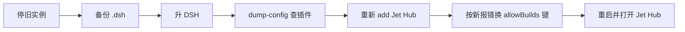

## 为什么 Jet Hub 值得单独一篇？（痛点引入）

Jet Hub 是 DSH 里最容易被当成「一个包」的东西：它其实不是一个能单独安装的包，而是 `dsh-providers-hub` 插件在设置页挂出的账号面板。装它要跨过三道门：

- **来源门**：包没上 npm，只能从 Gitee 的 git 仓库装；
- **构建门**：pnpm 10+ 默认拦截依赖的 `prepare` 脚本，第一次 `add` 必然失败；
- **版本门**：允许键带 commit，上游一升级旧键就失效；宿主与插件的 peer 范围还要对得上。

| 门 | 失败时的典型报错 | 这篇的过关方式 |
|----|------------------|----------------|
| 来源 | `dsh plugin add dsh-providers-hub` 找不到包 | 用完整 git 地址安装 |
| 构建 | `ERR_PNPM_GIT_DEP_PREPARE_NOT_ALLOWED` | 按报错抄带 commit 的完整键 |
| 版本 | `peers check` 报 missing peer | 先看组合树与启动日志，不要直接加宿主包 |
| 升级 | 新 commit 与旧允许键不匹配 | 重新 `add`，按新报错换键 |



<a id="s11"></a>
## 11. Jet Hub（账号枢纽）与安装方案

### 11.1 它是什么

> ### 💡 新人小结：Jet Hub 是机箱里的一个面板
>
> Jet Hub 不是一个能单独安装的包，更像“机箱里的一个面板”。真正装进去的是 `dsh-providers-hub` 插件，Jet Hub 是它在设置页挂出的账号管理界面。

- **上游仓库**：Gitee `iJetLi/deepseek-harness-codearts`。
- **包名**：`dsh-providers-hub`；`0.2.0-rc.11` 起由旧名 `dsh-codearts-auth` 改名。
- **能做什么**：统一登录多个 AI 编程服务，维护多账号池，凭据到期前静默续期，在面板里看有效期/积分/模型开关，并执行每日签到或积分领取。
- **实测组合**：安装当时是 DSH `0.2.0-rc.2` + 插件 `0.2.1-rc.2`；随后宿主已升到 `0.2.1-rc.2`，插件版本未变。【实测·用户】
- **渠道数量**：上游 README 标称 17 个 provider 路由 + 1 个聚合路由（版本 0.2.1-rc.2）；实际以你的设置页显示为准。【规】
- **本机网关**：插件可在 `127.0.0.1:8326` 暴露 OpenAI 兼容接口，供 Cline、Continue 等客户端复用已登录账号。【规】


*图 11-1　Jet Hub 设置页实拍（2026-10-24，本机）。*

**边界**：插件会登录第三方平台并保存凭据，权限与你的用户相同；只从可信来源安装，安装前读一遍权限说明，并遵守各平台服务条款。

### 11.2 安装前检查

| 检查项 | 要求 | 命令 |
|---|---|---|
| DSH 版本 | 0.2.x；当前 latest `0.2.1-rc.2`（初版基线 `0.2.0-rc.2`） | `dsh --version` |
| Node | `^22.19.0` 或 `>=24` | `node -v` |
| pnpm | 由 DSH 内置，本机 `12.14.0` | `dsh plugin --profile web --version` |
| 网络 | 能访问 Gitee | 能 `git clone` 该仓库即可 |
| 旧包名 | 不能残留 `dsh-codearts-auth` | 看 `profiles\web\package.json` |
| 时间与空间 | 首次约 1 分 19 秒，新增 6 个包 | 日志实测【实测·用户】 |

### 11.3 三种安装方案

| 方案 | 来源 | 装到的包 / 面板名 | 结论 |
|---|---|---|---|
| A. Gitee 上游 | `iJetLi/deepseek-harness-codearts` | `dsh-providers-hub` / **Jet Hub** | **推荐**；本机实测成功 |
| B. GitHub 镜像 | `gurio-wine/dsh-account-hub` | `dsh-account-hub` / **账号中心** | 可用但面板不同、渠道较少（7 个） |
| C. GitHub 旧版 | `anye-99/dsh-codearts-auth` | 旧包名 / 渠道 14 个 | 安装说明最终仍指向 Gitee 上游；不要混装 |
| D. 其他 “Jet-Hub” 副本 | 如 `MYCF711/Jet-Hub` | 旧包名 | README 的安装 URL 已 404，不建议 |

**结论**：只选 A。镜像适合对比源码，不适合当长期安装源；不同包名同时存在会触发 DSH 的 bundle 解析失败。

### 11.4 安装步骤（本机真实过程）

<a id="s11-install"></a>

**第 1 步：先跑一次，拿到 pnpm 要求的允许键。**

```powershell
dsh plugin --profile web add "https://gitee.com/iJetLi/deepseek-harness-codearts.git"
```

第一次（尚未放行 `prepare` 时）会失败，本机实际报错（节选）：

```text
Error: ERR_PNPM_GIT_DEP_PREPARE_NOT_ALLOWED
  `-> The git-hosted package "dsh-providers-hub@0.2.1-rc.2" needs to execute
      build scripts but is not in the "allowBuilds" allowlist.
  help: Add the package to "allowBuilds" in your project's pnpm-workspace.yaml:
        allowBuilds:
          dsh-providers-hub@git+https://gitee.com/iJetLi/deepseek-harness-codearts.git#a777741d3ef351ae32f9c76db2a69e877f0108aa: true
```

**键必须整段照抄，尤其是 `#<commit>`**。commit 会随上游更新变化，本文的 `a777741…` 只对应这一次。

**第 2 步：把键写进 profile 的 pnpm 配置。**

文件：`C:\Users\webtu\.dsh\profiles\web\pnpm-workspace.yaml`。本机写入后的实际内容：

```yaml
packages:
  - .

nodeLinker: hoisted
autoInstallPeers: false

allowBuilds:
    dsh-providers-hub@git+https://gitee.com/iJetLi/deepseek-harness-codearts.git#a777741d3ef351ae32f9c76db2a69e877f0108aa: true
```

缩进 2 或 4 个空格都合法，YAML 只看层级。不要只写 `dsh-providers-hub: true` 就完事——本次 pnpm 打印的是带 commit 的完整键，按它写最稳。

**第 3 步：重跑同一条命令。**

```powershell
dsh plugin --profile web add "https://gitee.com/iJetLi/deepseek-harness-codearts.git"
```

本机成功日志（节选）：

```text
[WARN] Issues with peer dependencies found. Run "pnpm peers check" to list them.

dependencies:
+ dsh-providers-hub 0.2.1-rc.2

Done in 1m 18.9s using pnpm v12.14.0
```

> 这份日志产生于宿主 `0.2.0-rc.2`；随后宿主升级到 `0.2.1-rc.2`，插件版本仍是 `0.2.1-rc.2`。升级宿主不要求重装插件，但必须重启并验证，见[第 12 章](/docs/04-hands-on/JetHub与升级/JetHub安装与升级/#s12)。

**第 4 步：重启并打开面板。**

```powershell
dsh web
```

进入 **设置 → Jet Hub**，看到图 11-1 的渠道列表即成功。

**第 5 步：核对写入位置。**

`profiles\web\package.json` 本机实际内容（节选）：

```json
{
  "dependencies": {
    "dsh-providers-hub": "https://gitee.com/iJetLi/deepseek-harness-codearts.git"
  },
  "dsh": {
    "profile": {
      "bundles": [
        "@deepseek-ai/dsh-base",
        "@deepseek-ai/dsh-web-app",
        "dsh-providers-hub"
      ]
    }
  }
}
```

两处都有才算真正装进启动链：`dependencies` 负责安装，`bundles` 负责启动时加载。

### 11.5 日志逐行分析

<a id="s11-log"></a>

| 日志行 / 阶段 | 说明 | 你该做什么 |
|---|---|---|
| `Progress: resolved 0, reused 1, downloaded 0, added 0` | 第一次在解析前就被拦下 | 不是网络问题，直接看下一行 |
| `ERR_PNPM_GIT_DEP_PREPARE_NOT_ALLOWED` | pnpm 拒绝执行 Git 依赖的 `prepare` 构建脚本 | 按报错写 `allowBuilds` |
| `dsh-providers-hub@0.2.1-rc.2` | 本次解析到的插件版本 | 与 `list` 结果对照 |
| `#a777741d3ef351ae32f9c76db2a69e877f0108aa` | 允许键里的 commit 锁 | 必须原样抄；升级后会变 |
| `diagnostics: ...\.plugin-manager\logs\operation-oMAutv\pnpm.log` | 完整 pnpm 日志 | 二次排障先看这个文件 |
| `../../../AppData/Local/Temp/.tmpSOsRr9 pnpm-install$ pnpm install` | pnpm 在临时目录拉源码并执行 `prepare` | 属正常流程，不是装错位置 |
| `[30 lines collapsed]` | 终端折叠了 30 行 | 本文无法分析这部分；需要时展开或看 pnpm.log |
| `+ @deepseek-ai/dsh-credentials 0.2.1-rc.2` 等 | 插件构建环境安装的依赖，不等于宿主版本 | 以 profile 的 `list` 结果为准 |
| `[WARN] Issues with peer dependencies found` | pnpm 报告存在 peer 依赖问题（未列具体项），未阻断安装 | 运行 `dsh plugin --profile web peers check` 确认 |
| `Packages: +6` / `added 6` | profile 新增 6 个包 | 属正常范围 |
| `Done in 1m 7.4s` / `Done in 1m 18.9s` | 内层构建 vs 外层总耗时 | 首次较慢；缓存复用后会快 |
| `Content-addressable store is at: ...\pnpm\store\v11` | pnpm 内容寻址仓库 | 不要手删；重装会复用 |
| `+ dsh-providers-hub 0.2.1-rc.2` | 写入 profile 依赖成功 | 重启 `dsh web` |

**三句话结论：**

1. 失败原因是**构建授权**，不是 Gitee 连不上或版本不兼容。
2. pnpm 12 本次打印的是**带 commit 的完整键**；按它写最稳，升级后旧键会失效。
3. 第二次安装成功；唯一的 `[WARN]` 是 peer 依赖提示，先跑 `peers check`，不要直接忽略。

### 11.6 装后验证与排障

| 症状 | 原因 | 处理 |
|---|---|---|
| 设置里没有 Jet Hub | 没重启，或 `bundles` 没写入 | 重启 `dsh web`；核对 `package.json` 两处 |
| 日志有 `entry did not activate` | 包名解析失败或旧包名残留 | 移除 `dsh-codearts-auth`，只保留 `dsh-providers-hub` |
| 升级后再次 `ERR_PNPM_...PREPARE_NOT_ALLOWED` | 新 commit 与原允许键不匹配 | 用新报错里的完整键替换旧键，重跑 |
| `peers check` 报版本不一致 | 宿主与插件 peer 范围不完全匹配 | 优先把 DSH 升到插件匹配的版本；或按提示评估豁免 |
| 登录回调打不开 / 卡住 | 浏览器与本地回调被代理或安全软件拦截 | 临时放行 `127.0.0.1`；按插件面板的代理设置处理 |
| 本机网关从别的机器访问不到 | 默认只绑 `127.0.0.1`，通配地址会被拒绝 | 保持本机访问；跨机走端口转发，不要改成 `0.0.0.0` |
| 面板里显示“读取中”或积分不更新 | 渠道接口限流、登录态过期 | 在对应渠道卡片上重测/重新登录 |

**升级**：重新执行第 1 步 → 拿到新 commit 键 → 替换 `allowBuilds` → 重跑。

**卸载**：

```powershell
dsh plugin --profile web remove dsh-providers-hub
```

账号与凭据是否随之清理，取决于 DSH 凭据库与插件自身存储；本文未验证，卸载后请检查设置页与 `.credentials.yaml`。

### 11.7 本章判据

```powershell
dsh plugin --profile web list --depth 0
# 期望看到：dsh-providers-hub@0.2.1-rc.2
```

再加两条人工判据：

1. `profiles\web\package.json` 的 `dependencies` 与 `dsh.profile.bundles` 都含 `dsh-providers-hub`。
2. 重启后 **设置 → Jet Hub** 能打开，渠道卡片可展开；日志无 `entry did not activate`。

---

### 💡 新人小结：为什么第一次安装一定要先失败一次？

把它想成「配钥匙」：
- pnpm 不会猜你要放行哪个包的哪个 commit；
- 它把「要配的那把钥匙」原样打印在报错里；
- 你照着配，第二次才开门；
- 自己猜一个纯包名或旧 commit，等于拿错钥匙。

**先让工具报错，是拿到准确授权键的最短路径。**

<a id="s12"></a>
## 12. 升级到最新版（DSH + Jet Hub）

> 原则：先备份、先停旧实例、先升宿主、再升插件；每一步都留下可回退的点。

### 12.1 先分清三个“最新”

| 对象 | 来源 | 查法 | 2026-10-24 实测 |
|---|---|---|---|
| DSH `latest` | npm dist-tag | `npm view @deepseek-ai/dsh dist-tags --json` | `0.2.1-rc.2` |
| DSH `next` | npm dist-tag | 同上 | `0.2.1-rc.3`（预发布，不建议日常） |
| Jet Hub 最新版 | Gitee 仓库 `package.json` + HEAD | `git ls-remote ... HEAD`；`curl.exe .../package.json` | `0.2.1-rc.2`，HEAD `a777741…` |
| 本机已装 | 本地 | `dsh --version`；`dsh plugin --profile web list --depth 0` | DSH `0.2.1-rc.2`；插件 `0.2.1-rc.2` |

查 Jet Hub 上游的两个值：

```powershell
git ls-remote https://gitee.com/iJetLi/deepseek-harness-codearts.git HEAD
curl.exe -sL "https://gitee.com/iJetLi/deepseek-harness-codearts/raw/master/package.json" | Select-String '"version"'
```

本机在 Git Bash 下用等价命令取到 HEAD `a777741…` 与版本 `0.2.1-rc.2`；PowerShell 下用 `curl.exe` 可避开 `curl` 别名差异。

**当前结论**：截至本文实测，本机 DSH 与 Jet Hub 都已是各自的最新版。下面的步骤用于以后升级，也可作为换机后的复现流程。

### 12.2 DSH 升级最新版

**第 0 步：停旧实例、备份。**

如果 `dsh web` 还在运行，先按 [8.1](/docs/04-hands-on/配置与日常/配置插件与日常运维/#s8) 停掉。否则新进程会报（本机日志实测）：

```text
Error: listen EADDRINUSE: address already in use 127.0.0.1:3080
```

备份数据目录：

```powershell
Copy-Item -Recurse -LiteralPath "$env:USERPROFILE\.dsh" -Destination "D:\backup\dsh-2026-10-24"
```

该备份命令本机未执行，原因见 [10.2](/docs/04-hands-on/排障与验收/排障验收与附录/#s10)。

**第 1 步：升级并验证。**

```powershell
npm install -g @deepseek-ai/dsh@latest
dsh --version
```

期望输出：`0.2.1-rc.2`（当前 `latest`）。如果还是旧版本，先 `where.exe dsh` 确认命令指向的是刚升级的全局目录，再重开终端。

**第 2 步：确认插件仍在组合树里。**

```powershell
dsh --profile web --dump-config | Select-String "dsh-providers-hub"
```

本机实测命中：

```text
# == dsh-providers-hub
- id: codearts-auth
  name: dsh-providers-hub
```

`--dump-config` 只证明“组合树包含插件”，不等于运行时已激活；最终仍要看启动日志与设置页。

**第 3 步：启动。**

```powershell
dsh web
```

若再次出现 `EADDRINUSE`，说明旧实例没停干净；回到第 0 步，不要用“再开一个默认端口实例”来绕过。

**回滚**：

```powershell
npm install -g @deepseek-ai/dsh@0.2.0-rc.2
```

本机未执行回滚，见 [10.2](/docs/04-hands-on/排障与验收/排障验收与附录/#s10)。

### 12.3 Jet Hub 升级最新版

Jet Hub 是 Git 源插件，“升级”就是重新 `add` 上游仓库；这是 Git 源安装的通用方式，镜像 README 也写明之后每次升级重新 `add` 即可。【规】

**第 1 步：重新 add。**

```powershell
dsh plugin --profile web add "https://gitee.com/iJetLi/deepseek-harness-codearts.git"
```

**第 2 步：处理 `allowBuilds` 键轮换。**

- 上游 commit 没变：pnpm 通常直接完成或提示无变化。
- 上游 commit 变了：会再次报 `ERR_PNPM_GIT_DEP_PREPARE_NOT_ALLOWED`，并打印**新 commit 的完整键**。把 [11.4](/docs/04-hands-on/JetHub与升级/JetHub安装与升级/#s11-install) 里 `pnpm-workspace.yaml` 的旧键替换成新键，再重跑第 1 步。
- 旧键只锁旧 commit，不会自动放行新版本。

**第 3 步：验证版本。**

```powershell
dsh plugin --profile web list --depth 0
```

期望看到 `dsh-providers-hub@<新版本>`。本机当前已是 `0.2.1-rc.2`，上游 HEAD 为 `a777741…`，所以现在不需要重装。

**第 4 步：重启并打开面板。**

```powershell
dsh web
```

进入 **设置 → Jet Hub** 能看到渠道卡片，且 `.dsh\logs` 中没有 `entry did not activate`，才算升级完成。

**回滚**：从备份恢复 `profiles\web` 下的 `package.json`、`pnpm-workspace.yaml`、`pnpm-lock.yaml` 与 `node_modules`，再启动；或重新 `add` 旧 commit。该路径本机未实测。

### 12.4 本次升级后的实测状态与 peer 警告

<a id="s12-state"></a>

本机当前状态：

```text
dsh --version                              → 0.2.1-rc.2
dsh plugin --profile web list --depth 0    → dsh-providers-hub@0.2.1-rc.2
Gitee HEAD                                  → a777741d3ef351ae32f9c76db2a69e877f0108aa
dsh plugin --profile web --version         → 12.14.0 (pnpm)
```

执行 `dsh plugin --profile web peers check`，本机实际输出（节选）：

```text
Issues with peer dependencies found

✕ missing peer @deepseek-ai/cordis
✕ missing peer @deepseek-ai/dsh-commands
✕ missing peer @deepseek-ai/dsh-credentials
✕ missing peer @deepseek-ai/dsh-llm
...
dsh: plugin command failed; diagnostics: ...\.plugin-manager\logs\operation-cwBPmJ\pnpm.log
```

**怎么读这条警告：**

- 这四个包是 DSH 宿主的运行时包，由 DSH 安装目录提供；profile 设了 `autoInstallPeers: false`，所以 profile 的 `node_modules` 里没有独立副本。
- `peers check` 只检查 profile 依赖树，会把它们报成 missing；**命令退出非零 ≠ Jet Hub 一定坏了**。
- 正确判定顺序：`--dump-config` 命中 `dsh-providers-hub`（本机已命中）→ 启动日志无 `entry did not activate` → 设置页能打开 Jet Hub。三条都过才算正常。
- **不要**为了让这条命令变绿而手动把四个宿主包加进 profile；那会多装一份宿主模块，可能造成重复实例。先按上面的判定顺序确认。

### 12.5 升级检查表

| 顺序 | 动作 | 成功判据 | 失败先看 |
|---|---|---|---|
| 1 | 停旧实例 | 目标端口无监听 | [8.1](/docs/04-hands-on/配置与日常/配置插件与日常运维/#s8) 查 PID |
| 2 | 备份 `.dsh` | 备份目录存在 | [10.2](/docs/04-hands-on/排障与验收/排障验收与附录/#s10) |
| 3 | 升 DSH | `dsh --version` = latest | PATH / npm 全局目录 |
| 4 | 查组合树 | `--dump-config` 命中 `dsh-providers-hub` | profile `package.json` |
| 5 | 升 Jet Hub | `list` 显示新版本 | 新 `allowBuilds` 键 |
| 6 | 重启验证 | Jet Hub 页签可打开、日志无 activate 错误 | 日志 / `peers check` |

### 12.6 本章未验证项

- 作者未执行 `npm install -g @deepseek-ai/dsh@latest`（用户本机已是 latest）。
- Jet Hub 重装升级未触发（当前已是上游最新）。
- DSH 回滚、Jet Hub 回滚未执行。
- 升级后 Jet Hub 页签未由作者在浏览器中实测。
- `next` 通道（`0.2.1-rc.3`）未使用。
### 💡 新人小结：升级为什么不能跳步？

把它想成「换发动机」：
- 先熄火（停旧实例），否则新发动机点不着（`EADDRINUSE`）；
- 先拍照留档（备份 `.dsh`），装不回去还能还原；
- 先换主机（升 DSH），再换附件（升 Jet Hub）；
- 最后试车（重启、看设置页、看日志）。

**升级不是一条 `npm install`，而是一条有回退点的顺序链。**

## 要点总结

1. **Jet Hub 是面板，不是包**：真正安装的是 `dsh-providers-hub`。
2. **只从 Gitee 上游装**：镜像与旧包名会造成面板不同或 bundle 解析失败。
3. **allowBuilds 键必须带 commit**：先失败、照抄、再重跑；升级后按新报错换键。
4. **两处写入才算装进启动链**：`dependencies` 与 `dsh.profile.bundles`。
5. **升级顺序固定**：停旧实例 → 备份 → 升宿主 → 查组合树 → 升插件 → 重启验证。
6. **peers check 非零不等于插件坏了**：宿主包由 DSH 安装目录提供，判定要看组合树、启动日志与设置页。

> ### 💡 新人小结：Jet Hub 学完了，记住这 6 点
>
> - 面板叫 Jet Hub，包叫 `dsh-providers-hub`；
> - 来源只认 Gitee 上游，旧包名要清干净；
> - 构建授权按报错抄，尤其是 `#<commit>`；
> - 安装成功要同时看 `dependencies` 和 `bundles`；
> - 升级先停旧实例、再备份、再动版本；
> - `peers check` 红了先别加宿主包，先看三条运行判据。

