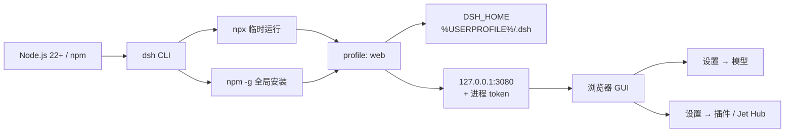

## 为什么需要一篇从 Node 到 Web UI 的安装教程？（痛点引入）

这份教程来自 2026-10-24 的 Windows 本机实测。第一次装 DSH 的人，卡点通常不在「命令太长」，而在四件事：

- `dsh` 装完却找不到：npm 全局目录没有进 PATH；
- 版本漂移：`latest` 与示例版本不一致，profile 里的插件还要按 peer 范围校验宿主；
- 打开裸地址被拒：启动行打印的 URL 带一次性进程 token；
- 工作区跑偏：启动时所在目录就是 agent 的 workspace 根。

| 卡点 | 常见表现 | 这篇给出的实测基线 |
|------|----------|--------------------|
| 运行环境 | `node`/`npm` 可用，但 `dsh` 不是内部或外部命令 | Node `v24.22.0`、npm `11.19.1`，全局目录在用户 PATH |
| 版本 | 跟着 `latest` 走，换机后行为不一致 | 锁 `@deepseek-ai/dsh@0.2.1-rc.2`；`next` 为 `0.2.1-rc.3` |
| 启动 | 只看到端口监听，浏览器打开 401 或空白 | 必须用终端打印的 `dsh web:` token URL |
| 工作区 | agent 在 `System32` 或下载目录里干活 | 先 `cd` 项目目录，再 `dsh web` |
| 数据 | 重装后以为会话和模型设置没了 | 程序在 `%APPDATA%\npm`，数据在 `%USERPROFILE%\.dsh`，卸载保留 |

> ### 💡 新人小结：这篇教程在整站里的位置
>
> 把它想成「新电脑的开机设置向导」：
> - 先确认发动机（Node/npm）能点火；
> - 再插钥匙（安装 dsh）并核对钥匙版本；
> - 最后看仪表盘（浏览器）是否真的亮起来；
> - 仪表盘亮不等于车能开，还要确认工作区停在你想要的项目目录。
>
> **安装的终点不是「端口在监听」，而是「带 token 的页面能对话、工作区在项目目录」。**

> 适用：Windows 10/11，在本机用命令行启动 DeepSeek Harness（DSH）Web UI。
> 基线：2026-10-24 在本机实测；命令默认在 **PowerShell** 中执行，Git Bash 差异单独标注。
> 本文可持续追加：新增内容按 [附录 B](/docs/04-hands-on/排障与验收/排障验收与附录/#sB) 的约定写入，不改动已有编号。

<a id="s0"></a>
## 0. 新人小结：3 分钟跑起来

> ### 💡 新人小结：把 DSH 想成一台要自己点火的本地服务
>
> Node 是发动机，`dsh` 是钥匙，`dsh web` 点火，浏览器是仪表盘。点火时终端会打印一把**一次性钥匙（token）**，必须用带这把钥匙的地址进仪表盘。

已经装好 Node 和 DSH 的话，最短路径只有三步：

```powershell
cd D:\work\my-project     # 换成你的项目目录
dsh web
# 或临时运行：npx -y @deepseek-ai/dsh@latest web
# 复制终端打印的 dsh web: http://127.0.0.1:3080/?token=... 到浏览器
```

首次安装则先执行（当前 `latest` 为 `0.2.1-rc.2`）：

```powershell
npm install -g @deepseek-ai/dsh@0.2.1-rc.2
dsh --version
dsh web
```

**成功判据**：终端出现 `dsh web:` 开头的 URL，浏览器能加载页面并正常对话。仅仅看到端口在监听不算成功。

### 三条硬规矩

1. **先 `cd` 再启动**：启动时所在目录就是默认 workspace 根目录；在 `C:\Windows\System32` 里启动，agent 的工作区就是那里。
2. **只用启动行打印的 URL**：URL 带进程 token；手敲 `http://127.0.0.1:3080` 通常过不了认证。
3. **改完插件/配置后重启 `dsh web`**；`desktop` profile 归 Electron 桌面端管，CLI 不碰。

---

<a id="s1"></a>
## 1. 前置条件与版本基线

| 项 | 要求 | 本机实测（2026-10-24） | 证据 |
|---|---|---|---|
| Windows | 10 / 11，x64 | 10.0.26300 x64 | 【实测】 |
| Node.js | 22+，建议 24 LTS | `v24.22.0` | 【实测】 |
| npm | 随 Node 安装 | `11.19.1` | 【实测】 |
| DSH | `@deepseek-ai/dsh` | `0.2.1-rc.2`（当前 latest；初版基线为 `0.2.0-rc.2`） | 【实测】 |
| DSH 内置 pnpm | 由 DSH 提供，无需单装 | `12.14.0` | 【实测】 |
| npm 全局目录 | 必须在 PATH | `C:\Users\webtu\AppData\Roaming\npm` | 【实测】 |
| 磁盘 | 程序约数百 MB，数据随会话增长 | 以实际为准 | 【规】 |
| 网络 | 能访问 npm registry 与模型 API | — | 【规】 |

### 读表约定

- **【实测】**：本机实际跑过，输出原样贴出。
- **【实测·用户】**：用户在本机执行并提供了终端日志或装后状态，本文据此分析。
- **【规】**：来自官方 README、配置注释或上游文档，未在本机复跑。
- **【未验证】**：本文写出但本机未执行，文末有汇总。
- 表中版本号是 **2026-10-24 的快照**。npm `latest` 当前为 `0.2.1-rc.2`，`next` 为 `0.2.1-rc.3`（预发布通道，不建议日常使用）；升级后以 `dsh --version` 为准，步骤见[第 12 章](/docs/04-hands-on/JetHub与升级/JetHub安装与升级/#s12)。

### 启动链路



---

<a id="s2"></a>
## 2. 安装 Node.js 与 npm

### 2.1 安装

1. 从 [nodejs.org](https://nodejs.org/) 下载 **LTS 24.x** 的 Windows 安装包。
2. 安装向导里勾选 **Add to PATH**。
3. 安装完成后**新开一个 PowerShell 窗口**，执行验证。

```powershell
node -v
npm -v
where.exe node
where.exe npm
```

本机实测输出：

```text
v24.22.0
11.19.1
C:\Program Files\nodejs\node.exe
C:\Program Files\nodejs\npm
C:\Program Files\nodejs\npm.cmd
```

### 2.2 PATH 与全局目录

npm 的全局命令落在 `npm config get prefix` 目录下。本机：

```text
C:\Users\webtu\AppData\Roaming\npm
```

如果 `dsh` 装完却提示“不是内部或外部命令”，先确认这个目录在用户 PATH 里，再重开终端。`where.exe dsh` 应能看到 `dsh` 与 `dsh.cmd` 两条。

### 2.3 PowerShell 执行策略（可选）

若 PowerShell 报 `npm.ps1 cannot be loaded because running scripts is disabled`，有两种处理：

- 不改系统策略：把命令换成 `npm.cmd install -g ...`。
- 只对当前用户放开：

```powershell
Set-ExecutionPolicy -Scope CurrentUser RemoteSigned
```

后者会允许本机创建的脚本与远程签名脚本，属于系统策略变更；不确定时用 `npm.cmd`。

> 不建议混用 Node 版本管理器与系统安装版。若用 nvm-windows，全局包按 Node 版本隔离，切版本后 `dsh` 可能“消失”，需要重装。

---

<a id="s3"></a>
## 3. 安装 DSH

DSH 的 npm 包名是 `@deepseek-ai/dsh`。有两种用法，区别只在“装在哪、怎么启动”。

| 方式 | 命令 | 适合 | 代价 |
|---|---|---|---|
| 临时运行（npx） | `npx @deepseek-ai/dsh@0.2.1-rc.2 web` | 试一次、不想污染全局 | 每次可能重新下载；缓存清理后失效 |
| 全局安装 | `npm install -g @deepseek-ai/dsh@0.2.1-rc.2` | 日常使用 | 全局只有一个版本 |

### 3.1 临时运行（npx）

```powershell
npx -y @deepseek-ai/dsh@0.2.1-rc.2 web
```

- `-y` 跳过首次安装确认。
- 不写版本号会拿 `latest`（当前 `0.2.1-rc.2`）；需要复现问题时建议显式锁版本。
- npx 只是程序来源不同，`%USERPROFILE%\.dsh` 里的 profile 与会话仍然共用。

### 3.2 全局安装（推荐）

```powershell
npm install -g @deepseek-ai/dsh@0.2.1-rc.2
```

验证：

```powershell
dsh --version
where.exe dsh
npm ls -g @deepseek-ai/dsh --depth=0
```

本机实测（升级到 latest 后）：

```text
0.2.1-rc.2
C:\Users\webtu\AppData\Roaming\npm\dsh
C:\Users\webtu\AppData\Roaming\npm\dsh.cmd
C:\Users\webtu\AppData\Roaming\npm
- @deepseek-ai/dsh@0.2.1-rc.2
```

不锁版本就是：

```powershell
npm install -g @deepseek-ai/dsh@latest
```

**版本要锁**：DSH 处于 rc 阶段，profile 里的插件按 peer 范围校验宿主版本；跨版本升级前先备份 `.dsh`。

### 3.3 程序目录与数据目录不是一回事

| 内容 | 位置 | 卸载时 |
|---|---|---|
| 程序本体 | `%APPDATA%\npm\node_modules\@deepseek-ai\dsh` | 会被删 |
| 数据与配置 | `%USERPROFILE%\.dsh` | **保留** |

所以“重装 DSH”通常不会丢会话与模型设置；要彻底清理得手动删 `.dsh`。

---

<a id="s4"></a>
## 4. 首次启动与验收

### 4.1 启动

```powershell
cd D:\work\my-project
dsh web
```

首次使用 `web` 时，DSH 会从随附模板自动初始化 `%USERPROFILE%\.dsh\profiles\web`。【规】

终端会打印带 token 的启动行。本机用随机端口实测（token 已打码）：

```text
dsh web: http://127.0.0.1:61143/?token=<REDACTED>
```

默认端口是 **3080**；上面用 `--port 0` 让系统挑了一个空闲端口。

### 4.2 常用启动参数

| 参数 | 作用 | 示例 |
|---|---|---|
| `--no-open` | 不自动打开浏览器，只打印 URL | `dsh web --no-open` |
| `--port <n>` | 指定端口；`0` 表示让系统挑 | `dsh web --port 8080` |
| `--host <host>` | 绑定主机，默认 `127.0.0.1` | `dsh web --host 127.0.0.1` |
| `--trusted-host <authority>` | 追加 `/api` 信任的主机名，可重复 | `dsh web --trusted-host dsh.local` |
| `--help` | 查看 web 子命令参数 | `dsh web --help` |

> **不支持绑定所有网卡**：`--host 0.0.0.0` 会在启动时被拒绝，官方出于安全考虑只允许 loopback。远程访问请用端口转发/内网代理，不要改绑定地址。【规】

### 4.3 验收

1. 终端出现 `dsh web:` 行。
2. 浏览器打开该 URL（含 token）。
3. 页面能加载、能发一条消息并收到回复。

只看到端口监听、页面空白或 401，都不算成功，按[第 9 章](/docs/04-hands-on/排障与验收/排障验收与附录/#s9)排查。

### 4.4 停止

前台运行时按 `Ctrl+C`。进程退出后端口释放；下次启动会重新生成 token。

## 要点总结

1. **版本先锁死**：Node 22+（本机 24.22.0）、npm 11.19.1、DSH `0.2.1-rc.2`。
2. **程序与数据分家**：程序在 `%APPDATA%\npm`，数据在 `%USERPROFILE%\.dsh`；卸载 DSH 不删数据。
3. **启动只认启动行**：`dsh web` 打印的 token URL 才是入口，裸 `127.0.0.1:3080` 通常过不了认证。
4. **先 cd 再启动**：启动目录就是 workspace 根，别在 `System32` 里点火。
5. **失败先查三件事**：PATH 里有没有 `dsh`、端口是否被占、URL 有没有带 token。

> ### 💡 新人小结：安装链路学完了，记住这 5 点
>
> - 发动机是 Node/npm，钥匙是锁定版本的 `dsh`；
> - 数据都在 `.dsh`，重装不会丢，但要按密钥保管 `.credentials.yaml`；
> - 启动行打印的 token URL 是唯一入口；
> - 工作区跟着启动目录走；
> - 看到端口监听只算「点火成功」，能对话才算「车能开」。

