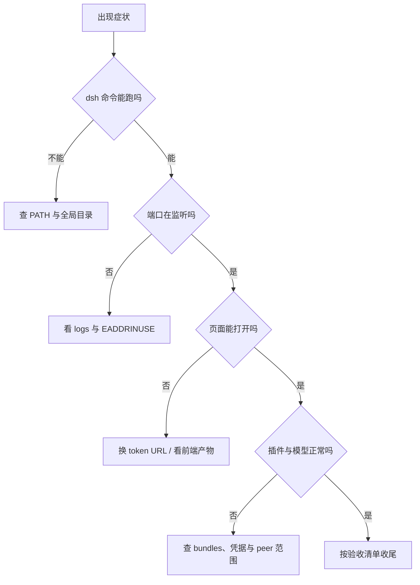

## 为什么需要一份排障、验收与附录？（痛点引入）

DSH 的失败很少以「明确的错误类型」出现，更多是「页面打不开」「设置页没有」「命令退出非零」这类症状。没有一张症状到原因的对照表，排查会退化成反复重启和猜版本。

| 症状 | 先分哪一层 | 这篇对应的章节 |
|------|------------|----------------|
| `dsh` 找不到 / 启动即退出 | 环境层：PATH、端口 | 第 9 章 |
| 页面空白 / 401 | 入口层：token URL、前端产物 | 第 9 章 |
| 插件装完没出现 | 配置层：profile、bundles、日志 | 第 9 章 |
| 模型 401 / 404 | 凭据层：Key 来源、Base URL | 第 9 章 |
| 升级后不兼容 | 版本层：peer 范围与豁免 | 第 9 章、第 12 章 |



## 本篇包含什么

| 部分 | 内容 | 什么时候看 |
|------|------|------------|
| 第 9 章 | 症状 → 最可能原因 → 处理 | 出问题时先查 |
| 第 10 章 | 机器可检清单与未验证项 | 装完、升级后 |
| 附录 A | 一页命令速查 | 日常查阅 |
| 附录 B | 追加内容约定与模板 | 后续扩写 |
| FAQ | 十个高频问题 | 先看有没有现成答案 |
| 变更记录 | 版本与改动 | 回查口径 |

<a id="s9"></a>
## 9. 排障手册

| 症状 | 最可能原因 | 处理 |
|---|---|---|
| `dsh` 不是内部或外部命令 | 全局目录不在 PATH | 把 `%APPDATA%\npm` 加进用户 PATH，重开终端；或临时用 `npx` |
| 端口被占用 / 启动即退出 | 3080 已有进程 | `dsh web --port 8081`；或按 8.1 查 PID 停掉旧实例 |
| 浏览器没自动打开 | 默认浏览器交接失败 | 不要关服务器；复制终端打印的 `dsh web:` URL 手动打开 |
| 打开 `127.0.0.1:3080` 提示未授权 | 少了进程 token | 使用带 `?token=...` 的完整 URL；token 每次启动都会变 |
| 页面空白 | 前端产物缺失（源码运行） | npm 安装版不会遇到；源码 checkout 先在仓库根执行 `pnpm run build` |
| `--host 0.0.0.0` 启动被拒绝 | 官方禁止绑定所有网卡 | 保持 `127.0.0.1`；远程访问走端口转发/内网代理 |
| 插件装完设置页没有 | 没重启或 profile 没写对 | 重启 `dsh web`；检查 `package.json` 的 `dependencies` 与 `bundles`；看日志 `did not activate` |
| `ERR_PNPM_...PREPARE_NOT_ALLOWED` | pnpm 拦截构建脚本 | 按 6.3 把报错里的键写进 `pnpm-workspace.yaml` 后重跑 |
| 模型 401 | Key 缺失、过期或来源不对 | 设置 → 模型重新填；检查环境变量是否覆盖了托管凭据 |
| 模型 404 / 没有模型 | Base URL 或模型 ID 写错 | Base URL 写到 `/v1`；模型 ID 用服务端返回的真实 id |
| 升级后插件报版本不兼容 | 宿主与插件 peer 范围不匹配 | 回滚 DSH 版本，或按提示显式豁免（先评估风险） |

---

### 💡 新人小结：排障为什么先分层？

把它想成「家里停电」：
- 先看整栋楼有没有电（环境层：PATH、端口、进程）；
- 再看自家电闸（入口层：token URL、页面产物）；
- 然后看电器插头（配置层：profile、bundles、凭据）；
- 最后才怀疑电器本身（版本层：peer 范围、豁免）。

**从外到内排查，能避免「一上来就重装」这种把现场证据一起删掉的做法。**

<a id="s10"></a>
## 10. 验收清单与未验证项

### 10.1 机器可检清单

```powershell
node -v                              # 期望 v24.22.0（或 >=22）
npm -v                               # 期望 11.19.1（随 Node 版本变化）
dsh --version                        # 期望 0.2.1-rc.2（当前 latest；0.2.0-rc.2 可回滚）
where.exe dsh                        # 期望看到 ...\npm\dsh 与 dsh.cmd
dsh plugin --profile web --version   # 期望 12.14.0（DSH 内置 pnpm）
dsh plugin --profile web list --depth 0  # 装了 Jet Hub 时期望 dsh-providers-hub@0.2.1-rc.2
```

启动冒烟（不打开浏览器、随机端口）：

```powershell
dsh web --no-open --port 0
# 期望：dsh web: http://127.0.0.1:<随机端口>/?token=<...>
# 本机 2026-10-24 实测输出（token 已打码）：
# dsh web: http://127.0.0.1:61143/?token=<REDACTED>
```

按 `Ctrl+C` 结束。

装完 Jet Hub 后的本机实况（2026-10-24，【实测·用户】）：

```text
dsh-profile-web  C:\Users\webtu\.dsh\profiles\web  (PRIVATE)

dependencies:
- dsh-providers-hub@0.2.1-rc.2

1 package
```

### 10.2 未验证项汇总

> Jet Hub 安装已由用户在本机实测成功（见 [11.4](/docs/04-hands-on/JetHub与升级/JetHub安装与升级/#s11-install) / [11.5](/docs/04-hands-on/JetHub与升级/JetHub安装与升级/#s11-log)）；DSH 当前也已升到 latest `0.2.1-rc.2`（见 [12.4](/docs/04-hands-on/JetHub与升级/JetHub安装与升级/#s12-state)）。作者未复跑安装/升级动作，下表是其余未验证项。

| 项 | 原因 |
|---|---|
| 本次重新执行 `npm install -g @deepseek-ai/dsh` | 本机已全局安装，未重复安装 |
| `npx` 临时运行 | 未执行；本机走的是全局安装 |
| `npm install -g @deepseek-ai/dsh@latest` 升级命令 | 作者未执行；用户本机当前已是 `0.2.1-rc.2`，见 12.4 |
| DSH 回滚到 `0.2.0-rc.2` | 未执行 |
| PATH 修改与 `Set-ExecutionPolicy` | 本机无需修改，未执行 |
| `setx DEEPSEEK_API_KEY` 持久化 | 未修改用户环境变量 |
| 本地 Ollama Provider 实际调用 | 示例配置，未在本机跑通 |
| `--trusted-host` / 局域网访问 | 未在本机验证；官方默认只允许 loopback |
| `Get-NetTCPConnection` + `Stop-Process` 查杀 | 日志里出现过 `EADDRINUSE`，但未手动执行该流程 |
| `Copy-Item` 备份与迁移到另一台机器 | 未执行 |
| `desktop` profile 的 CLI 行为 | 官方说明归 Electron 管，未在本机复现 |
| Jet Hub 本地 OpenAI 网关（`127.0.0.1:8326`） | 未调用 |
| Jet Hub 重装升级与回滚 | 当前已是上游最新，未触发重装；回滚未实测 |
| Jet Hub 各渠道真实登录与积分领取 | 未执行 |
| `next` 通道（`0.2.1-rc.3`） | 未使用，不建议日常使用 |
| 升级后 Jet Hub 页签的浏览器实测 | 作者未打开 UI；以 `--dump-config` 与启动日志为准 |

---

---

<a id="sA"></a>
## 附录 A. 命令速查

| 目的 | 命令 |
|---|---|
| 查 Node / npm | `node -v`、`npm -v` |
| 全局安装 DSH | `npm install -g @deepseek-ai/dsh@0.2.1-rc.2` |
| 临时运行 | `npx -y @deepseek-ai/dsh@0.2.1-rc.2 web` |
| 启动 Web UI | `dsh web` |
| 不自动开浏览器 | `dsh web --no-open` |
| 换端口 | `dsh web --port 8081` |
| 随机空闲端口 | `dsh web --port 0` |
| 安装插件 | `dsh plugin --profile web add <包名>` |
| 卸载插件 | `dsh plugin --profile web remove <包名>` |
| 查看已装插件 | `dsh plugin --profile web list --depth 0` |
| 安装 Jet Hub | `dsh plugin --profile web add "https://gitee.com/iJetLi/deepseek-harness-codearts.git"` |
| 检查 peer 依赖 | `dsh plugin --profile web peers check` |
| 查看组合配置 | `dsh --profile web --dump-config` |
| 查占用端口的 PID | `Get-NetTCPConnection -LocalPort 3080 -State Listen` |
| 升级 DSH | `npm install -g @deepseek-ai/dsh@latest` |
| 查 DSH 最新标签 | `npm view @deepseek-ai/dsh dist-tags --json` |
| 升级 Jet Hub | `dsh plugin --profile web add "https://gitee.com/iJetLi/deepseek-harness-codearts.git"` |
| 查 Jet Hub 上游提交 | `git ls-remote https://gitee.com/iJetLi/deepseek-harness-codearts.git HEAD` |
| 备份数据 | `Copy-Item -Recurse -LiteralPath "$env:USERPROFILE\.dsh" -Destination <目标>` |

---

<a id="sB"></a>
## 附录 B. 追加内容约定

后续往这份指南里加内容时，按下面规则写，保证结构不乱、可回查：

1. **编号只增不改**：新主题追加为新的 `## N.`（放在 FAQ 之前）；新场景用 `### 场景 7-x`，每批 3 个；不改已有编号与锚点。
2. **同步更新两处**：文首目录表 + 文末[变更记录](/docs/04-hands-on/排障与验收/排障验收与附录/#sChangelog)。
3. **每节五件套**：适用版本、命令、预期输出、判据、该场景特有的坑。
4. **证据标记**：跑过的写【实测】并贴真实输出；没跑的写【未验证】并说明原因；引用文档写【规】。
5. **不要编造输出**：端口、token、路径以本机实际为准；token 一律打码。
6. **敏感信息**：`%USERPROFILE%\.dsh\.credentials.yaml` 与任何 `sk-` 开头的 Key 不进文档、不进 Git。
7. **图片统一放 `assets/`**：用相对路径引用（如 `/picture/jet-hub-settings.png`），文件名用 kebab-case，图下写“图 N-M + 说明”；不要把 `%TEMP%`、PixPin 临时目录等本机路径写进正文。

新章节模板（外层用四个反引号，避免与内层代码块冲突）：

````markdown
<a id="sX"></a>
## N. 标题

适用版本：dsh x.y.z / Windows 10+
痛点：……
做法：……

```powershell
<命令>
```

预期输出：

```text
<真实输出或标记 未验证>
```

判据：……
坑：……
````

---

### 💡 新人小结：验收清单怎么用？

把它想成「飞机起飞前的检查单」：
- 每一项都要有可观察的结果，不靠感觉；
- 先查静态项（版本、PATH、配置文件），再查动态项（启动、页面、对话）；
- 任何一项失败都停在原地，不要带着故障起飞；
- 检查单不是一次性的，升级、换机、迁移后都要重跑。

**验收的价值在于「能重复」，而不是「这次碰巧能用」。**

<a id="sFAQ"></a>
## 常见问题（FAQ）

**1. 只临时用一次，也必须装 Node 吗？**
是。`npx` 只是不全局安装 DSH，仍然需要 Node 与 npm 来下载和运行它。

**2. npx 和全局安装怎么选？**
长期使用选全局安装并锁版本；临时对比版本用 `npx @deepseek-ai/dsh@<版本> web`。两者共用 `%USERPROFILE%\.dsh` 里的 profile 与会话。

**3. 为什么不能直接打开 `http://127.0.0.1:3080`？**
启动 URL 带一次性进程 token，浏览器要用它换取签名 cookie。手敲裸地址通常过不了认证，必须复制终端打印的完整 URL。

**4. 端口能改吗？能开多个吗？**
能。`--port 8081` 指定端口，`--port 0` 让系统挑。每个实例独立 token，URL 不能混用。

**5. DSH 的数据在哪里？怎么备份？**
默认 `%USERPROFILE%\.dsh`。整个目录复制即可；其中 `.credentials.yaml` 含密钥，备份要按敏感文件保管。

**6. 换电脑怎么迁移？**
复制 `.dsh` 到新机器的同一路径，或设置 `DSH_HOME` 指向它；随后重装缺失的插件并核对模型凭据。本文未实测完整迁移。

**7. API Key 存在哪？安全吗？**
模型页写入 `%DSH_HOME%\.credentials.yaml`，不会注入进程环境；环境变量优先级更高。两者都是本机明文，靠文件权限保护，不要提交到仓库。

**8. 插件装完为什么设置页没有？**
先重启 `dsh web`；再确认装的是 `web` profile、`package.json` 的 `dependencies` 与 `dsh.profile.bundles` 都有该包；最后看日志是否有 `did not activate`。

**9. allowBuilds 要不要放开？**
只放开你审过源码、信任的包，并按报错里的精确键写。`dangerouslyAllowAllBuilds: true` 会放行该 profile 的所有构建脚本，等于放弃逐包审查。

**10. 能不能局域网或手机访问？**
官方默认只允许本机，`--host 0.0.0.0` 会被拒绝。需要远程访问时用 SSH 端口转发或内网代理，并自行承担认证与暴露风险；本文未验证该路径。

---

### 💡 新人小结：FAQ 和附录为什么还要留着？

把它想成「说明书最后那几页」：
- FAQ 收的是重复被问到的问题，省得每次翻长文；
- 命令速查是给熟练读者的索引，不是教程的替代品；
- 追加约定让后来的人知道怎么扩写而不打乱编号；
- 变更记录让「当时的结论」和「现在的结论」能对上。

**正文讲清一次，附录负责快速回查；两者分工不同，不是重复。**

<a id="sChangelog"></a>
## 变更记录

| 日期 | 版本 | 改动 |
|---|---|---|
| 2026-10-24 | v1.0 | 初版：环境基线、Node/npm、npx/全局安装、首次启动、配置面、插件面、3 个场景、运维、排障、验收、附录与 FAQ |
| 2026-10-24 | v1.1 | 新增第 11 章 Jet Hub：设置页截图（`/picture/jet-hub-settings.png`）、三种安装方案、真实报错与成功日志逐行分析、装后验证与排障；同步更新 6.3、7-3、10.1、10.2、速查表 |
| 2026-10-24 | v1.2 | 新增第 12 章：DSH 升级 latest、Jet Hub 升级 latest、`allowBuilds` 键轮换、`EADDRINUSE` 与 `peers check` 实测分析；版本基线更新为 DSH `0.2.1-rc.2`，同步第 0/1/3/8/10 章与速查表 |
## 要点总结

1. **先分层再排障**：环境 → 入口 → 配置 → 版本，不要一上来就重装。
2. **验收看行为不看端口**：token URL 能打开、能对话、工作区正确，才算通过。
3. **证据要贴真实输出**：版本、端口、日志、组合树四样先收集齐。
4. **未验证项要显式标注**：没跑过的命令不写成已通过。
5. **速查表用来减少翻页**：命令、判据、坑都收在一页里。

> ### 💡 新人小结：排障与验收学完了，记住这 5 点
>
> - 症状先归层，层错了就会在错误的地方修；
> - 端口监听不是成功判据，token URL 能对话才是；
> - 插件问题先看 `bundles` 与日志里的 `did not activate`；
> - 版本问题先看 peer 范围，不要盲目重装；
> - 没跑过的项老实写「未验证」，比假装通过更有用。

