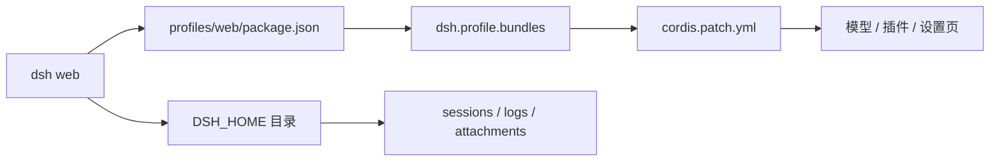

## 为什么需要把配置、插件和日常运维放在一篇？（痛点引入）

装好 DSH 只是起点。真正每天要碰的是三件事：配置放在哪、插件怎么装、出了问题怎么停和备份。三件事分开看都简单，合起来却容易互相踩：

- 改了模型 Key，却不知道它落在 `.credentials.yaml` 还是进程环境；
- 装完插件设置页没有，因为只写进了 `dependencies`，没写进 `dsh.profile.bundles`；
- 端口冲突时又开一个默认实例，结果两个 token URL 混用；
- 升级前没备份 `.dsh`，回滚时连旧 profile 一起丢了。

| 要解决的问题 | 只看单章容易漏掉 | 按本篇顺序 |
|--------------|------------------|------------|
| 配置 | 只知道有 `.dsh`，不知道哪个文件管模型、哪个管端口 | 先认 DSH_HOME 与 profile 目录，再改模型与端口 |
| 插件 | 会 `add`，但不知道装进了哪个 profile、何时生效 | 先认 `dsh plugin` 的转发语义，再按三种来源安装 |
| 场景 | 每天从错误目录启动，workspace 跟着跑偏 | 用三个固定场景把启动、端口、Jet Hub 固化下来 |
| 运维 | 只会 `Ctrl+C`，后台残留与备份没规程 | 查 PID、升级回滚、备份迁移、看日志 |



<a id="s5"></a>
## 5. 配置面

### 5.1 DSH_HOME 与目录结构

默认 `DSH_HOME` 是 `%USERPROFILE%\.dsh`，可用环境变量覆盖。

| 路径 | 内容 |
|---|---|
| `.dsh\profiles\web` | web 组合包清单（`package.json`）、用户补丁（`cordis.patch.yml`）、pnpm 配置 |
| `.dsh\sessions` | 会话历史 |
| `.dsh\logs` | 启动/运行日志与诊断报告 |
| `.dsh\storages` | 存储数据 |
| `.dsh\attachments` | 附件（按内容去重，不自动删除） |
| `.dsh\.credentials.yaml` | 托管凭据（模型 Key 等） |
| `.dsh\.anonymous-user-id` | 匿名标识 |

`profiles\web\package.json` 里有两处关键信息：

- `dependencies`：装了哪些第三方插件；
- `dsh.profile.bundles`：启动时按顺序加载哪些组合包。

改插件后如果 UI 没变化，先看这两处是否真的写进去了。

### 5.2 模型与 API Key

**图形界面方式（推荐）**：启动后进入 **设置 → 模型 → DeepSeek**，填入 `DEEPSEEK_API_KEY` 对应的 Key，选择模型。模型页只写托管凭据文件，不会把 Key 写进进程环境。

**环境变量方式**（只对当前 PowerShell 会话生效）：

```powershell
$env:DEEPSEEK_API_KEY = "sk-..."
dsh web
```

凭据解析顺序（【规】，来自 `dsh-base` 配置注释）：

```text
继承的环境变量 → $DSH_HOME/.credentials.yaml → 项目 .env → 用户 .env
```

想持久化到用户环境可用 `setx DEEPSEEK_API_KEY "sk-..."`，但它会明文写进注册表，且只对新开的终端生效；本文未在本机执行。

**自定义/本地模型**：在 **设置 → 模型** 里添加 Provider，核心是三件事——协议、Base URL、模型 ID。以本机 Ollama 为例（示例，未在本机验证）：

```text
Base URL: http://127.0.0.1:11434/v1
API Key:  任意非空占位（本地服务通常不校验）
Model:    <你的模型 ID>
```

Base URL 要写到 `/v1` 这一层；写错会表现成 404 或“没有模型”。

### 5.3 端口、主机与 URL

- 默认 `127.0.0.1:3080`，只接受本机连接。
- 端口冲突就换 `--port`；同时开两个实例时每个实例有自己的 token，URL 不能互串。
- 打印的 URL 带进程 token；token 换一次启动就换一次。
- `DSH_WEB_URL` 会暴露给 agent 的受管 shell，供其引用当前 GUI 地址。【规】

---

### 💡 新人小结：配置到底改的是哪一个文件？

把它想成「三层抽屉」：
- 最外层抽屉是 `DSH_HOME`，放所有 profile、会话与日志；
- 中间抽屉是 `profiles/web`，放这份 profile 的依赖清单与用户补丁；
- 最里面抽屉是 `cordis.patch.yml`，只放你相对默认组合改过的设置。

**先确定改的是哪一层，再动手；改错层就会出现「设置页有、命令行没有」的分裂。**

<a id="s6"></a>
## 6. 插件面

> ### 💡 新人小结：profile 是一份“今天用哪些插件”的清单
>
> DSH 把“模型、界面、工具”都做成插件，profile 是一份“今天用哪些插件”的清单。装插件不是往全局目录扔文件，而是把包写进指定 profile 的依赖与加载清单。

### 6.1 基本命令

```powershell
dsh plugin --profile web add <包名>
dsh plugin --profile web remove <包名>
dsh plugin --profile web list --depth 0
```

`dsh plugin` 会把参数原样转发给 pnpm，在 profile 目录里执行。【实测：`dsh plugin --profile web --version` 输出 `12.14.0`】

**`--profile` 在 0.2.x（0.2.0-rc.2 / 0.2.1-rc.2 实测）是必填**。省略会直接报：

```text
error: required option '--profile <name>' not specified
```

### 6.2 三种来源

| 来源 | 命令形态 | 注意 |
|---|---|---|
| npm | `dsh plugin --profile web add <包名>` | 最省事，装的是构建产物 |
| GitHub / Gitee | `dsh plugin --profile web add "https://github.com/<owner>/<repo>.git"` | 拉源码，可能需要跑 `prepare` 构建 |
| 本地目录 | `dsh plugin --profile web add <绝对路径>` | 开发联调用，路径要真实存在 |

### 6.3 allowBuilds：Git 源第一次安装必踩

pnpm 10+ 默认拦截依赖的构建脚本。Git 源插件通常靠 `prepare` 生成 `lib/`，所以第一次 `add` 会失败，并在报错里打印**期望的允许键**。

处理顺序：

1. 先跑一次 `add`，让它失败；
2. 把报错里的键**原样**写进 `%USERPROFILE%\.dsh\profiles\web\pnpm-workspace.yaml`：

```yaml
allowBuilds:
  <报错里打印的包名或完整键>: true
```

3. 重跑 `add`。

本机 pnpm 是 12.14.0。**实测打印的是带 commit 的完整键**；不要想当然只写纯包名（pnpm 11.x 对 Git 依赖就不认纯包名，12.x 以你的报错为准）。升级后 commit 会变，旧键随即失效。真实样例与日志见[第 11 章](/docs/04-hands-on/JetHub与升级/JetHub安装与升级/#s11)。不同 pnpm 版本对键的写法要求不同，**以报错为准**，不要照抄旧教程。`allowBuilds` 下缩进 2 或 4 个空格都合法，YAML 只看层级。

图省事可以写：

```yaml
dangerouslyAllowAllBuilds: true
```

但这会放行该 profile 里**所有**依赖的构建脚本，等于扩大信任面。

### 6.4 装完为什么不生效

1. 重启 `dsh web`（多数插件在启动时加载）。
2. 看 `profiles\web\package.json`：`dependencies` 与 `dsh.profile.bundles` 是否都有目标包。
3. 看 `.dsh\logs` 是否有 `entry did not activate` 或 `MODULE_NOT_FOUND`。
4. 确认装对了 profile（`--profile desktop` 归桌面端，CLI 会被拒绝）。

### 6.5 安全边界

插件与你的用户权限相同：能读文件、用凭据、访问网络，工具审批管不到插件自身。只装可信来源，Git 源尽量锁 commit，涉及登录第三方平台的插件先读一遍权限说明。

---

<a id="s7"></a>
## 7. 典型场景（第一批 3 个）

> 按约定每批 3 个；后续场景在确认后继续追加，编号从 `7-4` 起。

### 场景 7-1：每天从项目目录启动

**目标**：让 agent 的工作区固定为项目目录。

```powershell
cd D:\work\my-project
dsh web
```

**判据**：浏览器里让 agent 执行 `pwd` 或读取相对路径文件，结果落在 `D:\work\my-project`。

**坑**：用“以管理员身份运行”从 `System32` 启动，工作区就变成了 `System32`；别在快捷方式里省略 `cd`。

### 场景 7-2：3080 被占用 / 同时开两个实例

**目标**：保留原实例，再开一个隔离实例。

```powershell
dsh web --port 3081
```

若需要找出占用 3080 的进程：

```powershell
Get-NetTCPConnection -LocalPort 3080 -State Listen |
  Select-Object -ExpandProperty OwningProcess
Stop-Process -Id <上一步的 PID>
```

**判据**：两个终端各打印自己的 `dsh web:` 行，两个 URL 的端口不同，token 也不同。

**坑**：不要把 A 实例的 token URL 贴到 B 实例的端口上；`Stop-Process` 只按查到的 PID 杀，不要按进程名批量杀 `node`。

### 场景 7-3：安装 Jet Hub（账号枢纽）

**目标**：在设置里得到 **Jet Hub** 页签，管理 CodeArts / CodeBuddy / WorkBuddy / TRAE / Qoder 等账号。

**最短步骤**：

```powershell
dsh plugin --profile web add "https://gitee.com/iJetLi/deepseek-harness-codearts.git"
# 首次因 allowBuilds 失败：把报错里的完整键写进 web/pnpm-workspace.yaml
# 再跑一次上面的命令，然后重启 dsh web
```

**判据**：`dsh plugin --profile web list --depth 0` 能看到 `dsh-providers-hub@0.2.1-rc.2`，设置页出现 **Jet Hub**。

**完整方案、真实报错原文、日志逐行分析与设置页截图见[第 11 章](/docs/04-hands-on/JetHub与升级/JetHub安装与升级/#s11)。**

---

<a id="s8"></a>
## 8. 日常运维

### 8.1 停止与查进程

- 前台：`Ctrl+C`。
- 后台残留：先查 PID，再精确停止。

```powershell
Get-NetTCPConnection -LocalPort 3080 -State Listen |
  Select-Object -ExpandProperty OwningProcess
Stop-Process -Id <PID>
```

### 8.2 升级与回滚

```powershell
# 升到 latest（当前 0.2.1-rc.2）
npm install -g @deepseek-ai/dsh@latest

# 回到初版基线
npm install -g @deepseek-ai/dsh@0.2.0-rc.2
```

升级前备份 `.dsh`，并先停掉正在运行的旧实例（否则新进程会报 `EADDRINUSE 127.0.0.1:3080`）。DSH 会按插件声明的 peer 范围校验版本，不兼容插件需要显式豁免。【规】

**完整升级流程**（停旧实例 → 备份 → 升 DSH → 升 Jet Hub → allowBuilds 键轮换 → 验证/回滚）见[第 12 章](/docs/04-hands-on/JetHub与升级/JetHub安装与升级/#s12)。

### 8.3 备份与迁移

```powershell
Copy-Item -Recurse -LiteralPath "$env:USERPROFILE\.dsh" -Destination "D:\backup\dsh-2026-10-24"
```

- 备份包含 `.credentials.yaml`，**按密钥对待**，不要进 Git、不要传群。
- 迁到新机器：把 `.dsh` 放到新机器的 `%USERPROFILE%\.dsh`，或设置 `DSH_HOME` 指向它。
- profile 里的插件依赖可能含绝对路径；迁移后先启动一次，缺插件按第 6 章重装。

### 8.4 日志

`%USERPROFILE%\.dsh\logs` 下是启动与运行日志；启动失败先看这里，再看终端 stderr。

---
## 要点总结

1. **配置分三层看**：`DSH_HOME` 是数据根，`profiles/web` 是这份配置，`cordis.patch.yml` 是你自己的覆盖。
2. **模型 Key 有两条路**：设置页写托管凭据，环境变量只对当前会话生效；凭据解析有固定顺序。
3. **插件是 profile 的依赖**：`dsh plugin` 转发 pnpm，`dependencies` 负责安装、`bundles` 负责启动加载。
4. **allowBuilds 按报错写**：先让它失败，照抄 pnpm 打印的完整键，再重跑；不要照抄旧教程。
5. **运维先留退路**：停旧实例、备份 `.dsh`、查 PID、看 `logs`，再升级或迁移。

> ### 💡 新人小结：配置与运维学完了，记住这 5 点
>
> - 数据都进 `.dsh`，配置先找 `profiles/web`；
> - 模型 Key 别混用环境变量与托管凭据；
> - 插件两处都写进去才算装进启动链；
> - `allowBuilds` 只认当次报错里的键；
> - 升级前先停旧实例、备份数据。

